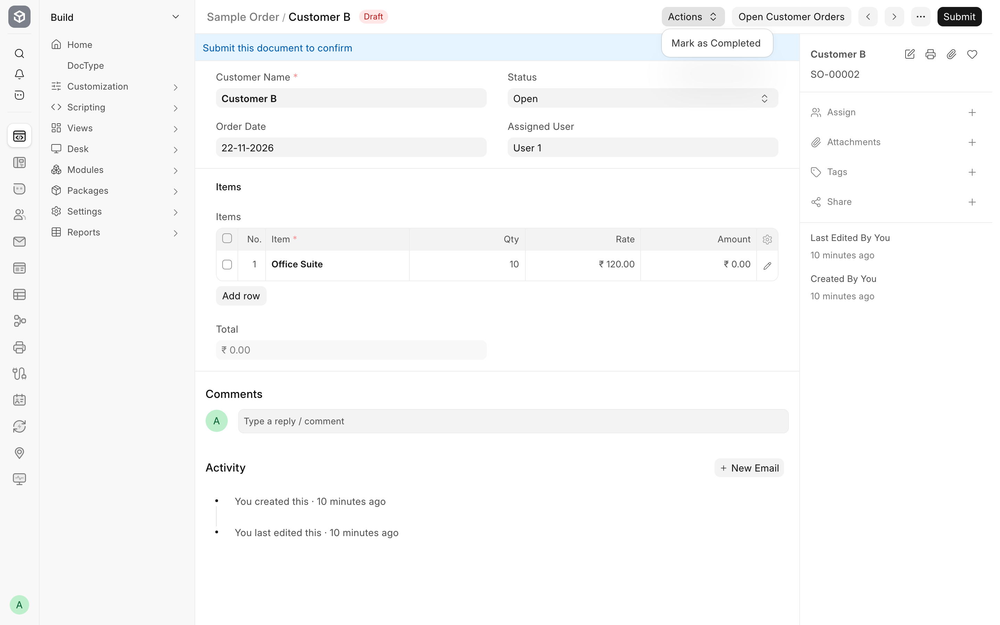

# Form Scripts

A form script is JavaScript that runs in the desk form of a DocType. Use it to react to form events, change field properties, add buttons, filter Link fields and call the server. Keep business rules and validation on the server, in the [controller](../data-model/controllers.md). A form script only improves the user interface. A user can skip it with a direct API call.

## Where form scripts come from

When the desk loads a DocType, `frappe/desk/form/meta.py` collects all form code into the `__js` and `__custom_js` keys of the DocType meta. The browser runs them in this order:

1. `<doctype>.js` in the DocType folder of the app that owns the DocType, for example `sample_app/sample_module/doctype/sample_order/sample_order.js`.
2. `regional/<country>.js` in the same folder, if System Settings has a country and the file exists.
3. The files that other apps add with the `doctype_js` hook, in app order.
4. The client script of the active DocType Layout, if the form opens with one.
5. All enabled `Client Script` records with `view` = `Form` for the DocType, oldest first. These do not run when a DocType Layout is active.

Steps 1 to 3 apply only to standard DocTypes. A DocType with `custom` = 1 gets no file-based code, so use a `Client Script` record for it. Client Script records are described in [Server and Client Scripts](../low-code-and-ai/server-and-client-scripts.md).

To add code to a DocType that another app owns, use the `doctype_js` hook. The path is relative to the app package.

```python
# sample_app/hooks.py
doctype_js = {
	"ToDo": "public/js/todo.js",
	"User": ["public/js/user.js", "public/js/user_extra.js"],
}
```

The value can be a string or a list of strings. See [Extending Apps](../building-apps/extending-apps.md) for the other extension hooks.

## Register event handlers

Use `frappe.ui.form.on(doctype, handlers)`. Each key is a form event or a fieldname. Each handler gets `frm`, and for child rows also `cdt` (child DocType) and `cdn` (child row name).

```js
// sample_app/sample_module/doctype/sample_order/sample_order.js
frappe.ui.form.on("Sample Order", {
	setup(frm) {
		frm.set_query("item", "items", () => ({ filters: { disabled: 0 } }));
	},
	refresh(frm) {
		if (!frm.is_new()) {
			frm.add_custom_button(__("Mark as Completed"), () => {
				frm.set_value("status", "Completed").then(() => frm.save());
			}, __("Actions"));
		}
	},
	customer_name(frm) {
		frm.set_intro(__("Customer changed. Check the items."), "orange");
	},
});
```



You can call `frappe.ui.form.on` many times for the same DocType. All handlers for an event run, one after the other, in the order they were registered. If a handler returns a promise, the next handler waits for it. `frappe.ui.form.off(doctype, event)` removes all handlers for that event.

To run another handler from your code, use `frm.trigger("event_name")`. It returns a promise.

## Form events

The event order below was checked in the browser on a `Sample Order` form.

| Action | Events, in order |
|---|---|
| Open a form for the first time (new or existing document) | `setup`, `before_load`, `onload`, `refresh`, `onload_post_render` |
| Open a document that is already loaded in this session | `refresh` |
| Change a field value | `<fieldname>` |
| Save | `validate`, `before_save`, (server save), `after_save`, `refresh` |
| Submit | `before_submit`, `validate`, `before_save`, (server submit), `after_save`, `on_submit`, `refresh` |
| Cancel | `before_cancel`, (server cancel), `after_cancel`, `refresh` |
| Delete | `after_delete` |

`setup` runs once for each form instance, that is once for each DocType in a browser session. Put `set_query` and other one-time setup there. Put buttons and anything that depends on the document in `refresh`.

All form events:

| Event | When it runs |
|---|---|
| `setup` | Once, when the form object for the DocType is made. |
| `before_load` | Before `onload`, the first time a document opens. |
| `onload` | The first time a document opens in this session. |
| `refresh` | Every time the form renders: after load, after save, submit or cancel, and when you go back to the form. |
| `onload_post_render` | After the first `refresh` of a document. |
| `<fieldname>` | After the value of that field changes. |
| `validate` | Before save. Stop the save with `frappe.throw()` or `frappe.validated = false`. |
| `before_save` | After `validate`, before the request to the server. |
| `after_save` | After the server saved the document. |
| `before_submit` | Before submit. Stop it with `frappe.validated = false`. |
| `on_submit` | After the server submitted the document. |
| `before_cancel` | Before cancel. Stop it with `frappe.validated = false`. |
| `after_cancel` | After the server cancelled the document. |
| `before_discard`, `after_discard` | Before and after the user discards a draft. |
| `after_delete` | After the document was deleted, before the browser goes back. |
| `before_workflow_action`, `after_workflow_action` | Before and after a workflow action. `frm.selected_workflow_action` holds the action name. |
| `timeline_refresh` | After the timeline renders. |
| `dashboard_update` | After the connections dashboard loads its counts. |
| `on_tab_change` | After the user changes the form tab. |
| `on_hide` | When the user leaves the form page. |
| `<button fieldname>` | When the user clicks a `Button` field. |

## Child table events

Register child table events on the child DocType, not on the parent. The handler gets `(frm, cdt, cdn)`. Use `locals[cdt][cdn]` or `frappe.get_doc(cdt, cdn)` to read the row.

```js
// sample_app/sample_module/doctype/sample_order/sample_order.js
frappe.ui.form.on("Sample Order Item", {
	qty(frm, cdt, cdn) {
		const row = locals[cdt][cdn];
		frappe.model.set_value(cdt, cdn, "amount", flt(row.qty) * flt(row.rate));
	},
	items_add(frm, cdt, cdn) {
		frappe.model.set_value(cdt, cdn, "qty", 1);
	},
	items_remove(frm) {
		frm.set_value("total", frm.get_sum("items", "amount"));
	},
});
```

| Event | When it runs |
|---|---|
| `<child fieldname>` | After a field in a row changes. |
| `<table fieldname>_add` | After the user adds a row in the grid. `frm.add_child()` does not trigger it. |
| `before_<table fieldname>_remove` | Before a row is removed. |
| `<table fieldname>_remove` | After a row is removed. |
| `<table fieldname>_move` | After the user drags a row to a new position. |
| `<table fieldname>_delete` | After the user deletes selected rows or all rows. |
| `form_render` | When the row editor of a row opens. |

## The frm object

`frm` is the `frappe.ui.form.Form` instance (`frappe/public/js/frappe/form/form.js`). The global `cur_frm` points to the form on screen, but use the `frm` argument in handlers.

Common properties:

| Property | Description |
|---|---|
| `frm.doc` | The document as a plain object. Child tables are arrays of row objects. |
| `frm.doctype`, `frm.docname` | The DocType and the document name. |
| `frm.meta` | The DocType meta. |
| `frm.fields_dict` | Field controls by fieldname. `frm.fields_dict.items.grid` is the grid of a table field. |
| `frm.page` | The `frappe.ui.Page` of the form. |
| `frm.custom_buttons` | Buttons added with `add_custom_button`, by label. |

Methods:

| Method | Description |
|---|---|
| `set_value(fieldname, value)` or `set_value({field: value, ...})` | Set values and run the change events. Returns a promise. Pass an array to replace a child table. |
| `refresh_field(fieldname)` | Render one field again after you change `frm.doc` directly. |
| `refresh_fields()` / `refresh()` | Render all fields again / render the whole form again. |
| `set_df_property(fieldname, property, value)` | Change a field property, for example `read_only`, `hidden`, `reqd`, `options`, `label`, `description`. |
| `set_df_property(table, property, value, docname, child_field, row_name)` | Change a property of a child field for one row. |
| `toggle_display(fieldnames, show)` | Show or hide one field or a list of fields. |
| `toggle_reqd(fieldnames, mandatory)` | Make fields mandatory or not. |
| `toggle_enable(fieldnames, enable)` | Make fields editable or read-only. |
| `set_query(fieldname, fn)` / `set_query(child_field, table, fn)` | Set the filters of a Link field. `fn` returns `{ filters }` or `{ query, filters }`. |
| `add_custom_button(label, fn, group)` | Add a toolbar button. A `group` puts it in a dropdown. Returns the button. |
| `remove_custom_button(label, group)`, `clear_custom_buttons()` | Remove one button or all custom buttons. |
| `change_custom_button_type(label, group, type)` | Change the button style, for example `"primary"`. |
| `add_child(table_fieldname, values)` | Add a row to a child table. Call `refresh_field(table)` after it. Returns the row. |
| `clear_table(table_fieldname)` | Remove all rows of a child table. |
| `get_sum(table_fieldname, fieldname)` | Sum a column of a child table. |
| `update_in_all_rows(table_fieldname, fieldname, value)` | Set a value in all rows. |
| `get_selected()` | Selected rows of each grid, as `{table_fieldname: [row names]}`. |
| `call(method, args)` | Call a whitelisted method of the document controller. See below. |
| `save(action)`, `savesubmit()`, `savecancel()`, `savetrash()` | Save, submit, cancel or delete with the standard confirm dialogs. `save()` returns a promise. |
| `reload_doc()` | Load the document again from the server. |
| `is_new()`, `is_dirty()`, `dirty()` | Check if the document is unsaved or changed, or mark it as changed. |
| `has_perm(ptype)` | Check a permission on the document, for example `"write"`. |
| `set_intro(text, color)` | Show a message at the top of the form. Call with no text to clear it. |
| `set_indicator_formatter(fieldname, get_color, get_text)` | Show a colored indicator in a Link column of a grid. |
| `disable_save()`, `enable_save()`, `disable_form()` | Hide the save button, show it again, or make the whole form read-only. |
| `scroll_to_field(fieldname)` | Scroll to a field and focus it. |
| `set_active_tab(tab_fieldname)` | Open a form tab. |
| `add_fetch(link_field, source_field, target_field)` | Copy a field of the linked document into the form when the link changes. Prefer `fetch_from` in the DocType. |
| `trigger(event)` | Run the handlers of an event. |
| `copy_doc()`, `amend_doc()`, `print_doc()`, `email_doc()`, `rename_doc()` | Open the standard actions. |

The helpers in `frappe/public/js/frappe/form/script_helpers.js` (`refresh_field`, `hide_field`, `unhide_field`, `set_field_options`) are older globals that act on `cur_frm`. Use the `frm` methods in new code.

## Call the server

`frm.call(method, args)` runs a whitelisted method of the controller class of the document. The current document is sent with the request. If the method changes the document, the form updates its fields.

```python
# sample_app/sample_module/doctype/sample_order/sample_order.py
class SampleOrder(Document):
	@frappe.whitelist()
	def get_open_count(self):
		return frappe.db.count("Sample Order", {"customer_name": self.customer_name, "docstatus": 0})
```

```js
// sample_app/sample_module/doctype/sample_order/sample_order.js
frappe.ui.form.on("Sample Order", {
	refresh(frm) {
		frm.call("get_open_count").then((r) => {
			frm.set_intro(__("{0} draft orders for this customer", [r.message]));
		});
	},
});
```

If you pass an object with `method` and no `doc`, and the method has no dot, `frm.call` prefixes it with the Python module of the DocType. For other server calls, use `frappe.call` or `frappe.xcall`. See [Client API](client-api.md).

## Class-based controllers

Older code uses a controller class. `frappe.ui.form.set_controller(doctype, Class)` binds a class whose methods have event names. These methods get `(doc, cdt, cdn)`, not `frm`. They run after the `frappe.ui.form.on` handlers for the same event. Use `frappe.ui.form.on` in new code.

## Pitfalls

- Do not trust form scripts for validation. Repeat each rule in the controller `validate`.
- Add buttons in `refresh`, not in `onload`. The toolbar is rebuilt on every refresh.
- `frm.add_child()` and direct changes to `frm.doc` do not render. Call `frm.refresh_field()` after them.
- `frm.set_value()` is asynchronous. Use `await` or `.then()` before you read dependent values or save.
- A handler that returns a promise delays the next handler and the save. A promise that never settles blocks the form.
- `frappe.model.set_value(cdt, cdn, ...)` sets a child row value. `frm.set_value` sets parent fields only.
- If a form uses a DocType Layout, Client Script records with `view` = `Form` do not run. Put the code in the client script of the layout.

## Related

- [List View Settings](list-view-settings.md)
- [Client API](client-api.md)
- [Controllers](../data-model/controllers.md)
- [Server and Client Scripts](../low-code-and-ai/server-and-client-scripts.md)
- [Extending Apps](../building-apps/extending-apps.md)
- [JavaScript API reference](../../reference/api/js-api.md)
