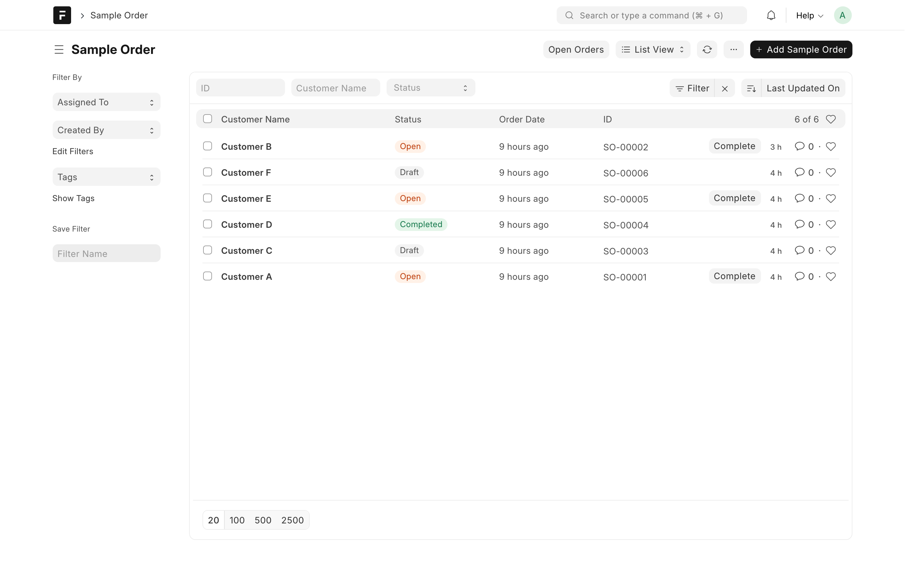

# List View Settings

Each desk view of a DocType reads a settings object from a global registry. An app fills the registry in a JavaScript file next to the DocType, for example `sample_order_list.js` for the list view. Use these files to add indicators, row buttons, column formatters, default filters and view-specific options. To change columns or the page size without code, users have List Settings in the desk. See [List View](../../user-guide/basics/list-view.md).

## Files and registries

`frappe/desk/form/meta.py` reads these files from the DocType folder and from hooks. The browser runs them when it loads the DocType meta, in this order: list, calendar, tree, then `Client Script` records with `view` = `List`. A Client Script can therefore override the file-based settings.

| File in the DocType folder | Hook for other apps | Registry it fills |
|---|---|---|
| `<doctype>_list.js` | `doctype_list_js` | `frappe.listview_settings["<DocType>"]` (list, report, kanban and image views) |
| `<doctype>_calendar.js` | `doctype_calendar_js` | `frappe.views.calendar["<DocType>"]` (calendar and gantt views) |
| `<doctype>_tree.js` | `doctype_tree_js` | `frappe.treeview_settings["<DocType>"]` (tree view) |

The `<doctype>` part is the scrubbed DocType name, for example `sample_order`. A file `<doctype>_list.html` in the DocType folder is loaded as the list view template (`__listview_template`). A file `regional/<country>_list.js` is also added to the list code when System Settings has that country. A custom DocType (`custom` = 1) loads no files. Use a `Client Script` with `view` = `List` for it.

```python
# sample_app/hooks.py
doctype_list_js = {"ToDo": "public/js/todo_list.js"}
doctype_calendar_js = {"ToDo": "public/js/todo_calendar.js"}
```

A hook file runs after the file of the owning app. Assigning a new object replaces the settings of the owning app. Change single keys instead:

```js
// sample_app/public/js/todo_list.js
frappe.listview_settings["ToDo"] = frappe.listview_settings["ToDo"] || {};
frappe.listview_settings["ToDo"].add_fields = ["priority"];
```

## List view settings

```js
// sample_app/sample_module/doctype/sample_order/sample_order_list.js
frappe.listview_settings["Sample Order"] = {
	add_fields: ["status", "total"],
	has_indicator_for_draft: 1,
	get_indicator(doc) {
		const colors = { Draft: "gray", Open: "orange", Completed: "green", Cancelled: "red" };
		return [__(doc.status), colors[doc.status] || "gray", "status,=," + doc.status];
	},
	button: {
		show: (doc) => doc.status === "Open",
		get_label: () => __("Complete"),
		get_description: (doc) => __("Mark {0} as Completed", [doc.name]),
		action: (doc) =>
			frappe.db.set_value("Sample Order", doc.name, "status", "Completed")
				.then(() => cur_list.refresh()),
	},
	formatters: {
		order_date: (value) => `<span class="text-muted">${frappe.datetime.prettyDate(value)}</span>`,
	},
	onload(listview) {
		listview.page.add_inner_button(__("Open Orders"), () =>
			listview.filter_area.add([["Sample Order", "status", "=", "Open"]])
		);
	},
};
```



If the DocType has an active Workflow, the workflow state takes priority over `get_indicator`.

| Key | Type | Description |
|---|---|---|
| `add_fields` | list | Extra fields to fetch for each row. Add every field that `get_indicator`, `button` or `formatters` reads. |
| `filters` | list | Default filters, as `[fieldname, operator, value]`. Used only when the user has no saved filters. |
| `hide_name_column` | bool | Hide the name (ID) column. |
| `hide_name_filter` | bool | Hide the ID filter in the standard filter bar. |
| `get_indicator(doc)` | function | Return `[label, color, filter]` for the status indicator. `filter` is `"field,operator,value"` and is applied when the user clicks the indicator. |
| `has_indicator_for_draft` | bool | For a submittable DocType, use `get_indicator` for drafts instead of the "Draft" indicator. |
| `has_indicator_for_cancelled` | bool | The same for cancelled documents. |
| `formatters` | object | `{fieldname: (value, df, doc) => html}`. Formats a column. |
| `button` | object | One button per row: `show(doc)`, `get_label(doc)`, `get_description(doc)`, `action(doc)`. |
| `onload(listview)` | function | Runs once after the view is set up. Add page buttons and menu items here. |
| `before_render()` | function | Runs before each render of the rows. |
| `refresh(listview)` | function | Runs after each data refresh. |
| `primary_action()` | function | Replaces the action of the "Add" button. |
| `get_form_link(doc)` | function | Return the URL a row opens. |

`listview` is the `frappe.views.ListView` instance. Useful members: `listview.page` (a `frappe.ui.Page`), `listview.filter_area`, `listview.data`, `listview.get_checked_items()`, `listview.refresh()`. To add an item to the Actions menu of selected rows, call `listview.page.add_actions_menu_item(label, fn)`.

The indicator rules in `frappe/public/js/frappe/model/indicator.js` run in this order: unsaved, workflow state, draft and cancelled (for submittable DocTypes), DocType states that match `doc.status`, `get_indicator`, submitted, `status`, `enabled`, `disabled`.

## Calendar and gantt settings

```js
// sample_app/sample_module/doctype/sample_event/sample_event_calendar.js
frappe.views.calendar["Sample Event"] = {
	field_map: {
		start: "starts_on",
		end: "ends_on",
		id: "name",
		title: "subject",
		allDay: "all_day",
	},
	gantt: true,
	get_events_method: "frappe.desk.calendar.get_events",
};
```

| Key | Description |
|---|---|
| `field_map` | Maps `start`, `end`, `id`, `title`, `allDay` and `convertToUserTz` to fieldnames. The gantt view also reads `field_map.progress` (a fieldname or a function). It reads `color`, `is_milestone` and `depends_on_tasks` from the row. |
| `get_events_method` | Dotted path of a whitelisted method. Default `frappe.desk.calendar.get_events`, which takes `doctype`, `start`, `end`, `field_map`, `filters` and `fields`. |
| `get_css_class(event)` | Return `danger`, `success`, `warning` or `default` to color an event. |
| `fields` | Extra fields to fetch for each event. The calendar sends the current list filters with the request. |
| `options` | Extra FullCalendar options. |
| `gantt` | `true`, or an object of keys that override this object in the gantt view. |
| `order_by` | Sort order of the gantt view. |

## Tree view settings

A tree view needs a DocType with `is_tree` = 1. See [DocTypes](../data-model/doctypes.md). Common keys of `frappe.treeview_settings["<DocType>"]`:

| Key | Description |
|---|---|
| `get_tree_nodes` | Method that returns child nodes. Default `frappe.desk.treeview.get_children`. |
| `add_tree_node` | Method that adds a node. Default `frappe.desk.treeview.add_node`. |
| `root_label` | Label of the root node. |
| `get_tree_root` | Set `false` to skip the root node lookup. |
| `title` | Page title. |
| `filters` | Filter fields shown above the tree. |
| `fields`, `ignore_fields` | Fields of the "Add Child" dialog. |
| `onload(treeview)`, `post_render(treeview)` | Run after load and after render. |
| `onrender(node)`, `on_get_node(nodes, deep)`, `click(node)` | Node hooks. |
| `get_label(node)` | Return the label of a node. |
| `toolbar`, `extend_toolbar` | Node buttons. With `extend_toolbar: true` your buttons are added to the standard ones. |
| `menu_items` | Extra page menu items. |
| `disable_add_node` | Hide "Add Child". |

## Pitfalls

- A field that `get_indicator` or `button.show` reads is `undefined` unless it is a list column or in `add_fields`.
- For submittable DocTypes, `get_indicator` is ignored for drafts and cancelled documents unless you set `has_indicator_for_draft` or `has_indicator_for_cancelled`.
- A `Calendar View` record uses only its own field map. It does not read `frappe.views.calendar` settings.
- The settings code comes with the DocType meta, which the browser caches. After you change a settings file, reload the page. Outside developer mode, also run `bench --site <site> clear-cache`.

## Related

- [Form Scripts](form-scripts.md)
- [Client API](client-api.md)
- [DocTypes](../data-model/doctypes.md)
- [Views](../../user-guide/basics/views.md)
- [Hooks reference](../../reference/configuration/hooks.md)
