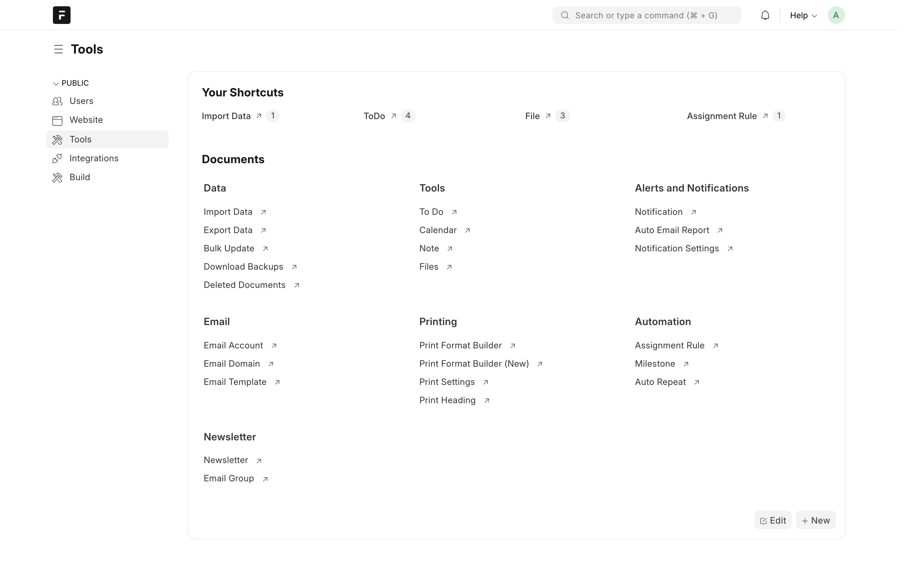

# Workspaces

In v15, desk navigation is made of workspaces. The left sidebar of the desk at `/app` lists the workspaces that the user can see. Each workspace is a page with shortcuts, cards of links, charts, number cards and quick lists. An app ships its workspaces as JSON files, and `bench migrate` imports them. The apps screen at `/apps` lists installed apps, and an app joins it with the `add_to_apps_screen` hook. For the user view, see [Desk](../../user-guide/basics/desk.md).

!!! note "Version"
    v15 has no Sidebar or Dock DocTypes. They were added in later versions.



## Workspace files

A standard workspace lives in the `workspace` folder of a module:

```text
sample_app/sample_module/workspace/sample_orders/sample_orders.json
```

The folder and file names are the scrubbed workspace title. `bench migrate` imports the JSON into the `Workspace` table. On import, Frappe keeps the site value of `is_hidden`. Migrate does not delete a workspace whose file is gone from the app.

## Workspace fields

| Field | Description |
|---|---|
| `label`, `title` | Name of the workspace. The record name is the label. |
| `module` | The module the workspace belongs to. Decides where it is exported. Users with the module blocked do not see the workspace. |
| `icon`, `indicator_color` | Icon and color in the sidebar. |
| `public` | Visible to all users with access. A private workspace belongs to `for_user`. |
| `for_user` | Owner of a private workspace. |
| `parent_page` | Title of the parent workspace. The sidebar shows the workspace nested under it. |
| `sequence_id` | Order in the sidebar. |
| `is_hidden` | Hide the workspace from the sidebar for users who are not Workspace Managers. |
| `content` | JSON list of blocks. Must be a list. |
| `shortcuts`, `links`, `charts`, `number_cards`, `quick_lists`, `custom_blocks` | Widget definitions. A block finds its row by name. |
| `roles` | Roles that can see the workspace. Empty means all desk users. |
| `restrict_to_domain` | Show the workspace only when this domain is active. |
| `hide_custom` | Hide custom DocTypes and reports of the module in the cards. |

Block types in `content`: `header`, `paragraph`, `spacer`, `shortcut`, `card`, `chart`, `number_card`, `quick_list`, `custom_block` and `onboarding`. Each block has an `id`, a `type` and `data`. `data.col` is the width in a 12-column grid.

```json
[
 {"id": "hdr1", "type": "header", "data": {"text": "<span class=\"h4\"><b>Your Shortcuts</b></span>", "col": 12}},
 {"id": "sc1", "type": "shortcut", "data": {"shortcut_name": "Sample Order", "col": 3}},
 {"id": "cd1", "type": "card", "data": {"card_name": "Masters", "col": 4}}
]
```

`Workspace Shortcut` rows have `type` (`DocType`, `Report`, `Page`, `Dashboard` or `URL`), `link_to`, `label`, `doc_view`, `stats_filter`, `color`, `format`, `url` and `kanban_board`. `Workspace Link` rows make the cards: a row with `type` = `Card Break` starts a card, and the next `link_count` rows of `type` = `Link` are its links. A link has `link_type`, `link_to`, `label`, `dependencies`, `only_for` (a country) and `onboard`.

## Make or change a standard workspace

1. Turn on developer mode for the site.
2. Log in as a user with the Workspace Manager role.
3. Open the workspace at `/app/<workspace>` and select **Edit**.
4. Make sure the workspace is public and has a `module` of your app.
5. Save. Frappe writes the JSON file into the module folder.
6. Commit the file in your app.

Only a Workspace Manager can save, rename or delete a public workspace. If you change the title or module in developer mode, Frappe deletes the old folder. Deleting a public workspace in developer mode deletes its folder.

During install, uninstall, migrate, patches, tests and fixture import, a workspace save does not export files and skips the Workspace Manager check.

## Routes

The desk builds a map of workspaces at boot. The route of a public workspace is `/app/<slug of the name>`, for example `/app/tools`. A private workspace is at `/app/private/<slug of the title>`. A route that matches no workspace falls through to a DocType or Page route.

The sidebar data comes from `frappe.desk.desktop.get_workspace_sidebar_items`. It returns the public workspaces that the user may see and the user's own private workspaces. Boot sends them as `frappe.boot.allowed_workspaces`.

## Apps screen: add_to_apps_screen

The `add_to_apps_screen` hook puts an app on the apps screen at `/apps`. It is a list with one dict per entry.

```python
# sample_app/hooks.py
add_to_apps_screen = [
	{
		"name": "sample_app",
		"logo": "/assets/sample_app/images/logo.svg",
		"title": "Sample App",
		"route": "/app/sample-orders",
		"has_permission": "sample_app.api.has_app_permission",
	}
]
```

| Key | Description |
|---|---|
| `name` | App name. Frappe uses it only to find a workspace of the app's modules when the user cannot open `route`. The tile always shows the app that sets the hook. |
| `title` | Label on the apps screen. It is translated. |
| `logo` | Logo URL. |
| `route` | Where the icon goes. Default `/apps`. |
| `has_permission` | Dotted path of a function with no arguments. Return `True` if the session user may see the app. |

`frappe.apps.get_apps` builds the list. It skips `frappe` itself. It also skips apps whose setup wizard is not complete, unless the user is a System Manager. If the `route` starts with `/app/` and the user cannot open that workspace, Frappe uses the first allowed workspace of the app's modules, or else the first allowed workspace.

If no app is on the list, `/apps` redirects to `/app`. With only `frappe` installed, this is always the case.

### Default app

**System Settings > Default App** and **User > Default App** pick the app to open after login. The user value wins. Without a default:

- With one app on the apps screen, login opens its route.
- With more apps whose routes are all under `/app`, login opens `/app`.
- Otherwise login opens `/apps`.

The whitelisted method `frappe.apps.set_app_as_default(app_name)` toggles the user's default app.

## Pitfalls

- Export works only in developer mode and only for public workspaces. On other sites, desk changes stay in the database and are lost when a migrate imports the file again.
- A workspace file that you delete from the app stays on sites as a record. Delete the record too, or ship a patch.
- `has_permission` errors are logged to Error Log and the app is left out of the list.

## Related

- [Desk](../../user-guide/basics/desk.md)
- [Desk Pages](desk-pages.md)
- [Apps](../building-apps/apps.md)
- [Hooks](../building-apps/hooks.md)
- [Fixtures and Patches](../building-apps/fixtures-and-patches.md)
- [Hooks reference](../../reference/configuration/hooks.md)
