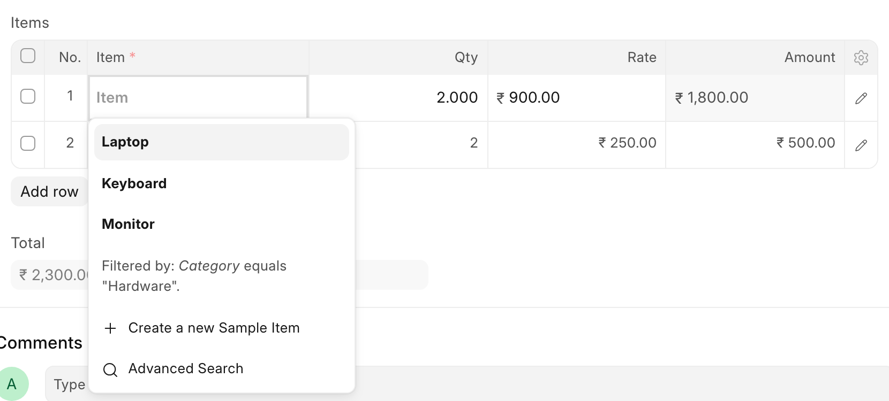

# Link and Select Fields

Use these fieldtypes when a value must come from a list. A `Link` points to one document of a fixed DocType. A `Dynamic Link` points to a document of a DocType that another field holds. A `Select` takes one value from a fixed list. An `Autocomplete` suggests values but does not check them on the server. All four store one string in a column of the parent table. For column types and the rules for `options`, see [Field Types](../../reference/data-model/field-types.md). For properties that apply to all fields, see [Field Properties](field-properties.md).

## Summary

| Fieldtype | `options` | Desk control | Server check on save |
|---|---|---|---|
| `Link` | Target DocType | Search input with a dropdown | Target document must exist and must not be cancelled |
| `Dynamic Link` | Fieldname that holds the target DocType | Same as `Link` | Same as `Link`. The DocType field must have a value. |
| `Select` | Values, one per line | `<select>` list | Value must be one of the options |
| `Autocomplete` | Suggestions, one per line, or a JSON list | Input with suggestions | None |

## `Link`

- **Stores**: the `name` of the linked document as a `str`, or `None`. REST JSON has the same string. The value is always the `name`, also when the desk shows a title.
- **Desk**: an input with a dropdown. Focus on an empty input opens the list at once. Typing searches again 500 ms after the last key. The dropdown shows up to `link_field_results_limit` rows (System Settings, default 10). Each row shows the label in bold and the values of the search fields below it.
- **Properties**: `options` (target DocType), `ignore_user_permissions`, `link_filters`, `remember_last_selected_value`, `fetch_from` on other fields, `fetch_if_empty`. See [Field Properties](field-properties.md).
- **Server**: `_validate_links()` in `frappe/model/document.py`. See [Server validation](#server-validation).
- **JS**: `frappe.ui.form.ControlLink` in `frappe/public/js/frappe/form/controls/link.js`.

```json
{
	"fieldname": "item",
	"fieldtype": "Link",
	"label": "Item",
	"options": "Sample Item",
	"reqd": 1
}
```

### The dropdown

After the search results, the dropdown adds these rows:

| Row | When it shows |
|---|---|
| `Filtered by: ...` | The field has filters, or the df has `filter_description`. The text describes the filters. It cannot be selected. |
| `Create a new <DocType>` | The user can create the target DocType and the df has no `only_select`. |
| Custom rows | `frappe.ui.form.ControlLink.link_options(control)` returns a list of rows. |
| `Advanced Search` | In the desk, not in web forms. Opens a search dialog with filters. |



The arrow button next to a value opens the linked document. It is hidden when the user has only `select` permission on the target DocType. A clear (x) button shows only when System Settings has `allow_clearing_link_fields` set.

`Create a new <DocType>` opens the quick entry dialog of the target DocType. If the DocType has no quick entry, it opens the full form. The typed text goes to the new document as `name_field` in `frappe.route_options`. After the new document is saved, its name is set in the Link field. To fill more fields in the new document, set `df.get_route_options_for_new_doc` to a function that gets the field control and returns an object of values.

### How the search works

The desk calls `frappe.desk.search.search_link`. Without a custom query, `search_widget()` in `frappe/desk/search.py` builds the query:

1. It matches the text with `LIKE %txt%` on `name`, the DocType `title_field` and the DocType `search_fields`. Only fields of type `Data`, `Text`, `Small Text`, `Long Text`, `Text Editor`, `Link`, `Select`, `Read Only` and `Autocomplete` are matched.
2. It adds the filters of the field.
3. It removes disabled records. A `Check` field `enabled` must be 1. A `Check` field `disabled` must not be 1. To include disabled records, add the filter `include_disabled: 1`.
4. It applies the read permission and the User Permissions of the user, with `frappe.get_list`.
5. It sorts by position of the text in `name`, then by `idx` descending, then by the DocType sort order. Results that start with the text come first.

`idx` on the target documents counts how often they were linked. The count is sampled for 10% of requests and skipped for some DocTypes, for example `User` and `Role`. See `frappe/model/utils/link_count.py`.

Call the endpoint directly to test a search:

```bash
curl -b cookies.txt -G "http://frappe.localhost:8000/api/method/frappe.desk.search.search_link" \
  --data-urlencode doctype="Sample Item" \
  --data-urlencode txt="o" \
  --data-urlencode 'filters={"category": "Hardware"}'
```

```json
{"message": [
	{"value": "Keyboard", "description": "Keyboard", "label": "Keyboard"},
	{"value": "Laptop", "description": "Laptop", "label": "Laptop"},
	{"value": "Monitor", "description": "Monitor", "label": "Monitor"}
]}
```

`search_link` arguments:

| Argument | Type | Default | Description |
|---|---|---|---|
| `doctype` | str | | Target DocType. |
| `txt` | str | | Search text. |
| `query` | str | `None` | Dotted path of a whitelisted custom query. |
| `filters` | dict, list or JSON str | `None` | Filters in the `frappe.get_list` format. |
| `page_length` | int | `10` | Number of rows. |
| `searchfield` | str | `None` | Extra field to return. Passed to a custom query. |
| `reference_doctype` | str | `None` | DocType of the form that holds the field. |
| `ignore_user_permissions` | bool | `False` | Skip User Permissions. Needs `reference_doctype` and `link_fieldname`. |
| `link_fieldname` | str | `None` | Fieldname of the Link field. |
| `start` | int | `0` | Offset for paging. |
| `include_image` | bool | `False` | Add `image` to each row from the DocType `image_field`. |

`ignore_user_permissions` is checked on the server. The field `link_fieldname` in `reference_doctype` must have `ignore_user_permissions = 1` and must not be read-only or hidden. Otherwise the search throws an error or keeps the User Permissions.

### Filter the dropdown

There are three ways to filter. All three apply in the desk only. The server accepts any existing record on save.

| Method | Where | Example |
|---|---|---|
| `link_filters` | DocField property, JSON | `[["Sample Item", "category", "=", "Hardware"]]` |
| `frm.set_query` | Form script | `frm.set_query("item", "items", () => ({ filters: { category: "Hardware" } }))` |
| `df.filters` | Dialog or field group df | `{ fieldtype: "Link", options: "Sample Item", filters: { disabled: 0 } }` |

A `link_filters` value can start with `eval:`. The desk evaluates it with `doc`, `parent` and `frappe` in scope, for example `"eval:doc.category"`. `link_filters` replace filters on the same fieldnames from `set_query`.

`frm.set_query(fieldname, fn)` sets the query of a parent field. `frm.set_query(child_fieldname, table_fieldname, fn)` sets it for a column of a child table. The function gets `(doc, cdt, cdn)` and returns one of these:

- `{ filters: {...} }` or `{ filters: [[...], ...] }` for filters.
- `{ query: "dotted.path", filters: {...} }` for a custom server query.
- A string with the dotted path of a custom query.

Filter keys with an empty value are removed when the key is a Link or Dynamic Link field of the form. See [Form Scripts](../desk-ui/form-scripts.md) for where to call `set_query`.

### Custom server query

Use a custom query when filters cannot express the list. Write a whitelisted function with this signature. Return a list of tuples. The first value is the document name. The other values show as the description.

```python
# sample_app/api.py
import frappe


@frappe.whitelist()
@frappe.validate_and_sanitize_search_inputs
def item_query(doctype: str, txt: str, searchfield: str, start: int, page_len: int, filters: dict):
	return frappe.get_list(
		"Sample Item",
		filters={"disabled": 0, "category": filters.get("category") or "Hardware"},
		or_filters={"name": ["like", f"%{txt}%"], "item_name": ["like", f"%{txt}%"]},
		fields=["name", "category", "rate"],
		limit_start=start,
		limit_page_length=page_len,
		order_by="name asc",
		as_list=True,
	)
```

```js
// sample_app/sample_module/doctype/sample_order/sample_order.js
frappe.ui.form.on("Sample Order", {
	setup(frm) {
		frm.set_query("item", "items", () => ({
			query: "sample_app.api.item_query",
			filters: { category: "Hardware" },
		}));
	},
});
```

The search shows `Laptop` with the description `Hardware, 900.0`. Frappe also passes `as_dict`, `reference_doctype`, `ignore_user_permissions` and `link_fieldname` as keyword arguments, if the function accepts them. `validate_and_sanitize_search_inputs` rejects a `searchfield` with special characters and converts `start` and `page_len` to integers.

To use one query for every Link field to a DocType, add the `standard_queries` hook. Frappe uses the last value when several apps set the same DocType. Frappe itself sets one for `User`.

```python
# sample_app/hooks.py
standard_queries = {"Sample Item": "sample_app.api.item_query"}
```

### Validation in the desk

When the user leaves the field or picks a row, the control calls `frappe.client.validate_link_and_fetch`. The call uses the same filters and query as the search.

- If the record exists and passes the filters, the value is set with the case of the stored name. For example, `laptop` becomes `Laptop`.
- If the record does not exist or is filtered out, the field is cleared. With filters, an alert shows "<label>: <value> did not match any results."
- The same call returns the values for fields with `fetch_from` on this Link, and the control sets them.

With a custom query, the value passes only if the query returns it when `txt` is the full name. `frm.set_value()` and `frappe.model.set_value()` skip this validation and do not run `fetch_from`. The server fills `fetch_from` fields on save.

### Link titles

Set `show_title_field_in_link = 1` and a `title_field` on the target DocType to show titles. The input shows the title, for example `User 1`, and the field stores the name `user1@example.com`. The dropdown shows the title as the label and the name in the description. The list of these DocTypes is in `frappe.boot.link_title_doctypes`.

When a form loads, `frappe/desk/form/load.py` sends the titles of all Link and Dynamic Link values, also in child tables. For other values the control calls `frappe.desk.search.get_link_title`. That method returns the name when the user cannot read the title field.

Set `translated_doctype = 1` ("Translate Link Fields") on the target DocType to show translated names. The search then matches the translated text.

### Server validation

`_validate_links()` in `frappe/model/document.py` runs on insert and save, for the parent and all child rows. For each `Link` and `Dynamic Link` field with a value:

| Check | Error |
|---|---|
| The target document exists. | `frappe.LinkValidationError`: `Could not find Item: Nope`. In a child row: `Could not find Row #1: Item: Nope`. |
| The parent and the target DocType are submittable, and the target is cancelled. `amended_from` is skipped. | `frappe.CancelledLinkError`: `Cannot link cancelled document: ...` |

The check also sets the value to the name as stored, and sets the fields that use `fetch_from` on this Link. It does not apply `link_filters`, `set_query` or custom queries. To skip it, set `doc.flags.ignore_links = True`. It does not run on cancel.

Frappe also protects links in the other direction. Deleting a document that other documents link to raises `frappe.LinkExistsError`. Renaming a document updates the Link fields that point to it.

## `Dynamic Link`

- **Stores**: a document name as a `str`, like `Link`.
- **Desk**: the same control as `Link`. The target DocType is the current value of the field named in `options`. If that field is empty, the dropdown does not search. If it names a Single DocType, the desk throws "is not a valid DocType for Dynamic Link".
- **Properties**: `options` (fieldname of a `Link` to `DocType` or of a `Select` field), `ignore_user_permissions`.
- **Server**: the same checks as `Link`. If the DocType field is empty, the save throws `<label> must be set first`.
- **JS**: `frappe.ui.form.ControlDynamicLink` in `dynamic_link.js`. It reads the DocType from the form, or from `cur_dialog.get_value(options)` in a dialog. Set `df.get_options` to a function that returns the DocType to override this.

```json
[
	{"fieldname": "reference_doctype", "fieldtype": "Link", "options": "DocType", "label": "Reference DocType"},
	{"fieldname": "reference_name", "fieldtype": "Dynamic Link", "options": "reference_doctype", "label": "Reference Name"}
]
```

## `Select`

- **Stores**: one option as a `str`. An empty first line in `options` allows a blank value.
- **Default**: if `default` is empty, a new document gets the first option. This applies in the desk (`frappe/public/js/frappe/model/create_new.js`) and on the server (`frappe/model/create_new.py`). So a Select whose first option is not blank always has a value.
- **Desk**: a `<select>` element. Each label is translated with the DocType as context, and the stored value stays untranslated. `placeholder` shows when the value is blank. In grid cells, the value is shown translated.
- **Properties**: `options`, `default`, `sort_options` (sort by translated label, desk only), `placeholder`.
- **Server**: `_validate_selects()` strips spaces from the value and checks it against `options`. A wrong value throws `Status cannot be "Weird". It should be one of "Draft", "Open", "Completed", "Cancelled"`. The check skips empty values, `naming_series`, fields without options, and data import (`frappe.flags.in_import`).
- **DocType save**: options are stripped, and empty lines are removed except the first. A `default` must be one of the options.
- **JS**: `frappe.ui.form.ControlSelect` in `select.js`.

Change the options at runtime with `frm.set_df_property`. Pass a string with one value per line, or an array. Array items can be strings or objects with `value`, `label` and optional `disabled`.

```js
frm.set_df_property("status", "options", ["Draft", "Open"]);
frm.set_df_property("status", "options", [
	{ value: "Open", label: __("Open") },
	{ value: "Completed", label: __("Done"), disabled: true },
]);
```

`frm.set_value()` with a value that is not an option still sets it in `frm.doc`. The server rejects it on save.

```json
{
	"fieldname": "status",
	"fieldtype": "Select",
	"label": "Status",
	"options": "Draft\nOpen\nCompleted\nCancelled",
	"default": "Draft"
}
```

## `Autocomplete`

- **Stores**: a `str`. The server does not compare it with `options`. Any value is saved.
- **Desk**: an input with a suggestion list. The list is filtered in the browser, and the text can match the label, value or description. It shows up to `df.max_items` rows (default 99). When the user leaves the field, a value that is not a suggestion is cleared. If there are no suggestions, any value is kept.
- **Options**: one value per line, or a JSON list that starts with `[`. JSON items can be strings or objects with `value`, `label` and `description`. The input shows the label and stores the value. The special value `Installed Applications` loads the installed apps.
- **JS**: `frappe.ui.form.ControlAutocomplete` in `autocomplete.js`. Set `df.ignore_validation = 1` to keep typed values that are not suggestions.

To load suggestions from the server, use `set_query`. The control calls the method with `txt` and the keys of `params`. The method returns a list of strings or of objects with `value` and `label`.

```js
frm.set_query("autocomplete", () => ({
	query: "sample_app.api.get_colors",
	params: { palette: "basic" },
}));
```

```python
# sample_app/api.py
@frappe.whitelist()
def get_colors(txt: str = "", palette: str | None = None):
	return [c for c in ["Red", "Green", "Blue"] if txt.lower() in c.lower()]
```

## Combobox controls (beta)

System Settings has `enable_combobox_link_field` ("Enable Combobox Fields (Beta)"), off by default. When it is on, `Link`, `Dynamic Link`, `Autocomplete` and `Table MultiSelect` fields use the `Control<Fieldtype>Combobox` classes, for example `ControlLinkCombobox` in `link_combobox.js`. They accept the same hooks as the classic controls. They always show a clear button.

Two DocType properties change how a combobox Link to that DocType works. The classic Link control ignores them.

| DocType property | Default | Effect |
|---|---|---|
| `link_display_mode` | `Search` | `Select` loads the whole list once and hides the search box. A list longer than 1000 rows, or a custom query, uses `Search`. |
| `show_image_in_link` | `0` | Shows the DocType `image_field` as an avatar in the dropdown and the input. |

A combobox Link also accepts `map_options(rows, { query, start })` on the control or the df. Use it to change, remove or group the rows before they show.

## Pitfalls

- `link_filters`, `set_query` and custom queries filter the desk only. Check the rule again in the controller `validate` if it matters.
- A custom query must return the exact name when `txt` is the full name. Otherwise the desk clears a valid value.
- `frappe.model.set_value()` on a Link does not run `fetch_from` in the browser. Set the fetched values in your script, or let the save fill them.
- A `Select` without a blank first option is never empty on a new document.
- `Autocomplete` values are not validated on the server. Use `Select` or `Link` when the value must be from a list.
- Select validation does not run during data import.

## Related

- [Field Types](../../reference/data-model/field-types.md)
- [Field Properties](field-properties.md)
- [Table Fields](table-fields.md)
- [Controls](controls.md)
- [Form Scripts](../desk-ui/form-scripts.md)
- [Permissions](../security/permissions.md)
- [Hooks](../building-apps/hooks.md)
