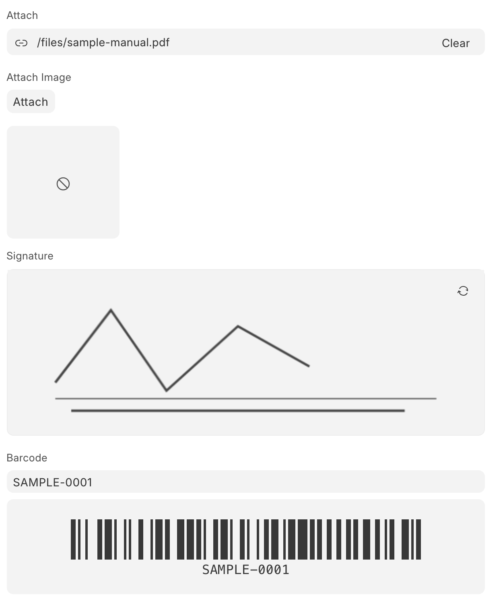

# Media and Special Fields

Use these fieldtypes for files, images, drawn signatures, barcodes, map shapes, colors, icons and phone numbers. Each one, except `Image`, has a column in the parent table and a special desk control. Most of them store a plain string. The server validates only `Phone` values. For column types, see [Field Types](../../reference/data-model/field-types.md). For properties that apply to all fields, see [Field Properties](field-properties.md). `Rating` is on [Number Fields](number-fields.md).



## Summary

| Fieldtype | Stores | Server validation on save |
|---|---|---|
| `Attach` | File URL string | None. Links a `File` to the document. |
| `Attach Image` | Image file URL string | None. Links a `File` to the document. The uploader accepts only images. |
| `Image` | Nothing | None. No column. |
| `Signature` | PNG data URL string | None |
| `Barcode` | SVG markup string | None. XSS filter skipped. |
| `Geolocation` | GeoJSON text | None. The JSON is not parsed. |
| `Color` | Hex color string | None |
| `Icon` | Icon name string | None |
| `Phone` | `+<code>-<number>` string | Must be a valid number with a country code. |

In Python (`frappe.get_doc`, `frappe.db.get_value`) and in REST JSON, every value is a `str` or `None`. `Geolocation` is also a string, not an object. Call `json.loads()` on it.

## `Attach`

- **Stores**: the `file_url` of a `File`, for example `/files/manual.pdf`, `/private/files/manual.pdf` or `https://example.com/a.pdf`.
- **Desk**: an "Attach" button opens the upload dialog. After upload, the control sets the value and saves the form. The control then shows the URL as a link, a "Reload File" button (to upload the same file again) and a "Clear" button. "Clear" asks for confirmation, deletes the attachment, sets the value to `null` and saves the form. In list view and grid, the value shows as a link.
- **Properties**: `make_attachment_public` selects "public" in the uploader by default. Without it, the DocType setting `make_attachments_public` applies. The DocType setting `max_attachments` also applies.
- **Server**: no validation of the value. The server saves any string, also a URL such as `javascript:...`. The `on_update` and `on_update_after_submit` hook `attach_files_to_document` in `frappe/core/doctype/file/utils.py` links the file. See [How files link to the document](#how-files-link-to-the-document).
- **JS**: `frappe.ui.form.ControlAttach` (extends `ControlData`). `on_attach_click()` opens `frappe.ui.FileUploader`. `clear_attachment()` runs the "Clear" action. If `df.options` is an object, its keys are merged into the uploader options.

### Upload dialog

The control opens `frappe.ui.FileUploader` with `allow_multiple: false`. The dialog has these sources: the device (drag and drop or file picker), "Library" (existing files), "Link" (a web URL), "Camera", and Google Drive if it is enabled. Each file has a "Private" checkbox. Images (except SVG) have an "Optimize" checkbox. It is on by default for images above 200 KB.

| Restriction | Source | Enforced by |
|---|---|---|
| Allowed file types | `restrictions.allowed_file_types`. Default: System Settings `allowed_file_extensions`. | Uploader, and `File.validate_file_extension()` for files uploaded over HTTP |
| Maximum file size | System Settings `max_file_size` (MB), else site config `max_file_size` (bytes), else 25 MB | Uploader, and `File.check_max_file_size()` |
| Maximum number of files | DocType `max_attachments` | Uploader, and `File.validate_attachment_limit()` |
| Image only | `Attach Image` fieldtype (`image/*`) | Uploader only |
| File types for Guest and website users | JPG, PNG, GIF, PDF, TXT, CSV and Microsoft documents | `upload_file` in `frappe/handler.py` |

When you save a DocType, `max_attachments` is raised to the number of `Attach` and `Attach Image` fields if it is lower.

### How files link to the document

The uploader posts to `/api/method/upload_file` with `doctype`, `docname` and `fieldname`. The handler makes a `File` with these values:

| `File` field | Value |
|---|---|
| `attached_to_doctype` | The DocType of the form |
| `attached_to_name` | The document name |
| `attached_to_field` | The fieldname of the Attach field |
| `is_private` | The "Private" checkbox in the dialog |

Other rules:

- A new, unsaved document has a temporary name such as `new-sample-order-abc`. When the desk saves the document, files with that name, made in the last 60 minutes, get the real name (`relink_mismatched_files`).
- If code sets a URL in an Attach field, `attach_files_to_document` runs after the save. It links an unattached `File` of the current user with the same URL. If there is no such file, it makes a new `File` in `Home/Attachments`. If that fails, it logs an Error Log and the save continues. This applies only to URLs that start with `/files`, `/private/files`, `http://` or `https://`.
- An Attach field in a child table row links the file to the parent document, with `attached_to_field` set to the child fieldname.
- Deleting a `File` does not clear the Attach field. The field keeps the old URL. If the DocType has `protect_attached_files` and the document is submitted or cancelled, the delete is refused.

To make and attach a file from code, see [Files](../data-model/files.md).

## `Attach Image`

- **Stores**: the `file_url` of an image file.
- **Desk**: same as `Attach`. Hover over the link to see a preview. The uploader accepts only `image/*` files.
- **Properties**: same as `Attach`. Set the DocType property `image_field` to this fieldname to show the image in the form sidebar. A click on that image opens the uploader for the field. `image_field` must point to an `Attach Image` field, else the DocType does not save.
- **Server**: same as `Attach`. The server does not check that the file is an image.
- **JS**: `frappe.ui.form.ControlAttachImage` (extends `ControlAttach`).

## `Image`

- **Stores**: nothing. It shows the image whose URL is in another field.
- **Desk**: an `` of `doc[options]`. If that field is empty, it shows a placeholder icon.
- **Properties**: `options` is the fieldname that holds the URL, usually an `Attach Image` field.
- **JS**: `frappe.ui.form.ControlImage` (extends `Control`).

```json
{"fieldname": "image_preview", "fieldtype": "Image", "options": "attach_image"}
```

## `Signature`

- **Stores**: a data URL, for example `data:image/png;base64,iVBORw0KGgo...`.
- **Desk**: a drawing pad, 200 px high, with a reset button. Each stroke updates the value. Reset sets an empty string. A read-only field shows the image.
- **Server**: no validation. The server saves any string.
- **JS**: `frappe.ui.form.ControlSignature` (extends `ControlData`). It loads `jSignature` on demand.

## `Barcode`

- **Stores**: the SVG markup of the barcode. The raw value is in the `data-barcode-value` attribute of the `<svg>`.
- **Desk**: a text input and the rendered barcode below it. The control turns typed text into SVG with JsBarcode. If JsBarcode cannot encode the value, the description shows "Invalid Barcode".
- **Properties**: `options` is an optional JSON object of JsBarcode options. Without `options`, the control uses `fontSize` 16, `width` 3 and `height` 50. A JSON `options` replaces these defaults. `"format": "EAN"` selects `EAN8` for 8 characters and `EAN13` otherwise. `"valueField": "<fieldname>"` also copies the raw value into that field.
- **Server**: no validation. A value set from code stays as you set it. The desk converts a raw value to SVG when it shows the form. Barcode fields skip the XSS filter.
- **JS**: `frappe.ui.form.ControlBarcode` (extends `ControlData`). `get_barcode_html(value)` returns the SVG.

```json
{"fieldname": "barcode", "fieldtype": "Barcode", "options": "{\"format\": \"EAN\", \"valueField\": \"barcode_value\"}"}
```

A `Data` field with `options` `Barcode` is a different thing. It stores plain text. See [Text Fields](text-fields.md).

## `Geolocation`

- **Stores**: a GeoJSON `FeatureCollection` as text. A circle is a `Point` feature with `properties.point_type` `circle` and `properties.radius`.
- **Desk**: a Leaflet map, full width, at least 400 px high, with OpenStreetMap tiles. Users draw lines, polygons, rectangles and circles, and edit or delete them. A locate button centers the map on the user. A read-only field has no draw or locate controls, and drag and zoom are off. The default center and tile URL are in `frappe.utils.map_defaults`.
- **Server**: no validation. The server saves any string, also text that is not JSON.
- **JS**: `frappe.ui.form.ControlGeolocation` (extends `ControlData`). Override `point_to_layer`, `set_style` or `on_each_feature` in a subclass to change how features show.

```python
import json

doc = frappe.get_doc("Sample Field Demo", name)
shapes = json.loads(doc.geolocation) if doc.geolocation else None
```

## `Color`

- **Stores**: a hex color, for example `#077DDF`.
- **Desk**: a text input with a swatch. A click on the swatch opens a color picker with preset swatches. In list view and grid, the value shows with a swatch.
- **Server**: no validation.
- **JS**: `frappe.ui.form.ControlColor` (extends `ControlData`). `validate()` accepts only `#RRGGBB` (6 hex digits). When a user types another value, the control sets `null`.

!!! warning
    `frm.set_value()` and server code do not run the control validation. They can save values such as `red` or `#fff`.

## `Icon`

- **Stores**: the name of an icon in the desk icon sprite, for example `star`.
- **Desk**: a text input and an icon picker with a search box. In list view and grid, the value shows with the icon.
- **Server**: no validation. The server does not check that the icon exists.
- **JS**: `frappe.ui.form.ControlIcon` (extends `ControlData`).

## `Phone`

- **Stores**: the country calling code, a hyphen and the number, for example `+1-2025550123`.
- **Desk**: a country picker with flags and a number input. A new field selects the country from System Settings (`frappe.sys_defaults.country`), or India if it is not set. The control stores the code of the selected country, a hyphen and the typed number.
- **Server**: `validate_phone_number_with_country_code()` in `frappe/utils/__init__.py` parses the value with the `phonenumbers` library. A value without a country code raises `InvalidPhoneNumberError` ("Please select a country code"). An invalid number raises the same error. Empty values pass.
- **JS**: `frappe.ui.form.ControlPhone` (extends `ControlData`).

```python
doc.phone = "+1-2025550123"   # valid
doc.phone = "2025550123"      # InvalidPhoneNumberError on save
```

A `Data` field with `options` `Phone` checks only a character pattern and needs no country code. See [Text Fields](text-fields.md).

## Pitfalls

- `Attach`, `Attach Image`, `Signature`, `Barcode`, `Geolocation`, `Color` and `Icon` have no server validation. Validate them in the controller if the data comes from the API. For Attach fields, reject URL schemes other than `/files`, `/private/files` and `https://`.
- `Barcode` values set from code are not SVG. Code that reads the field gets the raw value or the SVG, depending on where it was set.
- An Attach URL that is not under `/files`, `/private/files` or `http(s)://` gets no `File` document.
- Changing `is_private` of a `File` changes its URL. Frappe updates the `attached_to_field` of the attached document only.

## Related

- [Files](../data-model/files.md)
- [Field Types](../../reference/data-model/field-types.md)
- [Field Properties](field-properties.md)
- [Text Fields](text-fields.md)
- [Layout Fields](layout-fields.md)
- [Controls](controls.md)
- [Customize Form](../../user-guide/customization/customize-form.md)
