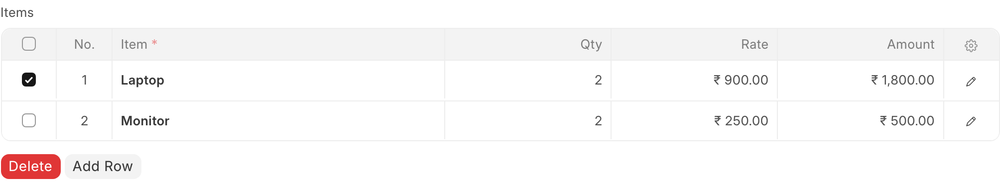

# Table Fields

A `Table` field holds a list of rows of a child DocType, for example the items of an order. A `Table MultiSelect` field holds rows too, but shows them as pills of one Link value, for example the roles of a user. The rows are stored in the table of the child DocType, not in a column of the parent. For the rules on `options`, see [Field Types](../../reference/data-model/field-types.md). For form events of child rows, see [Form Scripts](../desk-ui/form-scripts.md).

## Summary

| Fieldtype | `options` | Desk control | Value |
|---|---|---|---|
| `Table` | A child DocType (`istable = 1`) | Grid with rows and columns | List of row documents |
| `Table MultiSelect` | A child DocType with at least one `Link` field | Input with pills | List of row documents |

## How rows are stored

Each row is a document of the child DocType. Frappe adds these fields to each row:

| Field | Value |
|---|---|
| `parent` | Name of the parent document |
| `parenttype` | Parent DocType |
| `parentfield` | Fieldname of the Table field in the parent |
| `idx` | Position of the row, from 1 |
| `name` | Random 10-character name, set on insert |

When the parent is saved, Frappe deletes the rows that are no longer in the list, updates the other rows and inserts new ones. See `update_child_table()` in `frappe/model/document.py`. A row has no permissions of its own. Frappe checks the permissions of the parent.

If the child DocType is virtual (`is_virtual = 1` on the DocType), Frappe does not load its rows from the database and does not delete rows on save.

## `Table`

- **Stores**: no column in the parent. `frappe.get_doc` returns a `list` of child `Document` objects, or `[]`. REST JSON has a list of row objects.
- **Desk**: a grid. See [The grid](#the-grid).
- **Properties**: `options`, `reqd` (at least one row), `read_only`, `hidden`, `allow_on_submit`, `allow_bulk_edit` (Upload and Download buttons), `description`. On child fields: `in_list_view`, `columns`, `bold`, `reqd`.
- **Child DocType properties**: `editable_grid` (default 1), `grid_page_length` (default 50), `rows_threshold_for_grid_search` (default 20).
- **Server**: a mandatory Table with no rows raises `frappe.MandatoryError`. Each row is validated like a document: links, Select values, mandatory fields and lengths. Errors start with the row number, for example `Could not find Row #1: Item: Nope`.
- **JS**: `frappe.ui.form.ControlTable` in `table.js`. The grid is `frm.fields_dict.<fieldname>.grid`, an instance of the `Grid` class in `grid.js`.

!!! warning
    A child Link value that does not exist is not rejected when the child DocType has a field with `fetch_from` on that Link. For example, a `Sample Order Item` row with `item` `Nope` saves, because `rate` fetches from `item.rate`. Validate such links in the controller.

```json
{
	"fieldname": "items",
	"fieldtype": "Table",
	"label": "Items",
	"options": "Sample Order Item",
	"reqd": 1
}
```

REST JSON of a `Sample Order` with one row:

```json
{
	"name": "SO-00014",
	"customer_name": "Customer A",
	"items": [
		{
			"name": "8ethpgqlee",
			"idx": 1,
			"item": "Laptop",
			"qty": 2.0,
			"rate": 900.0,
			"amount": 1800.0,
			"parent": "SO-00014",
			"parentfield": "items",
			"parenttype": "Sample Order",
			"doctype": "Sample Order Item"
		}
	]
}
```

## The grid

### Columns

The grid shows the child fields that have `in_list_view = 1`. If no field has it when you save the child DocType, Frappe sets it on the first four mandatory fields that are not hidden. Fieldtypes without a value, such as layout fields and `Table`, cannot have `in_list_view`. In a child DocType, `Button` and `HTML` fields can.

The grid uses a 12-column layout. The row number takes one column. Each field column takes `columns` on the DocField. If `columns` is not set, the default is 2, 3 for `Small Text` and 1 for `Check`. Columns that do not fit in the total stop the list. When the total is less than 11, Frappe makes the other columns wider.

A user can pick the columns and their widths with the gear icon in the header. The total width must be 10 or less. The choice is saved in the user settings of the parent DocType, under `GridView`. "Reset to default" removes it.

### Edit rows

- If the child DocType has `editable_grid = 1`, the user edits values in the cells. Otherwise a click opens the row form.
- The pencil icon at the end of a row opens the row form. It shows all child fields and the buttons Move, Duplicate, Insert Above, Insert Below and Delete.
- Drag the row handle to change the order. This works only when the grid is editable.
- Select rows with the checkboxes. Shift-click selects a range. The footer then shows a Delete button. The header checkbox selects the rows. When the table has more rows than are selected, a Delete All button also shows. It asks for confirmation and removes all rows.
- Paste tab-separated data, for example from a spreadsheet, into a cell. If the first row has field labels or fieldnames, Frappe maps the columns by them. Otherwise it fills the visible columns from the cell to the right. It adds rows as needed.
- The grid shows `grid_page_length` rows per page. A search row shows when the table has at least `rows_threshold_for_grid_search` rows.



Keyboard shortcuts in an editable cell:

| Keys | Action |
|---|---|
| <kbd>Ctrl</kbd> + <kbd>Down</kbd> / <kbd>Ctrl</kbd> + <kbd>Up</kbd> | Insert a row below / above |
| <kbd>Ctrl</kbd> + <kbd>Shift</kbd> + <kbd>Down</kbd> / <kbd>Up</kbd> | Add a row at the end / at the start |
| <kbd>Shift</kbd> + <kbd>Alt</kbd> + <kbd>Down</kbd> | Duplicate the row |
| <kbd>Up</kbd> / <kbd>Down</kbd> | Go to the same cell in the previous / next row |
| <kbd>Tab</kbd> in the last cell of the last row | Add a row |

On macOS, <kbd>Cmd</kbd> works as <kbd>Ctrl</kbd>. In `Text`, `Small Text`, `Code`, `Text Editor` and `HTML Editor` cells, the arrow keys move the cursor in the text. Add <kbd>Alt</kbd> to move between rows.

### Upload and Download

Set `allow_bulk_edit = 1` on the Table field to show these buttons. Download shows always. Upload shows only when the grid is editable.

- Download makes a CSV file. The first seven lines are a header: the title, the field labels, the fieldnames, the descriptions and three lines of notes. The rows follow. Dates use the user date format.
- Upload accepts only a CSV file in the same format. Frappe reads the fieldnames from the third line and the rows from the eighth line. A file with more than 5000 rows is refused.
- Upload replaces all rows of the table. The rows change in the form. The user must save the document to keep them.

## Python API

```python
doc = frappe.new_doc("Sample Order")
doc.customer_name = "Customer A"
row = doc.append("items", {"item": "Laptop", "qty": 2})  # returns the child Document
doc.append("items", {"item": "Monitor", "qty": 1})
doc.insert()

row.idx, row.parentfield, row.rate  # (1, 'items', 900.0) - rate came from fetch_from on save
doc.get("items", {"item": "Monitor"})  # rows that match, a list
doc.remove(doc.items[0])  # remove the row and number the others again
doc.save()  # deletes the removed row in the database
```

| Method | Description |
|---|---|
| `doc.append(fieldname, value=None, position=-1)` | Add a row from a dict or a child `Document`. Returns the row. With `position`, insert at that index and number all rows again. |
| `doc.extend(fieldname, rows)` | Append each row of a list. |
| `doc.set(fieldname, rows)` | Replace all rows. An empty value clears the table. |
| `doc.get(fieldname, filters=None, limit=None)` | Rows that match a filter dict. Values can be `"x"`, `["!=", "x"]`, `["in", [...]]`, `"^prefix"`, `True` (set) or `False` (not set). |
| `doc.getone(fieldname, filters)` | The first matching row. |
| `doc.remove(row)` | Remove a row from the list and number the rest again. |
| `doc.get_all_children()` | All rows of all Table fields. |
| `row.parent_doc` | The parent `Document`. It is `None` for a row loaded alone with `frappe.get_doc(child_doctype, name)`. |

Rows are saved only through the parent. To read rows without the parent, query the child DocType with the parent filters:

```python
frappe.get_all(
	"Sample Order Item",
	filters={"parenttype": "Sample Order", "parent": "SO-00014"},
	fields=["item", "qty"],
	order_by="idx",
)
```

`frappe.get_list` on the parent can also read child fields with `<table fieldname>.<field>`, for example `fields=["name", "items.item"]`. This returns one row for each child row.

## REST API

- `GET /api/resource/Sample Order/SO-00014` returns the rows in the `items` key.
- `PUT` with an `items` list replaces all rows. Rows without `name` are inserted. Rows that are not in the list are deleted.
- `PUT` without the `items` key keeps the rows.
- To list rows of a child DocType, pass the parent DocType: `GET /api/resource/Sample Order Item?parent=Sample Order&fields=["item","parent"]`. Without `parent`, the request fails with `PermissionError`. The parent must have a Table field with this child DocType, and the user must have permission on the parent.

See [REST API](../api/rest-api.md).

## JavaScript API

Form methods for tables are listed in [Form Scripts](../desk-ui/form-scripts.md). This table shows what each one does to events and rendering. It was checked in the browser on a `Sample Order` form.

| Call | Fires `<table>_add` / `_remove` | Renders | Notes |
|---|---|---|---|
| `frm.add_child("items", {item: "Laptop"})` | No | No. Call `frm.refresh_field("items")`. | No change events, no `fetch_from`. |
| `frm.fields_dict.items.grid.add_new_row()` | `_add` | Yes | Same as the Add Row button. Does nothing if rows cannot be added. |
| `frm.set_value("items", [{...}, ...])` | No | Yes | Replaces all rows. `name`, `idx` and other standard keys in the input are ignored. |
| `frm.clear_table("items")` | No | No. Call `frm.refresh_field("items")`. | |
| Delete button on selected rows | `before_items_remove`, `items_remove` for each row, then `items_delete` | Yes | |
| `frappe.model.set_value(cdt, cdn, field, value)` | The child field event | Yes | No `fetch_from` for Link fields. |

Child events such as `items_add` and `items_remove` fire on the child DocType: register them with `frappe.ui.form.on("Sample Order Item", {...})`.

To set a value in a row and run the field event, use `frappe.model.set_value`:

```js
// sample_app/sample_module/doctype/sample_order/sample_order.js
frappe.ui.form.on("Sample Order", {
	refresh(frm) {
		frm.fields_dict.items.grid.add_custom_button(__("Set Qty to 1"), () => {
			for (const row of frm.doc.items || []) {
				frappe.model.set_value(row.doctype, row.name, "qty", 1);
			}
		});
	},
});
```

### Grid methods

Get the grid with `frm.fields_dict.<fieldname>.grid` or `frm.get_field(<fieldname>).grid`.

| Method or property | Description |
|---|---|
| `add_new_row(idx, callback, show)` | Add a row. `idx` inserts at that position. `show` opens the row form when the grid is not editable. Returns the row. |
| `get_row(key)` | The `GridRow` by index (negative counts from the end) or by row name. `get_row(0).doc` is the row data. |
| `get_selected_children()` | Selected rows as objects. `frm.get_selected()` returns the names for all grids. |
| `update_docfield_property(fieldname, property, value)` | Change a child DocField property for all rows of this form, for example `read_only`. |
| `toggle_reqd(fieldname, reqd)`, `toggle_enable(fieldname, enable)`, `toggle_display(fieldname, show)` | Set `reqd`, `read_only` or `hidden` on a child field through `update_docfield_property`. |
| `set_column_disp(fieldname, show)` | Set `hidden` on a child field and hide its cells. The column header stays. |
| `reset_grid()` | Build the columns and rows again. |
| `add_custom_button(label, click, position)` | Add a button to the footer, or above the grid with `position = "top"`. Returns the button. |
| `clear_custom_buttons()` | Hide all custom buttons. |
| `set_multiple_add(link_fieldname, qty_fieldname)` | Show an Add Multiple button that opens a search dialog for the Link field. |
| `only_sortable()` | Allow drag to reorder, but no other edits. |
| `refresh()` | Render the grid again. |
| `grid_rows`, `data` | The `GridRow` objects and the row data. |

To remove a column from the grid of one form, set `in_list_view` to 0 and build the grid again:

```js
const grid = frm.fields_dict.items.grid;
grid.update_docfield_property("rate", "in_list_view", 0);
grid.reset_grid();
```

To stop adding or deleting rows, set a property on the Table field. These are df keys, not DocField properties in the DocType.

```js
frm.set_df_property("items", "cannot_add_rows", true);
frm.set_df_property("items", "cannot_delete_rows", true);
```

`cannot_add_rows` hides Add Row and Add Multiple, and `add_new_row()` adds nothing. `cannot_delete_rows` hides the Delete buttons. To block one row from drag and drop, set `_sortable = false` on the row data.

To open the row form of a row from code, call `frm.fields_dict.items.grid.get_row(0).toggle_view(true)`.

## `Table MultiSelect`

- **Stores**: rows of the child DocType, like `Table`. The control uses the first `Link` field of the child DocType. In JSON, `roles` on a `Sample Field Demo` is `[{"role": "Sample Role", "parentfield": "roles", "doctype": "Has Role", ...}]`.
- **Desk**: an input that shows one pill for each row. Typing searches the target DocType of the Link field, with the same search as a `Link` field. Values that are already selected do not show. A click on a pill opens the linked document. The x on a pill removes the row. <kbd>Backspace</kbd> in the empty input removes the last pill. A new value is validated like a `Link` value. A value that is already selected is ignored. Pills show link titles when the target DocType uses them.
- **Properties**: `options`, `reqd`, `ignore_user_permissions`. With `ignore_user_permissions` on the Table MultiSelect field, the search skips User Permissions.
- **Server**: the same as `Table`. Each row is validated, so the Link value must exist. When you save the parent DocType, Frappe checks that the child DocType has a Link field.
- **JS**: `frappe.ui.form.ControlTableMultiSelect` in `table_multiselect.js`. It extends `ControlLink`, so `frm.set_query("roles", ...)` filters the search. `get_value()` returns the rows. Adding or removing a pill does not fire `<fieldname>_add` or `<fieldname>_remove`. Use the change event of the field.

```js
frm.set_value("roles", [{ role: "Sample Role" }]);
```

```json
{
	"fieldname": "roles",
	"fieldtype": "Table MultiSelect",
	"label": "Roles",
	"options": "Has Role"
}
```

## Pitfalls

- `frm.add_child()` and `frm.clear_table()` do not render and do not fire `_add` or `_remove`. Call `frm.refresh_field()` and run your own logic.
- A `PUT` with a partial `items` list deletes the rows that are not in it. Send all rows, or leave out the key.
- `grid.toggle_display()` hides a field in the row form. It does not remove the grid column.
- `grid.set_column_disp(fieldname, false)` empties the cells but keeps the column header.
- Upload replaces all rows of the table, also rows that are not in the file.
- `cannot_add_rows` and `cannot_delete_rows` work only in the desk. The server accepts any rows. Check limits in the controller `validate`.
- Child rows saved with `frappe.db.set_value` or SQL skip the parent `validate`.

## Related

- [Field Types](../../reference/data-model/field-types.md)
- [Field Properties](field-properties.md)
- [Link and Select Fields](link-and-select-fields.md)
- [Form Scripts](../desk-ui/form-scripts.md)
- [Controllers](../data-model/controllers.md)
- [REST API](../api/rest-api.md)
- [Data Import and Export](../../user-guide/data-and-reports/data-import-export.md)
