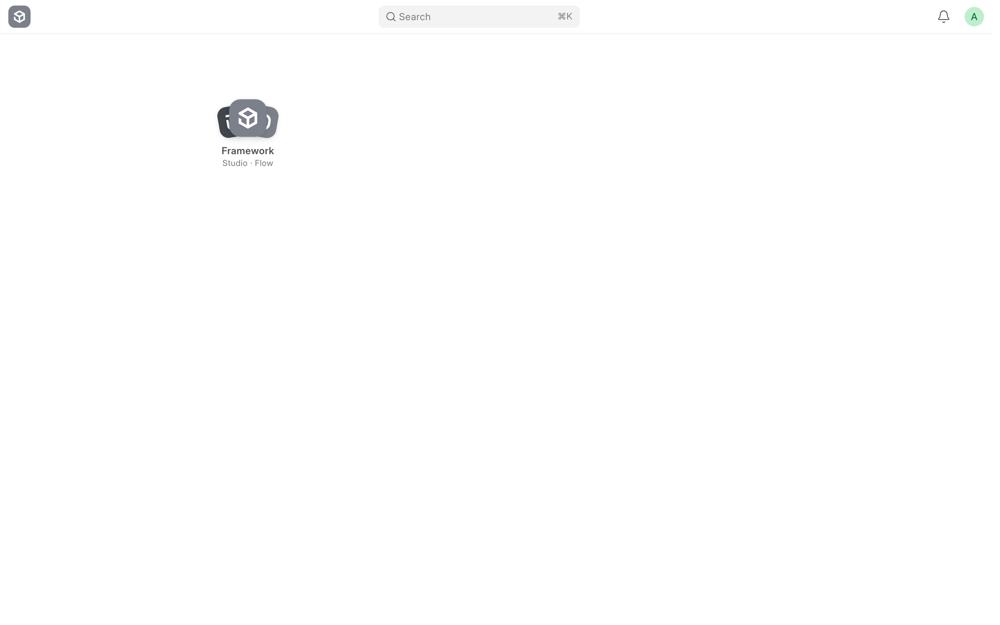

# Architecture

Read this page before you build an app. It explains the parts of a Frappe installation, the path of one HTTP request, and the processes that run beside the web server. The details of each part are in the developer guide.

## Bench, site and app

| Term | What it is | On disk |
|---|---|---|
| Bench | One installation folder. It holds the code, the Python environment and all sites. | `frappe-bench/` with `apps/`, `sites/`, `env/`, `config/`, `logs/`, `Procfile` |
| App | A Python package that adds DocTypes, pages, APIs and hooks. Frappe itself is an app. | `apps/<app_name>/` |
| Site | One tenant: one database, one set of files and one `site_config.json`. | `sites/<site_name>/` |

The apps available to the bench are listed in `sites/apps.txt`. Each site installs a subset of them, in order. `frappe` is always the first app.

### Multi-tenancy

One bench serves many sites from the same processes. For each request, `init_request()` in `frappe/app.py` picks the site in this order:

1. The site given to `bench serve` (for example with `bench --site <site> serve`).
2. The `X-Frappe-Site-Name` request header.
3. The host name of the request, without the port (`get_site_name()` in `frappe/utils/__init__.py`).

Then `frappe.init(site)` loads the site config and `frappe.connect()` opens the site database. State for the request lives in `frappe.local`, which is local to the thread.

Configuration is merged from `sites/common_site_config.json` (all sites) and `sites/<site>/site_config.json` (one site). See [Configuration](../developer-guide/operations/configuration.md).

## Request lifecycle

The WSGI entry point is `application()` in `frappe/app.py`. Gunicorn runs it in production. `bench serve` runs it with the Werkzeug server in development.

1. `init_request()` finds the site, connects to the database and builds `frappe.form_dict` from the query string and body. It loads the session from the session cookie (`HTTPRequest` in `frappe/auth.py`). Then it runs the `before_request` hooks.
2. `validate_auth()` reads the `Authorization` header. It sets the user from an API token or an OAuth bearer token.
3. The request path picks the handler:

    | Path | Handler |
    |---|---|
    | `/api/*` | `frappe.api.handle()`. Routes `/api/v1/*` (also `/api/*`) and `/api/v2/*`. |
    | `/backups/*` | `frappe.utils.response.download_backup()` |
    | `/private/files/*` | `frappe.storage.serve.serve_private_file()` (permission check) |
    | `/files/*` | `frappe.storage.serve.serve_public_file()` |
    | `/.well-known/*` | `security.txt` and other well-known files |
    | any other `GET`, `HEAD`, `POST` | `frappe.website.serve.get_response()` (website and desk pages) |

4. If no exception occurs, `sync_database()` commits for `POST`, `PUT`, `DELETE` and `PATCH`. It rolls back for other methods, unless `frappe.local.flags.commit` is set.
5. If an exception occurs, Frappe makes an error response and rolls back the transaction.
6. The `after_request` hooks run. Then the response gets its headers and cookies.
7. Callbacks added to `frappe.request.after_response` run after the response is sent.

!!! note
    A request with a `cmd` form value still goes to `frappe.handler.handle()`. This is deprecated in `develop`. Call `/api/method/<dotted.path>` instead.

### Whitelisted methods

`/api/method/<dotted.path>` resolves the Python function and calls `frappe.handler.execute_cmd()`. This checks that the function has the `@frappe.whitelist()` decorator and that the HTTP method is allowed. Then it calls the function with `frappe.form_dict` as keyword arguments. The return value is sent as `message` in the JSON response. See [Whitelisted methods](../developer-guide/api/whitelisted-methods.md) and [REST API](../developer-guide/api/rest-api.md).

## Desk, website and API

One process serves three kinds of clients:

| Area | Route | Who uses it | Built from |
|---|---|---|---|
| Desk | `/desk` and `/desk/<path>` | Logged-in System Users | `frappe/www/desk.html` and the JS bundle `desk.bundle.js`. Routing inside the desk is done in the browser. |
| Website and portal | all other routes, for example `/login`, `/me`, web forms, `www/` pages | Guests and Website Users | Page renderers in `frappe/website/page_renderers/` |
| API | `/api/v1/*`, `/api/v2/*` | Scripts, mobile apps, the desk itself | `frappe/api/` |

The hook `website_route_rules` in `frappe/hooks.py` maps `/desk/<path:app_path>` to the `desk` page. The hook `website_redirects` sends `/app`, `/app/*` and `/apps` to `/desk`. A Guest who opens `/desk` gets a redirect to `/login`. A Website User gets a permission error.

For website routes, `PathResolver` in `frappe/website/path_resolver.py` tries the page renderers in this order: renderers from the `page_renderer` hook, then `StaticPage`, `WebFormPage`, `DocumentPage`, `TemplatePage`, `PrintPage` and `ListPage`. See [Website](../developer-guide/website/website.md).



## Processes

`bench start` (development) or the process manager (production) runs these processes:

| Process | Command | Job |
|---|---|---|
| Web | `bench serve` / Gunicorn | Runs `frappe.app.application` for HTTP requests. |
| Worker | `bench worker` | Runs background jobs from Redis queues. |
| Scheduler | `bench schedule` | Every tick, enqueues the due scheduled jobs of each site. |
| Realtime | `bench socketio` | Socket.IO server for live updates in the browser. |
| Redis cache | `redis-server config/redis_cache.conf` | Cache store (`redis_cache`). |
| Redis queue | `redis-server config/redis_queue.conf` | Job queues and realtime pub/sub (`redis_queue`). |

### Background workers

`frappe.enqueue()` puts a job in a Redis queue (RQ). A worker process takes jobs from one or more queues and runs each job in the context of its site. The built-in queues and their default timeouts (`get_queues_timeout()` in `frappe/utils/background_jobs.py`) are:

| Queue | Default timeout |
|---|---|
| `short` | 300 seconds |
| `default` | 300 seconds |
| `long` | 1500 seconds |

Add more queues with the `workers` key in `common_site_config.json`. See [Background jobs](../developer-guide/runtime/background-jobs.md).

### Scheduler

`bench schedule` runs `start_scheduler()` in `frappe/utils/scheduler.py`. On each tick it reads the `Scheduled Job Type` records of every site and enqueues the jobs that are due. The workers run them. Apps add jobs with the `scheduler_events` hook. See [Scheduler](../developer-guide/runtime/scheduler.md).

### Realtime

Server code calls `frappe.publish_realtime()`. This publishes the event to the Redis channel `events` on the `redis_queue` server. The realtime server reads the channel and sends the event to the browser sockets in the right room (user, document or DocType). The browser receives it with `frappe.realtime.on()`.

`bench socketio` starts one of two servers, set by `socketio_backend` in `common_site_config.json`:

- `node` (default): `apps/frappe/socketio.js`.
- `python`: `python -m frappe.realtime.server`, a Python Socket.IO server on asyncio and uvicorn. It calls back to the web process to authenticate sockets and check permissions.

Both listen on `socketio_port` (default `9000`). See [Realtime](../developer-guide/runtime/realtime.md).

## Metadata-driven model

Frappe stores the data model as data. A DocType is a document that describes a table: its fields, permissions, naming and form layout.

- Each DocType has one table named `tab<DocType>`, for example `tabToDo`.
- Each field of a DocType is a column. Standard columns (`name`, `owner`, `creation`, `modified`, `modified_by`, `docstatus`, `idx`) are added to every table.
- A child DocType (`istable`) stores its rows in its own table, with `parent`, `parenttype` and `parentfield` columns.
- A Single DocType (`issingle`) has no table. Its values are stored in `tabSingles`.
- The form, list view, REST API, permissions and reports all read the same DocType metadata (`frappe.get_meta()`).

A standard DocType belongs to an app. Its definition is a JSON file in the app, for example `frappe/desk/doctype/todo/todo.json`. `bench migrate` syncs these files to the database. A custom DocType (`custom = 1`) exists only in the site database. See [DocTypes](../developer-guide/data-model/doctypes.md).

## Modules

A module groups DocTypes, reports, pages and workspaces inside an app. Each module is a `Module Def` record and a Python package in the app:

```text
apps/sample_app/sample_app/        # Python package of the app
├── hooks.py
├── modules.txt                    # list of module names
└── sample_app/                    # module folder "Sample App"
    ├── .frappe                    # marks the folder as a module
    └── doctype/
        └── sample_item/
            ├── sample_item.json
            ├── sample_item.py
            └── sample_item.js
```

A new app gets one module with the same name as the app title. `bench new-app` writes both `modules.txt` and the `.frappe` marker file. See [Apps](../developer-guide/building-apps/apps.md).

## Related

- [Installation](installation.md)
- [Quickstart](quickstart.md)
- [Glossary](glossary.md)
- [Hooks](../developer-guide/building-apps/hooks.md)
- [Deployment](../developer-guide/operations/deployment.md)
- [Request lifecycle](../developer-guide/api/request-lifecycle.md)
