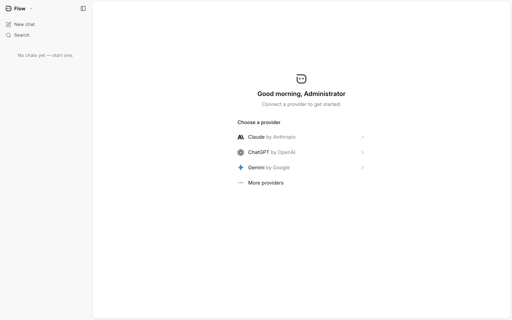
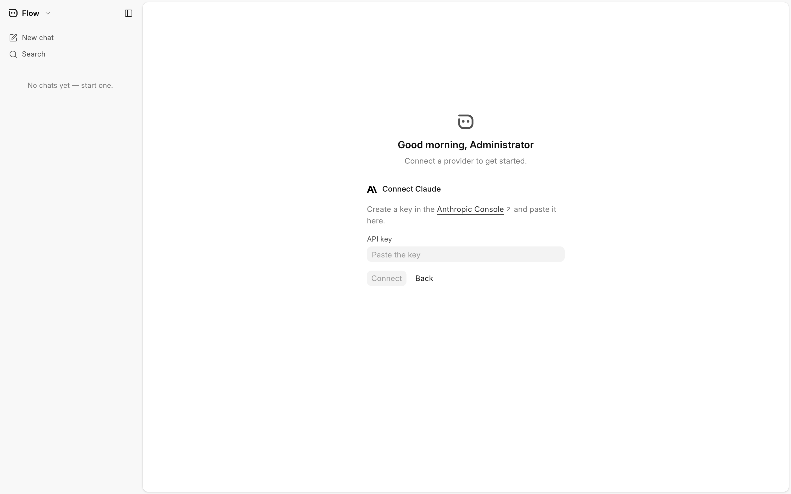
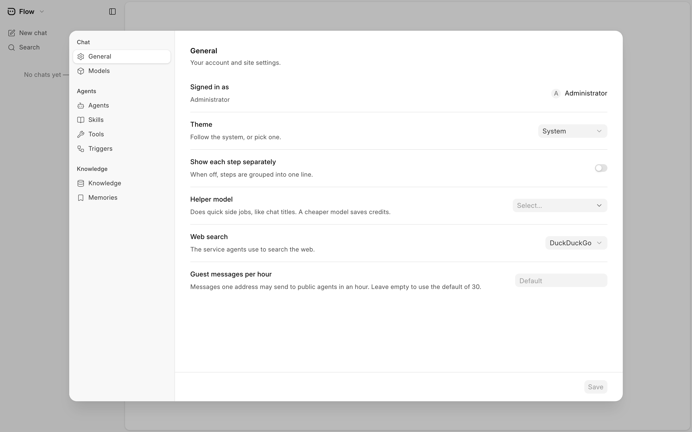

# Flow

Flow is an AI assistant inside your Frappe site. You chat with an **agent**. The agent uses **tools** to read and change records, run reports, call APIs and search the web, with your permissions. Use Flow to ask questions about your data, do repeated work in plain language, or run an agent on a schedule or when a document changes. Flow needs a model provider, such as Anthropic, OpenAI or Google, and an API key from that provider.

!!! warning
    Flow is in beta and can make mistakes. Flow sends your messages and the data its tools read to the model provider you connect.

## Open Flow

- Go to `/flow` for the full page. Guests are sent to the login page.
- In the desk or in Studio, press <kbd>Ctrl</kbd>+<kbd>I</kbd> (<kbd>Cmd</kbd>+<kbd>I</kbd> on macOS) to open Flow in a side panel. The panel shows to users who can read `Flow Session`, also before a provider is connected.

The left sidebar has **New chat**, **Search** and your earlier chats. The **Flow** menu at the top has **Apps**, **Settings** (<kbd>Cmd</kbd>+<kbd>,</kbd>) and **Log out**.

## Connect a provider

Before anyone can chat, a System Manager connects a provider and picks a model.

1. Open `/flow`.
2. Under **Choose a provider**, select **Claude**, **ChatGPT** or **Gemini**. Click **More providers** for OpenRouter, Grok, Groq, DeepSeek, Mistral, Cerebras and **Custom provider**.
3. Create a key at the provider and paste it in **API key**.
4. Click **Connect**. Flow checks the key with the provider. A wrong key saves nothing.
5. Pick the model that chats start with.





**Custom provider** connects any server that speaks the OpenAI API, such as vLLM, LM Studio or a LiteLLM proxy. Enter its address, starting with `http://` or `https://`. The key is optional. When Ollama runs on the same server at `localhost:11434`, Flow also offers its models.

The first enabled model also makes the built-in agent **Flow** (`frappe/Flow`), which knows the site and the built-in tools.

### What the setup saves

`Flow Provider` (one per provider):

| Field | Default | Description |
|---|---|---|
| `provider` | | `openai`, `anthropic`, `gemini`, `openrouter`, `xai`, `groq`, `deepseek`, `mistral`, `cerebras`, `custom_openai` (OpenAI-compatible endpoint) or `litellm_proxy`. |
| `enabled` | 1 | Turn off to stop all its models. |
| `api_key` | | Password field. Stored encrypted. |
| `base_url` | | For a custom endpoint or proxy. |

`Flow Model` (one per model):

| Field | Default | Description |
|---|---|---|
| `title` | | Name shown in the model picker, for example "Claude Sonnet 4.6". |
| `provider` | | Link to `Flow Provider`. |
| `model_id` | | The id of the model at the provider. |
| `enabled` | 1 | |
| `embedding` | 0 | The model makes embeddings for knowledge search. |
| `context_window` | | Number of tokens the model accepts. |
| `api_key`, `base_url` | | Only when the model has no provider. |
| `extra_params` | | JSON passed to the model call. |
| `roles` | | Only users with one of these roles can use the model. |

## Chat

1. Click **New chat**.
2. Select an agent in the agent picker. The default agent is **Flow**.
3. Type a request, for example "List open Sample Orders for Customer A".
4. Attach files if the agent needs them.
5. Send the message. Flow shows each tool call as it runs.

Pick how Flow asks before it changes data:

| Mode | Description |
|---|---|
| **Auto** | Default. A helper model decides which tool calls need approval. |
| **Ask for approval** | Asks you before each change. |
| **Auto-approve** | Runs everything without asking. |

To use a skill in a message, type `/skill:<name>` or pick it in the skill picker. Only skills with **User Invocable** on show there.

To share a chat, click **Share**. Set **General access** to "Only people you add" or "Every Flow user", or add members. People you share with can read the chat. Only the owner can send messages.

## Settings

Open **Flow** > **Settings**.



| Tab | What you set |
|---|---|
| **General** | Theme, **Show each step separately**, **Helper model**, **Web search** service, **Guest messages per hour**. |
| **Models** | Providers and models. Add a model, change a key, or delete a provider. |
| **Agents** | The agents users can chat with. |
| **Skills** | Instructions agents can load for specific tasks. |
| **Tools** | Actions agents can take. |
| **Triggers** | Run an agent when a document changes or on a schedule. |
| **Knowledge** | Knowledge bases and their sources. |
| **Memories** | What agents remember. |

`Flow Settings` fields:

| Field | Default | Description |
|---|---|---|
| `small_model` (Helper model) | | Does side jobs such as chat titles and approvals in **Auto** mode. A cheaper model saves credits. |
| `search_provider` | `DuckDuckGo` | `DuckDuckGo`, `Brave`, `Tavily` or `Exa`. |
| `search_api_key` | | Needed for every search provider except DuckDuckGo. |
| `guest_messages_per_hour` | 0 | Messages one address can send to public agents in an hour. 0 uses the default of 30. |

## Agents

An agent is a `Flow Agent` record.

| Field | Default | Description |
|---|---|---|
| `title` | | Agent name. |
| `model` | | `Flow Model` the agent uses. |
| `instructions` | | The system prompt. |
| `tools` | | `Flow Tool` records the agent can call. |
| `sub_agents` | | Other agents this agent can hand work to. |
| `skills` | | `Flow Skill` records the agent can load. |
| `knowledge_bases` | | Knowledge bases the agent can search. |
| `max_iterations` | 100 | Most model turns in one run. |
| `token_budget` | | Most tokens in one run. |
| `roles` | | Only users with one of these roles can chat with the agent. |
| `public` | 0 | Guests can chat with the agent without a login. |

Records with **System Generated** set come from an app. Their greyed-out fields cannot be changed.

## Tools, skills and knowledge

- **Tools** (`Flow Tool`): the built-in tools have names such as `frappe/read_records`, `frappe/create`, `frappe/update`, `frappe/run_report` and `frappe/web_search`. A `Script` tool runs sandboxed Python with a `main(...)` function. An `Imported` tool points to a Python function in **Import Path**. Turn on **Requires Confirmation** to always ask before it runs.
- **Skills** (`Flow Skill`): a name, a one-line **Description** of when it applies, and **Instructions**. **Available to All Agents** offers it to every agent.
- **Knowledge** (`Flow Knowledge Base` with `Flow Knowledge Source` rows): a source is `Text`, `File`, `URL` or `DocType`. A `DocType` source can **Auto Sync** when records change. Set the **Embedding Model** in `Flow Knowledge Settings` first. Search is `Hybrid` by default, with chunk size 1000 and overlap 200.
- **Memories** (`Flow Agent Memory`): notes an agent keeps, for the agent or for one user.

## Triggers

A trigger runs an agent without a chat.

1. Open **Settings** > **Triggers** and add a trigger.
2. Select the **Agent**.
3. Set **Event** to `DocType Event` or `Scheduled`.
4. For `DocType Event`, select the **Target DocType** and the **Doc Event** (`after_insert`, `on_update`, `on_submit`, `on_cancel` or `on_trash`).
5. For `Scheduled`, enter a **Cron Expression**. Flow checks due triggers every 5 minutes.
6. Optional: enter a Python **Condition**. It gets `doc` and `utils`.
7. Write the **Prompt Template**. It is Jinja with `doc` and `now`.
8. Save.

```jinja
A new Sample Order {{ doc.name }} came in from {{ doc.customer_name }}.
Check the items and add a comment if a rate is missing.
```

The trigger runs as the **Run As** user, or as its owner. It skips documents that user cannot read. Trigger chats approve tool calls on their own. Each run is a `Flow Run` with status `Running`, `Paused`, `Completed`, `Denied` or `Failed`.

## Access

| Role | Can do |
|---|---|
| `System Manager` | Connect providers, manage models, agents, tools, skills and triggers. See trigger and guest chats. |
| `Flow User` | Chat with agents they may use, read models and skills, and manage their own triggers. |

Chats, runs and personal memories are private to their owner. Roles on an agent or a model limit who can use it.

## For developers

- Define agents, tools and triggers in Python with `frappe.flow.Agent` and the `@tool` decorator, and register them with the `flow_agents`, `flow_tools` and `flow_triggers` hooks. See [Flow Development](../../developer-guide/low-code-and-ai/flow-development.md).
- Agents run in the Flow server daemon. Manage it with `bench flow-server setup`, `start`, `serve`, `stop`, `restart` and `status`.
- Flow adds its launcher to the desk, to Studio and to apps with a route in `add_to_apps_screen` (`frappe/flow/launcher.py`, an `after_request` step).

## Pitfalls

- Without an enabled model, `/flow` shows only the provider setup. Users who cannot connect a provider see "An admin needs to connect a provider first."
- **Auto-approve** lets the agent change data without asking. Use it only with agents and tools you trust.
- A public agent answers guests. Give it only read tools and limit **Guest messages per hour**.

## Related

- [Flow Development](../../developer-guide/low-code-and-ai/flow-development.md)
- [Automation Flow](../automation/automation-flow.md)
- [Studio](studio.md)
- [Users and Roles](../users-and-permissions/users-and-roles.md)
