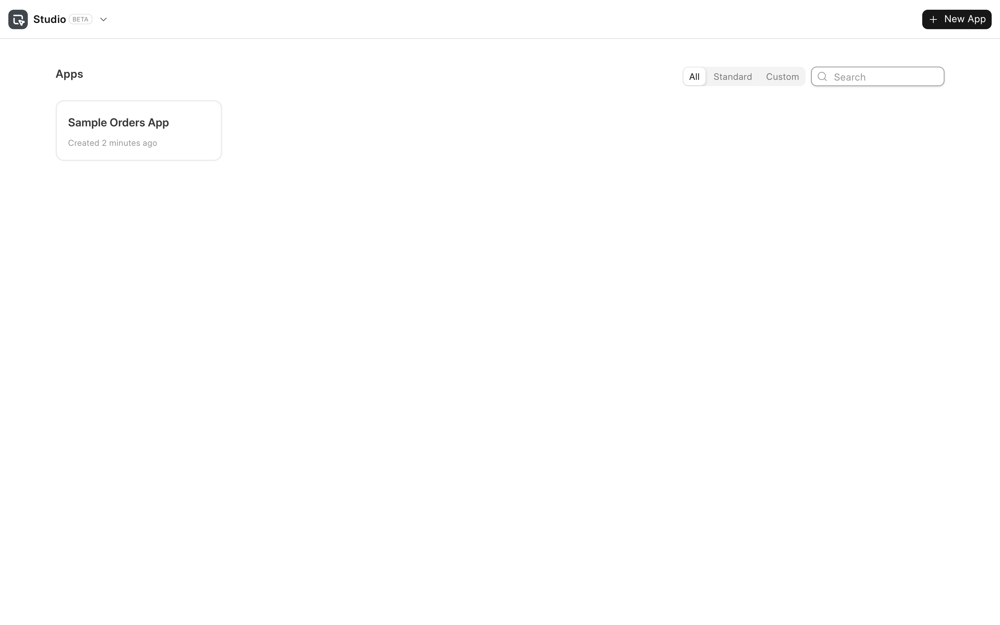
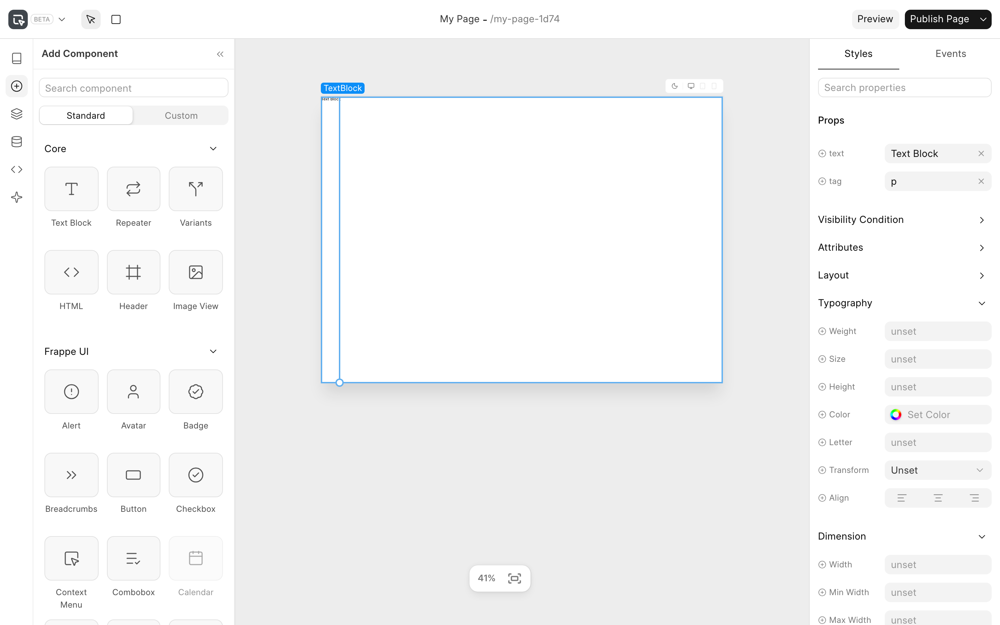
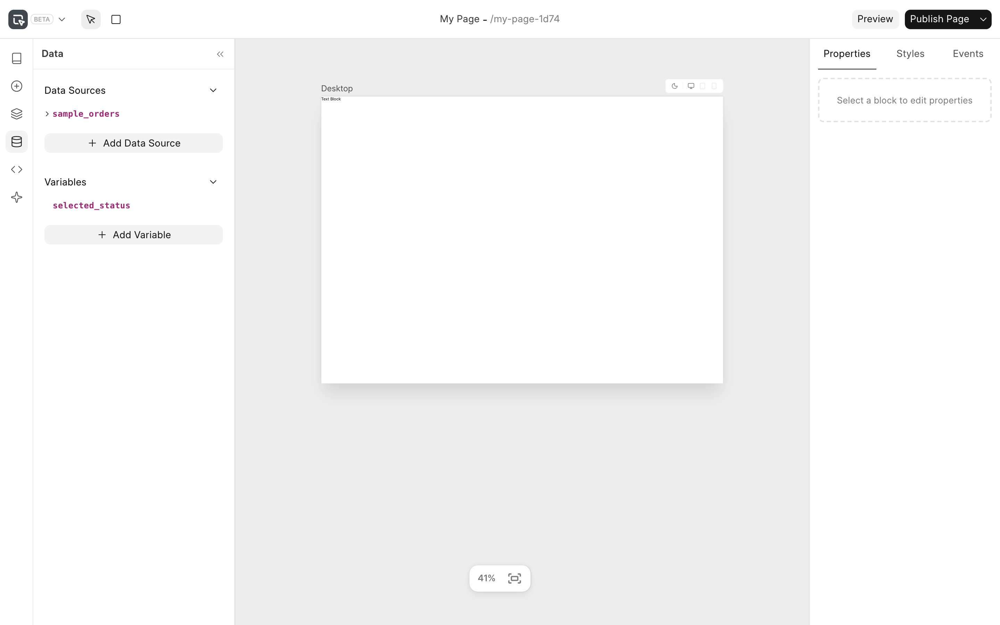

# Studio

Studio is a visual app builder in Frappe. You build pages from components with drag and drop, connect them to Frappe data, and publish them as a web app on your site. Use Studio for a portal, an internal tool or a small app that needs its own UI, without a separate frontend project. Studio is in beta.

## Core concepts

| Name | DocType | What it is |
|---|---|---|
| App | `Studio App` | A web app served at `/<app route>`. It has one or more pages. |
| Page | `Studio Page` | One screen of the app, at `/<app route>/<page route>`. Holds the block tree, data sources, variables and a page script. |
| Component | `Studio Component` | A reusable part of the UI that you make in the app. |
| Data source | `Studio Page Resource` | Data a page loads: a list of documents, one document, or an API call. |
| Variable | `Studio Page Variable` | Page state of type `String`, `Number`, `Boolean` or `Object`. |

An app is **Custom** (stored in the database, edited on any site) or **Standard** (exported to files in a Frappe app, edited in developer mode).

## Open Studio

Go to `/studio`. The home page lists your apps. Filter them with **All**, **Standard** and **Custom**, or search by name.

## Make an app

1. Click **New App**.
2. Enter a **Title**, for example "Sample Orders App".
3. Optional: enter an **App Route** and an **App Name**. By default both come from the title, for example `sample-orders-app`.
4. Click **Create**.

Studio makes the app and a first page, and opens the editor at `/studio/app/<app>/<page>`.

## The editor

| Area | What it does |
|---|---|
| Top bar | Page title and route. Click it to change **Page Title**, **Page Route**, **Tab Title** and **Allow Guest Access**. **Preview** and **Publish Page** are at the right. |
| Left rail | **Pages**, **Add Component**, **Layers**, **Data**, **Code** and **AI Assistant**. |
| Canvas | The page. Switch between desktop, tablet and mobile, and zoom. |
| Right panel | **Properties**, **Styles** and **Events** of the selected block. For a text block, the props show at the top of **Styles** and there is no **Properties** tab. |

### Add components

1. Click **Add Component** in the left rail.
2. Find a component in **Standard** or **Custom**. Standard groups include **Core** (Text Block, Repeater, Variants, HTML, Header, Image View) and **Frappe UI** (Button, Alert, Badge, charts, List and more).
3. Drag the component onto the canvas.
4. Select it and set its props in the **Properties** tab. For a text block, use **Props** in the **Styles** tab.

Use **Layers** to see and select blocks in a tree. Use **Visibility Condition** in the right panel to show a block only when an expression is true.

### Connect data

1. Click **Data** in the left rail.
2. Click **Add Data Source**.
3. Enter a **Data Source Name**.
4. Select the **Type**: `Document List`, `Document` or `API Resource`.
5. For a document type, select the **Document Type**, the fields and filters.
6. For `API Resource`, enter the **URL**, the method and the parameters.
7. Save the data source. Bind block props to it.

Click **Add Variable** to add page state. Read and set variables in events and in the page script.

### Scripts

Click **Code** to write the page script and app files. A custom app can use `.js`, `.json` and `.css` files and import `vue`, `vue-router`, `pinia` and `frappe-ui`.

## Preview and publish

- **Preview** opens the page at `/dev/<app route>/<page route>`. It shows your draft and needs a login.
- **Publish Page** publishes the current page and opens it at `/<app route>/<page route>`.
- The arrow next to **Publish Page** has **Revert Changes** (shows when a published page has a draft), **Publish App** (all pages), **Unpublish Page** and **Unpublish App**.

An app is live when at least one page is published. Published apps also show on the apps screen of the desk. A guest can open a page only when it is published and **Allow Guest Access** is on. Other guests go to the login page.

## AI Assistant

The **AI Assistant** in the left rail builds or changes pages from a prompt. It needs an OpenRouter API key in **Studio Settings** (`ai_api_key`), set from the Studio settings dialog. When Flow is set up, the panel can also open Flow.

## Access

Users with the `System Manager` or `Studio User` role can create and edit Studio apps. A user needs write permission on `Studio App` and `Studio Page` to edit an app.

## For developers

- Export an app with **Export App** (developer mode only) to make it standard. The files go to `<frappe_app>/studio/<studio_app>/`.
- Run `bench --site <site> watch-studio` beside `bench start` to sync file changes of a standard app.
- Add boot data for an app with the `studio_app_boot` hook. Frappe serves Studio apps through the `page_renderer` hook.
- See [Studio Development](../../developer-guide/low-code-and-ai/studio-development.md) and `skills/studio-app-building/SKILL.md` in the frappe repo.

## Pitfalls

- A standard app can be saved only in developer mode.
- A custom app cannot use `.ts` or `.vue` files or npm packages. Export the app if you need them.
- Editor changes are saved as a draft (`draft_blocks`). Publishing copies the draft to `blocks`, which the live page shows.

## Related

- [Studio Development](../../developer-guide/low-code-and-ai/studio-development.md)
- [Website](../website-and-integrations/website.md)
- [Flow](flow.md)
