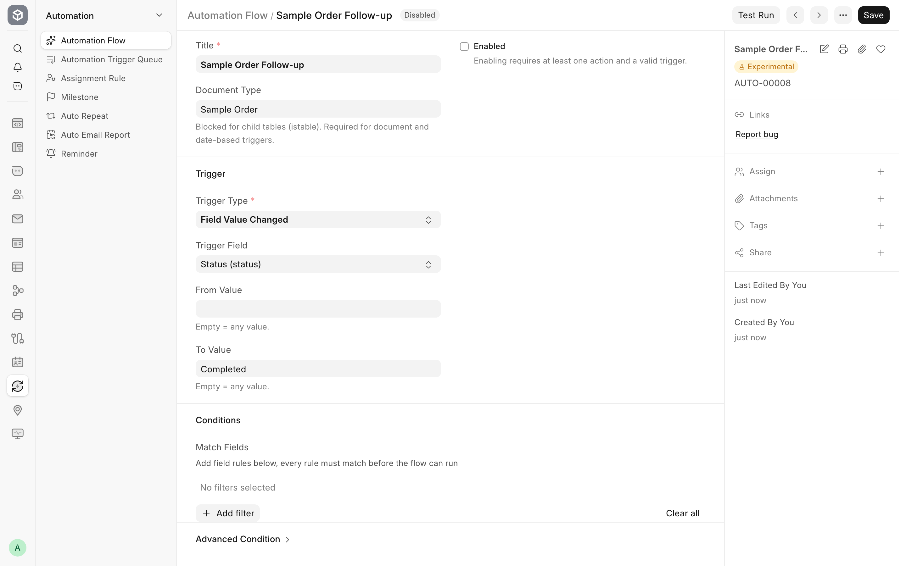
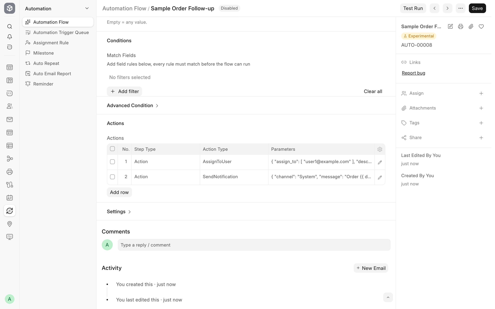

# Automation Flow

An Automation Flow runs a list of steps when a trigger fires: a document is created, a field changes, a date comes near, a cron schedule is due, or an app sends an event. Steps can set fields, create documents, assign users, send notifications, call webhooks and run server scripts. Use it for multi-step automation without code. For one simple rule, an [Assignment Rule](automation.md) or a [Notification](notifications.md) can be enough.

!!! note "Version"
    Automation Flow is new in develop and is marked **Experimental** in the desk. Only System Managers can create flows.

## How a flow runs

1. A trigger fires. Frappe checks the trigger, the match fields and the advanced condition.
2. If they match, Frappe adds a row to `Automation Trigger Queue`. The save that fired the trigger does not wait.
3. A background job takes rows from the queue and runs the flow.
4. Each run is saved as an `Automation Run` with one row for each step.

Because steps run in the background, an error in a step does not block the save that fired the trigger.

## Create a flow

1. Go to `/desk/automation-flow/new`.
2. Enter a **Title** and select the **Document Type**.
3. Select the **Trigger Type** and fill in its fields.
4. Optional: add match fields or an advanced condition.
5. Add rows in **Actions**.
6. Save.
7. Select **Enabled** and save again.

A flow can only be enabled when it has at least one action.



## Triggers

| Trigger Type | Fires when | Fields |
|---|---|---|
| Doc Created | A document is inserted. | |
| Doc Updated | A document is saved, but not on insert. | |
| Field Value Changed | A saved document has a new value in a field. | **Trigger Field**, optional **From Value** and **To Value** (empty means any value). |
| Doc Deleted | A document is deleted. | |
| Doc Submitted | A document is submitted. | |
| Doc Cancelled | A document is cancelled. | |
| Date Based | A date field is a number of days before or after today. Checked every hour. Each document fires once a day. | **Date Field**, **Date Offset (Days)**, **Date Direction** |
| Scheduled | A cron expression is due. Checked every 5 minutes. | **Cron Expression**, for example `0 9 * * 1` |
| Custom Event | An app sends an event with this name. | **Custom Event** |
| Manual | Started from code with `run_manually`. | |

Document triggers and Date Based need a **Document Type**. A child table DocType is not allowed.

## Conditions

- **Match Fields**: field rules made with the filter editor. All rules must match.
- **Advanced Expression using Python** (`condition`): an expression with `doc`, for logic the match fields cannot express, such as OR groups. The match fields and the expression must all be true.
- **Revalidate on Run**: check the match fields and the expression again in the background job before the steps run.

## Steps

Each row in **Actions** is one step. Steps run in order.



| Field | Description |
|---|---|
| Step Type | `Action`, `Wait`, `WaitForEvent` or `If`. Default `Action`. |
| Action Type | For `Action` steps. See the table below. |
| Parameters (`params`) | JSON with the values for the action. |
| Target | The record alias the step acts on. Default `trigger`, the document that fired the flow. |
| Output Alias | A name for the record that this step creates, for later steps. |
| Step Condition | Python expression. The step runs only when it is true. Required for `If` steps. |
| Parent Step / Parent Step Branch | Put a step inside an earlier `If` step, in its `If` or `Else` branch. |

Built-in actions:

| Action Type | Label | Parameters |
|---|---|---|
| `SetFieldValue` | Set Field Value | `field` and `value`, or `values` (a map of field to value). Saves the document. |
| `IncrementFieldValue` | Increment Field Value | `field` (a numeric field), `amount`. |
| `CreateDocument` | Create Document | `doctype`, `values`. |
| `AssignToUser` | Assign to User | `assign_to` (list of users), `description`. |
| `SendNotification` | Send Notification | `channel` (`Email` or `System`), `recipients`, `subject`, `message`, or `email_template`. Use `@owner` and `@assignees` as recipients. |
| `CallWebhook` | Call Webhook | `url`, `method`, `headers`, `payload`, `timeout` (seconds). |
| `RunScript` | Run Script | `server_script` (a Server Script of type API) or `script`, not both. |

Text values in parameters are Jinja templates with `doc`, for example `"Order {{ doc.name }} completed"`.

Other step types:

- `Wait`: pause the run. Parameters: `value` and `unit` (`Seconds`, `Minutes`, `Hours` or `Days`).
- `WaitForEvent`: pause until an app sends an event, or until a timeout. Parameters: `event_name`, `correlation_key`, `timeout_value`, `timeout_unit`.
- `If`: run the child steps in the `If` branch when **Step Condition** is true, else the `Else` branch.

Example parameters for a Set Field Value step:

```json
{"values": {"status": "Completed", "owner_user": "user1@example.com"}}
```

## Settings of a flow

| Field | Default | Description |
|---|---|---|
| Run As | `Automation User` | `Triggering User`, `Document Owner` or `Automation User`. The steps run with this user's permissions. |
| Automation User | `Administrator` | The user for `Automation User`. Must be enabled. |
| Stop on Error | 1 | Stop the run at the first failed step. |

## Test a flow

Click **Test Run** on a saved flow. Select a document in **Run against** and click **Run**. The flow runs for real against this document, then Frappe rolls back everything it did. The result shows each step and its status. `CallWebhook` steps do not send requests in a test run, and `Wait` steps do not pause.

## Runs and history

- `Automation Run` (`/desk/automation-run`): one record for each run, with status `Running`, `Waiting`, `Success`, `Partially Failed`, `Failed` or `Skipped`. The **Steps** table has the status, duration, detail and error of each step.
- `Automation Trigger Queue` (`/desk/automation-trigger-queue`): rows waiting to run, with status `Pending`, `Scheduled`, `Running`, `Done`, `Failed` or `Skipped`.

After a number of failures in a row (**Failure Threshold**, default 10), Frappe disables the flow. It sets **Disabled Reason**, skips the waiting rows, and sends a notification to the owner of the flow.

## Automation Settings

Go to `/desk/automation-settings`.

| Field | Default | Description |
|---|---|---|
| Disable Automations | 0 | Stop all flows on the site. Queued rows stay. |
| Maximum Recursion Depth | 3 | How many times a flow can trigger another flow in one chain. |
| Failure Threshold | 10 | Failures in a row before a flow is disabled. |
| Stale Running Minutes | 30 | A row that stays `Running` longer is queued again. |
| Maximum Attempts | 3 | Retries for a row that fails outside its steps. |
| Queue Retention Days | 7 | Days to keep `Failed` and `Skipped` queue rows. |
| Step Output Limit | 65536 | Bytes of output a step can pass to later steps. |
| Event Payload Limit | 65536 | Bytes an event payload can have. |
| Allow Unregistered Events | 0 | Accept events that no app registered. |

## Pitfalls

- Flows do not run during install, patches or migrate.
- A flow changes data with the **Run As** user. With the default `Automation User` (`Administrator`), steps can change any document.
- When a flow saves a document, that save can trigger other flows. The recursion depth limit stops long chains and logs an error.

## For developers

- Send a custom event from code with `emit(event, doc=None, payload=None, correlation_key=None)` in `frappe/automation_engine/events.py`.
- Register events, actions and record relationships with the `automation_events`, `automation_actions` and `automation_relationships` hooks.
- Start a Manual flow with `frappe.automation_engine.api.run_manually(automation, docname=None)`.
- See [Automation Engine](../../developer-guide/low-code-and-ai/automation-engine.md) for the developer guide.

## Related

- [Automation](automation.md)
- [Notifications](notifications.md)
- [Workflow](../customization/workflow.md)
- [Server and Client Scripts](../../developer-guide/low-code-and-ai/server-and-client-scripts.md)
