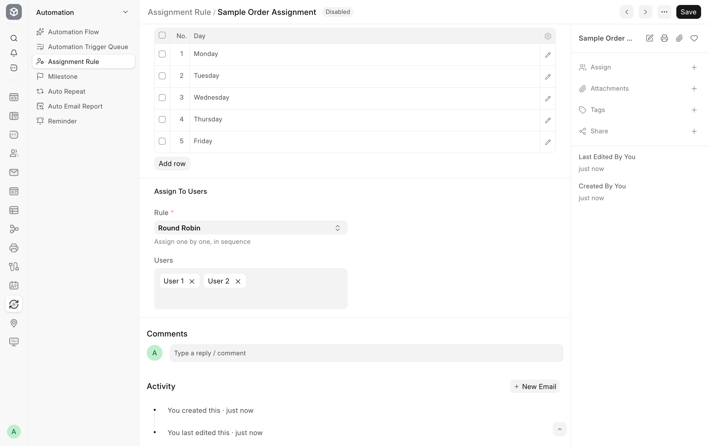

# Automation

Frappe has small, rule-based tools that act on documents without code. This page covers Assignment Rule, Auto Repeat, Reminder, Milestone Tracker, Document Naming Rule and Document Naming Settings. For multi-step flows with triggers and actions, see [Automation Flow](automation-flow.md).

## Assignment Rule

An Assignment Rule assigns a document to a user when a condition is true. The assignment is a `ToDo`, the same as a manual assignment. Use it to share incoming work in a team.

1. Go to `/desk/assignment-rule/new`.
2. Enter a name, and select the **Document Type**.
3. Enter the **Assign Condition**.
4. Select the **Rule** and add **Users**.
5. In **Assignment Days**, add the days the rule is active.
6. Save.



| Field | Description |
|---|---|
| Document Type | The DocType to assign. `ToDo` is not allowed. |
| Priority | Rules with a higher priority are tried first. |
| Disabled | Stop the rule. |
| Description | The ToDo text. Jinja with the document fields, for example `{{ name }}`. Default "Automatic Assignment". |
| Assign Condition | Python expression. Assign when true. Example: `status == "Open"`. |
| Unassign Condition | Python expression. Remove the assignment made by this rule when true. |
| Close Condition | Python expression. Close the open ToDos of the document when true. |
| Rule | `Round Robin`, `Load Balancing`, `Based on Field` or `Weighted Distribution`. |
| Users | The users for Round Robin and Load Balancing. |
| Field | For Based on Field: a field that holds a user or the email address of a user. |
| Users (`weighted_users`) | For Weighted Distribution: users with a **Weight**. |
| Due Date Based On | A date field. Its value becomes the ToDo date, and the ToDo date follows it when it changes. |
| Assignment Days | The rule runs only on these weekdays. |

Conditions use the document fields by name, without `doc.`.

How the rules choose a user:

- **Round Robin**: the next user in the list after the last one assigned.
- **Load Balancing**: the user with the fewest open ToDos for this DocType.
- **Based on Field**: the user in the selected field.
- **Weighted Distribution**: users in turn, in proportion to their weight. A user with weight 2 gets two documents for each one a user with weight 1 gets.

Frappe runs the rules after each save, cancel and update after submit. It tries the unassign conditions first. It assigns only when the document has no assignment from these rules, and stops at the first rule that assigns. If an expression has an error, Frappe shows "Auto assignment failed" and saves the document.

To apply the rules to existing documents, select them in the list view and use **Actions** > **Apply Assignment Rule**.

## Auto Repeat

Auto Repeat makes a copy of a document on a schedule, for example a monthly order. The DocType must allow it.

1. Open **Customize Form** for the DocType.
2. Select **Allow Auto Repeat** and save. Frappe adds an `auto_repeat` field to the DocType.
3. Open the document to repeat.
4. Select **Repeat** from the menu.
5. Enter the **Frequency** and **Start Date** in the dialog, and confirm.

You can also create the record at `/desk/auto-repeat/new` and select the **Reference Document Type** and **Reference Document**.

| Field | Description |
|---|---|
| Start Date / End Date | The schedule period. End Date cannot be today or the start date. |
| Frequency | `Daily`, `Weekly`, `Fortnightly`, `Monthly`, `Quarterly`, `Half-yearly` or `Yearly`. |
| Repeat on Days | Weekdays, for `Weekly`. |
| Repeat on Day / Repeat on Last Day of the Month | The day of the month, for monthly and longer frequencies. |
| Next Schedule Date | The date of the next copy. Read only. |
| Submit on Creation | Submit each new copy. Only for submittable DocTypes. |
| Assignee / Generate Separate Documents For Each Assignee | Assign the copy to these users, or make one copy for each user. |
| Notify by Email | Email the **Recipients** with **Subject** and **Message**, or an Email **Template**. |
| Attach Print / Print Format | Attach a PDF of the new document. |
| Status | `Active`, `Disabled` or `Completed`. Set by Frappe. |

A daily job (`make_auto_repeat_entry`) makes the copies in the background. Each copy keeps the field values of the reference document, except fields marked **No Copy**. Required Date fields get the schedule date. A document can be linked to only one Auto Repeat.

## Reminder

A Reminder is a personal note that appears as a notification at a time you choose.

1. Open a saved document.
2. Select **Remind Me** from the menu, or press <kbd>Shift</kbd>+<kbd>R</kbd>.
3. Select **Remind Me In** (30 minutes, 1 hour, 4 hours, 1 day, or custom).
4. Enter a **Description** and click **Create**.

Frappe checks reminders every 15 minutes and creates a `Notification Log` for the user. The time cannot be in the past. Reminders more than one hour late are not sent.

## Milestone Tracker

A Milestone Tracker records each change of one field, for example the `status` of an order. Each change makes a `Milestone` record with the document, the field and the new value.

1. Go to `/desk/milestone-tracker/new`.
2. Select the **Document Type to Track** and the **Field to Track**.
3. Save.

Open `/desk/milestone` to see the records. Use them in reports, for example to count how many orders reached "Completed" each week.

## Document Naming Rule

A Document Naming Rule gives a document a name from a prefix and a counter, when the document matches conditions. Use it to name documents of one type by category, for example `HW-2026-001` for hardware items.

| Field | Default | Description |
|---|---|---|
| Document Type | | The DocType to name. |
| Prefix | | The name before the counter. It can use naming series parts such as `.YYYY.`, `.MM.` and `{fieldname}`. |
| Digits (`prefix_digits`) | 5 | The length of the counter, padded with zeros. |
| Conditions | | Field, operator (`=`, `!=`, `>`, `<`, `>=`, `<=`) and value. All must match. |
| Priority | 0 | Higher priority rules are tried first. |
| Disabled | 0 | Stop the rule. |

Frappe tries the rules before the `autoname` method and the DocType naming option. The first matching rule sets the name. The counter is kept per resolved prefix in the `Series` table, so `HW-2026-` and `HW-2027-` count on their own.

```text
Prefix: HW-.YYYY.-    Digits: 3    Condition: category = Hardware
Result: HW-2026-001
```

Naming rules do not apply to Single DocTypes, log DocTypes, or DocTypes with `autoincrement` or `UUID` naming. An amended document uses the rules only when its amendment naming is `Default Naming`.

## Document Naming Settings

Go to `/desk/document-naming-settings`. This page has two parts.

**Naming Series** (for DocTypes that use a `naming_series` field):

1. Select the DocType in **Select Transaction**.
2. Edit **Series List for this Transaction**, one series on each line.
3. Select **User must always select** to make the user pick a series.
4. Click **Update**.
5. To change a counter, select a **Prefix**, enter the **Current Value** and click **Update Series Number**.

Enter a series in **Try a Naming Series** to see a preview of the names.

**Amended Documents**: an amended document gets a name from the cancelled one.

| Option | Result |
|---|---|
| `Amend Counter` (default) | `SO-00001` becomes `SO-00001-1`, then `SO-00001-2`. |
| `Default Naming` | The amended document gets a new name from the normal naming rules. |

Set **Default Amendment Naming**, and override it per DocType in **Amendment Naming Override**. Then click **Update Amendment Naming**.

## For developers

- Assignment Rule runs from `doc_events` for `*` in `frappe/hooks.py`: `assignment_rule.apply` and `assignment_rule.update_due_date`.
- Auto Repeat calls `on_recurring(reference_doc, auto_repeat_doc)` on the new document before insert. Define it in your controller to change the copy.
- Set `allow_auto_repeat` in the DocType JSON to allow Auto Repeat without Customize Form.
- Create a reminder from code: `frappe.automation.doctype.reminder.reminder.create_new_reminder(remind_at, description, reminder_doctype=None, reminder_docname=None)`.
- Add your own naming series parts with the `naming_series_variables` hook. See [Naming](../../developer-guide/data-model/naming.md).

## Related

- [Automation Flow](automation-flow.md)
- [Collaboration](../basics/collaboration.md)
- [Customize Form](../customization/customize-form.md)
- [Naming](../../developer-guide/data-model/naming.md)
