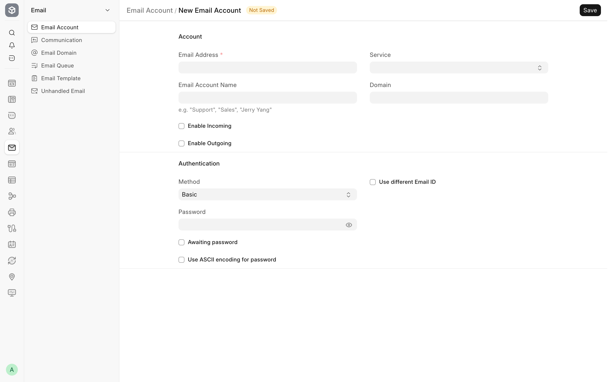

# Email

Frappe sends and receives email through Email Accounts. Every outgoing email first goes to the Email Queue, and a scheduler job sends it. Use this page to connect a mailbox, check sent and failed emails, reuse message text, and email reports on a schedule.

## Concepts

| DocType | Purpose |
|---|---|
| `Email Account` | One mailbox. It can send (SMTP), receive (IMAP or POP3), or both. |
| `Email Domain` | Server settings shared by all accounts of one domain. |
| `Email Queue` | One outgoing email and its status. |
| `Email Template` | A reusable subject and body with Jinja. |
| `Auto Email Report` | A report that Frappe emails on a schedule. |
| `Email Unsubscribe` | An address that does not want more email for one document, or for all email (`global_unsubscribe`). |
| `Communication` | A sent or received email linked to a document. It shows in the form timeline. |

## Email Account

Go to `/app/email-account/new`.



1. Enter the **Email Address**.
2. Select a **Service** (`GMail`, `Sendgrid`, `SparkPost`, `Yahoo Mail`, `Outlook.com` or `Yandex.Mail`) or a **Domain**. Use one, not both. A service or domain fills in the server settings.
3. Select the **Method**: `Basic` (password) or `OAuth` (a `Connected App`).
4. Enter the password, or authorize API access for OAuth.
5. Select **Enable Outgoing**, **Enable Incoming**, or both.
6. Save.

### Outgoing (SMTP)

| Field | Default | Description |
|---|---|---|
| Outgoing Server / Port | | SMTP host and port. |
| Use TLS / Use SSL | 0 | Connection security. |
| Default Outgoing | 0 | Send system emails and notifications from this account. |
| Always use this email address as sender address | 0 | Replace the sender of every email with this address. |
| Always use this name as sender name | 0 | Use the account name as the sender name. |
| Send unsubscribe message in email | 1 | Add an unsubscribe link to emails sent from this account. |
| Track Email Status | 1 | Track if the recipient opened the email. |
| Disable SMTP server authentication | 0 | Send without login. |
| Always BCC Address | | Copy every email to this address. |
| Add Signature / Signature | 0 | Add a signature. |
| Footer Content | | Add a footer. |
| Brand Logo | | Logo for emails sent from this account. |

### Incoming (IMAP or POP3)

| Field | Default | Description |
|---|---|---|
| Incoming Server / Port | | IMAP or POP3 host. |
| Use IMAP | 0 | Use IMAP. When on, add folders in **IMAP Folder**. |
| Use SSL / Use STARTTLS | 0 | Connection security. |
| Append To | | Create or update a document of this DocType for each new email (POP3). The DocType must allow it in its settings. |
| Default Incoming | 0 | Replies to system emails come to this inbox. |
| Email Sync Option | `UNSEEN` | `ALL` or `UNSEEN` (IMAP). |
| Initial Sync Count | 250 | Emails to fetch on the first sync (IMAP). |
| Attachment Limit (MB) | | Skip larger attachments. |
| Create Contacts from Incoming Emails | 1 | Make a `Contact` for new senders. |
| Enable Automatic Linking in Documents | 0 | Link emails to the documents named in the recipient address. |
| Notify if unreplied | 0 | Email the addresses in **Send Notification to** when an email has no reply after **Notify if unreplied for (in mins)** (default 30). |
| Enable Auto Reply | 0 | Reply to every new email with **Auto Reply Message**. |
| Append Emails to Sent Folder | 0 | Save a copy of sent emails in the IMAP sent folder (**Sent Folder Name**). |

Frappe pulls incoming email every 10 minutes. Click **Pull Emails** on a saved account to pull now.

Without an Email Account record, Frappe can send email with the SMTP settings in `site_config.json` (`mail_server`, `mail_port`, `mail_login`, `mail_password`, `use_tls`, `auto_email_id`, `email_sender_name`). See [Site Config](../../reference/configuration/site-config.md).

## Email Domain

Create an `Email Domain` when many accounts use the same mail server. Enter the **Domain Name**, the incoming and outgoing servers, ports and security options. Then select this domain in each Email Account.

## Email Queue

Go to `/app/email-queue`. Each row is one email with a status: `Not Sent`, `Sending`, `Sent`, `Partially Sent` or `Error`.

- Frappe sends queued emails on every scheduler run (`frappe.email.queue.flush`). It takes up to 500 emails each time, highest priority first. Set `email_queue_batch_size` in site config to change this.
- An email in `Sending` for more than 15 minutes is retried, up to the **Email Retry Limit** in System Settings (default 3).
- Open an email and click **Send Now** to send it now. Click **Retry Sending** on a failed email.
- In the list, select failed emails and use **Actions** > **Retry Sending**.
- A System Manager can click **Suspend Sending** in the list to stop all sending, and **Resume Sending** to start again.

Emails are not sent when `mute_emails` is set in site config.

## Email Template

An Email Template holds a **Subject** and a **Response**. Both are Jinja templates. Select **Use HTML** to write the body as HTML code.

The document fields are available by name:

```jinja
Order {{ name }} for {{ customer_name }} is ready.
```

Use a template in these places:

- The email dialog of a form: select it in the **Email Template** field.
- A Workflow state, in **Next Action Email Template**.
- An Auto Repeat, in **Template**.

## Auto Email Report

An Auto Email Report emails the output of a report on a schedule. To create one, open a report and select **Setup Auto Email** from the menu, or go to `/app/auto-email-report/new`.

| Field | Default | Description |
|---|---|---|
| Report | | The report to send. |
| Based on Permissions For User (`user`) | current user | Run the report as this user. |
| Email To | | Addresses, one on each line. |
| Frequency | | `Daily`, `Weekdays`, `Weekly` or `Monthly`. |
| Day of Week | Monday | For `Weekly`. |
| Format | | `HTML`, `XLSX` or `CSV`. |
| Send only if there is any data | 1 | Skip empty reports. |
| No of Rows | 100 | Row limit for Report Builder reports. |
| Only Send Records Updated in Last X Hours | | Report Builder reports. 0 means all records. |
| Filters | | Filters for Query and Script reports. |
| From Date Field / To Date Field / Period | | Set date filters to the current period. |
| Sender | | The Email Account to send from. |
| Message (`description`) | | Text above the report in the email. |

Click **Download** to get the file now, or **Send Now** to send it now. A user can have up to 20 enabled reports. Change this with **Max auto email report per user** in System Settings.

## Unsubscribe

When **Send unsubscribe message in email** is on, emails get an unsubscribe link. When a recipient clicks it, Frappe creates an `Email Unsubscribe` record for that address and document. Frappe then skips that address for emails about the same document. A record with **Global Unsubscribe** skips the address for all emails.

## For developers

- Send email from code with `frappe.sendmail(...)`. It adds rows to the Email Queue. See [Email and Notifications](../../developer-guide/output/email-and-notifications.md).
- Render a template from code: `frappe.get_doc("Email Template", name).get_formatted_email(doc)` returns `{"subject", "message"}`.
- Add your DocType to the **Append To** list: set `email_append_to` in the DocType JSON, or select **Allow document creation via Email** in Customize Form.
- Scheduler jobs in `frappe/hooks.py`: `frappe.email.queue.flush` (all), `email_account.pull` (every 10 minutes), `email_account.notify_unreplied` (every 15 minutes), `auto_email_report.send_daily` (daily), `auto_email_report.send_monthly` (monthly).

## Related

- [Notifications](notifications.md)
- [Reports](../data-and-reports/reports.md)
- [System Settings](../settings/system-settings.md)
- [Form View](../basics/form-view.md)
