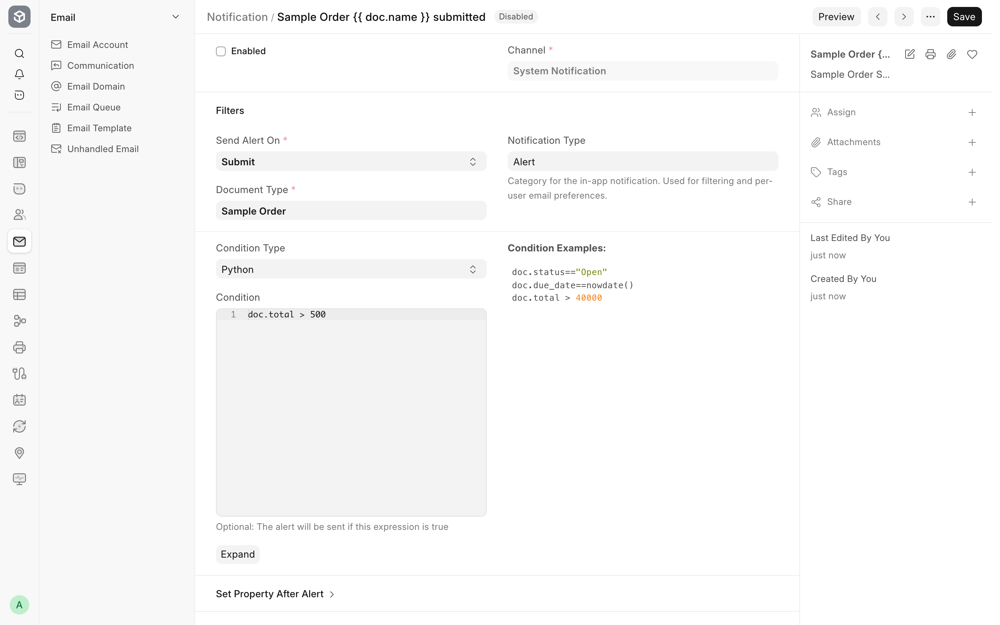

# Notifications

A Notification sends a message when something happens to a document: it is created, saved, submitted, cancelled, a field changes, or a date comes near. Use it to tell people about a document without code. The message can go by email, as an in-app (system) notification, by SMS, or to a chat service through a webhook.

## Concepts

| DocType | Purpose |
|---|---|
| `Notification` | The rule: which document, which event, which condition, who gets it, and the message. |
| `Notification Log` | One in-app notification for one user. It shows in the bell menu in the desk. |
| `Notification Settings` | Per-user preferences. The name of the record is the user. |
| `Notification Type` | A category for in-app notifications, for example `Alert`. Used for filters and email preferences. |
| `Notification Webhook URL` | A saved webhook for the Webhook channel. Services: Google Chat, Matrix (Hookshot), Mattermost, Rocket.Chat, Slack, Teams, Discord, Ntfy, Raven. |

## Create a notification

1. Go to `/desk/notification/new`.
2. Optional: enter a name. If you do not, Frappe uses the subject as the name.
3. Select the **Channel**.
4. Select the **Document Type** and **Send Alert On**.
5. Optional: add a condition.
6. Add rows in **Recipients**.
7. Enter the **Subject** and **Message**.
8. Make sure that **Enabled** is selected. It is on by default.
9. Save.



Use the **Preview** button to render the subject and message for an existing document and to check if it meets the condition.

## Channels

| Channel | Sends | Needs |
|---|---|---|
| Email | An email through the Email Queue. | An outgoing Email Account. Optional **Sender**. |
| System Notification | A `Notification Log` for each recipient user. | Recipients that resolve to users. |
| SMS | A text message through the SMS gateway. | SMS settings and recipients with a mobile number. |
| Webhook | The rendered message to a `Notification Webhook URL`. | **Notification Webhook URL**. Recipients are hidden. |

For the Email channel, select **Send System Notification** to also create an in-app notification.

!!! note "Version"
    The Slack channel is replaced by Webhook in develop. When a Notification with channel `Slack` is imported from a fixture or JSON file, Frappe changes it to `Webhook`.

## Events

| Send Alert On | When it runs |
|---|---|
| New | After a document is inserted (`after_insert`). |
| Save | After every save (`on_update`). |
| Submit | After submit (`on_submit`). |
| Cancel | After cancel (`on_cancel`). |
| Value Change | After save, when the field in **Value Changed** has a new value. Not on insert. |
| Method | When the controller method in **Trigger Method** runs, for example `before_insert`. |
| Days Before / Days After | Once a day, for documents whose **Reference Date** field is the given number of days from today. |
| Minutes Before / Minutes After | Every 5 minutes, for documents whose **Reference Datetime** is the given number of minutes away. The offset must be 10 minutes or more. |

Date-based events also work on child table DocTypes. Other events do not. You cannot create a notification on `Email Queue`.

## Conditions

Set **Condition Type** to one of these:

- `Python`: an expression in **Condition**. The notification is sent only when it is true.
- `Filters`: build the condition with the filter editor. Frappe stores it as JSON in `filters`.

The Python expression gets `doc`, `nowdate` and a safe `frappe` object.

```python
doc.status == "Open" and doc.total > 500
```

## Recipients

Each row in **Recipients** can add people in these ways:

| Field | Description |
|---|---|
| Receiver By Document Field | `owner`, or a field of the document (or of a child table) that holds a user, an email address or a mobile number. |
| Receiver By Role | All users with this role. |
| CC / BCC | Email addresses, one on each line. Jinja is allowed. Email channel only. |
| Condition | A Python expression. The row is used only when it is true. |

Select **Send To All Assignees** to also email every user the document is assigned to (Email channel).

## Message

**Subject** and **Message** are Jinja templates. The context has `doc`, `nowdate`, `frappe` and `comments` (the latest comments and communications on the document).

```jinja
<h3>Order {{ doc.name }}</h3>
<p>{{ doc.customer_name }} placed an order of {{ doc.total }}.</p>
```

For the Email channel, you can select an **Email Template** instead of a subject and message. Email Template content uses field names directly, for example `{{ name }}`, not `{{ doc.name }}`.

Other options:

| Field | Description |
|---|---|
| Attach Print / Print Format | Attach a PDF of the document. |
| Attach Files | `From Field` (one Attach field) or `All` (all attachments). |
| Set Property After Alert / Value To Be Set | Set a field on the document after the notification is sent. |
| Notification Type | The type of the in-app notification. Default `Alert`. |

## Notification Log and the bell menu

Each in-app notification is a `Notification Log` for one user (`for_user`). The bell icon in the desk lists them. A user can only read their own logs. Frappe does not create a log when the recipient is the user who made the change, except for types in the `notification_self_notify_types` hook (`Alert` in Frappe).

When a log is created, Frappe also emails it to the user if the user has email notifications on for that type. Types in the `notification_skip_email_types` hook (`Alert` in Frappe) do not send this extra email, because the Notification rule sends its own email.

## Notification Settings

Each user can open their settings from the gear icon in the bell menu, or at `/desk/notification-settings/<user>`.

| Field | Default | Description |
|---|---|---|
| Enable System Notification (`enabled`) | 1 | Turn off all in-app notifications for this user. |
| Enable Email Notifications | 1 | Receive notification emails. |
| Email me for these notification types | | Types that send an email. |
| Mentions / Assignments / Document Share / Event Reminders | 1 | Email for these events. |
| Email Threads on Assigned Document | 1 | Email when a reply arrives on a document assigned to you. |
| Open Documents (`subscribed_documents`) | | DocTypes to follow in the notifications panel. |

## Pitfalls

- Notifications do not run during data import with emails muted, during patches, or during install.
- If the **Value Changed** field is removed from the DocType, Frappe disables the notification and logs an error.
- A Standard notification (`is_standard`) can only be edited in developer mode. To change one, disable it and duplicate it.
- An error in the template stops the save that triggered it, with "Error in Notification".

## For developers

- Ship a notification with an app: set **Is Standard** and a **Module** in developer mode. Frappe exports it to `<module>/notification/<name>/` with the JSON, the message file (`.md`, `.html` or `.txt` by **Message Type**) and a `.py` file with `get_context(context)`.
- Send a notification from code: `frappe.get_doc("Notification", name).queue_send(doc)`. It runs in a background job after commit.
- `trigger_daily_alerts` (daily) and `trigger_offset_alerts` (every 5 minutes) run from `scheduler_events` in `frappe/hooks.py`.
- Create an in-app notification from code with `enqueue_create_notification(users, doc_dict)` in `frappe/desk/doctype/notification_log/notification_log.py`.
- See [Email and Notifications](../../developer-guide/output/email-and-notifications.md) for the developer guide.

## Related

- [Email](email.md)
- [Workflow](../customization/workflow.md)
- [Automation](automation.md)
- [Collaboration](../basics/collaboration.md)
