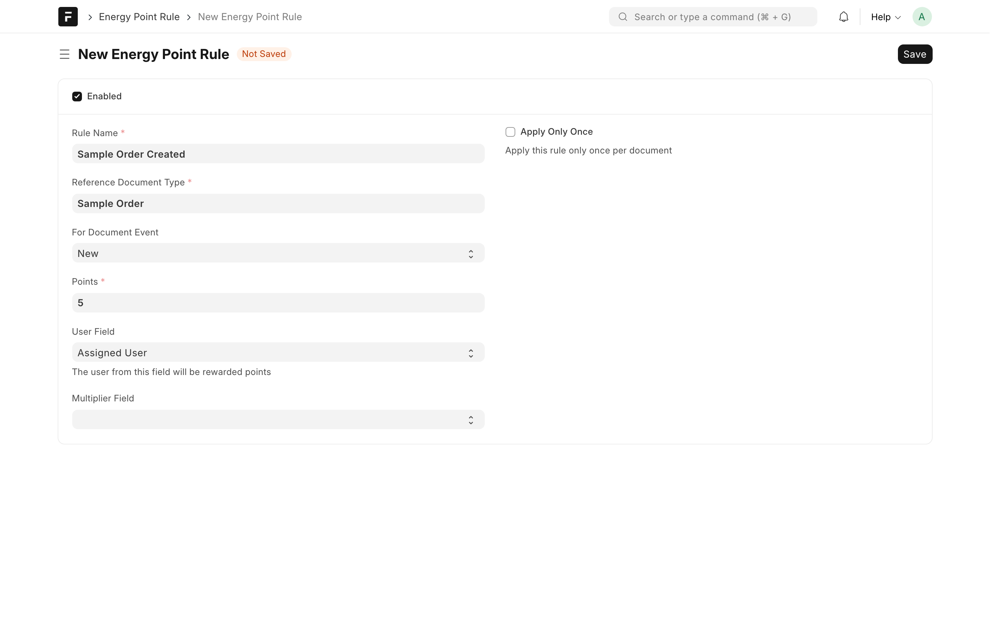

# Collaboration

The desk has tools to work on documents with other users. Assign a document to a user, share it, comment on it, mention users, follow it, tag it and give energy points. Each action can send a notification. Most tools are in the [form](form-view.md) sidebar and timeline. Some also work on many documents from the [list view](list-view.md).

## Assignments

An assignment gives a document to a user as a task. Each assignment is a `ToDo` document for that user.

To assign a document:

1. Open the document.
2. In the sidebar, click **+** next to **Assigned To**.
3. In **Assign To**, select one or more users. Select **Assign to me** to add yourself. Select a user group in **Assign To User Group** to add all its users.
4. Optional: set **Complete By**, **Priority** (**Low**, **Medium** or **High**) and a **Comment**.
5. Click **Add**.

To assign many documents, select them in the list view and click **Actions** > **Assign To**.

When you assign a document, Frappe:

- Creates a `ToDo` with `allocated_to`, `reference_type`, `reference_name`, `description`, `priority` and `date`. The default description is "Assignment for <DocType> <name>".
- Adds the user to the `_assign` field of the document. The list view shows the user's avatar on the row.
- Shares the document with the user (read only) if the user cannot read it. If document sharing is turned off in System Settings, it shows an error.
- Sends an `Assignment` notification to the user.
- Makes the user follow the document if **Auto follow documents that are assigned to you** is on for the user.

If the user already has an open ToDo for the document, Frappe does not make a second one.

Click the assigned users under **Assigned To** to open the assignments dialog. In this dialog:

- Click the check icon (**Done**) next to your own assignment to complete it. This sets the ToDo to `Closed`. Only the assignee can do this.
- Click the cross icon (**Cancel**) to remove an assignment. You can remove your own assignment, or any assignment if you can write the document. This sets the ToDo to `Cancelled`.

In the list view, **Actions** > **Clear Assignment** removes all assignments of the selected documents.

### The ToDo list

Open the **ToDo** list to see your assignments. A user without a ToDo role permission sees only ToDos allocated to, assigned by or created by them.

Calendar and Kanban views are also available for ToDo. Refer to [Views](views.md).

!!! note "For developers"
    Assign from code with `frappe.desk.form.assign_to.add({"assign_to": ["user1@example.com"], "doctype": "Sample Order", "name": "SO-00001", "description": "Check the items"})`. Remove with `frappe.desk.form.assign_to.remove(doctype, name, assign_to)`. If the DocType has a field named `assigned_to`, Frappe also sets it. Use an [Assignment Rule](../automation/automation.md) to assign documents automatically.

## Sharing

Sharing gives one user access to one document, even if the user's role has no access to the DocType.

1. Open the document.
2. In the sidebar, click **+** next to **Share**.
3. Under **Share this document with**, select a user.
4. Select the rights: **Can Read**, **Can Write**, **Can Submit** and **Can Share**.
5. Click **Add**.

Use the **Everyone** row to share the document with all users. You can share only if you have the share right on the document. The user gets a `Share` notification.

Each share is a `DocShare` document. A System Manager can turn off sharing for the site in System Settings (`disable_document_sharing`).

!!! note "For developers"
    Share from code with `frappe.share.add(doctype, name, user, read=1, write=0, submit=0, share=0, everyone=0, notify=0)`. Read shares with `frappe.share.get_users(doctype, name)`. Refer to [Permissions](../../developer-guide/security/permissions.md).

## Comments and mentions

Every user who can read a document can comment on it.

1. Type in the comment box below the form.
2. To mention a user, type `@` and select the user.
3. Click **Comment**.

The comment shows in the activity of the document. You can edit your own comments. Administrator can edit all comments. The comment owner and a System Manager can also delete (if they can delete `Comment`) and publish or unpublish a comment.

A mentioned user gets a `Mention` notification. A user gets mentions only if **Allowed In Mentions** is on for the user and the user is an enabled System User.

!!! note "For developers"
    A comment is a `Comment` document with `comment_type` = `Comment`. The desk calls `frappe.desk.form.utils.add_comment`. Mentions are handled by `frappe.desk.notifications.notify_mentions`.

## Likes

Click the heart in the form sidebar or on a list row to like a document. Click it again to remove the like. The list view header has a heart that shows only the documents you liked. Likes are stored in the `_liked_by` field and show in the activity.

## Follow

Follow a document to get emails about its changes.

1. Turn on **Send Notifications For Documents Followed By Me** in your User, in the **Document Follow** section.
2. Select a **Frequency**: **Hourly**, **Daily** or **Weekly**.
3. Open a document and click **Follow** in the form sidebar.

The **Follow** link shows on every form, but a follow is saved only for DocTypes with **Track Changes**, and only for users who turned on step 1. Administrator cannot follow documents. Each follow is a `Document Follow` document. Click **Unfollow** to stop.

You can also follow documents automatically. Turn on these options in your User:

- **Auto follow documents that you create**
- **Auto follow documents that you comment on**
- **Auto follow documents that you Like**
- **Auto follow documents that are shared with you**
- **Auto follow documents that are assigned to you**

!!! note "For developers"
    The scheduler sends the follow emails with `frappe.desk.form.document_follow.send_hourly_updates`, `send_daily_updates` and `send_weekly_updates`. Follow from code with `frappe.desk.form.document_follow.follow_document(doctype, doc_name, user)`.

## Tags

A tag is a label on a document, for example `urgent`.

- In the form sidebar, click **+** next to **Tags** and type a tag.
- In the list view, select documents and click **Actions** > **Add Tags**.

To find tagged documents, type `#` and the tag in the awesomebar, or use the **Tags** dropdown in the list sidebar. To show tags on list rows, click **Show Tags** in the list sidebar.

Tags are stored in the `_user_tags` column of the document, and in `Tag` and `Tag Link` documents.

## Energy points

Energy points reward users for work on documents. Rules give points automatically. Users with review points can also give or take points by hand. Energy points are off by default.

### Turn on energy points

1. Open **Energy Point Settings**.
2. Select **Enabled**.
3. Optional: add rows to **Review Levels**. Each row has a **Level Name**, a **Role** and **Review Points**.
4. Set **Point Allocation Periodicity**: **Daily**, **Weekly** (default) or **Monthly**.
5. Save.

A daily job (`allocate_review_points`) gives each user with a review level role the **Review Points** of that level, once per period. A user with more than one level gets the highest value. Administrator gets no review points.

### Energy Point Rule

An `Energy Point Rule` gives points when a document event happens. Only a System Manager can make rules.

| Field | Label | Description |
|---|---|---|
| `enabled` | Enabled | Default 1. |
| `rule_name` | Rule Name | The name of the rule. Required. |
| `reference_doctype` | Reference Document Type | The DocType to watch. Required. |
| `for_doc_event` | For Document Event | `New`, `Submit`, `Cancel`, `Value Change` or `Custom` (default). |
| `field_to_check` | Field To Check | For `Value Change`: the field that must change. |
| `condition` | Condition | For `Custom` and `Value Change`: a Python expression on `doc`, for example `doc.status == "Closed"`. |
| `points` | Points | Points to give. Required. |
| `user_field` | User Field | The field that holds the user who gets the points, for example `owner_user`. |
| `for_assigned_users` | Allot Points To Assigned Users | Gives the points to all assigned users in place of the user field. Not for `New`. |
| `multiplier_field` | Multiplier Field | A number field. Points are multiplied by its value. |
| `max_points` | Maximum Points | The upper limit when a multiplier is set. |
| `apply_only_once` | Apply Only Once | Gives points only once per document and user. |

Rules run on the `on_change` event of every document (`doc_events` in `frappe/hooks.py`), but not during install, migrate, patches or data import. Administrator and disabled users get no points. When a submitted document is cancelled, Frappe reverts the `Auto` points of that document.

You cannot delete a rule that has logs. Clear **Enabled** instead.

### Energy Point Log

Each change of points is an `Energy Point Log` document with `user`, `type`, `points`, `reason`, `rule`, `reference_doctype` and `reference_name`. The types are:

| Type | Made by |
|---|---|
| `Auto` | An Energy Point Rule. |
| `Appreciation` | A user who gives review points. Adds points. |
| `Criticism` | A user who gives review points. Removes points. |
| `Review` | The review point allocation, or the use of review points. |
| `Revert` | A System Manager who reverts an `Auto` log, or the cancel of a submitted document. |

The user gets an `Energy Point` notification for each log, except `Review` logs. Weekly and monthly summary emails are sent by scheduled jobs.

### Review a document

When energy points are on, a saved form shows **Reviews** in the sidebar.

1. Click **+** next to **Reviews**.
2. In **To User**, select a user. Only users involved in the document are listed.
3. In **Action**, select **Appreciate** or **Criticize**.
4. Type the **Points** and a **Reason**.
5. Click **Submit**.

The points come from your review points. If you do not have enough review points, Frappe shows a message and makes no log.

### Leaderboard

Open `/app/leaderboard` to see the users with the most energy points. Select a **Timespan**, for example **This Week**, **This Month** or **All Time**. The `User` leaderboard sums the energy points of enabled System Users, without `Review` logs.

!!! note "For developers"
    Add leaderboards with the `leaderboards` hook. It points to a function that returns a dict keyed by DocType, for example `{"User": {"fields": ["points"], "method": "frappe.desk.leaderboard.get_energy_point_leaderboard", "company_disabled": 1, "icon": "users"}}`. Read a user's points with `frappe.social.doctype.energy_point_log.energy_point_log.get_energy_points(user)`. It returns `energy_points`, `review_points` and `given_points`.

## Activity

The **Activity** section of a form shows the history of the document: creation, changes, attachments, likes, assignments, emails and comments. Field changes show only if the DocType has **Track Changes**. Refer to [Form view](form-view.md#comments-and-activity).

## Notification log

Each notification for a user is a `Notification Log` document. The notification types are `Alert`, `Share`, `Assignment`, `Mention` and `Energy Point` (DocType `Notification Type`).

To read notifications:

1. Click the bell in the navbar.
2. Click a notification to open the document. This marks it as read.
3. Click the check icon to mark all as read.
4. Click **View Full Log** to open the **Notification Log** list.

### Notification settings

Click the gear icon in the notifications panel to open your **Notification Settings**.

| Field | Label | Default | What it does |
|---|---|---|---|
| `enabled` | Enable System Notification | 1 | Shows notifications in the desk. |
| `enable_email_notifications` | Enable Email Notifications | 1 | Also sends notifications by email. |
| `enable_email_mention` | Mentions | 1 | Emails for mentions. |
| `enable_email_assignment` | Assignments | 1 | Emails for assignments. |
| `enable_email_energy_point` | Energy Points | 1 | Emails for energy points. |
| `enable_email_share` | Document Share | 1 | Emails for shares. |
| `enable_email_event_reminders` | Event Reminders | 1 | Emails for event reminders. |
| `enable_email_threads_on_assigned_document` | Email Threads on Assigned Document | 1 | Emails for email threads on documents assigned to you. |
| `energy_points_system_notifications` | Energy Points | 1 | Shows energy point notifications in the desk. |

Refer to [Notifications](../automation/notifications.md) to send your own notifications with the `Notification` DocType.

## Related

- [Form view](form-view.md)
- [List view](list-view.md)
- [Notifications](../automation/notifications.md)
- [Automation](../automation/automation.md)
- [Permissions](../users-and-permissions/permissions.md)
- [Email](../automation/email.md)
