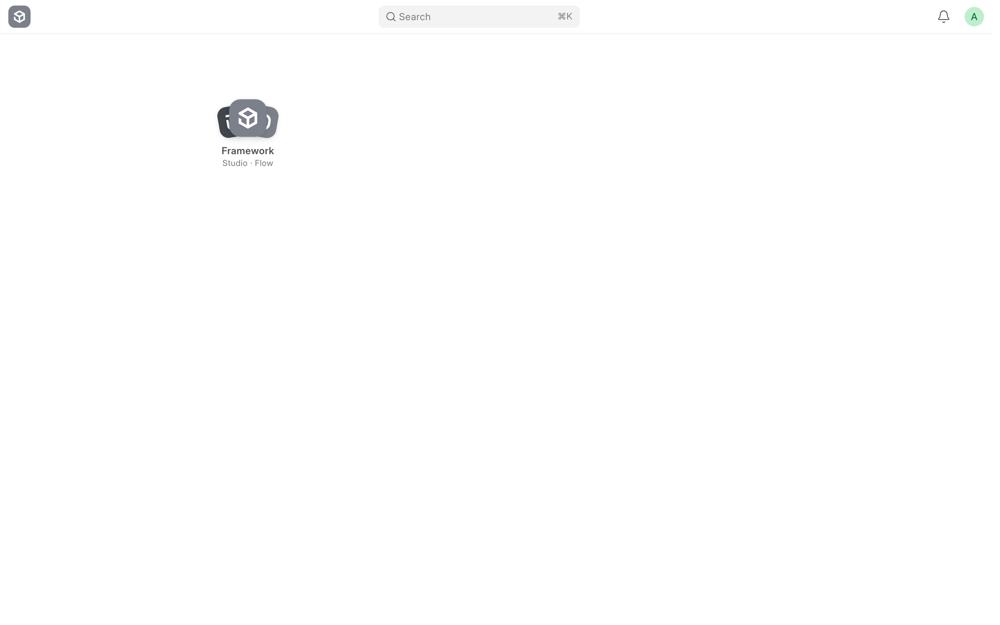
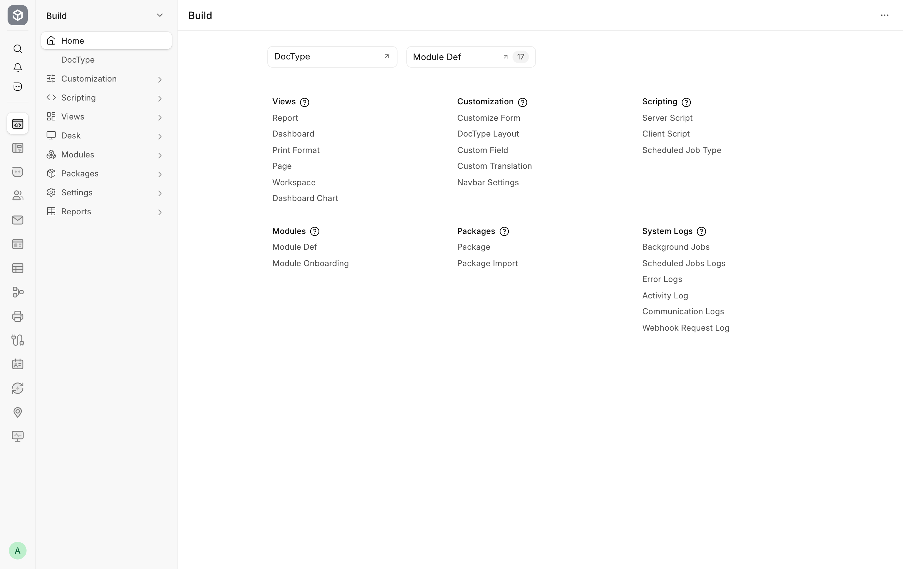
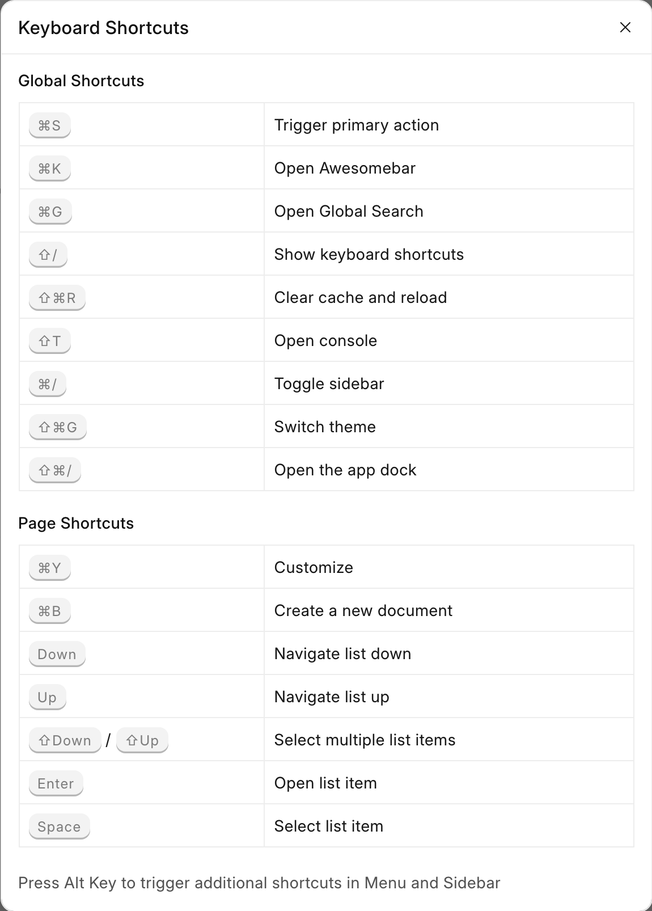

# Desk

The desk is the back-office user interface of a Frappe site. System Users use it to read, create and change documents. It opens at `/desk`. Use this page to learn the parts of the desk screen and how to move between them.

## Log in

1. Open `<site>/login` in the browser.
2. Type your email (or username) and password.
3. Click **Login**.

After login, a System User goes to `/desk`. A default app, a role home page or a default workspace can change this target. A Website User does not get desk access and goes to the website instead. The logic is in `frappe/auth.py` (`LoginManager.set_user_info`).

## The apps screen

`/desk` shows the apps screen. It has one icon for each installed app that you can open. On a site with only Frappe installed, there is one icon: **Framework**. The text under the icon names the other apps in the same group: **Studio** and **Flow**.

The top bar of the apps screen has:

- **Search** with the <kbd>Ctrl</kbd>+<kbd>K</kbd> hint. It opens the [awesomebar](search.md).
- The notification bell.
- Your avatar. Click it to open a menu with **My Settings**, **Toggle Theme**, **About**, **Frappe Support** and **Logout**.

Click an app icon to open the app at its landing page.

!!! note "For developers"
    An app adds its icon with the `add_to_apps_screen` hook in `hooks.py` (keys `name`, `logo`, `title`, `route`, `has_permission`). The Single DocType `Desktop Settings` has the field `desktop_page` (`Apps` or `Desktop Icons`). It selects which grid `/desk` shows. Apps add items to the avatar menu with `frappe.pages["desktop"].desktop_page.add_menu_item({label, icon, onclick, order})`. See [Workspaces, sidebar and dock](../../developer-guide/desk-ui/workspaces-sidebar-dock.md).

## Desk layout

Inside an app, the screen has three columns.

| Part | Where | What it does |
|---|---|---|
| Dock | Narrow column on the far left | Switches between the modules of the current app. Also holds search, notifications, Flow, background tasks and your user menu. |
| Sidebar | Column next to the dock | Shows the links of the current module: a workspace (**Home**), DocTypes, reports and pages, grouped in sections. |
| Page | Main area | Shows the workspace, list, form, report or page that you opened. |

### Dock

The dock has three groups of buttons:

1. Utilities at the top: **Search**, **Notifications**, **Flow** (only if you can use Flow) and **Background Tasks** (only while a background task runs).
2. One tile for each module of the current app, for example **Build**, **Users**, **Email** and **Printing**.
3. Your avatar at the bottom. It opens the user menu.

The dock has two modes. Set the mode in **My Settings** > **Appearance** > **Dock**.

| Mode | Behavior |
|---|---|
| Pinned (default) | The dock is always visible as a column. |
| Floating | The dock is hidden. Move the pointer to the left edge of the window to show it. |

Press <kbd>Ctrl</kbd>+<kbd>Shift</kbd>+<kbd>/</kbd> to open the dock from the keyboard. To change the order of the tiles, drag a tile, or select **Manage Dock** in the user menu.

### Sidebar

The sidebar header shows the name of the current module. Click the header to open its menu:

| Item | What it does |
|---|---|
| **All apps** | Goes back to the apps screen at `/desk`. |
| **Edit Sidebar** | Opens the sidebar editor. You can add, remove and move items. |
| **Help** | Shows the help links for the current page and the help items of the site. |

When the dock is not available, the menu also shows **Modules** and **Apps** to switch module or app. Items from **Navbar Settings** also show in this menu.

Click a section name in the sidebar to expand it. Press <kbd>Ctrl</kbd>+<kbd>/</kbd> to collapse or expand the sidebar.

### Workspaces

A workspace is a page with shortcuts, link cards, charts and number cards. The **Home** item at the top of a module sidebar opens the workspace of that module, for example `/desk/build`.

Click the **...** button at the top right of a workspace to open the workspace menu:

| Item | Shows when | What it does |
|---|---|---|
| **Edit** | You can edit this workspace | Makes the blocks editable. Drag blocks to move them. |
| **New** | You can create workspaces | Creates a new workspace. |
| **Manage** | You can manage at least one workspace | Opens the workspace manager. |
| **Reset to Standard** | The workspace was customized and you have access | Removes the customizations. |

A new workspace has an **Access** setting: **Only to you**, **To a group of users** or **To everyone**. Only a user with the `Workspace Manager` role can make a workspace for a group or for everyone. Private workspaces open at `/desk/private`. To show a **My Space** link to them in the user menu, turn on **Show My Space** in **My Settings**.

## Search

Click **Search** in the dock, or press <kbd>Ctrl</kbd>+<kbd>K</kbd>, to open the awesomebar. Type a DocType name, a report name or `new <DocType>`. Press <kbd>Ctrl</kbd>+<kbd>G</kbd> to open global search. Refer to [Search](search.md).

## Notifications

Click the bell in the dock to open the notifications panel. A dot on the bell shows that you have unread notifications.

The panel has two tabs:

- **All**: your notifications, for example assignments, mentions and shares.
- **Events**: your upcoming events.

At the top of the panel, click the gear icon to open your **Notification Settings**. Click the check icon to mark all notifications as read. Click **View Full Log** to open the **Notification Log** list. Refer to [Collaboration](collaboration.md#notification-log).

## User menu

Click your avatar at the bottom of the dock.

| Item | What it does |
|---|---|
| **My Space** | Opens your private workspaces. Shows only if **Show My Space** is on. |
| **My Settings** | Opens the settings dialog for your user. |
| **Manage Dock** | Opens the dock editor. Not shown on phones. |
| **Reload** | Clears the cache and reloads the desk. |
| **Logout** | Logs you out. |

### My Settings

**My Settings** opens a dialog with these tabs: **Profile**, **Email**, **Appearance**, **Preferences**, **Lists**, **Forms**, **Reports**, **Session Defaults** and **Keyboard Shortcuts**.

On **Appearance**, set the theme (light, dark or system), the form width (**Compact** or **Full Width**) and the dock mode. Press <kbd>Ctrl</kbd>+<kbd>Shift</kbd>+<kbd>G</kbd> to open the theme switcher from anywhere.

### Desk settings of a user

These check fields on the `User` DocType turn parts of the desk on or off for one user. A System Manager sets them in the **Desk Settings** section of the User form. The user can change some of them in **My Settings**.

| Field | Label | Default | Effect |
|---|---|---|---|
| `search_bar` | Show search bar | 1 | Shows the awesomebar. |
| `notifications` | Allow notifications | 1 | Shows the notification bell. |
| `show_my_space` | Show My Space | 0 | Shows **My Space** in the user menu. |
| `dock_mode` | Dock | Pinned | `Pinned` or `Floating`. |
| `bulk_actions` | Allow bulk actions | 1 | Shows bulk actions in list views. The server also checks it. |
| `view_switcher` | Show view switcher | 1 | Shows the view switcher in list views. |
| `form_sidebar` | Show sidebar | 1 | Shows the sidebar in forms. |
| `timeline` | Show timeline | 1 | Shows the activity timeline in forms. |
| `dashboard` | Show dashboard | 1 | Shows the connections dashboard in forms. |
| `form_navigation_buttons` | Show navigation buttons | 1 | Shows the previous and next buttons in forms. |
| `report_split_view` | Split view in reports | 1 | Uses the split view in reports. |

## Keyboard shortcuts

Press <kbd>Shift</kbd>+<kbd>/</kbd> (the <kbd>?</kbd> key) to see the shortcuts for the current page. On macOS, <kbd>Cmd</kbd> works in place of <kbd>Ctrl</kbd>.

These shortcuts work on every desk page:

| Shortcut | Action |
|---|---|
| <kbd>Ctrl</kbd>+<kbd>S</kbd> | Do the primary action of the page, for example **Save**. |
| <kbd>Ctrl</kbd>+<kbd>K</kbd> | Open the awesomebar. |
| <kbd>Ctrl</kbd>+<kbd>G</kbd> | Open global search. |
| <kbd>Shift</kbd>+<kbd>/</kbd> | Show keyboard shortcuts. |
| <kbd>Ctrl</kbd>+<kbd>Shift</kbd>+<kbd>R</kbd> | Clear cache and reload. |
| <kbd>Shift</kbd>+<kbd>T</kbd> | Open the System Console. Only for users who can write `System Console`. |
| <kbd>Ctrl</kbd>+<kbd>/</kbd> | Collapse or expand the sidebar. |
| <kbd>Ctrl</kbd>+<kbd>Shift</kbd>+<kbd>G</kbd> | Switch theme. |
| <kbd>Ctrl</kbd>+<kbd>Shift</kbd>+<kbd>/</kbd> | Open the app dock. |
| <kbd>Esc</kbd> | Close the open dialog or the open child table row. |

On a workspace page, type any letter to open the awesomebar with that letter.

Hold <kbd>Alt</kbd> to see underlined letters in menus and buttons. Press <kbd>Alt</kbd> and the letter to click that item. On macOS, this does not work while the cursor is in a text field.

Shortcuts for lists and forms are on [List view](list-view.md#keyboard-shortcuts) and [Form view](form-view.md#keyboard-shortcuts).

!!! note "For developers"
    Add a shortcut with `frappe.ui.keys.add_shortcut({shortcut, action, description, page, condition, ignore_inputs})` (`frappe/public/js/frappe/ui/keyboard.js`). Pass `page` to limit the shortcut to one page. Only shortcuts with a `description` show in the dialog. A menu item gets a shortcut through the `shortcut` argument of `page.add_menu_item()`.

## Related

- [List view](list-view.md)
- [Form view](form-view.md)
- [Search](search.md)
- [Collaboration](collaboration.md)
- [Workspaces, sidebar and dock](../../developer-guide/desk-ui/workspaces-sidebar-dock.md)
- [Users and roles](../users-and-permissions/users-and-roles.md)
