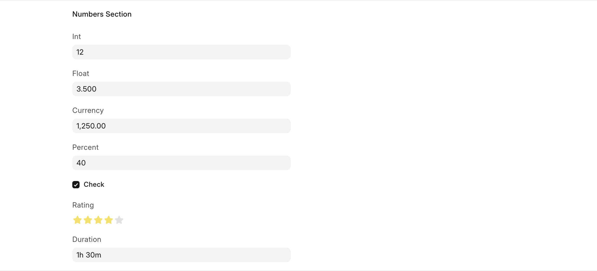
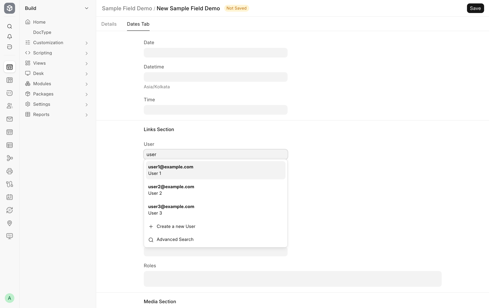
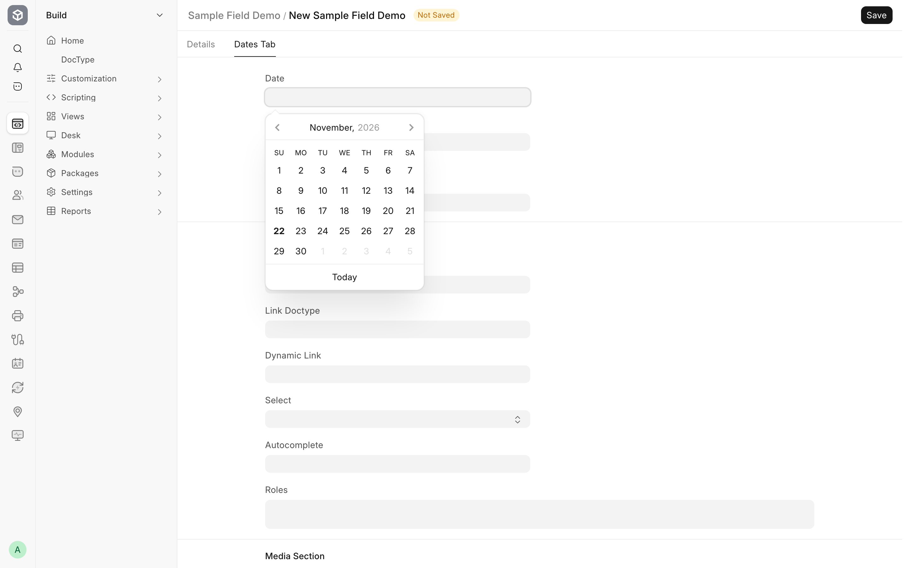
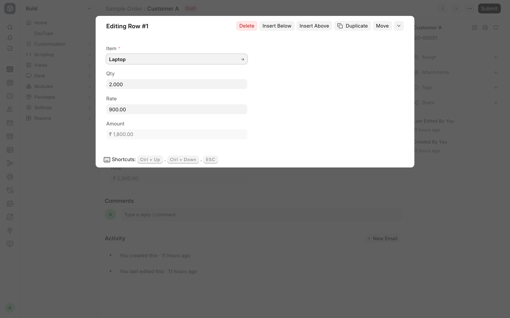

# Fields

A form shows the fields of a document. Each field has a type, and the type sets how you enter the value. This page tells you how to fill each kind of field. For the form itself (save, submit, tabs and sections), refer to [Form View](form-view.md).

## Field labels and states

| What you see | Meaning |
|---|---|
| Red `*` after the label | Mandatory field. If it is empty when you save, a **Missing Fields** message lists it, and the form does not save. |
| Gray text under the field | The description of the field. |
| Info icon after the label | Click it to see the description or a **View Documentation** link. |
| Value without an input box | The field is read-only. You cannot change it. |
| Field not shown | The field is hidden, or it shows only when another field has a value. |
| Red border | The value is not valid, for example a wrong email address. |

If System Settings has **Hide Empty Read-Only Fields** on (the default), read-only fields with no value are not shown.

Hold <kbd>Alt</kbd> and move the pointer over a field to see its fieldname.

## Text fields

- **Data**: Type one line of text. The field has a maximum length, usually 140 characters. If you paste a longer value, a **Data Clipped** message shows.
- **Data** with an email, phone, URL or name format: The field shows a red border if the value has the wrong format. A URL field shows an **Open Link** icon when the value is a valid URL.
- **Small Text**, **Text** and **Long Text**: Type more lines of text. Drag the bottom right corner to make the box taller.
- **Text Editor**: Use the toolbar to format text. It has headings, font size, bold, italic, underline, strikethrough, colors, quote, code block, text direction, link, image, lists, check lists, alignment, indent and tables.
- **Markdown Editor**: Type Markdown. Click **Preview** to see the result and **Edit** to go back.
- **Code**, **HTML Editor** and **JSON**: Type in a code editor.
- **Password**: The value shows as dots. A bar under the field shows the strength: **Weak**, **Average**, **Strong** or **Excellent**.

## Number fields

- **Int**: Type a whole number.
- **Float**, **Currency** and **Percent**: Type a number. After you leave the field, it shows in the number format of the system or the currency, for example `1,250.00`.
- **Check**: Click the box to turn it on or off.
- **Rating**: Click a star to set the rating. Click the left half of a star to set a half star.
- **Duration**: Click the field to open a small panel with **Days**, **Hours**, **Minutes** and **Seconds**. Type a number in each box. The field shows the total, for example `1h 30m`.

## Select fields

- **Select**: Click the field and select one option from the list.
- **Autocomplete**: Type to filter the options, then select one. Values that are not in the list are not kept.

## Link fields

A Link field stores the name of another document, for example a User.

1. Click the field. A dropdown shows documents you can select.
2. Type part of the name or title to filter the list.
3. Click a document, or use the arrow keys and press <kbd>Enter</kbd>.

At the end of the dropdown:

- **Create a new ...** opens a new document of the linked type. This shows only if you can create that type. After you save it, the new document is set in the field.
- **Advanced Search** opens a dialog with filters to find the document.
- Gray text shows the filters that limit the list, if the field has filters.

When the field has a value, move the pointer over it. An arrow icon (**Open Link**) opens the linked document. If System Settings has **Allow Clearing Link Fields** on, an **x** icon (**Clear Link**) also shows.

If you type a value that does not exist and leave the field, the field becomes empty.

**Dynamic Link**: The document type comes from another field of the form, usually a Link to DocType. Fill that field first. Then the Dynamic Link field searches documents of that type.

**Table MultiSelect**: Select more than one document. Each value shows as a pill in the field. Click the **x** on a pill to remove it. Press <kbd>Backspace</kbd> in the empty input to remove the last pill.

## Date and time fields

- **Date**: Click the field to open the calendar. Click a day, or click **Today**. You can also type the date in your date format.
- **Datetime**: The calendar also has a time selector, and the button is **Now**. The time zone of the system shows under the field.
- **Time**: Select the time, or click **Now**.

Press <kbd>T</kbd> in a Date, Datetime or Time field to set the current date or time.

## Tables

A **Table** field shows child rows in a grid, for example the **Items** of a Sample Order.

| Task | Steps |
|---|---|
| Add a row | Click **Add row** under the grid. |
| Edit a cell | Click the cell and type. Use the arrow keys and <kbd>Tab</kbd> to move between cells. |
| Open the row form | Click the edit icon at the end of the row. The row form shows all fields of the row. |
| Delete rows | Select the check boxes of the rows, then click **Delete row** or **Delete {n} rows**. |
| Duplicate rows | Select the rows, then click **Duplicate row**. |
| Move a row | Drag the row by its number. Or open the row form and click **Move**. |

In the row form:

- **Insert Above** and **Insert Below** add a new row next to this row.
- **Duplicate** copies the row.
- **Delete** removes the row.
- <kbd>Ctrl</kbd>+<kbd>Up</kbd> and <kbd>Ctrl</kbd>+<kbd>Down</kbd> open the previous or next row. <kbd>Esc</kbd> closes the row form.

Keys in a grid cell:

| Keys | Action |
|---|---|
| <kbd>Ctrl</kbd>+<kbd>Down</kbd> / <kbd>Ctrl</kbd>+<kbd>Up</kbd> | Add a row below or above. |
| <kbd>Ctrl</kbd>+<kbd>Shift</kbd>+<kbd>Down</kbd> / <kbd>Ctrl</kbd>+<kbd>Shift</kbd>+<kbd>Up</kbd> | Add a row at the end or at the start. |
| <kbd>Shift</kbd>+<kbd>Alt</kbd>+<kbd>Down</kbd> | Duplicate the row. |
| <kbd>Tab</kbd> in the last cell of the last row | Add a row. |
| <kbd>Esc</kbd> | Remove a new row that you did not change. |

On macOS, use <kbd>Cmd</kbd> in place of <kbd>Ctrl</kbd>. If the DocType allows bulk edit, **Edit**, **Download** and **Upload** buttons also show.

## Attachments and images

- **Attach** and **Attach Image**: Click **Attach**. The **Upload** dialog opens. Drag files into it, or upload from **My Device**, **Library** (files already on the site), **Link** (a URL) or **Camera**. Click **Upload**. To remove the file, click **Clear**.
- **Attach Image** also shows a preview of the image.
- **Signature**: Draw your signature with the mouse or with a finger. Click the reset icon to clear it.
- **Barcode**: Type the barcode value. The field shows the barcode image.
- **Geolocation**: The field shows a map. Use the tools at the side of the map to draw a marker, line, polygon, rectangle or circle. Click **Show me where I am** to go to your location.

## Other fields

- **Color**: Click the field to open the color picker.
- **Icon**: Click the field to select an icon.
- **Phone**: Click the flag to select the country. The field adds the country code in front of the number.

## Related

- [Form View](form-view.md)
- [Customize Form](../customization/customize-form.md)
- [System Settings](../settings/system-settings.md)
- [Controls](../../developer-guide/fields/controls.md)
