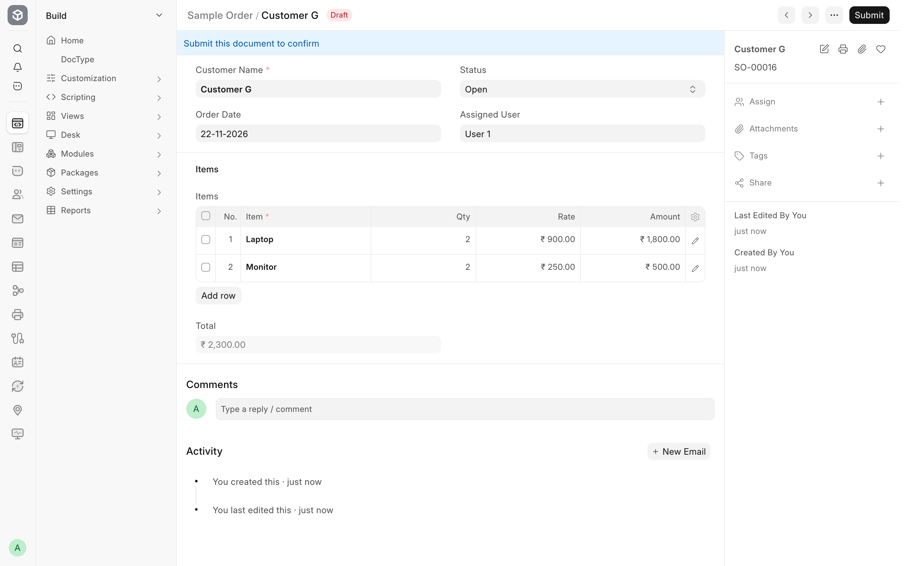

# Form View

The form view shows one document. Use it to read, change, save and submit the document, and to work with other users on it. Open a form from the list view, or at `/desk/<doctype-slug>/<name>`, for example `/desk/sample-order/SO-00001`. For a new document, click **Add** in the list view or press <kbd>Ctrl</kbd>+<kbd>B</kbd>.

## Parts of the form

| Part | What it shows |
|---|---|
| Title bar | The DocType, the document title and a status indicator, for example **Draft** or **Not Saved**. |
| Previous and next buttons | Open the previous or next document of the list. Turn them off with **Show navigation buttons** on your User. |
| **...** menu | More actions. Refer to [Form menu](#form-menu). |
| Primary button | The next action, for example **Save**, **Submit**, **Update**, **Cancel** or **Amend**. |
| Fields | The fields of the document in tabs, sections and columns. |
| Sidebar | Title, name, print and like icons, **Assign**, **Attachments**, **Tags**, **Share**, and who created and last changed the document. |
| **Comments** and **Activity** | The comment box and the timeline. |

## Layout

The DocType defines the layout with layout fields:

- A **Tab Break** starts a tab. The tabs show at the top of the form.
- A **Section Break** starts a section. A section can have a label. A collapsible section opens when you click its label.
- A **Column Break** starts a new column in the section.

A **Table** field shows a child table, for example **Items** in Sample Order. Click **Add row** to add a row. Click the edit icon at the end of a row to open the row as a form.

Hold <kbd>Alt</kbd> and move the pointer over a field to see its fieldname. Click to copy the fieldname.

Set the width of forms in **My Settings** > **Appearance** > **Layout** (**Compact** or **Full Width**).

## Save, submit, cancel and amend

Each document has a `docstatus`:

| `docstatus` | Status | Can you edit it? |
|---|---|---|
| 0 | Draft | Yes. |
| 1 | Submitted | Only fields with **Allow on Submit**. |
| 2 | Cancelled | No. |

A normal DocType has only drafts. Click **Save** or press <kbd>Ctrl</kbd>+<kbd>S</kbd> to save. If a mandatory field is empty, a **Missing Fields** message lists the fields.

A submittable DocType (**Is Submittable** set) has the full cycle:

1. Click **Save**. The document is a draft.
2. Click **Submit**. Confirm **Permanently Submit SO-00001?**. The document is now submitted.
3. To change an **Allow on Submit** field, change it and click **Update**.
4. To stop a submitted document, click **Cancel**. Confirm **Permanently Cancel SO-00001?**.
5. To fix a cancelled document, click **Amend**. A new draft opens with **Amended From** set.

When you cancel a document that other submitted documents link to, the **Cancel All Documents** dialog lists them. Click **Cancel All** to cancel them together.

By default, an amended document gets the name of the original with a counter, for example `SO-00001-1`. Change this in **Document Naming Settings** with **Default Amendment Naming** (`Amend Counter` or `Default Naming`) or **Amendment Naming Override** for one DocType.

To delete a draft without saving it as a record, select **Discard** in the menu. This sets `docstatus` to 2. **Discard** shows only for submittable DocTypes without a workflow.

The buttons need permissions: **Submit** needs the submit right, **Cancel** the cancel right, and **Amend** the amend right. If the DocType has a [workflow](../customization/workflow.md), the workflow actions replace **Submit** and **Cancel**.

## Comments and activity

Below the fields, the form shows:

- **Comments**: type in the box and click **Comment**. Type `@` to mention a user. Refer to [Collaboration](collaboration.md#comments-and-mentions).
- **Activity**: a timeline of events. It shows who created and changed the document, attachments, likes, assignments, emails and comments. If the DocType has **Track Changes**, it also shows each field change.
- **Show all activity**: turn it off to see only comments and emails.
- **New Email**: writes an email about the document. The email shows in the timeline. If the DocType has **Allow events in timeline**, there is also a **New Event** button.

Turn off the timeline for your user with **Show timeline** (`timeline`).

## Sidebar

| Item | What it does |
|---|---|
| Edit icon next to the title | Opens the **Rename** dialog. Shows if you can change the title or the name. |
| Print icon | Opens the print view. |
| Paperclip icon | Attaches a PDF of the print to the document. |
| Heart | Likes the document. |
| **Assign** | Assigns the document to users. Refer to [Collaboration](collaboration.md#assignments). |
| **Attachments** | Click **+** to upload a file or add a link. Click a file to preview it. **Max Attachments** on the DocType sets a limit. |
| **Tags** | Adds tags. |
| **Share** | Shares the document with users. |

Turn off the sidebar for your user with **Show sidebar** (`form_sidebar`).

## Connections

If other DocTypes link to this DocType, the form shows a **Connections** section with the linked document counts. Click a DocType to open its list with a filter for this document. Click **+** to create a linked document.

Select **Show Links** in the menu to see all documents that link to this one.

## Form menu

Click **...** in the title bar. The menu shows only the items that apply.

| Item | Shortcut | What it does |
|---|---|---|
| **Print** | <kbd>Ctrl</kbd>+<kbd>P</kbd> | Opens the print view. Refer to [Printing](../data-and-reports/printing.md). On a wide screen, use the print icon in the sidebar. |
| **Attach PDF** | | Attaches a PDF of the print. Save the document first. On a wide screen, use the paperclip icon in the sidebar. |
| **Discard** | | Discards a draft. |
| **Toggle Sidebar** | | Shows or hides the sidebar. |
| **Email** | <kbd>Ctrl</kbd>+<kbd>E</kbd> | Opens the email composer. |
| **Rename** | | Changes the name of the document. Needs **Allow Rename** on the DocType and write permission. |
| **Reload** | | Loads the document again. |
| **Delete** | <kbd>Ctrl</kbd>+<kbd>Shift</kbd>+<kbd>D</kbd> | Deletes the document. Not for submitted documents. |
| **Duplicate** | <kbd>Shift</kbd>+<kbd>D</kbd> | Opens a new document with the same values. Hidden if **Hide Copy** is set on the DocType. |
| **New Sample Order** | <kbd>Ctrl</kbd>+<kbd>B</kbd> | Opens a new document of this DocType. |
| **Jump to field** | <kbd>Ctrl</kbd>+<kbd>J</kbd> | Finds a field and moves to it. |
| **Show Links** | | Lists the documents that link to this document. |
| **Copy to Clipboard** | | Copies the document as JSON. |
| **Remind Me** | <kbd>Shift</kbd>+<kbd>R</kbd> | Sets a reminder for this document. |
| **Follow** / **Unfollow** | | Follows the document. Refer to [Collaboration](collaboration.md#follow). |
| **Undo** / **Redo** | <kbd>Ctrl</kbd>+<kbd>Z</kbd> / <kbd>Ctrl</kbd>+<kbd>Y</kbd> | Undoes or redoes a field change. |
| **Repeat** | | Creates an Auto Repeat. Needs **Allow Auto Repeat** on the DocType. |
| **View Audit Trail** | | Compares amended versions. Shows for amended documents of a DocType with **Track Changes**. |
| **Templates** | | Saves the form values as a template, or applies a template. |
| **Settings** | | Opens the settings dialog of the DocType. |
| **Customize** | | Opens **Customize Form**. |
| **Edit DocType** | | Opens the DocType. Only in developer mode. |

### Rename

1. Click the edit icon next to the title in the sidebar, or select **Rename** in the menu.
2. Change the title, the name or both.
3. To merge this document into an existing document with that name, select **Merge with existing**.
4. Click **Rename**.

The rename also changes the links in other documents. A rename can run in the background. A message tells you when it is queued.

### Templates

For a new document, a **Templates** button shows next to the primary button. For a saved document, **Templates** is in the menu. In the dialog, type a **Template Name** and click **Save** to save the current values. Click a template to apply its values to the form. Templates are saved as `Document Template` documents. Select **Private** to keep a template for yourself.

## Keyboard shortcuts

| Shortcut | Action |
|---|---|
| <kbd>Ctrl</kbd>+<kbd>S</kbd> | Save, or do the primary action. |
| <kbd>Ctrl</kbd>+<kbd>Shift</kbd>+<kbd>></kbd> | Go to the next record. |
| <kbd>Ctrl</kbd>+<kbd>Shift</kbd>+<kbd><</kbd> | Go to the previous record. |
| <kbd>Ctrl</kbd>+<kbd>P</kbd> | Print. |
| <kbd>Ctrl</kbd>+<kbd>E</kbd> | Email. |
| <kbd>Ctrl</kbd>+<kbd>J</kbd> | Jump to field. |
| <kbd>Ctrl</kbd>+<kbd>B</kbd> | New document. |
| <kbd>Shift</kbd>+<kbd>D</kbd> | Duplicate. |
| <kbd>Ctrl</kbd>+<kbd>Shift</kbd>+<kbd>D</kbd> | Delete. |
| <kbd>Shift</kbd>+<kbd>R</kbd> | Remind me. |
| <kbd>Ctrl</kbd>+<kbd>Z</kbd> | Undo. |
| <kbd>Ctrl</kbd>+<kbd>Y</kbd> or <kbd>Ctrl</kbd>+<kbd>Shift</kbd>+<kbd>Z</kbd> | Redo. |
| <kbd>Alt</kbd> + pointer on a field | Show the fieldname. Click to copy it. |

In a child table:

| Shortcut | Action |
|---|---|
| <kbd>Up</kbd> / <kbd>Down</kbd> | Move to the row above or below. |
| <kbd>Tab</kbd> / <kbd>Shift</kbd>+<kbd>Tab</kbd> | Move to the next or previous column. <kbd>Tab</kbd> in the last column of the last row adds a row. |
| <kbd>Ctrl</kbd>+<kbd>Up</kbd> / <kbd>Ctrl</kbd>+<kbd>Down</kbd> | Add a row above or below the current row. |
| <kbd>Ctrl</kbd>+<kbd>Shift</kbd>+<kbd>Up</kbd> / <kbd>Ctrl</kbd>+<kbd>Shift</kbd>+<kbd>Down</kbd> | Add a row at the top or at the bottom. |
| <kbd>Shift</kbd>+<kbd>Alt</kbd>+<kbd>Down</kbd> | Duplicate the current row. |
| <kbd>Esc</kbd> | Close the open row. |

## For developers

- Form behavior comes from `<doctype>.js` with `frappe.ui.form.on("Sample Order", {...})`. Other apps add form scripts with the `doctype_js` hook. Refer to [Form scripts](../../developer-guide/desk-ui/form-scripts.md).
- Add a menu item with `frm.page.add_menu_item(label, action, standard, shortcut)` and a button with `frm.add_custom_button()`.
- The DocType properties `is_submittable`, `allow_rename`, `allow_copy` (Hide Copy), `track_changes`, `max_attachments`, `allow_auto_repeat` and `image_field` control the items above. Refer to [DocTypes](../../developer-guide/data-model/doctypes.md).
- The **Connections** section comes from the `links` table of the DocType and from `get_data()` in `<doctype>_dashboard.py` (`Meta.get_dashboard_data` in `frappe/model/meta.py`). Other apps change it with the `override_doctype_dashboards` hook.
- The server runs `before_submit`, `on_submit`, `before_cancel`, `on_cancel`, `before_discard` and `on_discard` on the controller. Refer to [Controllers](../../developer-guide/data-model/controllers.md).

## Related

- [List view](list-view.md)
- [Collaboration](collaboration.md)
- [Printing](../data-and-reports/printing.md)
- [Workflow](../customization/workflow.md)
- [Form scripts](../../developer-guide/desk-ui/form-scripts.md)
- [Controllers](../../developer-guide/data-model/controllers.md)
