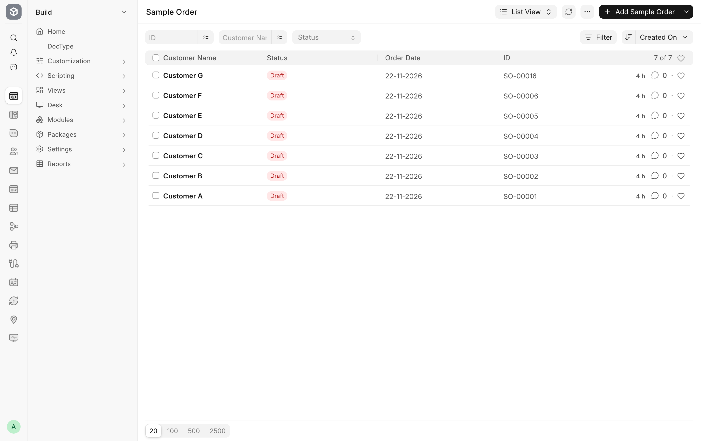
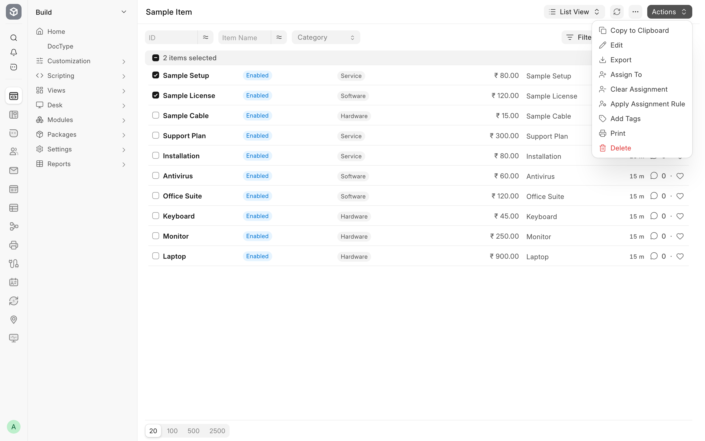

# List View

The list view shows the documents of one DocType as rows. Use it to find documents, filter and sort them, and change many documents at the same time. Open it from the sidebar, from the awesomebar, or at `/desk/<doctype-slug>`, for example `/desk/sample-order`.

## Parts of the list view

| Part | What it shows |
|---|---|
| Title | The DocType name, for example **Sample Order**. |
| View switcher (**List View**) | Changes to another view. Refer to [Views](views.md). |
| Reload button | Loads the list again. |
| **...** menu | List and DocType settings. Refer to [List menu](#list-menu). |
| **Add Sample Order** | Creates a document. The arrow next to it shows more ways to create, for example **Import**. |
| Quick filters | Fields under the title bar, for example **ID**, **Customer Name** and **Status**. |
| **Filter** | Adds filters on any field. |
| Sort button | Sets the sort field and the sort order. |
| Rows | One row for each document. The right side of the row shows the assigned users, the time of the last change, the comment count and a heart (like). |
| Count | For example `6 of 6`: rows loaded and total rows that match the filters. |
| Page size | **20**, **100**, **500** or **2500** rows, and **Load More**. |

Click the title of a row to open the document in the [form view](form-view.md).

## Filter

### Quick filters

Quick filters show above the list. Type or select a value to filter at once. These fields show as quick filters:

- **ID** (`name`) and the title field of the DocType.
- Fields with **In Standard Filter** (`in_standard_filter`) checked.
- Fields that you add with **Customize Quick Filters**.

A text quick filter has a match button next to it. Select **Equals** for an exact match or **Like** for a partial match. The desk saves your choice for each field.

To add quick filters:

1. Click **...** > **Customize Quick Filters**.
2. Select the fields. You can also select **Assigned To**, **Created By** and **Tags**.
3. Click **Save**. The page reloads.

**Assigned To**, **Created By** and **Tags** show as dropdowns. Each value in the dropdown shows the number of matching documents.

### Filter button

1. Click **Filter**.
2. Select a field, a condition (for example **Equals**) and a value.
3. To add one more condition, click **Add filter**.
4. To remove all conditions, click **Clear all**.

You can also click a value in a row, for example a status indicator, to filter by that value.

Filters show in the URL as query parameters, for example `/desk/sample-order?status=Open`. Share the URL to share the filtered list. The desk also remembers your last filters for each DocType.

!!! note "Large tables"
    The desk treats a table as large when it has more than 100,000 rows (estimated) and a document was created in the last 30 days. On a large table with no filters, the list adds a filter for documents created in the last 90 days. A message tells you about it. Turn this off with **Disable Automatic Recency Filters** in [List settings](#list-settings).

## Sort

Click the field name on the sort button to select the sort field. Click the icon on its left to change between ascending and descending order.

The sort options are **Last Updated On**, **Created On**, **ID**, **Most Used** (`idx`), the title field, the default sort field of the DocType, and every field that is mandatory, bold or in the list view. The default sort is the **Default Sort Field** and **Default Sort Order** of the DocType, or **Created On** descending.

## Select rows and run bulk actions

Select the check box of a row to select it. Select the check box in the header to select all loaded rows. When you select rows, the **Add** button changes to **Actions**.

| Action | Shows when | What it does |
|---|---|---|
| **Copy to Clipboard** | Always | Copies the selected rows. |
| **Edit** | The DocType has editable fields | Sets one field to one value on all selected documents. |
| **Export** | You can export the DocType | Exports the selected rows. |
| **Assign To** | Always | Assigns the documents to users. Refer to [Collaboration](collaboration.md#assignments). |
| **Clear Assignment** | Always | Removes all assignments. |
| **Apply Assignment Rule** | Always | Runs the assignment rules on the documents. |
| **Add Tags** | Always | Adds tags to the documents. |
| **Print** | You can print the DocType | Prints all selected documents in one PDF. |
| **Submit** | Submittable DocType, you can submit, no workflow | Submits the documents. |
| **Cancel** | You can cancel, no workflow | Cancels the documents. |
| **Delete** | You can delete | Deletes the documents after you confirm. |

All actions except **Copy to Clipboard** need **Allow bulk actions** (`bulk_actions`) on your User. If the DocType has a workflow, **Edit** and **Delete** need **Allow Bulk Editing** in list settings, and the workflow actions show in the menu.

Large jobs run in the background:

| Action | Runs in the background when |
|---|---|
| Edit, Submit, Cancel | 20 or more documents. More than 500 documents is not allowed. |
| Delete | More than 10 documents. |

The background tasks panel in the dock shows the progress.

## Like, comments and assignments in rows

- Click the heart on a row to like the document. Click the heart in the header to show only documents that you liked.
- The comment icon shows the number of comments.
- The avatars show the assigned users. Click an avatar to filter by that user.

## Paging and refresh

The list loads 20 rows. On a screen taller than 1180 pixels, it loads 100 rows. Select a page size at the bottom, or click **Load More**.

The list updates when another user changes a document. It also reloads every 5 minutes while it is open. Turn off live updates with **Disable Auto Refresh** in list settings.

## List menu

Click **...** to open the list menu.

| Item | Shows for | What it does |
|---|---|---|
| **Customize Quick Filters** | All users | Selects the quick filter fields. |
| **List Settings** | System Manager | Opens [List settings](#list-settings). |
| **Settings - Sample Order** | Users who can create Custom Field and Property Setter | Opens a settings dialog for the DocType, for example naming, workflow, print formats and roles. Not shown for core DocTypes. |
| **Customize** (<kbd>Ctrl</kbd>+<kbd>Y</kbd>) | Same as above | Opens **Customize Form**, or the DocType form for a custom DocType. |
| **Edit DocType** | System Manager in developer mode | Opens the DocType form. |
| **User Permissions** | System Manager | Opens the User Permission list for this DocType. |
| **Role Permissions Manager** | System Manager | Opens the permissions of this DocType. |

## List settings

**List Settings** changes the list for all users of the DocType. It saves a `List View Settings` document named after the DocType.

| Field | Label | What it does |
|---|---|---|
| `fields` | Fields | The columns of the list. Click **+ Add / Remove Fields** to change them, up to 50. You can also set the width of a column. |
| `disable_count` | Disable Count | Hides the total count. |
| `disable_comment_count` | Disable Comment Count | Hides the comment count in rows. |
| `disable_sidebar_stats` | Disable Sidebar Stats | The list view in this version does not read this field. |
| `disable_auto_refresh` | Disable Auto Refresh | Stops live updates of the list. |
| `allow_edit` | Allow Bulk Editing | Allows bulk **Edit** and **Delete** when the DocType has a workflow. |
| `disable_automatic_recency_filters` | Disable Automatic Recency Filters | Stops the 90 day filter on large tables. |
| `disable_scrolling` | Disable Scrolling | Turns off scrolling inside the list. |
| `show_tags` | Show Tags | Shows the tags of each document in its row. |

To resize a column, you can also drag the column border in the list.

## Saved layouts

A layout saves the filters, the sort and the columns of a list with a name.

1. Click the view switcher (**List View**).
2. Move to **List View** to open its submenu.
3. Click **Create Layout**.
4. Type a **Layout name**. Select **Available to all users** to share it.
5. Set the filters, sort and columns. Click **Create**.

The submenu shows **Default Layout**, **Global Layouts** and **Your Layouts**. Click a layout to apply it. The view switcher then shows the layout name. Click **Manage Layouts** to edit, copy or delete layouts. Layouts are saved as `List Filter` documents.

## Keyboard shortcuts

| Shortcut | Action |
|---|---|
| <kbd>Ctrl</kbd>+<kbd>B</kbd> | Create a new document. |
| <kbd>Down</kbd> / <kbd>Up</kbd> | Move to the next or previous row. |
| <kbd>Shift</kbd>+<kbd>Down</kbd> / <kbd>Shift</kbd>+<kbd>Up</kbd> | Select rows while you move. |
| <kbd>Space</kbd> | Select the current row. |
| <kbd>Enter</kbd> | Open the current row. |
| <kbd>Ctrl</kbd>+<kbd>Y</kbd> | Open **Customize**. |

## For developers

- Change the list of a DocType in `<doctype>_list.js` next to the DocType JSON. It sets `frappe.listview_settings["Sample Order"]` with keys such as `add_fields`, `get_indicator`, `onload`, `button`, `formatters`, `primary_action` and `hide_name_column`. Another app extends it with the `doctype_list_js` hook. `frappe/desk/form/meta.py` loads both. Refer to [List view settings](../../developer-guide/desk-ui/list-view-settings.md).
- The columns come from fields with `in_list_view`. Quick filters come from fields with `in_standard_filter`. The default sort comes from `sort_field` and `sort_order` on the DocType.
- The list gets its rows from `frappe.desk.reportview.get`. Bulk delete calls `frappe.desk.reportview.delete_items`. Bulk submit, cancel and edit call `frappe.desk.doctype.bulk_update.bulk_update.submit_cancel_or_update_docs`.

## Related

- [Views](views.md)
- [Form view](form-view.md)
- [Search](search.md)
- [Collaboration](collaboration.md)
- [Customize Form](../customization/customize-form.md)
- [List view settings](../../developer-guide/desk-ui/list-view-settings.md)
