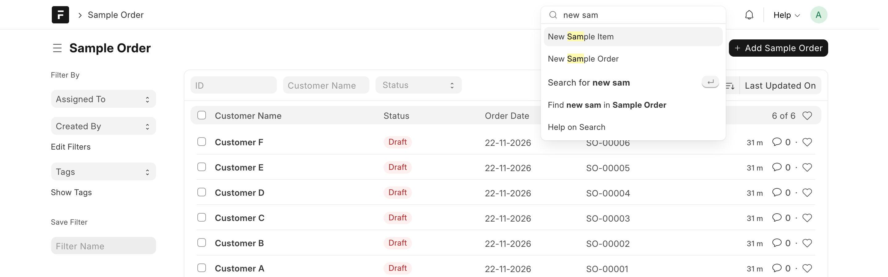

# Search

The desk has three ways to search. Use the awesomebar to open a page or start a new document. Use global search to find text in documents of many DocTypes. Use the list view filters to find documents of one DocType.

## Awesomebar

The awesomebar is the search box in the navbar (**Search or type a command**). Press <kbd>Ctrl</kbd>+<kbd>G</kbd>, or click the box, to use it. Type at least two characters. Use <kbd>Up</kbd> and <kbd>Down</kbd> to select a result and <kbd>Enter</kbd> to open it. Hold <kbd>Ctrl</kbd> while you select a result to open it in a new tab.

| You type | You get |
|---|---|
| A DocType name, for example `sample order` | **Sample Order List** and other matching DocTypes. |
| `new` and a DocType, for example `new sample` | **New Sample Order**. It opens a new document. |
| A text, `in` and a DocType, for example `customer a in sample order` | **Find customer a in Sample Order**. It opens the list filtered by that text. |
| A report, page, workspace or dashboard name | **Report ...**, **Open ...** (pages and workspaces) or **... Dashboard**. |
| A calculation, for example `= 12 * 4` or `12*4` | The result. |
| Text with `random` | **Generate Random Password**. |
| `#` and a tag, for example `#urgent` | Documents with that tag. |
| Any other text | **Search for ...**. It opens global search. |

On a list view, the awesomebar also offers **Find ... in ...** for the current DocType. Select **Help on Search** to see these rules in a dialog.

With an empty box, the awesomebar shows your recent pages.

Turn off the awesomebar for a user with **Search Bar** (`search_bar`) on the User.

!!! note "For developers"
    Add results with the `awesomebar_search` hook. Each method gets `txt` and returns a list of dicts with `label`, `route` and optional `description`, `index` and `route_options`. The desk calls `frappe.desk.search.awesomebar_search` and shows the first 20 results of each method.

## Global search

Global search finds text in the fields of many DocTypes at the same time.

1. Type a text in the awesomebar.
2. Select **Search for ...**. The search dialog opens.
3. Click a DocType in the dialog sidebar to see results of that DocType only. Click **All Results** to see all DocTypes. Click **More** under a DocType to load more results.
4. Click a result to open the document.

To match more than one term, join the terms with `&`, for example `Customer A&Laptop`. Start with `#` to search by tag.

Global search shows only documents that you can read.

### What global search finds

- Only DocTypes in **Global Search Settings** > **Search Priorities** (`allowed_in_global_search`). The order of the table does not change the order of the results: `search()` in `frappe/utils/global_search.py` puts the allowed DocTypes in a set before it sorts.
- Only fields with **In Global Search** (`in_global_search`) set. Set it in the DocType or in **Customize Form**. Fields of child tables also count.
- The document name too, if the DocType has **Make "name" searchable in Global Search** (`show_name_in_global_search`).
- Not cancelled documents, and not documents with `disabled` set or `enabled` not set.

When you save a document, the desk puts its text in a queue. A scheduled job (`frappe.utils.global_search.sync_global_search`) writes the queue to the `__global_search` table every 15 minutes. A new or changed document can take up to 15 minutes to show in the results.

!!! note "For developers"
    An app adds its DocTypes to the default search priorities with the `global_search_doctypes` hook. The hook is a dict keyed by domain, for example `{"Default": [{"doctype": "Sample Item"}]}`. Set `disable_global_search` in `site_config.json` to stop indexing. The search API is `frappe.utils.global_search.search(text, start, limit, doctype)`. Refer to [Site config](../../reference/configuration/site-config.md).

## Search in a list

In the [list view](list-view.md), type in the standard filters at the top. The **ID** filter and text filters match a part of the value. Click **Filter** to search in any field.

In Link fields, type to search the linked DocType. The search uses the name, the title field and the **Search Fields** of the linked DocType.

## Tags

Tags are labels that users add to documents. To find documents by tag:

- Type `#` and the tag in the awesomebar or in global search.
- In the list view sidebar, open the **Tags** dropdown and select a tag.

Refer to [Collaboration](collaboration.md#tags).

## Full-text search for apps

Frappe also has a full-text search framework based on SQLite FTS5 in `frappe/search/sqlite_search.py`. The desk search does not use it. An app makes a subclass of `SQLiteSearch`, lists it in the `sqlite_search` hook, and builds its own search UI and API on it. Frappe keeps the index current with document events and scheduled jobs in `frappe/hooks.py`.

## Related

- [Desk](desk.md)
- [List view](list-view.md)
- [Collaboration](collaboration.md)
- [Customize Form](../customization/customize-form.md)
- [Hooks](../../developer-guide/building-apps/hooks.md)
