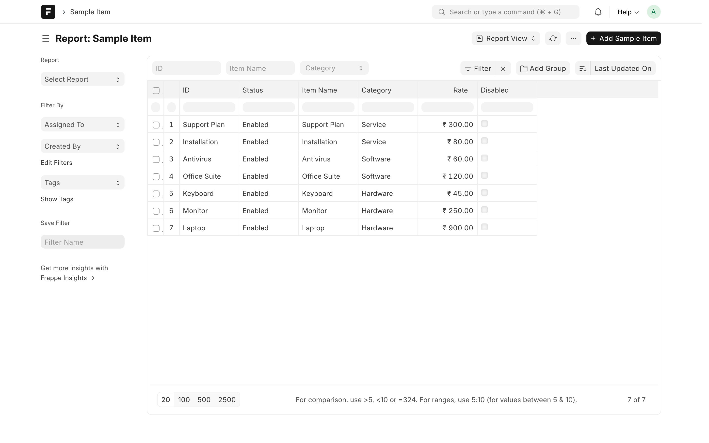
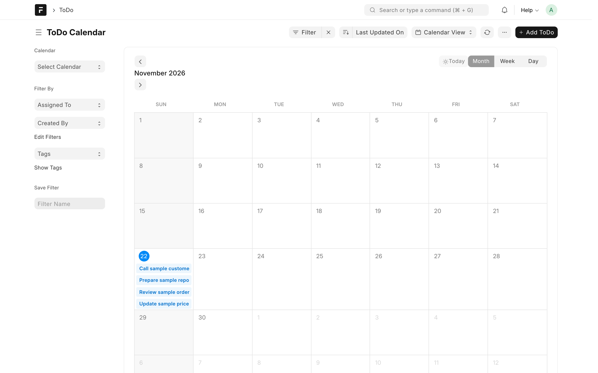

# Views

A view shows the documents of one DocType in a different form. The [list view](list-view.md) is the default view. Other views show the same documents as a table, a board, a calendar and more.

## Switch view

1. Open the list of a DocType.
2. Click the view switcher at the top right. It shows the name of the current view, for example **List View**.
3. Click a view.

Some views have more than one board or calendar. Select one in the view's own dropdown. For example, **Report View** has **Select Report** in the sidebar, **Calendar View** has **Select Calendar** in the sidebar, and **Kanban View** has **Select Kanban** in the page header.

The URL of a view is `/app/<doctype-slug>/view/<view>`, for example `/app/sample-item/view/report`.

The switcher shows only the views that the DocType supports:

| View | Shows when |
|---|---|
| List View | Always. |
| Report View | Always. |
| Dashboard View | Always. |
| Kanban View | Always, except for `File`. |
| Calendar View, Gantt View | The DocType has calendar settings (`frappe.views.calendar["<DocType>"]`), for example from `<doctype>_calendar.js`. |
| Image View | The DocType has an **Image Field**. |
| Tree View | The DocType is a tree (**Is Tree**), or has tree settings in `<doctype>_tree.js`. |
| Map View | The DocType has a Geolocation field named `location`, or fields named `latitude` and `longitude`, or list settings with `get_coords_method`. The Map view calls that method (default `frappe.geo.utils.get_coords`) to get the coordinates. |
| Inbox View | DocType `Communication`, and you have an email account. |

If **View Switcher** (`view_switcher`) is off on your User, the switcher does not show.

## Report View

Report View shows documents in a table, like a spreadsheet. Use it to pick columns, edit values in cells, group rows and export data.



- Filters and sort work the same as in the list view. The row under the header filters each column. For numbers, use `>5`, `<10`, `=324` or a range such as `5:10`.
- Double-click a cell to edit the value. The change saves at once. You can edit a cell only if you have write permission, the field is not read only, and the document is not submitted or cancelled. A field with **Allow on Submit** stays editable after submit.
- Click a column header menu to sort, remove or move the column, or to add a column before it.
- Click **Add Group** to group rows by a field. Select an aggregate: **Count**, **Sum** or **Average**.

The **...** menu of Report View has these items:

| Item | What it does |
|---|---|
| **Show Totals** | Adds a row with column totals. |
| **Print** | Prints the rows as shown. |
| **Toggle Chart** | Shows or hides a chart of the data. |
| **Toggle Sidebar** | Hides or shows the sidebar. |
| **Pick Columns** | Selects columns, also from child tables. |
| **Export** | Exports the rows. Shows if you can export the DocType. |
| **Setup Auto Email** | Sends the saved report by email on a schedule. Save the report first. |
| **Save** | Saves changes to the current saved report. |
| **Save As** | Saves the current columns, filters and sort as a new report. |
| **Delete** | Deletes the saved report. |
| **List Settings** | Opens the list settings of the DocType. Shows for a System Manager. |

A saved report is a `Report` document of type **Report Builder**. Open it from **Select Report** in the sidebar. Refer to [Reports](../data-and-reports/reports.md).

## Kanban View

A kanban board shows documents as cards in columns. Each column is one value of a Select field. Drag a card to another column to change the value.


To create a board:

1. Open the view switcher and click **Kanban View**. If the DocType has boards, select **Create New Kanban Board** in **Select Kanban**.
2. Type a **Kanban Board Name**.
3. In **Columns based on**, select a Select field, for example **Category**.
4. Click **Save**.

If the DocType has no Select field, the dialog asks you to add one with **Customize Form**. Boards for `Note` and `ToDo` are private (`private` = 1).

On the board:

- Click **+ Add Sample Item** at the top of a column to create a document in that column.
- Click a card to open the document. Click **+** on a card to assign it.
- Click **+ Add Column** to add a column. The column menu (**...**) has **Archive** and a color for the column.
- Click **Filter** to filter the cards. Click **...** > **Save filters** to keep them in the board.
- Click **...** > **Kanban Settings** to set **Show Labels** and the fields shown on cards.
- Click **...** > **Delete Kanban Board** to delete the board.

A board is a `Kanban Board` document (`kanban_board_name`, `reference_doctype`, `field_name`, `columns`, `filters`, `private`, `fields`, `show_labels`).

## Calendar View

Calendar View shows documents on a calendar by their date fields. Frappe has calendars for `Event` and `ToDo`.



- Click **Month**, **Week** or **Day** to change the range. Click **Today** to go to today.
- Select or drag across time slots to create a new document.
- Drag an event to change its dates.
- Click **Hide Weekends** or **Show Weekends**.

To make one more calendar for a DocType, create a `Calendar View` document. Set the **Reference Document Type**, **Subject Field**, **Start Date Field** and **End Date Field**. Select it in **Select Calendar** in the sidebar.

## Gantt View

Gantt View shows documents as bars on a timeline. It uses the same start and end fields as the calendar. Drag a bar to change the dates.

## Tree View

Tree View shows a tree DocType as nested nodes. Click a node to expand it.

- **Expand All** and **Collapse All** expand or collapse all nodes.
- The node menu has **Edit** (or **Details** without write permission), **Add Child**, **Rename** and **Delete**.
- The **...** menu has **View List**, **Print**, **Refresh** and **Rebuild Tree**.

## Dashboard View

Dashboard View shows charts and number cards for the DocType, for example `/app/sample-item/view/dashboard`.

1. Click **...** > **Customize Dashboard**. If the dashboard is empty, click **Customize** in the page.
2. Add, remove or move charts and cards.
3. Click **Save Customizations** to keep the changes, or **Discard** to drop them.

Your layout is saved in your user settings. To go back to the default, click **...** > **Reset Dashboard Customizations**. Refer to [Dashboards](../data-and-reports/dashboards.md).

## Image View

Image View shows documents as a grid of images from the **Image Field** of the DocType. For example, open `/app/user/view/image` to see users with their photos.

## Map View

Map View shows documents as markers on a map. It reads the `location` Geolocation field, or the `latitude` and `longitude` fields.

## Inbox View

Inbox View shows `Communication` documents of your email account as an inbox. Select the email account in the sidebar. Refer to [Email](../automation/email.md).

## For developers

| View | Controlled by |
|---|---|
| List, Report | `frappe.listview_settings` in `<doctype>_list.js` and the `doctype_list_js` hook. |
| Kanban | `Kanban Board` documents. `frappe.desk.doctype.kanban_board.kanban_board.quick_kanban_board(doctype, board_name, field_name)` makes a board with one column per Select option. |
| Calendar, Gantt | `frappe.views.calendar["<DocType>"]` in `<doctype>_calendar.js` (`field_map`, `get_events_method`, `gantt`). The calendar does not read a `filters` key. Other apps use the `doctype_calendar_js` hook. |
| Tree | `frappe.treeview_settings["<DocType>"]` in `<doctype>_tree.js`, and the `doctype_tree_js` hook. The DocType has `is_tree` set. |
| Image | `image_field` on the DocType. |
| Map | `get_coords_method` in list settings (a whitelisted method that returns GeoJSON), or the location fields. |

This example is the calendar of `ToDo` in `frappe/desk/doctype/todo/todo_calendar.js`:

```js
// frappe/desk/doctype/todo/todo_calendar.js
frappe.views.calendar["ToDo"] = {
	field_map: {
		start: "date",
		end: "date",
		id: "name",
		title: "description",
		allDay: "allDay",
		progress: "progress",
	},
	gantt: true,
	get_events_method: "frappe.desk.calendar.get_events",
};
```

Refer to [List view settings](../../developer-guide/desk-ui/list-view-settings.md).

## Related

- [List view](list-view.md)
- [Reports](../data-and-reports/reports.md)
- [Dashboards](../data-and-reports/dashboards.md)
- [List view settings](../../developer-guide/desk-ui/list-view-settings.md)
