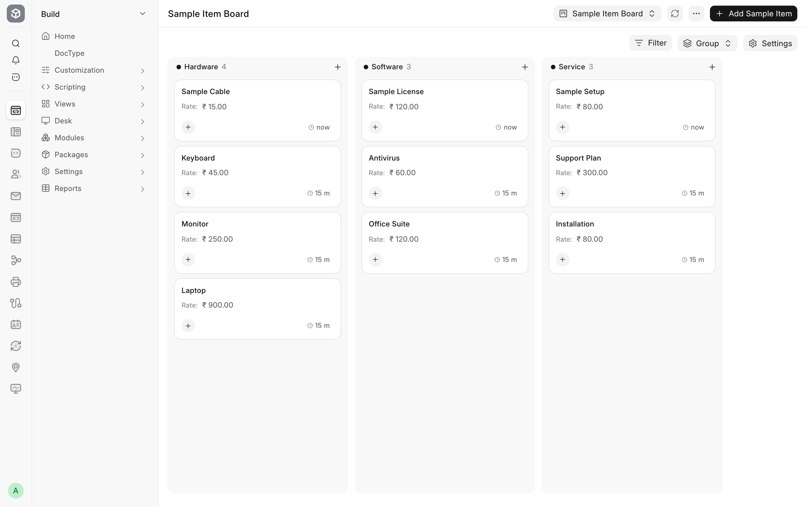

# Views

A view shows the documents of one DocType in a different form. The [list view](list-view.md) is the default view. Other views show the same documents as a table, a board, a calendar and more.

## Switch view

1. Open the list of a DocType.
2. Click the view switcher at the top right. It shows the name of the current view, for example **List View**.
3. Click a view.

Some views have a submenu, for example kanban boards, saved reports, calendars and saved layouts. Move the pointer to the view to open its submenu.

The URL of a view is `/desk/<doctype-slug>/view/<view>`, for example `/desk/sample-item/view/report`.

The switcher shows only the views that the DocType supports:

| View | Shows when |
|---|---|
| List View | Always. |
| Report View | You have report access to the DocType. |
| Dashboard View | Always. |
| Kanban View | Always, except for `File`. |
| Calendar View, Gantt View | The DocType has calendar settings in `<doctype>_calendar.js`, or **Is Calendar and Gantt** is set. |
| Image View | The DocType has an **Image Field**. |
| Tree View | The DocType is a tree (**Is Tree**), or has tree settings in `<doctype>_tree.js`. |
| Map View | The DocType has a Geolocation field named `location`, or fields named `latitude` and `longitude`, or list settings with `get_coords_method`. |
| Inbox View | DocType `Communication`, and you have an email account. |

If **Show view switcher** (`view_switcher`) is off on your User, the switcher does not show.

## Report View

Report View shows documents in a table, like a spreadsheet. Use it to pick columns, edit values in cells, group rows and export data.


- Filters and sort work the same as in the list view.
- Double-click a cell to edit the value. The change saves at once. You can edit a cell only if you have write permission, the field is not read only, and the document is not submitted or cancelled. A field with **Allow on Submit** stays editable after submit.
- Click a column header menu to sort, remove or move the column, or to add a column before it.
- Click **Add Group** to group rows by a field. Select an aggregate: **Count**, **Sum**, **Average**, **Minimum** or **Maximum**.

The **...** menu of Report View has these items:

| Item | What it does |
|---|---|
| **Show Totals** | Adds a row with column totals. |
| **Print** | Prints the rows as shown. |
| **Toggle Chart** | Shows or hides a chart of the data. |
| **Pick Columns** | Selects columns, also from child tables. |
| **Export** | Exports the rows. Shows if you can export the DocType. |
| **Setup Auto Email** | Sends the saved report by email on a schedule. Save the report first. |
| **Save** | Saves changes to the current saved report. Shows if you own it or can write `Report`. |
| **Save As** | Saves the current columns, filters and sort as a new report. |
| **Delete** | Deletes the saved report. |

A saved report is a `Report` document of type **Report Builder**. It shows under **Saved Reports** in the **Report View** submenu. Refer to [Reports](../data-and-reports/reports.md).

## Kanban View

A kanban board shows documents as cards in columns. Each column is one value of a Select field. Drag a card to another column to change the value.



To create a board:

1. Open the view switcher and move to **Kanban View**.
2. Click **Create Board**.
3. Type a **Kanban Board Name**.
4. In **Columns based on**, select a Select field, for example **Category**.
5. Click **Save**.

If the DocType has no Select field, the dialog asks you to add one with **Customize Form**. Boards for `Note` and `ToDo` are private.

On the board:

- Click **+** at the top of a column, or **Add Sample Item**, to create a document in that column.
- Click a card to open the document.
- Right-click a card, or use its menu, for **Open in New Tab**, **Copy Link**, **Move to**, **Assign**, **Select** and **Delete**.
- Select cards to show the selection bar with **Edit**, **Assign**, **Tags**, **Delete** and **Clear**. Press <kbd>Esc</kbd> to clear the selection.
- Click **Filter** to filter the cards. Click **...** > **Save Filters** to save them in the board. Only users who can write the board see **Save Filters**.
- Click **Group** to split the board into swimlanes by a second field.
- Click **Settings** to change the board: name, title field, image field, footer date, columns and their colors, card fields, preview fields and swimlanes.

A board is a `Kanban Board` document. A standard board (`is_standard` = Yes) comes from an app. Outside developer mode, a standard board shows **Duplicate** in place of **Settings**. Copy it to change it.

!!! note "Classic boards"
    New boards use the new kanban (`use_kanban_v2` = 1). Boards made before it keep the classic kanban until you set **Use Kanban v2 (New Experience)** on the board.

## Calendar View

Calendar View shows documents on a calendar by their date fields. Frappe has calendars for `Event` and `ToDo`.


- Click **Month**, **Week** or **Day** to change the range. Click **Today** to go to today.
- Select or drag across time slots to create a new document.
- Drag an event to change its dates.
- Click **Hide Weekends** or **Show Weekends** at the bottom.

To make one more calendar for a DocType, create a `Calendar View` document. Set the **Reference Document Type**, **Subject Field**, **Start Date Field** and **End Date Field**. The calendar shows in the **Calendar View** submenu. The **Default** calendar uses the calendar settings of the DocType.

## Gantt View

Gantt View shows documents as bars on a timeline. It uses the same start and end fields as the calendar. Drag a bar to change the dates.

## Tree View

Tree View shows a tree DocType as nested nodes. Click a node to expand it.

- **Expand/Collapse** expands or collapses all nodes.
- The node menu has **Add Child**, **Move to...**, **Rename** and **Delete**. You cannot rename or delete the root node.
- Change the order with **Default Order**, **Name A to Z** or **Name Z to A**.

## Dashboard View

Dashboard View shows charts and number cards for the DocType, for example `/desk/sample-item/view/dashboard`. At first it shows the public `Dashboard Chart` (type Count, Sum or Group By) and `Number Card` documents of the DocType.

1. Click **Customize** to add, remove or move charts and cards.
2. Click **Save Customizations** to keep the changes, or **Discard** to drop them.

Your layout is saved in your user settings. To go back to the default, click **...** > **Reset Dashboard Customizations**. Refer to [Dashboards](../data-and-reports/dashboards.md).

## Image View

Image View shows documents as a grid of images from the **Image Field** of the DocType. For example, open `/desk/user/view/image` to see users with their photos.

## Map View

Map View shows documents as markers on a map. It reads the `location` Geolocation field, or the `latitude` and `longitude` fields.

## Inbox View

Inbox View shows `Communication` documents of your email account as an inbox. Select the email account in the **Inbox View** submenu. Refer to [Email](../automation/email.md).

## For developers

| View | Controlled by |
|---|---|
| List, Report | `frappe.listview_settings` in `<doctype>_list.js` and the `doctype_list_js` hook. `reports` in list settings adds reports to the switcher. |
| Kanban | `frappe.kanban_v2.settings["<DocType>"]` in `<doctype>_kanban.js` (`card_context_menu`, `bulk_actions`, `callbacks`, `select_styles`). Other apps use `frappe.kanban_v2.extend_settings()` and the `doctype_kanban_js` hook. A standard board is exported to `<module>/doctype/<doctype>/kanban_board/<board>.json`. |
| Calendar, Gantt | `frappe.views.calendar["<DocType>"]` in `<doctype>_calendar.js` (`field_map`, `filters`, `get_events_method`, `gantt`). Other apps use the `doctype_calendar_js` hook. |
| Tree | `frappe.treeview_settings["<DocType>"]` in `<doctype>_tree.js`, and the `doctype_tree_js` hook. The DocType has `is_tree` set. |
| Image | `image_field` on the DocType. |
| Map | `get_coords_method` in list settings, or the location fields. |

This example is the calendar of `ToDo` in `frappe/desk/doctype/todo/todo_calendar.js`:

```js
// frappe/desk/doctype/todo/todo_calendar.js
frappe.views.calendar["ToDo"] = {
	field_map: {
		start: "date",
		end: "date",
		id: "name",
		title: "description",
		allDay: "allDay",
	},
	gantt: true,
	get_events_method: "frappe.desk.calendar.get_events",
};
```

Refer to [List view settings](../../developer-guide/desk-ui/list-view-settings.md).

## Related

- [List view](list-view.md)
- [Reports](../data-and-reports/reports.md)
- [Dashboards](../data-and-reports/dashboards.md)
- [List view settings](../../developer-guide/desk-ui/list-view-settings.md)
