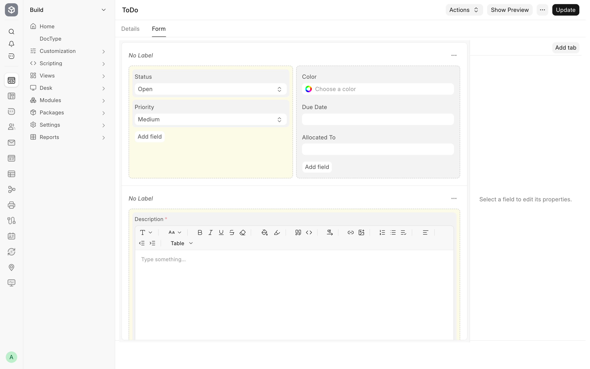

# Customize Form

Use Customize Form to change a standard DocType on one site without editing the app code. You can add fields, hide or reorder fields, change labels and other field properties, and change DocType settings such as the title field or the sort order. Your changes survive app updates, because Frappe stores them in two separate DocTypes: `Custom Field` and `Property Setter`.

## Core concepts

| Record | DocType | What it stores | Name format |
|---|---|---|---|
| New field | `Custom Field` | A field that you add to a DocType. Frappe adds a column to the database table. | `<DocType>-<fieldname>`, for example `ToDo-custom_sample_ref` |
| Changed property | `Property Setter` | One changed property of a DocType, a field, a link, an action or a state. | `<DocType>-<field or row or "main">-<property>`, for example `ToDo-priority-reqd` |

- When you add a field and do not give a fieldname, Frappe makes one from the label and adds the prefix `custom_`. A label "Sample Ref" gives `custom_sample_ref`.
- Property Setter `doctype_or_field` ("Applied On") is one of `DocField`, `DocType`, `DocType Link`, `DocType Action` or `DocType State`.
- Frappe merges Custom Fields and Property Setters into the DocType meta when it loads the meta (`frappe.get_meta`).
- Only users with the `System Manager` role can use Customize Form.

### What you cannot customize

Customize Form rejects these DocTypes:

- Core DocTypes in `frappe.model.core_doctypes_list`, for example `DocType`, `User`, `Role`, `Report`, `Print Format`, `Custom Field` and `Property Setter`. The error is "Core DocTypes cannot be customized."
- Single DocTypes. The error is "Single DocTypes cannot be customized."
- Custom DocTypes (DocTypes with `custom` set, such as `Sample Item`). For these, the desk opens the DocType form instead, where you edit the DocType directly.

## Open Customize Form

1. Open the list or a form of the DocType, for example ToDo.
2. Open the menu (the `...` button).
3. Select **Customize**. In the list view the shortcut is <kbd>Ctrl</kbd>+<kbd>Y</kbd>.

You can also go to `/desk/customize-form` and select the DocType in **Enter Form Type** (`doc_type`).



The form has two tabs:

- **Form** shows the form builder. Drag fields, sections, columns and tabs to change the layout. Click a field to edit its properties in the right panel. Click **Add field** to add a Custom Field.
- **Details** shows the DocType properties, the **Fields** table, and the **Document Actions**, **Document Links** and **Document States** tables.

Click **Update** to save. Frappe then creates or updates the Custom Fields and Property Setters, updates the database table if a column changed, and clears the cache of the DocType.

## Add a field

1. Open Customize Form for ToDo.
2. In the **Form** tab, click **Add field** in the column where you want the field.
3. Select the field type and enter the label, for example "Sample Ref".
4. Set other properties in the right panel, for example **Mandatory** or **In List View**.
5. Click **Update**.

To delete a Custom Field, remove it in the form builder and click **Update**. You cannot delete a standard field. Hide it instead.

## Change a standard field

You can change properties of standard fields, for example the label, **Hidden**, **Mandatory**, **Read Only**, **In List View**, **Default**, **Depends On** and the permission level. Each changed property becomes one Property Setter.

Frappe limits field type changes. You can change the type only inside a group of compatible types (`ALLOWED_FIELDTYPE_CHANGE` in `frappe/custom/doctype/customize_form/customize_form.py`). If the new type is shorter and saved values are too long, Frappe shows "Data Too Long" and lists the documents.

## DocType properties

These properties are in the **Details** tab. The list is not complete.

| Label | Fieldname | Description |
|---|---|---|
| Change Label (via Custom Translation) | `label` | Shows another name for the DocType. Frappe saves it as a `Translation` record. |
| Search Fields | `search_fields` | Fields that Link field search also looks in. |
| Title Field | `title_field` | Field shown as the document title. |
| Show Title in Link Fields | `show_title_field_in_link` | Shows the title, not the name, in Link fields. |
| Image Field | `image_field` | Field used as the document image. |
| Quick Entry | `quick_entry` | Opens a small dialog for new documents. |
| Track Changes | `track_changes` | Saves a `Version` record for each change. |
| Track Views | `track_views` | Logs who opened a document. |
| Allow Import (via Data Import Tool) | `allow_import` | Allows Data Import for this DocType. |
| Allow Auto Repeat | `allow_auto_repeat` | Adds an `auto_repeat` Custom Field so documents can repeat. |
| Max Attachments | `max_attachments` | Maximum number of attachments per document. |
| Hide Sidebar, Menu, and Comments | `hide_toolbar` | Hides the form sidebar, menu and comments. |
| Naming Rule / Auto Name | `naming_rule`, `autoname` | How new documents get a name. |
| Default Print Format | `default_print_format` | Print format used by default. |
| Default View | `default_view` | View that opens from the sidebar, for example List or Report. |
| Sort Field / Sort Order | `sort_field`, `sort_order` | Default sort of the list view. |
| Allow document creation via Email | `email_append_to` | Creates documents from incoming email. |

## Actions menu

The **Actions** button has these items:

| Item | What it does |
|---|---|
| Go to {DocType} List | Opens the list view. Not shown for child tables. |
| Set Permissions | Opens the [Role Permissions Manager](../users-and-permissions/permissions.md) for this DocType. |
| Reload | Loads the current customizations again. |
| Reset Layout | Deletes the Property Setters for `field_order` and `insert_after`. |
| Reset All Customizations | Deletes all Property Setters and Custom Fields of the DocType that are not system generated. Property Setters for `naming_series` and `options` stay. |
| Trim Table | Removes database columns that no field uses anymore. You cannot undo this. |
| Export Customizations | Shown only in developer mode. See below. |

To customize a child table, use **Customize Child Table** and select the table.

## For developers

Do not ask users to repeat customizations on each site. Ship them with your app.

**Export from the desk.** In developer mode, click **Actions > Export Customizations**. Select a module. Frappe writes the Custom Fields, Property Setters and links to `<module>/custom/<doctype>.json` in your app, and does the same for each child table. If **Sync on Migrate** is set, `bench migrate` applies the file on each site. If **Export Custom Permissions** is set, the file also holds the `Custom DocPerm` rules, and migrate force-syncs them.

**Create them in code.** Use `create_custom_fields` in an install hook or a patch. It creates the fields that do not exist and updates the ones that do.

```python
# sample_app/setup.py
from frappe.custom.doctype.custom_field.custom_field import create_custom_fields
from frappe.custom.doctype.property_setter.property_setter import make_property_setter


def after_install():
	create_custom_fields(
		{
			"ToDo": [
				{
					"fieldname": "sample_ref",
					"label": "Sample Ref",
					"fieldtype": "Data",
					"insert_after": "description",
				}
			]
		}
	)
	make_property_setter("ToDo", "priority", "reqd", 1, "Check")
```

- `create_custom_fields(custom_fields, ignore_validate=False, update=True)` creates the records as `Administrator`, clears the cache and updates the table.
- `make_property_setter(doctype, fieldname, property, value, property_type, for_doctype=False, ...)` ignores permissions. Set `for_doctype=True` for a DocType property.
- You can also export `Custom Field` and `Property Setter` records with the `fixtures` hook. See [Fixtures and Patches](../../developer-guide/building-apps/fixtures-and-patches.md) and [Extending Apps](../../developer-guide/building-apps/extending-apps.md).

## Pitfalls

- A field type change that makes a column smaller can fail if saved values are too long.
- Many fields can hit the database row size limit. Frappe then shows "Database Table Row Size Limit".
- **Reset All Customizations** also removes Custom Fields that other users added. Export them first if you need them.
- Customizations that an app ships with `is_system_generated` set stay after a reset.

## Related

- [Role Permissions Manager](../users-and-permissions/permissions.md)
- [Form View](../basics/form-view.md)
- [Extending Apps](../../developer-guide/building-apps/extending-apps.md)
- [DocTypes](../../developer-guide/data-model/doctypes.md)
