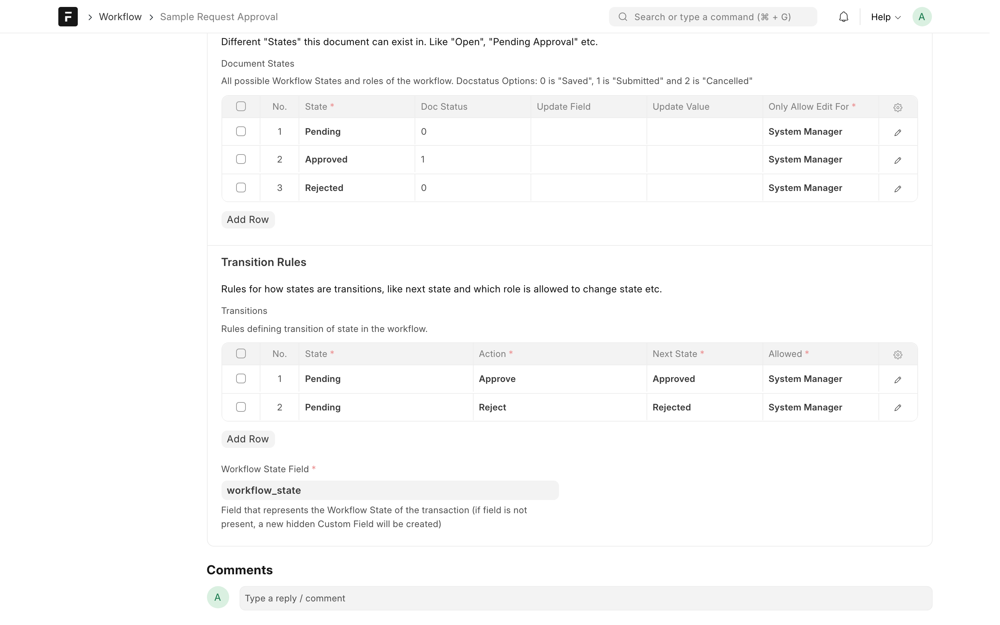
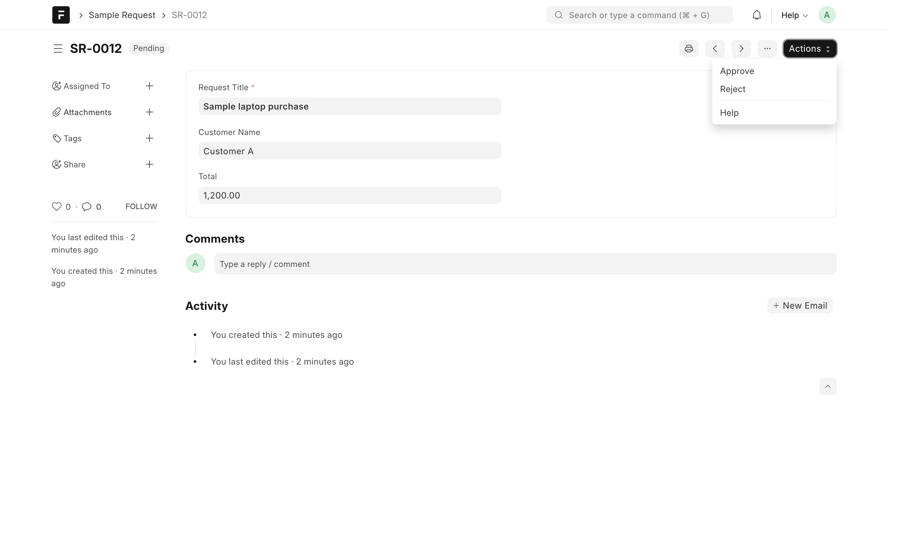

# Workflow

A Workflow controls how a document moves from one state to the next, and which role can move it. Use it when a document needs review or approval before it is submitted, for example "Pending" to "Approved". When a workflow applies to a document, the form shows an **Actions** menu instead of the standard **Submit** and **Cancel** buttons.

## Concepts

| Term | DocType | Meaning |
|---|---|---|
| Workflow | `Workflow` | The rule set for one DocType: states and transitions. |
| State | `Workflow State` | A named stage, for example "Pending". It has an optional icon and button style. |
| Action | `Workflow Action Master` | A named step a user clicks, for example "Approve". |
| Transition | `Workflow Transition` (child) | "From state X, role R can do action A to go to state Y." |
| Workflow Action | `Workflow Action` | A to-do record that Frappe creates for users who can act on a document in its current state. |

The current state of each document is stored in the field named in **Workflow State Field** (default `workflow_state`). If the DocType has no such field, Frappe adds a hidden Custom Field of type Link to `Workflow State` when you save the workflow.

A DocType has only one active workflow. When you save a workflow with **Is Active** set, Frappe clears **Is Active** on all other workflows of that DocType.

## Create a workflow

1. Go to `/app/workflow/new`.
2. Enter a **Workflow Name** and select the **Document Type**.
3. In **Document States**, add one row for each state.
4. In **Transitions**, add one row for each allowed move between states.
5. Select **Is Active**.
6. Save.

You can also edit states and transitions on a canvas in the **Workflow Builder** (`/app/workflow-builder`). The builder is marked beta.



### Document States

| Field | Description |
|---|---|
| State (`state`) | A `Workflow State` record. |
| Doc Status (`doc_status`) | `0` Draft, `1` Submitted, `2` Cancelled. A non-submittable DocType can only use `0`. |
| Only Allow Edit For (`allow_edit`) | The role that can edit the document in this state. |
| Update Field / Update Value | Set a field of the document to a fixed value when it enters this state. |
| Is Optional State | Do not create Workflow Action records for this state. |
| Send Email On State (`send_email`) | Default on. Send the action email when the document enters this state (needs **Send Email Alert** on the workflow). |
| Next Action Email Template | An `Email Template` for that email. |
| Message | A message to show for this state. |
| Don't Override Status | Do not show the workflow state as the list view status. |

### Transitions

| Field | Description |
|---|---|
| State / Next State | The state before and after the action. |
| Action | A `Workflow Action Master` record. |
| Allowed (`allowed`) | The role that can do this action. |
| Allow Self Approval | Default on. When off, the document owner cannot do this action. Administrator is always allowed. |
| Send Email To Creator (`send_email_to_creator`) | Default off. When off, the action email is not sent to the document owner. |
| Condition | Optional Python expression. The action shows only when it is true. |

Transition conditions get `doc` (the document as a dict) and a limited `frappe` object: `frappe.db.get_value`, `frappe.db.get_list`, `frappe.session`, and `frappe.utils.now_datetime`, `add_to_date`, `get_datetime`, `now`.

```python
doc.total > 0 and doc.customer_name != "Customer A"
```

Frappe checks these rules when it saves a workflow:

- Each transition must use states from **Document States**.
- A transition cannot start from a Cancelled state.
- A transition cannot go from Submitted (1) back to Draft (0).
- A transition cannot go from Draft (0) to Cancelled (2).

### Workflow options

| Field | Default | Description |
|---|---|---|
| Is Active | 0 | Only the active workflow applies. |
| Don't Override Status | 0 | Keep the document status in list view instead of the workflow state. |
| Send Email Alert | 0 | Email the users who can do the next action. |
| Workflow State Field | `workflow_state` | The field that stores the state. |

When you save a workflow, Frappe sets the state field of existing documents that have no state yet. It uses the first state row for each docstatus.

## Use a workflow on a document

1. Open the document.
2. Click **Actions**.
3. Select an action.



The menu shows only the transitions from the current state that your roles allow and whose condition is true. After the action, Frappe saves, submits or cancels the document to match the docstatus of the next state. It also adds a "Workflow" comment to the timeline.

To apply an action to many documents, select them in the list view and use the **Actions** menu. Fewer than 20 documents run at once. From 20 to 500 documents run in a background job. More than 500 documents are rejected.

## Workflow Action records

After each save, cancel or update after submit, Frappe creates `Workflow Action` records with status `Open` for the roles that can do the next transition. The user sees them in the `Workflow Action` list. When **Send Email Alert** is on, Frappe also emails these users. The email has links to do the action without logging in to desk. When a user does the action, the records change to `Completed`.

## Pitfalls

- A user can only change the state with a valid transition. A direct edit of the state field fails with "Workflow State transition not allowed".
- Data Import cannot insert documents in a state other than the first state.
- If the state stored on a document is not in the workflow, save fails. Update the workflow or the document.
- A cancelled state blocks the standard **Cancel** button. Use a transition to the cancelled state.
- Activating a second workflow for the same DocType deactivates the first one without a message.

## For developers

- Server API in `frappe/model/workflow.py`: `apply_workflow(doc, action)`, `get_transitions(doc)`, `bulk_workflow_approval(docnames, doctype, action)`, `get_workflow_name(doctype)`.
- `get_workflow_name(doctype)` caches the active workflow name in Redis (`workflow` hash).
- `process_workflow_actions` runs from `doc_events` for `*` (`on_update`, `on_cancel`, `on_trash`, `on_update_after_submit`) in `frappe/hooks.py`.

```python
from frappe.model.workflow import apply_workflow, get_transitions

doc = frappe.get_doc("Sample Order", "SO-00001")
[t.action for t in get_transitions(doc)]
apply_workflow(doc, "Approve")
```

## Related

- [Permissions](../users-and-permissions/permissions.md)
- [Notifications](../automation/notifications.md)
- [Email](../automation/email.md)
- [Server and Client Scripts](../../developer-guide/low-code-and-ai/server-and-client-scripts.md)
- [Hooks](../../developer-guide/building-apps/hooks.md)
