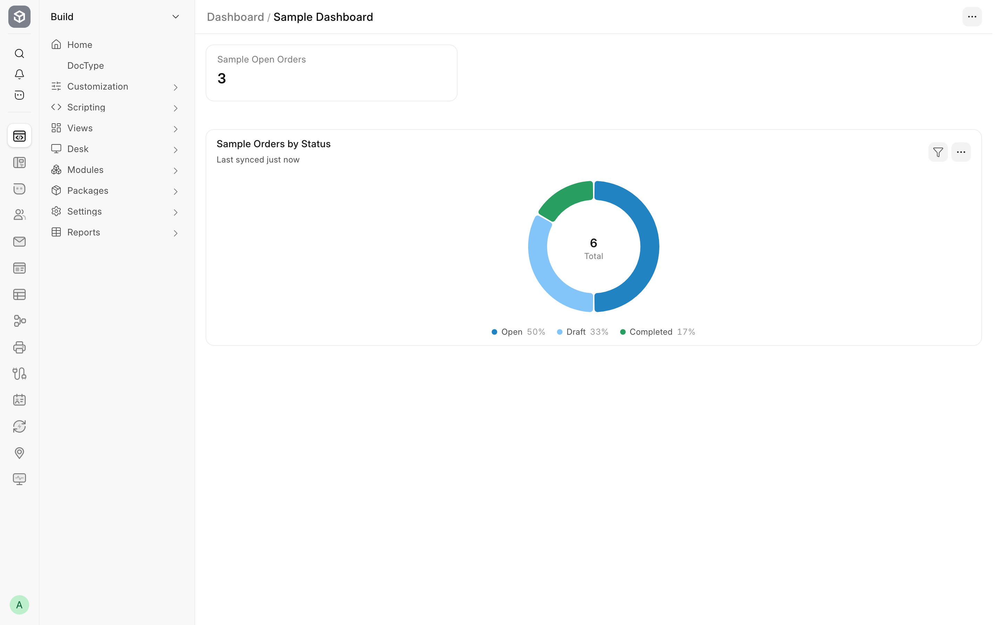
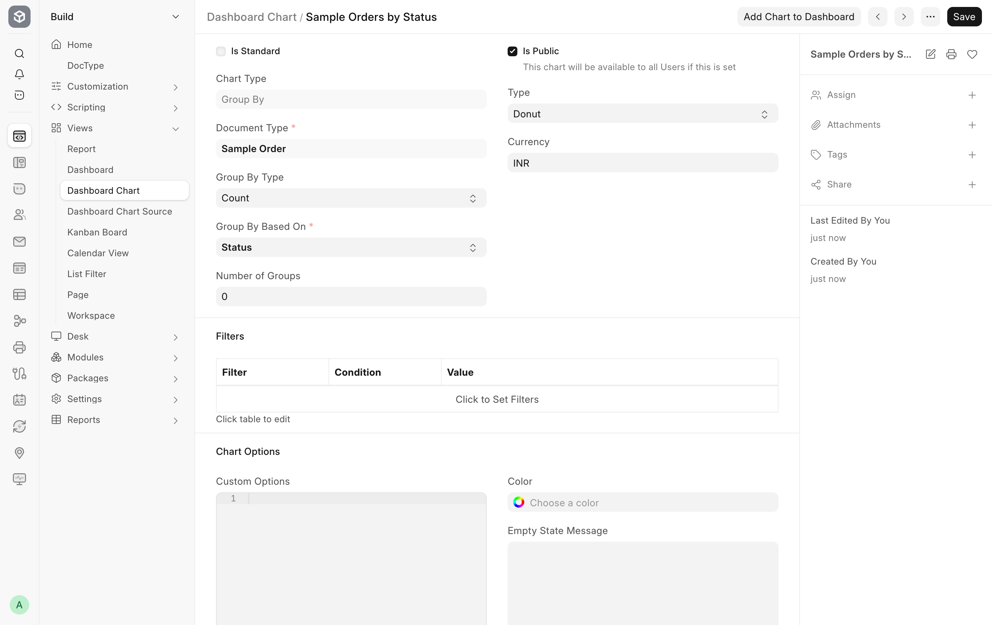

# Dashboards

A **Number Card** shows one number, such as the count of open orders. A **Dashboard Chart** shows data over time or by group. A **Dashboard** puts cards and charts on one page. You can also add cards and charts to a workspace. Use them to give users a quick view of the data they work with.

## Core concepts

| DocType | Route | What it is |
|---|---|---|
| `Number Card` | `/desk/number-card` | One number from a DocType, a report or a whitelisted method. |
| `Dashboard Chart` | `/desk/dashboard-chart` | A chart from a DocType, a report or a custom source. |
| `Dashboard` | `/desk/dashboard` | A named set of charts and cards. Shown at `/desk/dashboard-view/<name>`. |
| `Dashboard Chart Source` | `/desk/dashboard-chart-source` | Code in an app that gives data to a `Custom` chart. |
| `Dashboard Settings` | none | Per-user chart setup (`chart_config`), such as saved chart filters. |

## Make a Number Card

1. Go to `/desk/number-card/new`.
2. Enter a **Label**. The label is also the name of the card.
3. Set **Type** to `Document Type`.
4. Select the **Document Type**, for example `Sample Order`.
5. Select the **Function**: `Count`, `Sum`, `Average`, `Minimum` or `Maximum`.
6. If the function is not `Count`, select the number field in **Aggregate Function Based On**.
7. Click the filters table and set filters, for example `status` = `Open`.
8. Save.
9. Click **Add Card to Dashboard** to put it on a Dashboard.

| Field | Default | Description |
|---|---|---|
| `type` | | `Document Type`, `Report` or `Custom`. |
| `function` | | For `Document Type`. |
| `parent_document_type` | | Needed when the Document Type is a child table. |
| `report_name`, `report_field`, `report_function` | | For `Report`: the report, the number column, and `Sum`, `Average`, `Minimum` or `Maximum`. |
| `method` | | For `Custom`: dotted path of a whitelisted method. |
| `filters_json` | | Fixed filters. |
| `dynamic_filters_json` | | Filters with JavaScript expressions, for example `frappe.datetime.get_today()`. |
| `show_percentage_stats` | 1 | Shows the change from the previous period. |
| `stats_time_interval` | `Daily` | Period for the change: `Daily`, `Weekly`, `Monthly` or `Yearly`. |
| `is_public` | 0 | Makes the card available to all users. |
| `color`, `background_color` | | Card colors. |
| `show_full_number` | 0 | Shows the full number instead of a short form. |

## Make a Dashboard Chart

1. Go to `/desk/dashboard-chart/new`.
2. Enter **Chart Name**.
3. Select the **Chart Type**.
4. Select the **Document Type** and set the fields for that chart type.
5. Select the display **Type**: `Line`, `Bar`, `Percentage`, `Pie`, `Donut` or `Heatmap`.
6. Set filters in the filters table.
7. Save.
8. Click **Add Chart to Dashboard** to put it on a Dashboard.

| Chart Type | Fields to set | Result |
|---|---|---|
| `Count` | **Time Series Based On** (a date field), **Timespan**, **Time Interval** | Number of records per period. |
| `Sum` / `Average` | Same as `Count`, plus **Value Based On** | Sum or average of a number field per period. |
| `Group By` | **Group By Based On**, **Group By Type** (`Count`, `Sum`, `Average`), **Number of Groups** | One value per group, for example per status. |
| `Report` | **Report Name**, **X Field**, **Y Axis**, or **Use Report Chart** | Chart from the data of a report. |
| `Custom` | **Chart Source** | Data from a Dashboard Chart Source in an app. |

**Timespan** can be `Last Year`, `Last Quarter`, `Last Month`, `Last Week` or `Select Date Range`. **Time Interval** can be `Yearly`, `Quarterly`, `Monthly`, `Weekly` or `Daily`. Cancelled documents are never counted.

The chart menu on a dashboard has **Refresh**, **Edit**, **Reset Chart**, **Export**, and a link to the list or report of the source. Chart data is cached. **Refresh** gets new data and shows the time in **Last synced**.

## Make a Dashboard

1. Go to `/desk/dashboard/new`.
2. Enter **Dashboard Name**.
3. Add charts in the **Charts** table. Set the **Width** of each chart to `Half` or `Full`.
4. Add cards in the **Cards** table.
5. Save.
6. Click **Show Dashboard**.

**Is Default** makes this the default dashboard. **Chart Options** takes JSON that applies to all charts on the dashboard.

## Add cards and charts to a workspace

1. Open the workspace.
2. Click **Edit**.
3. Add a **Chart** block or a **Number Card** block.
4. Select an existing chart or card, or make a new one.
5. Save the workspace.

## Access

- System Managers see all charts and cards.
- A user sees a `Count`, `Sum`, `Average` or `Group By` chart, or a `Document Type` card, when they can read its DocType. A `Report` chart or card needs access to the report.
- The chart list does not show `Custom` charts to users without `System Manager`.
- If a chart has rows in its **Roles** table, a user with one of those roles can open it.
- Charts and cards are also limited to the modules the user can see.

## For developers

- A `Custom` Number Card calls the whitelisted method in `method` with `filters`. Return a number, or a dict with `value` and the formatting keys such as `fieldtype`.
- A `Custom` chart reads `frappe.dashboards.chart_sources["<Source Name>"]` from `<module>/dashboard_chart_source/<source_name>/<source_name>.js` in your app. Set `method` there to the Python method that returns the chart data.
- Cards and charts with **Is Standard** set are exported to the module of the app when you save in developer mode. A standard chart cannot be edited on a site without developer mode.
- Chart data comes from `frappe.desk.doctype.dashboard_chart.dashboard_chart.get` and card data from `frappe.desk.doctype.number_card.number_card.get_result`.
- Ship charts and cards in a workspace of your app. See [Workspaces, Sidebar and Dock](../../developer-guide/desk-ui/workspaces-sidebar-dock.md).

## Pitfalls

- The **Document Type** picker of a Number Card does not offer Single DocTypes.
- A card with a function other than `Count` needs **Aggregate Function Based On**. Save does not check the field type, so pick a number field.
- Chart data is cached per chart. Use **Refresh** after a large data change.

## Related

- [Reports](reports.md)
- [Views](../basics/views.md)
- [Desk](../basics/desk.md)
- [Workspaces, Sidebar and Dock](../../developer-guide/desk-ui/workspaces-sidebar-dock.md)
