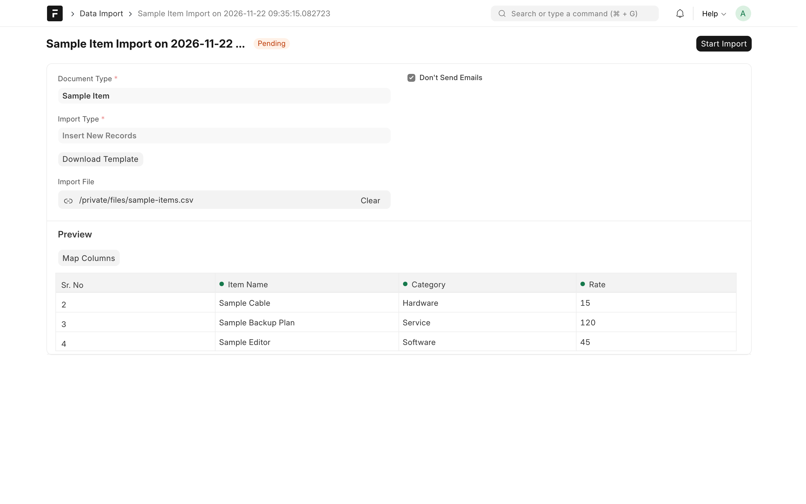

# Data Import and Export

Data Import inserts or updates many records from a CSV or Excel file, or from a public Google Sheet. Data Export downloads records as CSV or Excel. Use them to move data in from another system, to change many records at once, or to get a template to fill in.

## Before you import

- The DocType must allow import (**Allow Import** in the DocType or Customize Form).
- You need the `import` permission on the DocType.
- Most core DocTypes cannot be imported. `User`, `Role` and `Print Format` can.
- The scheduler must be active, because the import runs in a background job. In developer mode, the import runs in the request.

## Import records

Go to `/app/data-import/new`. You can also open the list view of the DocType and select **Import** from the menu. This opens the Data Import list for that DocType.

### 1. Set up the import


1. Select the **Document Type**.
2. Select the **Import Type**.
3. Save.
4. Optional: click **Download Template** to get a file with the right columns.
5. Attach the file in **Import File**, or enter a URL in **Import from Google Sheets**.

| Import Type | Result |
|---|---|
| Insert New Records | Each row makes a new document. |
| Update Existing Records | Each row updates the document in the **ID** column. A row with no change fails with "No changes to update". |

| Option | Default | Description |
|---|---|---|
| Don't Send Emails (`mute_emails`) | 1 | Do not send emails or notifications during the import. |
| Submit After Import | 0 | Submit each document. Submittable DocTypes only. |
| Show Only Failed Logs | 0 | Show only failed rows in the import log. |

### 2. Preview and map columns

After you attach the file, the form shows a preview of the first rows. Frappe matches each column header to a field.



- Click **Map Columns** to change which field a column goes to, or select **Don't Import** to skip a column. Save to apply the change.
- If a value is not valid, the form shows it in the **Import File Errors and Warnings** section, grouped by row and column. Fix the file and attach it again.

The import does not start while there are warnings that are not of type info. Frappe saves them in **Template Warnings** (`template_warnings`).

### 3. Import

Click **Start Import**. Frappe shows the progress, and then the result: how many records were inserted or updated.

- Frappe commits after each successful row. A failed row does not undo the rows before it.
- The status of the import becomes `Success`, `Partial Success`, `Error` or `Timed Out`.
- If some rows fail, fix the data and click **Retry**. Rows that were imported before are not imported again.
- On `Partial Success`, click **Export Errored Rows** to get a file with only the failed rows.

## Import log

Each imported or failed row makes a `Data Import Log` record with the document name, the row numbers, a success flag and the error. The form shows the log in a table with **Row Number**, **Status** and **Message**. Click **Export Import Log** to download it.

## Export records

There are two ways to export records.

**From a list view:** select records, then use **Actions** > **Export**. Or click **Download Template** on the Data Import form. The **Export Data** dialog has these options:

| Option | Values |
|---|---|
| File Type | `Excel` or `CSV` |
| Export Type | `All Records`, `Filtered Records`, `5 Records` or `Blank Template` |
| Fields | The fields of the DocType and its child tables. Use **Select Mandatory** or **Select All**. |

The exported file has the same format that Data Import reads, so you can edit it and import it with **Update Existing Records**.

**Data Export page:** go to `/app/data-export`. Select the DocType in **Select Doctype**, the **File Type** (`Excel` or `CSV`), filters and fields, then click **Export**. Select **Export without main header** to leave out the header notes and column descriptions.

To export the rows shown in a report, use **Export** in the menu of the report view. See [Reports](reports.md).

## Pitfalls

- When you update records, include the **ID** column. Frappe finds the document by it.
- In Insert mode, Frappe sets the name from the file only when the DocType uses `Prompt` naming.
- A workflow DocType can only import documents in the first workflow state.
- Child table rows go on the lines below their parent row, with the parent columns empty.

## For developers

- Import from the command line:

```bash
bench --site frappe.localhost data-import --file sample-items.csv --doctype "Sample Item" --type Insert
```

`--type` is `Insert` or `Update`. Add `--submit-after-import` to submit. The path is relative to the `sites` folder. The `--mute-emails` flag is always on and is not passed to the import.

- Import or export JSON records from code with `import_doc(path)` and `export_json(doctype, path, filters=None)` in `frappe/core/doctype/data_import/data_import.py`. `bench import-doc <path>` uses `import_doc`.
- Rows per batch: `data_import_batch_size` in site config (default 1000). See [Site Config](../../reference/configuration/site-config.md).

## Related

- [List View](../basics/list-view.md)
- [Customize Form](../customization/customize-form.md)
- [Permissions](../users-and-permissions/permissions.md)
- [CLI](../../reference/configuration/cli.md)
