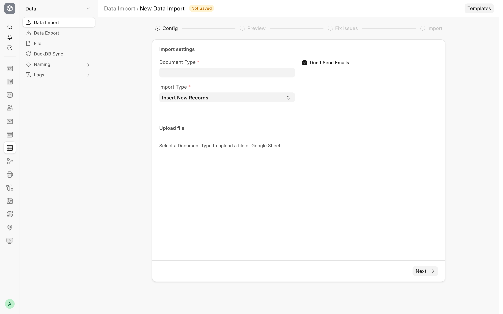
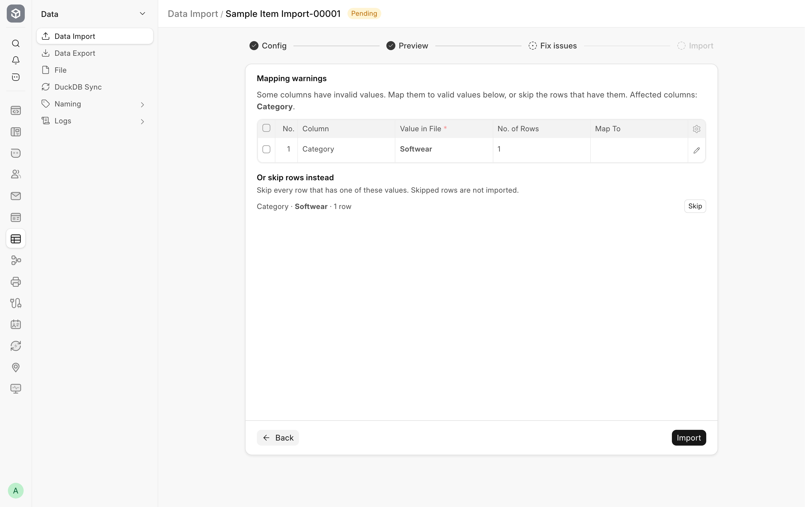

# Data Import and Export

Data Import inserts or updates many records from a CSV or Excel file, or from a public Google Sheet. Data Export downloads records as CSV or Excel. Use them to move data in from another system, to change many records at once, or to get a template to fill in.

## Before you import

- The DocType must allow import (**Allow Import** in the DocType or Customize Form).
- You need the `import` permission on the DocType.
- Most core DocTypes cannot be imported. `User`, `Role` and `Print Format` can.
- The scheduler must be active, because the import runs in a background job. In developer mode, the import runs in the request.

## Import records

Go to `/desk/data-import/new`, or open the list view of the DocType and select **Import** from the new-record menu. The import has four steps: Config, Preview, Fix issues and Import.

### 1. Config



1. Select the **Document Type**.
2. Select the **Import Type**.
3. Optional: click **Download Template** to get a file with the right columns.
4. Attach the file in **Import File**, or enter a URL in **Import from Google Sheets**.
5. Click **Next**.

| Import Type | Result |
|---|---|
| Insert New Records | Each row makes a new document. |
| Update Existing Records | Each row updates the document in the **ID** column. A row with no change fails with "No changes to update". |
| Insert or Update Records | Update the document if the ID exists, else insert it. |

| Option | Default | Description |
|---|---|---|
| Don't Send Emails (`mute_emails`) | 1 | Do not send emails or notifications during the import. |
| Submit After Import | 0 | Submit each document. Submittable DocTypes only. |
| Custom Delimiters / Delimiter Options | 0 / `,;\t|` | For CSV files with a delimiter other than a comma. |
| Detect CSV type (`use_csv_sniffer`) | 0 | Let Frappe find the CSV format. |

### 2. Preview

The preview shows the rows of the file. Each column has a field picker. Change it to match a column to another field, or select **Don't Import** to skip the column. Click **Next**. Frappe saves your changes and opens the next step.


For a tree DocType, the preview shows the tree. You can change the parent of a node or mark it as a group before the import.

### 3. Fix issues

Frappe checks Link and Select values, dates and mandatory fields. Each value that is not valid gets a row in **Mapping warnings**:

- Enter a valid value in **Map To**. Frappe uses it for every row with that value.
- For a Link field, select **Create New** to create the missing record during the import.
- Or click **Skip** to leave out every row that has the value.



After you change a mapping or a skip, click **Save**. The **Import** button shows when there are no unsaved changes. The import does not start while there are warnings that are not fixed or skipped.

### 4. Import

Click **Import** at the bottom of the Fix issues step. Frappe shows the progress, and then the result: how many records were inserted, updated, failed or skipped.

- Frappe commits after each successful row. A failed row does not undo the rows before it.
- The status of the import becomes `Success`, `Partial Success`, `Error` or `Timed Out`.
- If some rows fail, fix the data and start the import again. Rows that were imported before are not imported again.
- Click **Cancel Import** to stop a running import. Frappe asks you to confirm, then stops the job and sets the status to `Error`.

## Import log

Each imported or failed row makes a `Data Import Log` record with the document name, the row numbers, a success flag and the error. On the Import step you can filter the log, and download:

- **Download Failed Rows** (on the Failed count): a file with only the rows that failed, to fix and import again.
- **Download Skipped Rows** (on the Skipped count): the rows you chose to skip.
- **Export Import Log**: the full log.

Deleting a Data Import also deletes its logs.

## Export records

There are two ways to export records.

**From a list view (recommended):** select records, then use **Actions** > **Export**. Or open the Data Import form and click **Download Template**. The **Export Data** dialog has these options:

| Option | Values |
|---|---|
| File Type | `Excel` or `CSV` |
| Export Type | `All Records`, `Filtered Records`, `5 Records` or `Blank Template` |
| Fields | The fields of the DocType and its child tables. Use **Select Mandatory** or **Select All**. |

The exported file has the same format that Data Import reads, so you can edit it and import it with **Update Existing Records**.

**Data Export page:** go to `/desk/data-export`. Select the DocType, the **File Type** (`Excel` or `CSV`), filters and fields, then click **Export**. Select **Export without main header** to leave out the header notes and column descriptions.

To export the rows shown in a report, use **Export** in the menu of the report view. See [Reports](reports.md).

## Pitfalls

- When you update records, include the **ID** column. Frappe finds the document by it.
- In Insert mode, Frappe sets the name from the file only when the DocType uses `Prompt` naming.
- A workflow DocType can only import documents in the first workflow state.
- Child table rows go on the lines below their parent row, with the parent columns empty.

## For developers

- Import from the command line:

```bash
bench --site frappe.localhost data-import --file sample-items.csv --doctype "Sample Item" --type Insert
```

`--type` is `Insert`, `Update` or `Upsert`. Add `--submit-after-import` to submit. The path is relative to the `sites` folder.

- Import or export JSON records from code with `import_doc(path)` and `export_json(doctype, path, filters=None)` in `frappe/core/doctype/data_import/data_import.py`. `bench import-doc <path>` uses `import_doc`.
- Take over validation and record creation for one DocType with the `data_import_providers` hook. Map the DocType to a subclass of `ImportProvider` in `frappe/core/doctype/data_import/import_provider.py`.

```python
# sample_app/hooks.py
data_import_providers = {"Sample Order": "sample_app.imports.SampleOrderImport"}
```

- Rows per batch: `data_import_batch_size` in site config (default 1000). See [Site Config](../../reference/configuration/site-config.md).

## Related

- [List View](../basics/list-view.md)
- [Customize Form](../customization/customize-form.md)
- [Permissions](../users-and-permissions/permissions.md)
- [CLI](../../reference/configuration/cli.md)
