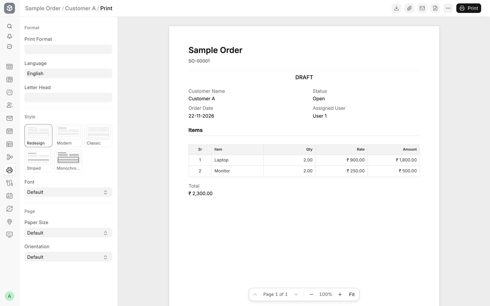
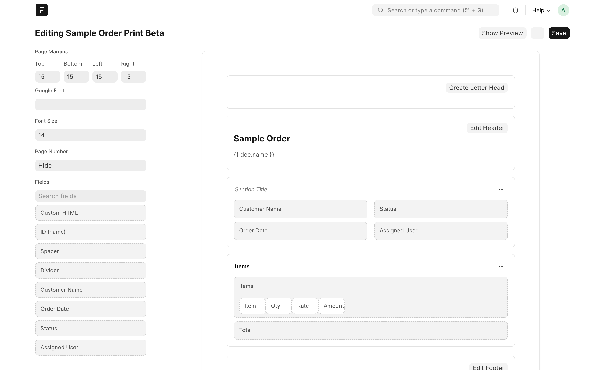

# Printing

Every document in the desk can be printed or saved as a PDF. A **Print Format** controls what the printed page shows. Use the print view to print a document or download it as a PDF. Make a Print Format when the standard layout does not fit, for example when an invoice needs a custom header or a narrow receipt layout. Frappe v15 makes PDFs with `wkhtmltopdf`.

## Core concepts

| Name | DocType | What it is |
|---|---|---|
| Print view | page `print` | The preview at `/app/print/<DocType>/<name>`. You pick the format, language and letter head there. |
| Print Format | `Print Format` | A layout for one DocType (or one report). Made in a Print Format Builder, or written as Jinja HTML. |
| Standard format | none | The layout Frappe makes from the form when no Print Format is selected. |
| Letter Head | `Letter Head` | A header and footer (image or HTML) added to the top and bottom of a print. |
| Print Style | `Print Style` | Site-wide CSS for printed pages. Standard styles: Redesign, Modern, Classic, Monochrome. |
| Print Settings | `Print Settings` (Single) | Site defaults: page size, draft and cancelled printing, raw printing, print server. |
| Print Heading | `Print Heading` | A named heading text that a print can show. |

## Print a document

1. Open the document.
2. Click the print icon in the form toolbar. The print view opens.
3. In the sidebar, select a **Print Format**, a **Language** and a **Letter Head**.
4. Click **Print** to open the browser print dialog.



The toolbar has these buttons:

| Button | Action |
|---|---|
| **Full Page** | Opens the print in a new tab at `/printview`. |
| **PDF** | Makes the PDF on the server with `wkhtmltopdf` and opens it. |
| **Refresh** | Renders the preview again. |
| Form icon | Goes back to the form. |
| **Print** | Opens the browser print dialog. |

The link **Try the new Print Designer** opens the Print Designer app if it is installed, or its page on the Frappe Cloud marketplace. The **...** menu has **Print Settings** and **Customize**, and repeats **Full Page**, **PDF** and **Refresh**. **Raw Printing Setting** shows when **Enable Raw Printing** is on in Print Settings. **Select Network Printer** shows when **Enable Print Server** is on.

!!! note
    Draft documents print with a "Draft" heading when **Always add "Draft" Heading for printing draft documents** is on in Print Settings. Cancelled documents print only when **Allow Print for Cancelled** is on.

## Make a Print Format with the builder

Frappe v15 has two builders. The classic **Print Format Builder** (`print_format_builder` = 1) is at `/app/print-format-builder/<name>`. The newer builder (`print_format_builder_beta` = 1) is at `/app/print-format-builder-beta/<name>`.

To start from the print view:

1. Open the print view of a document.
2. Click **...** > **Customize**.
3. Enter **New Print Format Name**.
4. Optional: turn on **Use the new Print Format Builder**.
5. Click **Start**. Frappe makes the Print Format and opens the builder.

If the selected format was made in a builder, **Customize** opens that format in its builder. If it is a custom HTML format, **Customize** opens the Print Format form.

To start from the Print Format form, go to `/app/print-format/new`, select the **DocType**, keep **Custom Format** off and save. Then click **Edit Format**.

### Classic builder


1. Drag fields from the sidebar onto a section. Drag a field back to the sidebar to remove it.
2. Click **Add a new section** to add a section.
3. Click the gear icon of a section to set **No of Columns** and **Section Heading**, or to remove it.
4. Click **Select Columns** on a table field to pick the child table columns.
5. Click **Edit Heading** to change the heading HTML.
6. Drag **Custom HTML** onto the page to add your own Jinja HTML block.
7. Click **Edit Properties** to open the Print Format form.
8. Click **Save**.

### New builder



The left panel sets **Page Margins**, **Google Font**, **Font Size** and **Page Number**, and lists the **Fields**. The fields list also has **Custom HTML**, **ID (name)**, **Spacer** and **Divider**. On the page you can **Create Letter Head**, **Edit Header** and **Edit Footer**. Click **Show Preview** to see the print of a document. Click **Save** to keep the change.

## Write a Jinja Print Format

Use a Jinja format when you need full control of the HTML.

1. Go to `/app/print-format/new` and select the **DocType**.
2. Turn on **Custom Format**.
3. Keep **Print Format Type** as `Jinja`.
4. Write the template in **HTML**.
5. Save.

```jinja
<h2>{{ doc.customer_name }}</h2>
<p>{{ _("Order Date") }}: {{ doc.get_formatted("order_date") }}</p>
<table class="table table-bordered">
  
  <tr>
    <td>{{ row.item }}</td>
    <td class="text-right">{{ row.get_formatted("qty") }}</td>
    <td class="text-right">{{ row.get_formatted("rate", doc) }}</td>
  </tr>
  
</table>
<p class="text-right">{{ _("Total") }}: {{ doc.get_formatted("total") }}</p>
```

The template gets `doc`, `meta`, `layout`, `no_letterhead`, `letter_head`, `footer` and `print_settings`, plus the Jinja globals such as `frappe` and `_`. Frappe validates the template on save. Frappe does not validate a format with **Print Format Type** `JS` as Jinja.

### Raw printing

For label and receipt printers, turn on **Custom Format** and **Raw Printing**, then write printer commands in **Raw Commands**. Turn on **Enable Raw Printing** in Print Settings first. The browser sends raw commands to the printer through the QZ Tray client.

### Print Format for a report

Set **Print Format For** to `Report` and select the **Report**. Frappe sets **Custom Format** for report formats, so you write the HTML yourself.

## Print Format fields

| Field | Default | Description |
|---|---|---|
| `print_format_for` | `DocType` | `DocType` or `Report`. |
| `standard` | `No` | `Yes` saves the format in the app. Shows only in developer mode. |
| `custom_format` | 0 | Write the format as HTML instead of in a builder. |
| `print_format_type` | `Jinja` | `Jinja` or `JS`. |
| `pdf_generator` | `wkhtmltopdf` | The only option in v15. |
| `default_print_language` | | Language used when the print view opens. |
| `margin_top`, `margin_bottom`, `margin_left`, `margin_right` | 15 | Page margins in mm. |
| `font_size` | 14 | Font size. |
| `page_number` | `Hide` | Position of the page number. |
| `align_labels_right`, `show_section_headings`, `line_breaks` | 0 | Layout options for builder formats. |
| `absolute_value` | 0 | Show negative numbers without the sign. |
| `css` | | Custom CSS for this format. |
| `disabled` | 0 | Hides the format. |

## Set the default format

- In the Print Format form, click **Set as Default**. For a custom DocType this sets `default_print_format` on the DocType. For other DocTypes it makes a Property Setter. The button shows only when you can write `Customize Form`.

## Letter Head

1. Go to `/app/letter-head/new`.
2. Enter **Letter Head Name**.
3. Set **Letter Head Based On** to `Image` or `HTML`.
4. Add the header **Image**, or save and then write the **Header HTML**.
5. Set **Footer Based On** and add the footer the same way.
6. Turn on **Default Letter Head** to use it when no letter head is picked.

Header and footer HTML are Jinja. They get `doc` when they render.

## Print Settings

Go to `/app/print-settings`.

| Field | Default | Description |
|---|---|---|
| `send_print_as_pdf` | 1 | Attach prints to emails as PDF. |
| `repeat_header_footer` | 1 | Repeat the letter head header and footer on each PDF page. |
| `pdf_page_size` | `A4` | Default PDF page size. `Custom` shows **PDF Page Height (in mm)** and **PDF Page Width (in mm)**. |
| `with_letterhead` | 1 | Print with the default letter head. |
| `allow_print_for_draft` | 1 | Allow printing of draft documents. |
| `add_draft_heading` | 1 | Add a "Draft" heading to draft prints. |
| `allow_print_for_cancelled` | 0 | Allow printing of cancelled documents. |
| `allow_page_break_inside_tables` | 0 | Let a table split across pages. |
| `enable_print_server` | 0 | Print to a network printer through `Network Printer Settings`. |
| `enable_raw_printing` | 0 | Allow raw command formats. |
| `print_style` | `Redesign` | Default Print Style. |
| `font`, `font_size` | `Default` | Default print font and size. |

## For developers

- Get the HTML or PDF of a document in Python with `frappe.get_print`. The PDF engine comes from the `pdf_generator` field of the format, or `wkhtmltopdf`.

```python
html = frappe.get_print("Sample Order", "SO-00001", print_format="Sample Order Jinja")
pdf = frappe.get_print("Sample Order", "SO-00001", as_pdf=True)  # bytes
```

- Use `frappe.attach_print(doctype, name, ...)` to get a PDF attachment dict for `frappe.sendmail`.
- The download URL is `/api/method/frappe.utils.print_format.download_pdf?doctype=...&name=...&format=...`. It checks print permission on the document.
- `wkhtmltopdf` must be on the `PATH` of the bench. The print view shows "Invalid wkhtmltopdf version" when it finds a wrong build. Use `wkhtmltopdf` 0.12.x with patched qt.
- Add Jinja methods and filters for templates with the `jinja` hook (`{"methods": [...], "filters": [...]}`).
- Add a PDF engine with the `pdf_generator` hook. `frappe.get_print` calls each hook function when the engine is not `wkhtmltopdf`. A function returns the PDF bytes, or `None` when the engine is not its own. Frappe itself registers no function for this hook.
- Other hooks: `get_print_format_template`, `on_print_pdf`, `pdf_header_html`, `pdf_body_html`, `pdf_footer_html`.
- A Print Format with **Standard** = `Yes` is saved in the app and can be changed only in developer mode. See [Print Formats](../../developer-guide/output/print-formats.md).

## Pitfalls

- A standard Print Format cannot be changed on a site. Duplicate it and edit the copy.
- A Print Format with **Custom Format** on needs **HTML**, or **Raw Commands** when **Raw Printing** is on.
- PDF generation runs `wkhtmltopdf` as a process on the server. It loads images and styles from the site URL, so the server must be able to reach its own site URL.

## Related

- [Form View](../basics/form-view.md)
- [Reports](reports.md)
- [Print Formats (developer)](../../developer-guide/output/print-formats.md)
- [Email](../automation/email.md)
- [Print settings](../settings/print-settings.md)
