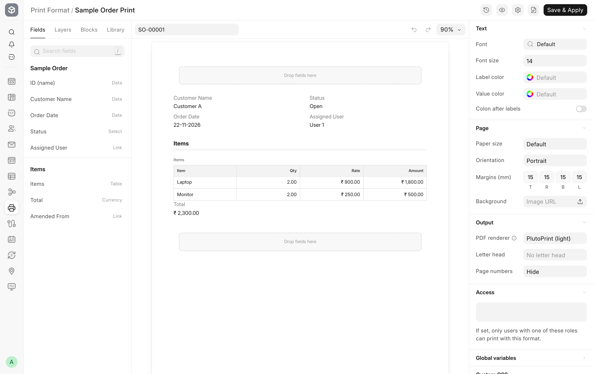

# Printing

Every document in the desk can be printed or saved as a PDF. A **Print Format** controls what the printed page shows. Use the print view to print, download or email a document. Make a Print Format when the standard layout does not fit, for example when an invoice needs a custom header or a narrow receipt layout.

## Core concepts

| Name | DocType | What it is |
|---|---|---|
| Print view | page `print` | The preview at `/desk/print/<DocType>/<name>`. You pick the format, letter head, style and paper there. |
| Print Format | `Print Format` | A layout for one DocType (or one report). Made in the Print Format Editor, or written as Jinja HTML. |
| Standard format | none | The layout Frappe makes from the form when no Print Format is selected. |
| Letter Head | `Letter Head` | A header and footer (image or HTML) added to the top and bottom of a print. |
| Print Style | `Print Style` | Site-wide CSS for printed pages. Standard styles: Redesign, Modern, Classic, Striped, Monochrome. |
| Print Settings | `Print Settings` (Single) | Site defaults: PDF engine, page size, draft and cancelled printing, raw printing. |
| Print Heading | `Print Heading` | A named heading text that a print can show. |

## Print a document

1. Open the document.
2. Click the print icon next to the title in the form sidebar, or press <kbd>Ctrl</kbd>+<kbd>P</kbd>. The print view opens.
3. In the sidebar, select a **Print Format**, **Language** and **Letter Head**.
4. Select a **Style**, a **Font**, a **Paper Size** and an **Orientation** if you need them.
5. Click **Print** to send the page to the browser print dialog.


The toolbar icons do these actions:

| Icon | Action | Shortcut |
|---|---|---|
| Download | **Download PDF**. Makes the PDF on the server. | <kbd>Ctrl</kbd>+<kbd>Shift</kbd>+<kbd>P</kbd> |
| Paperclip | **Attach PDF**. Saves the PDF as a file attachment on the document. | |
| Mail | **Email**. Opens the email composer with the print attached. | <kbd>Ctrl</kbd>+<kbd>Shift</kbd>+<kbd>E</kbd> |
| Form | Goes back to the form. | |
| Print button | **Print**. Opens the browser print dialog. | <kbd>Ctrl</kbd>+<kbd>P</kbd> |

The **...** menu has **Full Page**, **Refresh**, **Set as Default Format**, **Print Settings** and **Customize**. **Raw Printing Setting** shows when raw printing is on. **Select Network Printer** shows when **Enable Print Server** is on in Print Settings.

!!! note
    Draft documents print with a "Draft" heading when **Always add "Draft" Heading for printing draft documents** is on in Print Settings. Cancelled documents print only when **Allow Print for Cancelled** is on.

## Make a Print Format with the editor

A new Print Format that is not a custom HTML format uses the **Print Format Editor** (`print_format_builder_beta` is set on save).

1. Go to `/desk/print-format/new`.
2. Enter a name and select the **DocType**, for example `Sample Order`.
3. Save. The editor opens at `/desk/print-format-builder/<name>`.
4. Select **Start from default** to begin with all fields of the DocType, or **Start blank**.
5. Drag fields from the left panel onto the page.
6. Click **Save & Apply** to make the change live.



The left panel has four tabs:

| Tab | Content |
|---|---|
| **Fields** | The fields of the DocType and of its child tables. |
| **Layers** | The tree of sections and fields on the page. |
| **Blocks** | **Section**, **Page Break**, **Custom HTML** (or **Typst** for a Typst format), **Spacer**, **Divider**, **Image**, **Barcode**, **Custom Table**, **Text** and **Linked Field**. |
| **Library** | Saved snippets that you can reuse. |

The right panel sets font, font size, label and value colors, paper size, orientation, margins, background, **PDF renderer**, letter head, page numbers, **Access** (roles that may print with this format), global variables and custom CSS.

The editor keeps your edits as a working draft (`draft_data`) until you click **Save & Apply**. The history icon shows saved versions. The record box at the top picks the document used for the preview.

### PDF renderer

| Value | Label in the editor | Notes |
|---|---|---|
| `chrome` | Chromium | Renders HTML with headless Chromium. |
| `PlutoPrint` | PlutoPrint (light) | Default. Marked experimental. Falls back to Chromium for a format it cannot render. |
| `Typst` | Typst (fast) | Marked experimental. Only for editor formats. Adds a **Typst** block and removes **Custom HTML**. |

## Write a Jinja Print Format

Use a Jinja format when you need full control of the HTML.

1. Open a new Print Format and select the **DocType**.
2. Turn on **Custom Format**.
3. Keep **Print Format Type** as `Jinja`.
4. Write the template in **HTML**.
5. Save.

```jinja
<h2>{{ doc.customer_name }}</h2>
<p>{{ _("Order Date") }}: {{ doc.get_formatted("order_date") }}</p>
<table class="table table-bordered">
  
  <tr>
    <td>{{ row.item }}</td>
    <td class="text-right">{{ row.get_formatted("qty") }}</td>
    <td class="text-right">{{ row.get_formatted("rate", doc) }}</td>
  </tr>
  
</table>
<p class="text-right">{{ _("Total") }}: {{ doc.get_formatted("total") }}</p>
```

The template gets `doc`, `meta`, `layout`, `no_letterhead`, `letter_head`, `footer` and `print_settings`, plus the Jinja globals such as `frappe` and `_`. Frappe validates the template on save.

### Raw printing

For label and receipt printers, turn on **Custom Format** and **Raw Printing**, then write printer commands in **Raw Commands**. Turn on **Enable Raw Printing** in Print Settings first. The browser sends raw commands to the printer through the QZ Tray client.

### Print Format for a report

Set **Print Format For** to `Report` and select the **Report**. Frappe sets **Custom Format** for report formats, so you write the HTML yourself.

## Set the default format

- In the Print Format form, click **Set as Default**. For a custom DocType this sets `default_print_format` on the DocType. For other DocTypes it makes a Property Setter.
- In the print view, use **...** > **Set as Default Format**.

Disabling the default format removes it as the default after you confirm.

## Letter Head

1. Go to `/desk/letter-head/new`.
2. Enter **Letter Head Name**.
3. Set **Letter Head Based On** to `Image` or `HTML`.
4. Add the header image or the **Header HTML**.
5. Set **Footer Based On** and add the footer the same way.
6. Turn on **Default Letter Head** to use it when no letter head is picked.

Header and footer HTML are Jinja. They get `doc` when they render.

## Print Settings

Go to `/desk/print-settings`.

| Field | Default | Description |
|---|---|---|
| `send_print_as_pdf` | 1 | Attach prints to emails as PDF. |
| `repeat_header_footer` | 1 | Repeat the letter head header and footer on each PDF page. |
| `pdf_generator` | `PlutoPrint` | Default PDF engine: `chrome` or `PlutoPrint`. A format can override it. |
| `pdf_page_size` | `A4` | Default PDF page size. `Custom` shows height and width in mm. |
| `with_letterhead` | 1 | Print with the default letter head. |
| `allow_print_for_draft` | 1 | Allow printing of draft documents. |
| `add_draft_heading` | 1 | Add a "Draft" heading to draft prints. |
| `allow_print_for_cancelled` | 0 | Allow printing of cancelled documents. |
| `allow_page_break_inside_tables` | 0 | Let a table split across pages. |
| `enable_print_server` | 0 | Print to a network printer (`Network Printer Settings`, CUPS server and port 631 by default). |
| `enable_raw_printing` | 0 | Allow raw command formats. |
| `print_style` | `Redesign` | Default Print Style. |
| `font`, `font_size` | `Default` | Default print font. |
| `max_bulk_print_docs` | 100 | Most documents in one bulk print. |
| `max_concurrent_bulk_exports` | 5 | Most bulk PDF exports one user can run at the same time. |

## For developers

- Get the HTML or PDF of a document in Python with `frappe.get_print`. It uses the PDF engine from the format or Print Settings.

```python
html = frappe.get_print("Sample Order", "SO-00001", print_format="Sample Order Print")
pdf = frappe.get_print("Sample Order", "SO-00001", as_pdf=True)  # bytes, starts with b"%PDF-"
```

- Use `frappe.attach_print(doctype, name, ...)` to get a PDF attachment dict for `frappe.sendmail`.
- The download URL is `/api/method/frappe.utils.print_format.download_pdf?doctype=...&name=...&format=...`. It checks print permission and has a rate limit of 30 calls a minute per user.
- Add Jinja methods and filters for templates with the `jinja` hook (`{"methods": [...], "filters": [...]}`).
- Add a PDF engine with the `pdf_generator` hook. Frappe registers `get_chrome_pdf`, `get_plutoprint_pdf` and `get_typst_pdf`.
- Other hooks: `get_print_format_template`, `on_print_pdf`, `pdf_header_html`, `pdf_body_html`, `pdf_footer_html`.
- A Print Format with **Standard** = `Yes` is saved in the app and can be changed only in developer mode. See [Print Formats](../../developer-guide/output/print-formats.md).

## Pitfalls

- A standard Print Format cannot be changed on a site. Duplicate it and edit the copy.
- Edits in the Print Format Editor do not print until you click **Save & Apply**.
- **Paper Size** `Custom` needs **Paper Width** and **Paper Height** above 0 for a classic or custom format.
- The **Access** roles hide the format from users without one of the roles.

## Related

- [Form View](../basics/form-view.md)
- [Reports](reports.md)
- [Print Formats (developer)](../../developer-guide/output/print-formats.md)
- [Email](../automation/email.md)
