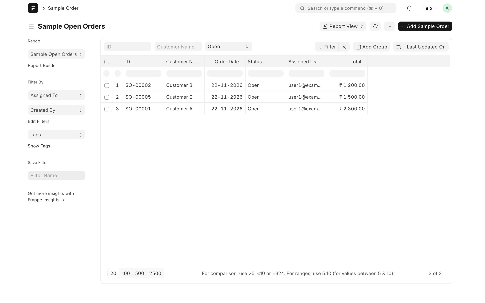

# Reports

A report shows records as a table, with filters, totals, charts and export. Frappe has four report types. Use **Report Builder** to save a column and filter setup of one DocType without code. Use a **Query Report** or a **Script Report** when you need joins, calculations or data from many DocTypes. Every report is a `Report` document.

## Report types

| `report_type` | Who makes it | Where it runs | Notes |
|---|---|---|---|
| `Report Builder` | A user with create permission on `Report` | Report view of one DocType | Columns, filters, sort, group by and totals are saved as JSON in the `json` field. |
| `Query Report` | `Script Manager` (non-standard) or a developer | `/app/query-report/<name>` | One SQL `SELECT` in the `query` field. |
| `Script Report` | `Script Manager` (non-standard) or a developer | `/app/query-report/<name>` | Python. In an app: an `execute(filters)` function. On a site: the **Script** field. |
| `Custom Report` | Report Manager | `/app/query-report/<name>` | A saved copy of a Query or Script Report with its own columns and filters. `reference_report` points to the original. |

A report is **Standard** (`is_standard` = `Yes`) when it is part of an app. A standard report cannot be changed or deleted on a site. Duplicate it, or use **Save** in the report to make a Custom Report.

## Make a Report Builder report

1. Open the list of the DocType, for example `/app/sample-order`.
2. Switch the view to **Report**. The URL becomes `/app/sample-order/view/report`.
3. Add filters with **Filter**, and a group with **Add Group**.
4. Click a column header to sort or remove the column. Use **...** > **Pick Columns** to add columns, also from child tables.
5. Click **...** > **Save As** and enter a name.

The new report opens at `/app/<doctype>/view/report/<report name>`. The page title shows **Not Saved** after you change it. Click **...** > **Save** to keep the change.

The **...** menu of the report view has these items. Some show only when you have the permission.

| Item | What it does |
|---|---|
| **Show Totals** | Adds a total row for number columns. |
| **Print** | Prints the table. Needs print permission on the DocType. |
| **Toggle Chart** | Shows a chart. Pick the X axis field, Y axis fields and chart type. |
| **Toggle Sidebar** | Shows or hides the sidebar. |
| **Pick Columns** | Selects the columns to show. |
| **Export** | Downloads the rows (see [Export](#export)). |
| **Setup Auto Email** | Makes an Auto Email Report that sends this report on a schedule. |
| **Save** / **Save As** | **Save** updates this report. It shows for a non-standard report when you can write `Report` or own the report. **Save As** makes a new report. |
| **Delete** | Deletes the saved report. |
| **User Permissions** | Opens the User Permission list filtered on this saved report. Shows for a System Manager on a saved report. |
| **List Settings** | Opens the list settings of the DocType. Shows for a System Manager. |

## Run a Query or Script Report

1. Search for the report name in the awesomebar, or open `/app/query-report/<Report Name>`.
2. Set the filters at the top. The report runs again on each change.
3. Use the **Actions** menu or the **...** menu for more actions.

| Item | What it does |
|---|---|
| **Refresh** | Runs the report again. |
| **Edit** | Opens the `Report` document. Report Managers only. |
| **Print** | Prints the report. |
| **PDF** | Makes a PDF of the report. |
| **Export** | Downloads the data. |
| **Setup Auto Email** | Makes an Auto Email Report. |
| **Add Column** | Adds a column from a linked DocType. |
| **User Permissions** | Opens User Permissions for the report DocType. System Managers only. |
| **Save** | Saves your columns and filters as a `Custom Report`. Report Managers only. |
| **Create Card** (Actions) | Makes a Number Card from a number column. Needs create permission on `Number Card`. |
| **Set Chart** / **Add Chart to Dashboard** (Actions) | Makes a chart from the report and adds it to a Dashboard. Needs create permission on `Dashboard Chart`. |

## Prepared reports

A prepared report runs in a background job and saves the result. Use it for a report that takes a long time.

- Turn on **Prepared Report** (`prepared_report`) in the `Report` document.
- For a Script Report, Frappe turns it on for you when one run takes more than 15 seconds. To stop this, turn on **Disable Prepared Report Automation**.
- **Timeout (In Seconds)** sets the job timeout. The default is 1500 seconds (25 minutes).

When a report is prepared:

1. Set the filters and click **Generate New Report**.
2. Frappe makes a `Prepared Report` with status `Queued`. The status changes to `Started` when a worker picks it up.
3. When the job ends, the status is `Completed` or `Error`. The open report refreshes, or an alert shows a link to the result.
4. Click **Edit** to change the filters, or **Rebuild** to run it again with the same filters.

In a completed `Prepared Report` document, click **Show Report** to open the result. Click **Download as CSV** to make a CSV file in a background job. The file is attached to the `Prepared Report` and you get a notification.

## Snapshot reports

A snapshot report reads data from a DuckDB copy of the database instead of the live database. Use it for heavy standard Script Reports.

1. In System Settings, turn on **Enable Snapshot Reports**.
2. Set **Frequency** to `Daily` or `Weekly` (default `Weekly`). Frappe makes a scheduled job that runs `frappe.database.duckdb.database.start_duckdb_sync`.
3. In the standard Script Report, turn on **Snapshot Report** and add the DocTypes to copy in **Doctype To Sync**.
4. In the report module, write `execute_snapshot_report(filters)`. Frappe calls it instead of `execute`.

The report shows data from the time of the last `DuckDB Sync`, not live data.

## Export

**Export** opens a dialog with these options:

| Option | Default | Description |
|---|---|---|
| **File Format** | `Excel` | `Excel` or `CSV`. |
| **Export in Background** | off | Makes the file in a background job. |
| **CSV Delimiter** | `,` | CSV only. |
| **CSV Quoting** | `Non-numeric` | `Minimal`, `All`, `Non-numeric` or `None`. |
| **CSV Preview** | | CSV only. Shows the first rows with the current settings. |

In a Query or Script Report, the dialog can also show **Include indentation** (tree reports), **Include filters** (when filters are set) and **Include hidden columns** (when the report allows it). In the report view, the dialog also asks if you want to export all matching rows when there are more rows than the page shows, and has **Translate values**. **Export** shows only when you have export permission on the DocType.

## Access

- A user can open a report when they can read its **Ref DocType** and have one of the roles in its **Roles** table.
- Non-standard Query and Script Reports can be saved only by a user with the `Script Manager` role.
- **Disabled** hides the report.

## For developers

- Write Query and Script Reports in an app as files in `<module>/report/<report_name>/`. See [Reports (developer)](../../developer-guide/output/reports.md).
- Run a Query or Script Report from code or the API with `frappe.desk.query_report.run(report_name, filters)`.
- `frappe.core.doctype.prepared_report.prepared_report.make_prepared_report(report_name, filters)` queues a prepared report.
- `frappe.desk.query_report.save_report(reference_report, report_name, columns, filters)` makes a Custom Report.
- `frappe.desk.reportview.save_report(name, doctype, report_settings)` saves a Report Builder report.

## Pitfalls

- A Report Builder report works on one DocType and its child tables. Use a Query or Script Report for joins.
- A prepared report shows the result of the last run, not live data. Check the **Finished At** time.
- When Administrator saves a new report in developer mode, Frappe sets `is_standard` to `Yes` and writes it to the app.

## Related

- [List View](../basics/list-view.md)
- [Views](../basics/views.md)
- [Dashboards](dashboards.md)
- [Email](../automation/email.md)
- [Printing](printing.md)
- [Reports (developer)](../../developer-guide/output/reports.md)
