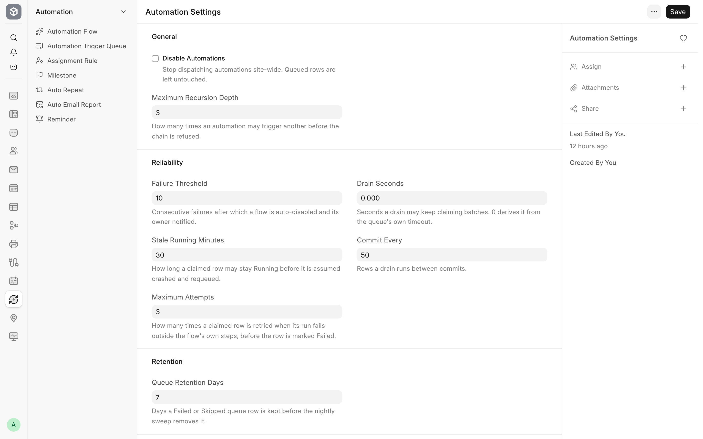

# Automation and AI Settings

This page is the field reference for the settings of the automation engine, Flow (AI agents) and the Studio AI assistant. For each field it gives the default and the code that reads it. For how Single DocTypes work in general, see [How Settings Work](how-settings-work.md).

All DocTypes on this page are Single DocTypes. Only the `System Manager` role can read or write them.

| DocType | Module | Route |
|---|---|---|
| `Automation Settings` | Automation | `/desk/automation-settings` |
| `Flow Settings` | Flow | `/desk/flow-settings`, or the settings of the `/flow` page |
| `Flow Knowledge Settings` | Flow | `/desk/flow-knowledge-settings`, or the settings of the `/flow` page |
| `Studio Settings` | Studio | `/desk/studio-settings` |

## Automation Settings

`Automation Settings` controls the automation engine that runs `Automation Flow` records: if it runs, how deep chains can go, retries, cleanup and size limits. Open it at `/desk/automation-settings`. The controller has no validation. All code reads the values through `frappe.automation_engine.settings.get(fieldname)`, which uses `frappe.get_cached_doc`. A save takes effect on the next read.



!!! note
    A value of 0 or empty falls back to the default in `DEFAULTS` (`frappe/automation_engine/settings.py`). Only **Disable Automations**, **Drain Seconds** and **Allow Unregistered Events** accept 0 as a value. For example, **Maximum Recursion Depth** 0 means 3.

### General

| Field | Default | Effect |
|---|---|---|
| Disable Automations (`disable_automations`) | 0 | When on, `is_enabled()` returns `False`. Document events do not queue automations (`dispatch.py`), the drain job does not run queued rows (`drainer.py`), and the `Scheduled` and `Date Based` triggers do not fire (`scheduler.py`). Rows already in `Automation Trigger Queue` stay there and run after you turn it off. |
| Maximum Recursion Depth (`max_depth`) | 3 | An automation that saves a document can trigger another automation. Each level adds 1 to the depth. Above this value, `dispatch.py` queues nothing and logs the error `Automation Flow depth limit reached`. |

### Reliability

| Field | Default | Effect |
|---|---|---|
| Failure Threshold (`failure_threshold`) | 10 | Consecutive failed runs of one flow, counted in Redis. At this count, `runner.py` sets **Enabled** to 0 on the `Automation Flow`, fills **Disabled Reason**, marks its waiting queue rows `Skipped` and sends the flow owner a `Notification Log`. A successful run resets the count. |
| Stale Running Minutes (`stale_running_minutes`) | 30 | `requeue_stale_running()` sets queue rows that stay `Running` longer than this back to `Pending`. It runs every 5 minutes from `drain_due`. |
| Maximum Attempts (`max_attempts`) | 3 | Tries for a queue row whose run fails outside the flow's own steps, for example when the flow was deleted. After the last try the row is `Failed`. |
| Drain Seconds (`drain_seconds`) | 0 | Time a drain job may keep claiming new batches. 0 uses the timeout of the `default` queue (300 seconds unless the `workers` config changes it) times 0.6. |
| Commit Every (`commit_every`) | 50 | Queue rows a drain runs between database commits. Each row has its own savepoint. |

### Retention

| Field | Default | Effect |
|---|---|---|
| Queue Retention Days (`queue_retention_days`) | 7 | `purge_queue()` (scheduler event `daily_maintenance`) deletes `Failed` and `Skipped` queue rows older than this. It also deletes `Automation Event Subscription` rows with status `Matched`, `Timed Out` or `Cancelled`. |

### Limits

| Field | Default | Effect |
|---|---|---|
| Step Output Limit (`step_output_limit`) | 65536 | Bytes of JSON output a step may pass to later steps. Larger output is replaced with `{"truncated": true}`. The step does not fail. |
| Event Payload Limit (`event_payload_limit`) | 65536 | Bytes of JSON payload `frappe.automation_engine.emit()` accepts. Larger payloads throw `Automation event payload is too large`. |
| Allow Unregistered Events (`allow_unregistered_events`) | 0 | When off, `emit()` and a **Wait for Event** step accept only event names that an app declares in the `automation_events` hook. When on, any event name is accepted. |

### For developers

```python
from frappe.automation_engine import emit, is_enabled, skip_automations
from frappe.automation_engine import settings

settings.get("max_depth")  # value, or the default when 0 or empty

with skip_automations():
	doc.save()  # no automations are queued inside this block
```

- `automation_disabled` in site config stops the engine without a database read, and wins over **Disable Automations**. See [Site Config](../../reference/configuration/site-config.md).
- The engine does not dispatch during install, patches or migrate.
- The scheduler events are in `frappe/hooks.py`: `process_cron` and `drain_due` every 5 minutes, `process_date_based` hourly, `purge_queue` in `daily_maintenance`.

## Flow Settings

`Flow Settings` holds site-wide options for Flow agents: the helper model, web search and the guest rate limit. Open it at `/desk/flow-settings`, or under **Flow settings** in the settings of the `/flow` page (`flow/frontend/src/settings/specs.js`).

| Field | Default | Effect |
|---|---|---|
| Helper Model (`small_model`) | empty | A `Flow Model` for small side jobs, like chat titles. `FlowSession` in `frappe/flow/doctype/flow_session/flow_session.py` sends it to the Flow runtime as `small_model`, only when that model is enabled. |

### Web Search

| Field | Default | Effect |
|---|---|---|
| Search Provider (`search_provider`) | `DuckDuckGo` | `DuckDuckGo`, `Brave`, `Tavily` or `Exa`. Sent to the Flow runtime as `web_search.provider` for each session. |
| Search API Key (`search_api_key`) | empty | Password field. Shows and is mandatory when the provider is not `DuckDuckGo`. `validate` throws `<provider> needs a Search API Key.` when it is empty. Sent decrypted as `web_search.api_key`. |

### Guest Chats

| Field | Default | Effect |
|---|---|---|
| Guest Messages per Hour (`guest_messages_per_hour`) | 0 (uses 30) | Rate limit per IP address for the guest methods `start` and `send` in `frappe/flow/api/guest.py`, used by public agents. 0 or empty uses 30. |

## Flow Knowledge Settings

`Flow Knowledge Settings` sets the embedding model, search type and chunking for Flow knowledge bases, chat attachments and agent memory. Open it at `/desk/flow-knowledge-settings`, or under **Knowledge settings** in the settings of the `/flow` page.

| Field | Default | Effect |
|---|---|---|
| Embedding Model (`embedding_model`) | empty | `Flow Model` that embeds chunks and queries (`frappe/flow/knowledge/embedder.py`). Its model ID must be an embedding model. While it is empty: `Flow Knowledge Base` and `Flow Knowledge Source` cannot be created, agents do not get the attachment search tool, and knowledge search throws `Set an embedding model in Flow Knowledge Settings first.` `validate` blocks a change while `Flow Knowledge Chunk` rows exist. Delete all knowledge sources first. Renaming the `Flow Model` updates this field. |
| Embedding Dimension (`embedding_dimension`) | 0 | Read only. On save, `validate` calls the model once with a probe text and stores the vector width. Set to 0 when there is no model. Used to create the vector tables for knowledge, attachments and memory. |
| Search Type (`search_type`) | `Hybrid` | `Hybrid` combines vector similarity with keyword matching. `Vector` uses similarity only. Read by `frappe/flow/knowledge/retriever.py` for knowledge search and attachment search. |

### Chunking

| Field | Default | Effect |
|---|---|---|
| Chunk Size (`chunk_size`) | 1000 | Maximum characters per chunk. Must be at least 1. A `Flow Knowledge Source` with its own **Chunk Size** uses that value instead. Chat attachments always use this value. |
| Chunk Overlap (`chunk_overlap`) | 200 | Characters shared by two chunks next to each other. Must be smaller than **Chunk Size**, or `validate` throws. A source can override it. |

## Studio Settings

`Studio Settings` holds the API key for the AI assistant in the Studio editor. Open it at `/desk/studio-settings`.

### AI Settings

| Field | Default | Effect |
|---|---|---|
| AI API Key (`ai_api_key`) | empty | Password field. An OpenRouter API key. `get_api_key()` in `frappe/studio/ai/llm.py` reads it. When it is empty, the `run` method in `frappe/studio/ai/api.py` throws `OpenRouter API key is not configured. Please set it in Studio Settings.` The editor loads this document (`studio/frontend/src/data/studioSettings.ts`), and `AIChatPanel.vue` shows the chat only when the field has a value. |

!!! note
    The **Open Settings** button in the Studio AI panel opens the Studio settings dialog, but that dialog has only the **App** and **Pages** tabs. Set the key at `/desk/studio-settings`.

## Related

- [How Settings Work](how-settings-work.md)
- [Automation Flow](../automation/automation-flow.md)
- [Automation Engine](../../developer-guide/low-code-and-ai/automation-engine.md)
- [Flow](../ai-and-app-builder/flow.md)
- [Flow Development](../../developer-guide/low-code-and-ai/flow-development.md)
- [Studio](../ai-and-app-builder/studio.md)
- [Studio Development](../../developer-guide/low-code-and-ai/studio-development.md)
