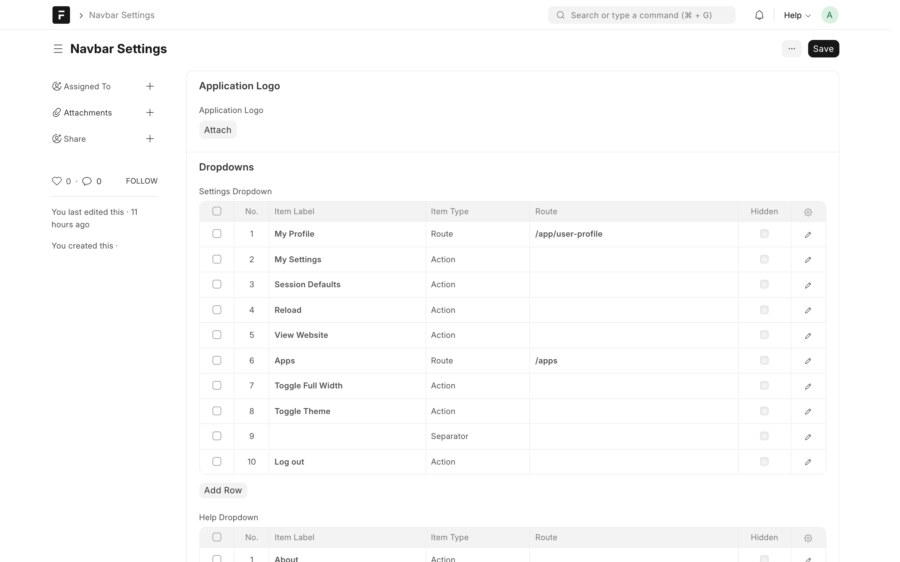

# Desk Settings

This page is the field reference for the settings that change the desk: `Navbar Settings`, `Global Search Settings`, `Domain Settings`, `Document Naming Settings`, `Energy Point Settings` and `Notification Settings`. All of them except `Notification Settings` are Single DocTypes that only `System Manager` can read and edit. For the general rules about settings pages, caching and code access, see [How Settings Work](how-settings-work.md).

## Navbar Settings

`Navbar Settings` sets the application logo, the items of the user menu and the **Help** menu in the navbar, and an announcement bar. Open it at `/app/navbar-settings`. Only `System Manager` can edit it. After a save, the form clears the cache and reloads the desk (`navbar_settings.js` calls `frappe.ui.toolbar.clear_cache`).



### Application Logo

| Field | Default | Effect |
|---|---|---|
| Application Logo (`app_logo`) | empty | Logo at the left of the desk navbar and on the login page. Both use `get_app_logo()` (`navbar_settings.py`). It takes the `app_logo` of Website Settings first, then this field, then the `app_logo_url` hook. The desk reads the result from `frappe.boot.app_logo_url` (`navbar.html`). The login page reads it in `frappe/www/login.py`. |

### Dropdowns

| Field | Default | Effect |
|---|---|---|
| Settings Dropdown (`settings_dropdown`) | rows from the `standard_navbar_items` hook | Table of `Navbar Item` rows. Rows that are not hidden show in the user menu, opened from the avatar at the right of the navbar (`navbar.html`, `#toolbar-user`). Frappe ships **My Profile**, **My Settings**, **Session Defaults**, **Reload**, **View Website**, **Apps**, **Toggle Full Width**, **Toggle Theme**, a separator and **Log out**. |
| Help Dropdown (`help_dropdown`) | rows from the `standard_help_items` hook | Table of `Navbar Item` rows. Rows that are not hidden show under **Help** in the navbar, after the help links of the current page. Frappe ships **About**, **Keyboard Shortcuts** and **Frappe Support**. |

`Navbar Item` row fields:

| Field | Default | Effect |
|---|---|---|
| Item Label (`item_label`) | empty | Menu label, translated with `__()`. Mandatory when Item Type is `Route` or `Action`. |
| Item Type (`item_type`) | empty | `Route`, `Action` or `Separator`. Read only on standard rows. |
| Route (`route`) | empty | Shows when Item Type is `Route`, and is then mandatory. A desk route or an external URL, used as the link `href`. Read only on standard rows. |
| Action (`action`) | empty | Shows when Item Type is `Action`, and is then mandatory. JavaScript that runs in the `onclick` of the menu item. Read only on standard rows. |
| Hidden (`hidden`) | `0` | Hides the row from the menu. |
| Is Standard (`is_standard`) | `0` | Read only. Set on rows that come from hooks. |
| Condition (`condition`) | empty | JavaScript expression. The template runs it with `eval` when the navbar renders at desk load. A Settings Dropdown row shows only when it is true. The Help menu does not read this field. |

`navbar.html` decides the kind of item by its values: a row with a `route` is a link, a row with an `action` is a button, and any other row is a separator.

`NavbarSettings.validate` blocks the removal of standard rows: "Please hide the standard navbar items instead of deleting them." Hide a standard row with **Hidden**. The check does not run during patches.

### Announcements

| Field | Default | Effect |
|---|---|---|
| Announcement Widget (`announcement_widget`) | empty | HTML shown in a blue bar below the navbar (`navbar.html`). The bar has a close button. A closed bar stays hidden in that browser (`localStorage` key `dismissed_announcement_widget`). When the text changes, the bar shows again (`toolbar.js`, `setup_announcement_widget`). |

### For developers

- Boot key: `frappe.boot.navbar_settings` holds the whole document (`frappe.get_single` in `frappe/boot.py`, and `frappe.get_cached_doc` in `frappe/sessions.py`).
- `frappe.boot.app_logo_url` holds the result of `get_app_logo()`.
- Add menu items from an app with the `standard_navbar_items` and `standard_help_items` hooks. `add_standard_navbar_items()` in `frappe/utils/install.py` fills the tables from all hooks. It runs once, when Frappe is installed on the site, and does nothing when both tables already have rows. An app that you install later on an existing site does not add its items. Add them in your app's `after_install` with `frappe.get_single("Navbar Settings")`, `append` and `save`.

```python
# sample_app/hooks.py
standard_navbar_items = [
	{
		"item_label": "Sample Orders",
		"item_type": "Route",
		"route": "/app/sample-order",
		"is_standard": 1,
	},
]

standard_help_items = [
	{
		"item_label": "Sample Docs",
		"item_type": "Route",
		"route": "https://example.com/docs",
		"is_standard": 1,
	},
]
```

## Global Search Settings

`Global Search Settings` lists the DocTypes that global search covers. Open it at `/app/global-search-settings`. Only `System Manager` can read and edit it.

### Search Priorities

| Field | Default | Effect |
|---|---|---|
| Search Priorities (`allowed_in_global_search`) | DocTypes from the `global_search_doctypes` hook, set by the setup wizard | Table of `Global Search DocType` rows. Only these DocTypes are searched, and only when the user can read them (`search` in `frappe/utils/global_search.py`). |

`Global Search DocType` row fields:

| Field | Default | Effect |
|---|---|---|
| Document Type (`document_type`) | empty | Link to `DocType`. |

Validation in `GlobalSearchSettings.validate`:

- A DocType of the `Core` module raises "Core Modules {0} cannot be searched in Global Search."
- A DocType in two rows raises "Document Type {0} has been repeated."
- After validation, the cached list (`global_search` / `search_priorities` in the cache) is deleted.

The **Reset** button replaces the table with the DocTypes from the `global_search_doctypes` hook of every installed app. It uses the `Default` key and the keys of the active domains. An entry with `index` is inserted at that position. A progress bar shows over realtime. The setup wizard runs the same reset (`frappe/desk/page/setup_wizard/install_fixtures.py`).

!!! note
    The code comment in `search()` says results are sorted by the table order. In this version the loop runs over a Python `set` of DocTypes, so the row order does not set the order of the results.

### For developers

- Read the list: `frappe.desk.doctype.global_search_settings.global_search_settings.get_doctypes_for_global_search()`. It is cached.
- Add your DocTypes for the **Reset** button. An optional `index` sets the position:

```python
# sample_app/hooks.py
global_search_doctypes = {
	"Default": [
		{"doctype": "Sample Order", "index": 0},
		{"doctype": "Sample Item"},
	]
}
```

## Domain Settings

`Domain Settings` turns on domains. A domain is a set of modules, roles and custom fields that an app makes available only when the domain is active. Open it at `/app/domain-settings`. Only `System Manager` can edit it. Frappe itself defines no domains, so on a site with only Frappe the list is empty.

### Active Domains

| Field | Default | Effect |
|---|---|---|
| Domains HTML (`domains_html`) | not stored | A checkbox for each `Domain` record (`frappe.boot.all_domains`). Checked boxes fill `active_domains` on save (`domain_settings.js`). |
| Active Domains (`active_domains`) | empty | Hidden, read only table of `Has Domain` rows (field `domain`, Link to `Domain`). `frappe.get_active_domains()` reads it. The result is cached and is also in `frappe.boot.active_domains`. |

Side effects in `DomainSettings.on_update`:

1. For each active domain, `Domain.setup_domain()` runs. It enables the restricted roles, gives them to the current user, applies property setters and values, creates custom fields and calls `on_setup`.
2. `restrict_roles_and_modules()` sets `restrict_to_domain` on the domain's `Module Def` and `Role` records. For each inactive domain, it disables its roles, removes them from all users and deletes its custom fields.
3. Frappe clears the whole cache.

Where the active domains take effect:

- DocTypes, modules and workspace items with `restrict_to_domain` set to an inactive domain are hidden from the user (`frappe/utils/user.py`, `frappe/desk/desktop.py`).
- The **Reset** button of Global Search Settings uses the `global_search_doctypes` entries of the active domains.

### For developers

Declare a domain in your app. The module must have a `data` dict. Keys that `frappe/core/doctype/domain/domain.py` and `domain_settings.py` read: `modules`, `restricted_roles`, `custom_fields`, `properties`, `set_value`, `on_setup`, `default_portal_role`, `allow_sidebar_items`, `remove_sidebar_items`.

```python
# sample_app/hooks.py
domains = {
	"Sample Domain": "sample_app.domains.sample_domain",
}
```

```python
# sample_app/domains/sample_domain.py
data = {
	"modules": ["Sample App"],
	"restricted_roles": ["Sample Role"],
}
```

Activate domains from code with `frappe.get_single("Domain Settings").set_active_domains(["Sample Domain"])`. It saves only when it adds a domain.

## Document Naming Settings

`Document Naming Settings` is a tool to edit naming series options, change series counters and set how amended documents are named. Open it at `/app/document-naming-settings`. Only `System Manager` can edit it. The form has no **Save** button (`frm.disable_save()`). Each section has its own button. Most fields are work fields: they hold input for a button and have no effect on their own. For naming rules in general, see [Naming](../../developer-guide/data-model/naming.md).

### Setup Series for transactions

| Field | Default | Effect |
|---|---|---|
| Select Transaction (`transaction_type`) | empty | DocType to edit. The list has the DocTypes with a `naming_series` field that you can read. Selecting one loads its current options. |
| Series List for this Transaction (`naming_series_options`) | empty | Shows when a DocType is selected. One series per line. **Update** writes them as the `options` Property Setter of the `naming_series` field. The first line becomes the `default` Property Setter. |
| User must always select (`user_must_always_select`) | `0` | Shows when a DocType is selected. On **Update**, an empty first option is added, so the default is empty and the user must select a series. |
| Update (`update`) | button | Shows when a DocType is selected. Runs `update_series`. Each series is validated. A series that another DocType already uses is rejected. Clears the DocType cache. |
| Try a Naming Series (`try_naming_series`) | empty | Shows when a DocType is selected. Enter a series to get a preview. Field values in the series come from the last document of the DocType. |
| Preview of generated names (`series_preview`) | empty | Read only. The names that `preview_series` returns. |
| Help HTML (`help_html`) | static | Shows when a DocType is selected. Help text about series syntax. |

### Update Series Counter

| Field | Default | Effect |
|---|---|---|
| Prefix (`prefix`) | empty | Series prefix from `tabSeries` and from series templates. Selecting one loads its counter into Current Value. |
| Current Value (`current_value`) | `0` | The number of the last document made with the prefix. Change it, then click the button. |
| Update Series Number (`update_series_start`) | button | Runs `update_series_start`. Only `System Manager` can run it. Sets the counter and adds a `Version` record for the `Series` change. |

!!! warning
    A counter set lower than an existing name makes the next insert fail with a duplicate name.

### Amended Documents

| Field | Default | Effect |
|---|---|---|
| Default Amendment Naming (`default_amend_naming`) | `Amend Counter` | `Amend Counter` names an amended document `<original>-1`, `<original>-2` and so on. `Default Naming` names it like a new document. Read by `_set_amended_name` in `frappe/model/naming.py` when no override exists for the DocType. |
| Amendment Naming Override (`amend_naming_override`) | empty | Table of `Amended Document Naming Settings` rows. Each row sets the rule for one DocType. |
| Update Amendment Naming (`update_amendment_naming`) | button | Runs `update_amendment_rule`. Saves the default and the override rows, and deletes rows that you removed. |

`Amended Document Naming Settings` row fields:

| Field | Default | Effect |
|---|---|---|
| DocType (`document_type`) | none, required | Link to `DocType`. The filter shows only submittable DocTypes. |
| Action (`action`) | `Amend Counter` | Rule for this DocType. Read with `frappe.db.get_value(..., cache=True)` in `_set_amended_name`. |

### For developers

- Only `default_amend_naming` and the override rows affect other code. Read the default with `frappe.db.get_single_value("Document Naming Settings", "default_amend_naming")`.
- The series options are not stored on this DocType. They are Property Setters on the target DocType's `naming_series` field. Ship them in your app as a `Property Setter` fixture.

## Energy Point Settings

`Energy Point Settings` turns energy points on and sets the review points that roles get. Open it at `/app/energy-point-settings`. Only `System Manager` can edit it. When energy points are on, the form has a **Give Review Points** button. It gives review points to one user (`add_review_points`, `System Manager` only). For how users give and get points, see [Collaboration](../basics/collaboration.md#energy-points).

### Fields

| Field | Default | Effect |
|---|---|---|
| Enabled (`enabled`) | `0` | Turns energy points on. Read by `is_energy_point_enabled()`. When off, `Energy Point Rule` gives no points, the weekly and monthly summary emails are not sent, and the form sidebar has no review section (`frappe.boot.energy_points_enabled`, `form_sidebar.js`). |
| Review Levels (`review_levels`) | empty | Shows when Enabled is on. Table of `Review Level` rows. |
| Point Allocation Periodicity (`point_allocation_periodicity`) | `Weekly` | Shows when Enabled is on. `Daily`, `Weekly` or `Monthly`. How often `allocate_review_points` gives review points. `Weekly` is 7 days and `Monthly` is 30 days after the last allocation. |
| Last Point Allocation Date (`last_point_allocation_date`) | empty | Shows when Enabled is on. Read only. Set by `allocate_review_points` after each allocation. |

`Review Level` row fields:

| Field | Default | Effect |
|---|---|---|
| Level Name (`level_name`) | none, required | Name of the level. |
| Role (`role`) | none, required | Link to `Role`. Enabled users with this role get the points. `Administrator` gets none. |
| Review Points (`review_points`) | none, required | Points given each period. A user with more than one level gets the highest value. |

### For developers

- The `daily_maintenance` scheduler event runs `frappe.social.doctype.energy_point_settings.energy_point_settings.allocate_review_points`. It runs even when Enabled is off. It creates one `Energy Point Log` of type `Review` per user, then saves the settings with the new `last_point_allocation_date`.
- `EnergyPointSettings.on_update` deletes the cached `bootinfo` of all users when `enabled` changes, so each user gets the new `frappe.boot.energy_points_enabled` at the next desk load.
- Check the setting in Python with `frappe.social.doctype.energy_point_settings.energy_point_settings.is_energy_point_enabled()`.

## Notification Settings

`Notification Settings` is not a Single. Each user has one record, named after the user. Frappe creates it in `User.after_insert`. Open your own record from the gear icon in the notification panel, or go to `/app/notification-settings/<user>`. Each user can read and write only their own record. `System Manager` can open all records except `Administrator`'s (`has_permission` and `permission_query_conditions` hooks). A `System Manager` also sees a **Go to Notification Settings List** button. After a save, the user's cached notification config is cleared.

### Fields

| Field | Default | Effect |
|---|---|---|
| Enable System Notification (`enabled`) | `1` | When off, Frappe makes no `Notification Log` for the user (`_get_user_ids` in `notification_log.py`). Frappe sets it to match the user's `enabled` flag when a user is enabled or disabled. |
| Open Documents (`subscribed_documents`) | empty | Table MultiSelect of `Notification Subscribed Document` rows (`document`, Link to `DocType`). When it has rows, the open-document counts of the notification config contain only these DocTypes (`get_notification_config` in `frappe/desk/notifications.py`). Empty means all DocTypes. |

### Email Settings

| Field | Default | Effect |
|---|---|---|
| Enable Email Notifications (`enable_email_notifications`) | `1` | Master switch. When off, the user gets no notification emails of any type. |
| Email me for these notification types (`email_notification_types`) | every enabled `Notification Type` except the ones in the `notification_skip_email_types` hook | Shows when emails are on. Hidden table of `Notification Type Preference` rows (`notification_type`). An allow-list: a `Notification Log` sends an email only when its type is in the list (`is_email_notifications_enabled_for_type`). An empty list means no emails. In-app notifications are not affected. |
| Email me for these notification types (`email_notification_types_html`) | not stored | Shows when emails are on. Checkbox grid that edits `email_notification_types`. Its options come from `get_emailable_notification_types`. |
| Email Threads on Assigned Document (`enable_email_threads_on_assigned_document`) | `1` | Shows when emails are on. Emails the user when an email arrives on a document assigned to them (`frappe/core/doctype/communication/mixins.py`). |
| Event Reminders (`enable_email_event_reminders`) | `1` | Shows when emails are on. Emails reminders for events (`frappe/desk/doctype/event/event.py`). |
| Mentions (`enable_email_mention`) | `1` | Hidden. Not read by Frappe code. Replaced by `email_notification_types`. A patch used it once to fill the new table. |
| Assignments (`enable_email_assignment`) | `1` | Hidden. Not read by Frappe code. Replaced by `email_notification_types`. |
| Energy Points (`enable_email_energy_point`) | `1` | Hidden. Not read by Frappe code. Replaced by `email_notification_types`. |
| Document Share (`enable_email_share`) | `1` | Hidden. Not read by Frappe code. Replaced by `email_notification_types`. |
| Seen (`seen`) | `0` | Hidden. Set to `1` when the user opens the notification panel and to `0` when a new notification arrives (`notifications.js`, `set_seen_value`). |

### System Notifications

| Field | Default | Effect |
|---|---|---|
| Energy Points (`energy_points_system_notifications`) | `1` | When off, a new `Energy Point Log` (other than type `Review`) makes no `Notification Log` for the user (`EnergyPointLog.after_insert`). |

### For developers

- Boot key: `frappe.boot.notification_settings` holds the current user's record.
- Check settings in Python with the helpers in `frappe/desk/doctype/notification_settings/notification_settings.py`: `is_notifications_enabled(user)`, `is_email_notifications_enabled(user)`, `is_email_notifications_enabled_for_type(user, notification_type)` and `is_email_enabled_for_feature(user, fieldname)`. Each returns `True` when the user has no record.
- Use `is_email_enabled_for_feature` only for the per-feature checkboxes. Use `is_email_notifications_enabled_for_type` for a `Notification Type` name such as `Mention`.

## Related

- [How Settings Work](how-settings-work.md)
- [System Settings](system-settings.md)
- [Website Settings](website-settings.md)
- [Search](../basics/search.md)
- [Collaboration](../basics/collaboration.md)
- [Notifications](../automation/notifications.md)
- [Naming](../../developer-guide/data-model/naming.md)
- [Hooks reference](../../reference/configuration/hooks.md)
