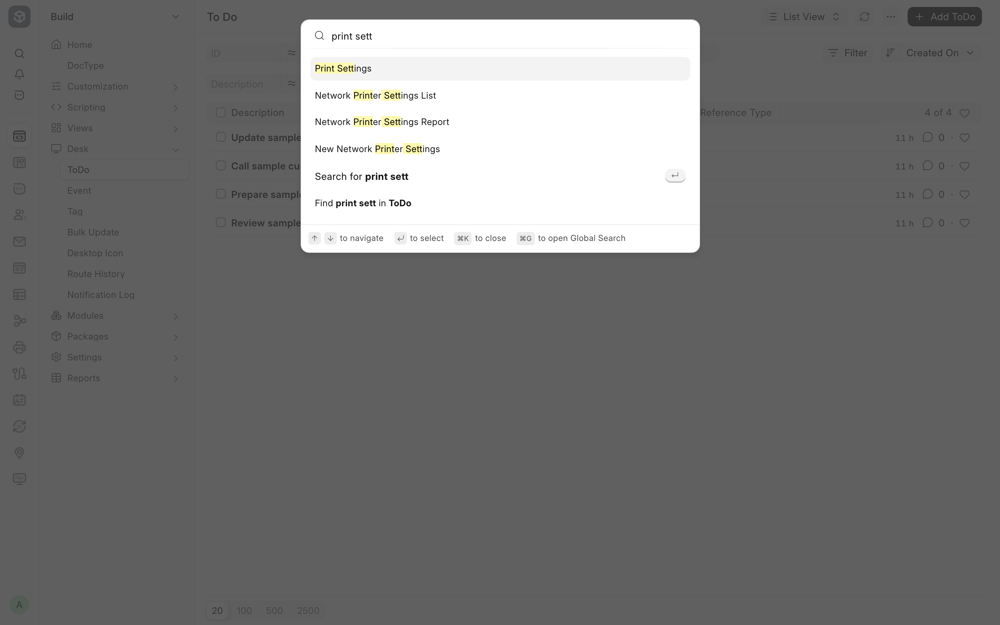

# How Settings Work

A settings page in Frappe is a Single DocType. A Single DocType has exactly one record, and the record has the same name as the DocType. For example, the one record of `System Settings` is named `System Settings`. Use this page to find a settings page, to know when a change takes effect, and to read or build settings in an app.

## Single DocTypes and `tabSingles`

A DocType with **Is Single** (`issingle`) set has no table of its own. Frappe stores its values in the shared table `tabSingles`. Each value is one row with the columns `doctype`, `field` and `value`. All values are stored as text and cast to the field type when you read them.

- A Single DocType cannot be submittable, importable or renamed. Frappe clears these flags when you save the DocType.
- Until you save a Single for the first time, `tabSingles` has no rows for it. See [Defaults of a Single](#defaults-of-a-single).
- The desk opens a Single as a form, not as a list.

## Open a settings page

Each Single has a desk route `/desk/<slug>`. The slug is the DocType name in lowercase, with hyphens for spaces. For example, `System Settings` opens at `/desk/system-settings`.

You can also use the awesomebar:

1. Press <kbd>Ctrl</kbd>+<kbd>K</kbd>.
2. Type part of the name, for example `print sett`.
3. Select the settings page in the results.



## Who can edit

The permission rules on each DocType control who can open and save it. In Frappe, the `System Manager` role can read and write all settings DocTypes, except the website settings. The `Website Manager` role writes `Website Settings`, `Portal Settings`, `Contact Us Settings`, `About Us Settings` and `Website Script`. See the table in [Settings DocTypes in Frappe](#settings-doctypes-in-frappe).

Some controllers check the role again. For example, the System Settings form loads its values through `frappe.core.doctype.system_settings.system_settings.load`, which throws `PermissionError` for users without `System Manager`.

## When a change takes effect

A change in a settings form takes effect at different times on the server and in the browser.

| Where | When the new value is used |
|---|---|
| Server code that reads the document (`frappe.get_cached_doc`, `frappe.get_single_value`, `frappe.get_system_settings`) | On the next request after the save. Save clears the document cache. |
| Server code that reads a global default (`frappe.db.get_default`) | On the next request, if the controller copies the value to the defaults. `System Settings` does this. |
| Desk JavaScript that reads `frappe.boot` | After the user reloads the page. The boot data loads once per page load. |

How the cache is cleared:

- `Document.save()` calls `clear_cache()` after `on_update`. This runs `frappe.clear_document_cache(doctype, name)`. It removes the document from Redis and from `frappe.db.value_cache`.
- `frappe.db.set_single_value()` also calls `frappe.clear_document_cache()`.
- When you save `System Settings`, `on_update` writes each changed value as a global default with `frappe.db.set_default`. A changed global default clears the full site cache, including the cached boot data of all users (`bootinfo`).
- After you save `System Settings` with a changed **Language** or **Rounding Method**, the form reloads the page.

!!! note
    Other users keep the old boot data in their open browser tabs. They see the change after they reload the page.

## Read and write settings in Python

| Function | Returns | Cache | Notes |
|---|---|---|---|
| `frappe.get_single(doctype)` | `Document` | No | Same as `frappe.get_doc(doctype, doctype)`. Applies field defaults if the Single was never saved. |
| `frappe.get_cached_doc(doctype)` | `Document` | Redis, 1 hour | Use for frequent reads. Do not change and save the returned object. |
| `frappe.get_single_value(doctype, fieldname)` | value | Redis, through `get_cached_doc` | Use for frequent reads of one value. |
| `frappe.db.get_single_value(doctype, fieldname, cache=True)` | value cast to the field type | Per request (`frappe.db.value_cache`) | Reads `tabSingles` directly. Does not apply field defaults. |
| `frappe.db.get_singles_dict(doctype, cast=False)` | `frappe._dict` of all values | No | Pass `cast=True` to cast values to field types. |
| `frappe.db.set_single_value(doctype, fieldname, value)` | `None` | Clears document cache | Pass a dict as `fieldname` to set many values. Skips validation, controller methods and permissions. |
| `frappe.get_system_settings(key)` | value | Client cache and `frappe.local` for the request | Only for `System Settings`. |

```python
# Read
date_format = frappe.get_system_settings("date_format")
backup_limit = frappe.db.get_single_value("System Settings", "backup_limit")  # int
print_settings = frappe.get_cached_doc("Print Settings")

# Write with validation and controller methods
settings = frappe.get_single("Sample Settings")
settings.page_limit = 20
settings.save()

# Write without validation and controller methods
frappe.db.set_single_value("Sample Settings", {"page_limit": 20, "enable_feature": 1})
```

!!! warning
    `frappe.db.set_single_value("System Settings", ...)` does not run `on_update`. The global default is not updated, so `frappe.boot.sysdefaults` and `frappe.db.get_default()` keep the old value. Use `doc.save()` when the value must reach the desk.

## Read settings in JavaScript

The desk gets some settings in `frappe.boot` when the page loads.

| Key | Content |
|---|---|
| `frappe.boot.sysdefaults` | Global defaults, from `frappe.defaults.get_defaults()`. Includes the `System Settings` values that were saved in the form. The user's own defaults override them. |
| `frappe.sys_defaults` | Same object as `frappe.boot.sysdefaults`. Set in `frappe/public/js/frappe/desk.js`. |
| `frappe.boot.time_zone` | `{system, user}` time zones. |
| `frappe.boot.navbar_settings` | Values of `Navbar Settings`. |

```js
// Values loaded at boot
frappe.boot.sysdefaults.date_format; // "dd-mm-yyyy"
frappe.defaults.get_default("date_format"); // reads frappe.sys_defaults
frappe.defaults.is_enabled("hide_empty_read_only_fields"); // true if the value is 1

// Value read from the server on demand. Needs read permission on the DocType.
const time_zone = await frappe.db.get_single_value("System Settings", "time_zone");
```

`frappe.db.get_single_value` calls `frappe.client.get_single_value`. That method checks `frappe.has_permission(doctype)`, so the user needs read permission on the settings DocType. Most settings DocTypes allow read only to `System Manager`. To give a value to all desk users, add it to the boot data from your app. See [Build your own settings DocType](#build-your-own-settings-doctype).

## Defaults of a Single

A field default in the DocType JSON is applied only when the Single has no rows in `tabSingles`. This was checked on a temporary Single with a Check field (default 1) and an Int field (default 50):

| Read | Before the first save | After a field is added to a saved Single |
|---|---|---|
| `frappe.get_single()` | 1 and 50 (defaults applied) | `None` for the new field |
| `frappe.db.get_single_value()` | 0 and 0 | 0 for the new field |

Because of this, code in Frappe usually adds a fallback when it reads a value, for example `frappe.get_system_settings("email_retry_limit") or 3`. Do the same in your app, or set the value in a patch.

## Set values from an app

| Method | Use it for | Notes |
|---|---|---|
| `after_install` hook | Initial values when your app is installed | Runs once per site. |
| Patch in `patches.txt` | Values for a new field on sites that already have the app | Runs once per site at `bench migrate`. |
| Fixture of a Single | Not recommended for settings | The whole document is imported again at each `bench migrate`. Values that a user changed on the site are overwritten. |
| Fixture of `Property Setter` | Change a field property of a Single, for example `hidden` or `default` | Changes the form, not the stored value. |

```python
# sample_app/hooks.py
after_install = "sample_app.install.after_install"
```

```python
# sample_app/install.py
import frappe


def after_install():
	settings = frappe.get_single("Sample Settings")
	settings.page_limit = 50
	settings.save()
```

To change a setting of another DocType, such as `System Settings`, use `doc.save()` so that its controller runs. See [Fixtures and Patches](../../developer-guide/building-apps/fixtures-and-patches.md) and [Hooks](../../developer-guide/building-apps/hooks.md).

## Change the settings form

- **Customize Form** does not accept Single DocTypes. It throws "Single DocTypes cannot be customized.", and its DocType picker hides Singles.
- The DocType picker of the **Custom Field** form also hides Singles. From code, `create_custom_fields()` adds a field to a Single. This was checked on a temporary Single.
- A **Client Script** or a `doctype_js` hook works on a Single form like on any other form.

## Build your own settings DocType

1. Create a DocType in your app module and set **Is Single**.
2. Add the fields. Give each field a default, and also use a fallback in code.
3. Set the permissions. Give write access to `System Manager` or to an app manager role.
4. Add validation in the controller.
5. Read values with `frappe.get_single_value()` or `frappe.get_cached_doc()`.

```python
# sample_app/sample_app/doctype/sample_settings/sample_settings.py
import frappe
from frappe.model.document import Document


class SampleSettings(Document):
	def validate(self):
		if self.page_limit and self.page_limit > 500:
			frappe.throw(frappe._("Page Limit cannot be more than 500"))

	def on_update(self):
		# Only needed for values that you cache yourself
		frappe.cache.delete_value("sample_app:derived_limits")


def get_page_limit() -> int:
	return frappe.get_single_value("Sample Settings", "page_limit") or 50
```

`Document.save()` clears the document cache of the Single for you. Clear only the caches that you build from the values.

To send a value to the desk of every user, use the `extend_bootinfo` hook. Frappe runs it on each desk load. The `boot_session` hook runs inside `get_bootinfo()`, and its result is cached per user in `bootinfo` until the cache is cleared.

```python
# sample_app/hooks.py
extend_bootinfo = ["sample_app.boot.extend_bootinfo"]
```

```python
# sample_app/boot.py
import frappe


def extend_bootinfo(bootinfo):
	bootinfo.sample_page_limit = frappe.get_single_value("Sample Settings", "page_limit") or 50
```

```js
// read it in the desk
frappe.boot.sample_page_limit;
```

## Settings DocTypes in Frappe

| DocType | Module | Route | Write role | Covered in |
|---|---|---|---|---|
| `System Settings` | Core | `/desk/system-settings` | System Manager | [System Settings](system-settings.md) |
| `Security Settings` | Core | `/desk/security-settings` | System Manager | [Security Settings](security-settings.md) |
| `Session Default Settings` | Core | `/desk/session-default-settings` | System Manager | [Security Settings](security-settings.md) |
| `Log Settings` | Core | `/desk/log-settings` | System Manager | [Security Settings](security-settings.md) |
| `Navbar Settings` | Core | `/desk/navbar-settings` | System Manager | [Desk Settings](desk-settings.md) |
| `Domain Settings` | Core | `/desk/domain-settings` | System Manager | [Desk Settings](desk-settings.md) |
| `Document Naming Settings` | Core | `/desk/document-naming-settings` | System Manager | [Desk Settings](desk-settings.md) |
| `Desktop Settings` | Desk | `/desk/desktop-settings` | System Manager | [Desk Settings](desk-settings.md) |
| `Global Search Settings` | Desk | `/desk/global-search-settings` | System Manager | [Desk Settings](desk-settings.md) |
| `SMS Settings` | Core | `/desk/sms-settings` | System Manager | [Integration Settings](integration-settings.md) |
| `Website Settings` | Website | `/desk/website-settings` | Website Manager | [Website Settings](website-settings.md) |
| `Portal Settings` | Website | `/desk/portal-settings` | Website Manager | [Website Settings](website-settings.md) |
| `Contact Us Settings` | Website | `/desk/contact-us-settings` | Website Manager | [Website Settings](website-settings.md) |
| `About Us Settings` | Website | `/desk/about-us-settings` | Website Manager | [Website Settings](website-settings.md) |
| `Website Script` | Website | `/desk/website-script` | Website Manager | [Website Settings](website-settings.md) |
| `Print Settings` | Printing | `/desk/print-settings` | System Manager | [Print Settings](print-settings.md) |
| `OAuth Provider Settings` | Integrations | `/desk/oauth-provider-settings` | System Manager | [Integration Settings](integration-settings.md) |
| `OAuth Settings` | Integrations | `/desk/oauth-settings` | System Manager | [Integration Settings](integration-settings.md) |
| `LDAP Settings` | Integrations | `/desk/ldap-settings` | System Manager | [Integration Settings](integration-settings.md) |
| `Push Notification Settings` | Integrations | `/desk/push-notification-settings` | System Manager | [Integration Settings](integration-settings.md) |
| `Geolocation Settings` | Integrations | `/desk/geolocation-settings` | System Manager | [Integration Settings](integration-settings.md) |
| `Google Settings` | Integrations | `/desk/google-settings` | System Manager | [Integration Settings](integration-settings.md) |
| `Automation Settings` | Automation | `/desk/automation-settings` | System Manager | [Automation and AI Settings](automation-and-ai-settings.md) |
| `Flow Settings` | Flow | `/desk/flow-settings` | System Manager | [Automation and AI Settings](automation-and-ai-settings.md) |
| `Flow Knowledge Settings` | Flow | `/desk/flow-knowledge-settings` | System Manager | [Automation and AI Settings](automation-and-ai-settings.md) |
| `Studio Settings` | Studio | `/desk/studio-settings` | System Manager | [Automation and AI Settings](automation-and-ai-settings.md) |

`Notification Settings` is not a Single. Each user has one record. See [Desk Settings](desk-settings.md).

Frappe also has Single DocTypes that are tools, not settings: `Customize Form`, `Bulk Update`, `Data Export`, `Audit Trail`, `Permission Inspector`, `Role Permission for Page and Report`, `Installed Applications`, `System Console` and `System Health Report`.

## Pitfalls

- `frappe.db.get_single_value()` returns 0 or an empty string for a field that was never saved. It does not use the field default.
- `frappe.db.set_single_value()` skips validation and `on_update`. For `System Settings`, the desk does not see the new value.
- `frappe.get_cached_doc()` returns a shared cached object. Do not change it. Use `frappe.get_single()` to change and save.
- A fixture of a Single overwrites the values on each `bench migrate`.
- Open browser tabs keep the old `frappe.boot` values until the user reloads the page.

## Related

- [System Settings](system-settings.md)
- [Caching](../../developer-guide/runtime/caching.md)
- [DocTypes](../../developer-guide/data-model/doctypes.md)
- [Controllers](../../developer-guide/data-model/controllers.md)
- [Database API](../../reference/python/database.md)
- [Hooks reference](../../reference/configuration/hooks.md)
