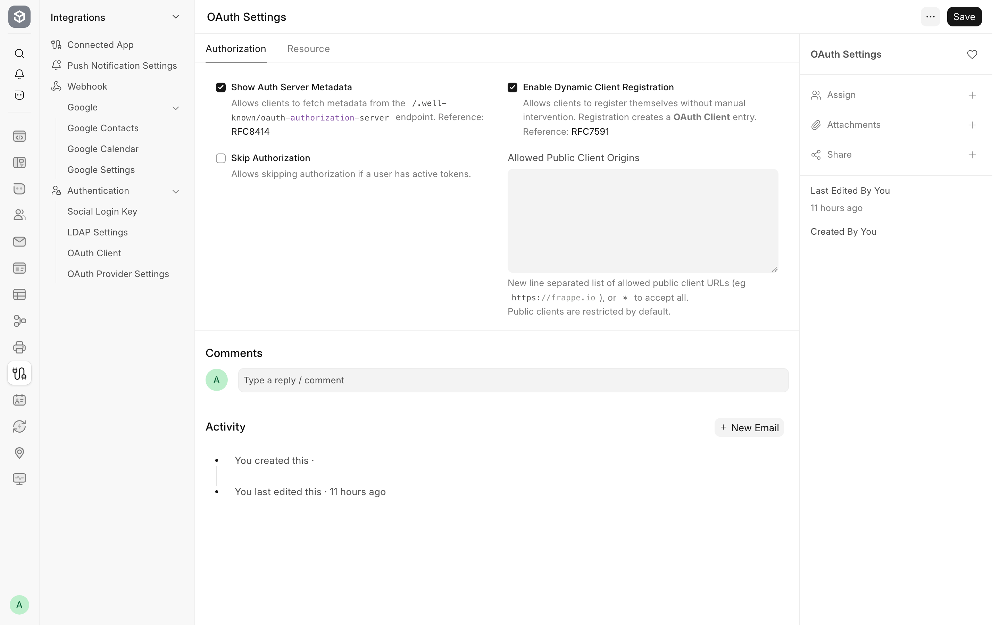

# Integration Settings

This page is the field reference for the settings DocTypes that connect a site to outside systems. For each field it gives the default and the code that reads it. For step-by-step setup of OAuth clients, LDAP login, Google and push notifications, see [Integrations](../website-and-integrations/integrations.md). For how Single DocTypes work in general, see [How Settings Work](how-settings-work.md).

All DocTypes on this page are Single DocTypes. Only the `System Manager` role can read or write them.

| DocType | Module | Route |
|---|---|---|
| `OAuth Provider Settings` | Integrations | `/desk/oauth-provider-settings` |
| `OAuth Settings` | Integrations | `/desk/oauth-settings` |
| `LDAP Settings` | Integrations | `/desk/ldap-settings` |
| `Push Notification Settings` | Integrations | `/desk/push-notification-settings` |
| `Geolocation Settings` | Integrations | `/desk/geolocation-settings` |
| `Google Settings` | Integrations | `/desk/google-settings` |
| `SMS Settings` | Core | `/desk/sms-settings` |

## OAuth Provider Settings

This DocType has one field. It sets if a user must approve an OAuth client again when the user already has an active token for it. Open it at `/desk/oauth-provider-settings`. The newer `OAuth Settings` has a **Skip Authorization** check that takes precedence (see below).

| Field | Default | Effect |
|---|---|---|
| Skip Authorization (`skip_authorization`) | `Force` (first option) | `Force` or `Auto`. Read by `get_oauth_settings()` in `frappe/integrations/utils.py`, but only when **Skip Authorization** in `OAuth Settings` is off. With `Auto`, `authorize` in `frappe/integrations/oauth2.py` skips the approval page when the user has an `Active` `OAuth Bearer Token` for the client. With `Force`, the user sees the approval page each time. |

The per-client check **Skip Authorization** on `OAuth Client` skips the approval page for that client in all cases.

## OAuth Settings

`OAuth Settings` controls how this site acts as an OAuth 2.0 authorization server and protected resource: the `/.well-known/` metadata endpoints, dynamic client registration and CORS for public clients. Open it at `/desk/oauth-settings`. The **Enable MCP** field in System Settings links to this form, because MCP clients sign in with OAuth. The controller has no `validate`. All reads use `frappe.get_cached_value` or `frappe.get_cached_doc`, so a save takes effect on the next request.



### Authorization (tab)

| Field | Default | Effect |
|---|---|---|
| Show Auth Server Metadata (`show_auth_server_metadata`) | 1 | When on, `handle_wellknown` in `frappe/integrations/oauth2.py` serves `GET /.well-known/oauth-authorization-server` (RFC 8414). When off, that path falls through to the files apps ship in `www/.well-known/`. |
| Skip Authorization (`skip_authorization`) | 0 | When on, `get_oauth_settings()` returns `Auto`. The approval page is skipped for a user who has an `Active` token for the client. Overrides `OAuth Provider Settings`. |
| Enable Dynamic Client Registration (`enable_dynamic_client_registration`) | 1 | When on, `register_client` (`POST /api/method/frappe.integrations.oauth2.register_client`, guest, 5 calls per 10 minutes) makes a new `OAuth Client` (RFC 7591). The authorization server metadata then includes `registration_endpoint`. When off, the endpoint returns 404. Also allows CORS on that endpoint, see the next row. |
| Allowed Public Client Origins (`allowed_public_client_origins`) | empty | One origin per line, or `*` for all. Read by `_set_allowed_cors()` in `frappe/integrations/oauth2.py`, called from the `before_request` hook `set_cors_for_privileged_requests`. Sets CORS for `POST` and `OPTIONS` on the token, revoke, introspect and user info endpoints, and on `register_client` when dynamic registration is on. Empty: no CORS headers are added for these endpoints. |

### Config (Resource tab)

| Field | Default | Effect |
|---|---|---|
| Show Protected Resource Metadata (`show_protected_resource_metadata`) | 1 | When on, `GET /.well-known/oauth-protected-resource` returns the resource metadata (RFC 9728). Also, `frappe/app.py` adds the header `WWW-Authenticate: Bearer resource_metadata="<site>/.well-known/oauth-protected-resource"` to every 401 and 403 response. |
| Show Social Login Key as Authorization Server (`show_social_login_key_as_authorization_server`) | 0 | When on, the resource metadata lists in `authorization_servers` the **Base URL** of each `Social Login Key` that has **Enable Social Login** and **Show in Resource Metadata** on, after this site. |

### Metadata (Resource tab)

These fields go into the JSON of `/.well-known/oauth-protected-resource`, built by `_get_protected_resource_metadata()` in `frappe/integrations/oauth2.py`. An empty field is left out of the response.

| Field | Default | Effect |
|---|---|---|
| Resource Name (`resource_name`) | `Frappe Framework Application` | Sent as `resource_name`. |
| Resource Policy URI (`resource_policy_uri`) | empty | Sent as `resource_policy_uri`. |
| Resource Documentation (`resource_documentation`) | `https://docs.frappe.io/framework` | Sent as `resource_documentation`. |
| Resource TOS URI (`resource_tos_uri`) | empty | Sent as `resource_tos_uri`. |
| Scopes Supported (`scopes_supported`) | empty | One scope per line. Sent as the list `scopes_supported`. |

### For developers

```python
from frappe.integrations.utils import get_oauth_settings

get_oauth_settings().skip_authorization  # "Auto", "Force" or None
frappe.get_cached_value("OAuth Settings", "OAuth Settings", "enable_dynamic_client_registration")
```

- `frappe.integrations.oauth2.is_oauth_metadata_enabled("auth_server")` and `is_oauth_metadata_enabled("resource")` return the two **Show ... Metadata** checks.
- `GET /.well-known/openid-configuration` does not depend on any field here.
- When `allow_cors` is `*` in site config, `set_cors_for_privileged_requests` returns early and **Allowed Public Client Origins** has no effect.

## LDAP Settings

`LDAP Settings` lets users log in with an LDAP or Active Directory account. Open it at `/desk/ldap-settings`. Fields marked mandatory in the JSON must be filled before the form saves, even when **Enabled** is off. When **Enabled** is on, `validate` binds to the server with the Base DN and its password, and searches both search paths. A bad connection, path or attribute stops the save.

| Field | Default | Effect |
|---|---|---|
| Enabled (`enabled`) | 0 | Read by `frappe/www/login.py`: the login page shows an LDAP login button (`frappe/www/login.html`) that posts to `frappe.integrations.doctype.ldap_settings.ldap_settings.login`. Also read by: `validate_user_pass_login` in System Settings (LDAP counts as another login method when you turn on **Disable Username/Password Login**), `frappe/core/doctype/user/user.js` (a **Reset LDAP Password** button for System Managers), and `needs_password_setup` in `frappe/core/doctype/user/user.py` (returns `False`, so users without a password are not asked to set one). |

### LDAP Server Settings

| Field | Default | Effect |
|---|---|---|
| Directory Server (`ldap_directory_server`) | empty, mandatory | `Active Directory`, `OpenLDAP` or `Custom`. Sets how `fetch_ldap_groups` finds a user's groups. `Active Directory`: object class `Group`, member attribute `member`, matched against the user DN. `OpenLDAP`: object class `posixgroup`, attribute `memberuid`, matched against the username. `Custom`: uses the fields in **LDAP Custom Settings**. |
| LDAP Server Url (`ldap_server_url`) | mandatory | Host passed to `ldap3.Server` in `connect_to_ldap`. |

### LDAP Auth

| Field | Default | Effect |
|---|---|---|
| Base Distinguished Name (DN) (`base_dn`) | mandatory | Bind user for the service connection. |
| Password for Base DN (`password`) | mandatory | Password field (stored encrypted). Read with `get_password` to bind. |

### LDAP Search and Paths

| Field | Default | Effect |
|---|---|---|
| LDAP search path for Users (`ldap_search_path_user`) | mandatory | Search base for users at login and password reset. |
| LDAP Search String (`ldap_search_string`) | mandatory | Filter for the login name. Must start with `(`, end with `)`, have balanced brackets and contain `{0}`, or `validate` throws when **Enabled** is on. `{0}` is replaced with the escaped login name. Example: `(&(objectclass=user)(uid={0}))`. |
| LDAP search path for Groups (`ldap_search_path_group`) | mandatory | Search base for group lookups. |

### LDAP User Creation and Mapping

Each field holds the name of an LDAP attribute. At login, `convert_ldap_entry_to_dict` copies the attribute values to the `User` fields shown. On each login the values overwrite the existing user's fields, except email.

| Field | Default | Effect |
|---|---|---|
| LDAP Email Field (`ldap_email_field`) | mandatory | Maps to `email`. Also used to find the LDAP entry in **Reset LDAP Password**. If the attribute has many values, Frappe picks the first one that matches an existing user. |
| LDAP Username Field (`ldap_username_field`) | mandatory | Maps to `username`. Also the group match value for `OpenLDAP` and `Custom`. |
| LDAP First Name Field (`ldap_first_name_field`) | mandatory | Maps to `first_name`. |
| Do Not Create New User (`do_not_create_new_user`) | 0 | When on, login fails for an LDAP user who has no `User` with that email. When off, Frappe inserts a `User` with **User Type** from **Default User Type** and no welcome email. |
| LDAP Middle Name Field (`ldap_middle_name_field`) | empty | Maps to `middle_name`. |
| LDAP Last Name Field (`ldap_last_name_field`) | empty | Maps to `last_name`. |
| LDAP Phone Field (`ldap_phone_field`) | empty | Maps to `phone`. |
| LDAP Mobile Field (`ldap_mobile_field`) | empty | Maps to `mobile_no`. |

### LDAP Security

| Field | Default | Effect |
|---|---|---|
| SSL/TLS Mode (`ssl_tls_mode`) | `Off` | `StartTLS` binds with `AUTO_BIND_TLS_BEFORE_BIND`. |
| Require Trusted Certificate (`require_trusted_certificate`) | `No` | `Yes` sets `ssl.CERT_REQUIRED` on the TLS configuration. `No` uses `ssl.CERT_NONE`. |
| Path to private Key File (`local_private_key_file`) | empty | File path on the server, passed to `ldap3.Tls`. |
| Path to Server Certificate (`local_server_certificate_file`) | empty | File path on the server, passed to `ldap3.Tls`. |
| Path to CA Certs File (`local_ca_certs_file`) | empty | File path on the server, passed to `ldap3.Tls`. |

### LDAP Custom Settings

Used only when **Directory Server** is `Custom`. With **Enabled** on, `validate` requires **Group Object Class** and **LDAP Group Member attribute** for `Custom`.

| Field | Default | Effect |
|---|---|---|
| Group Object Class (`ldap_group_objectclass`) | empty | Object class of group entries, for example `group`. |
| Custom Group Search (`ldap_custom_group_search`) | empty (`{0}`) | Value matched against the member attribute. `{0}` is the username. If filled, it must contain `{0}`. |
| LDAP Group Member attribute (`ldap_group_member_attribute`) | empty | Member attribute of group entries, for example `member`. |

### LDAP Group Mappings

| Field | Default | Effect |
|---|---|---|
| Default User Type (`default_user_type`) | mandatory, `validate` sets `Website User` when empty | **User Type** of new users. |
| Default User Role (`default_role`) | empty | Shows and is mandatory when **Default User Type** is `System User`. Added to the user at each login. For other user types, the role of the `User Type` is added. |
| LDAP Group Mappings (`ldap_groups`) | empty | Table of `LDAP Group Mapping` rows: **LDAP Group** (`ldap_group`) and **User Role** (`erpnext_role`). At each login, `sync_roles` adds the roles of groups the user is in, and removes mapped roles of groups the user is not in. Group names match without case. |
| LDAP Group Field (`ldap_group_field`) | empty | Deprecated. Used only when **Directory Server** has none of the three values: the groups are read from this attribute of the user entry. |

### For developers

- `LDAPSettings.get_ldap_client_settings()` returns `{"enabled": True, "method": "frappe.integrations.doctype.ldap_settings.ldap_settings.login"}` when enabled. The login page uses it.
- `login` is a guest `POST` method, rate limited to 10 calls per minute per `usr`. It runs two-factor authentication when it applies.
- `reset_password(user, password, logout)` is whitelisted for `System Manager`. It writes a salted SHA hash to `userPassword` in LDAP.
- The library `ldap3` must be installed.

## Push Notification Settings

`Push Notification Settings` turns on the push notification relay. Frappe apps then send mobile and browser push notifications through a central relay server that uses Firebase Cloud Messaging. Open it at `/desk/push-notification-settings`.

### Relay Settings

| Field | Default | Effect |
|---|---|---|
| Enable Push Notification Relay (`enable_push_notification_relay`) | 0 | Read by `PushNotification.is_enabled()` in `frappe/push_notification.py`. When off, every relay call raises `Push Notification Relay is not enabled`. `validate` throws when you turn it on and `push_relay_server_url` is not in the site config. |

### Authentication

| Field | Default | Effect |
|---|---|---|
| API Key (`api_key`) | empty | Key for the relay server. Filled by `_get_credential()` on the first authenticated relay call, not when you save the form. |
| API Secret (`api_secret`) | empty | Password field. Filled with the API Key. Delete both to register the site again. |

### For developers

```python
from frappe.push_notification import PushNotification

push = PushNotification("sample_app")
if push.is_enabled():
	push.send_notification_to_user("user1@example.com", "Order shipped", "Sample Order SO-0001 is on its way")
```

- The relay server URL comes from `push_relay_server_url` in `site_config.json`. See [Site Config](../../reference/configuration/site-config.md).
- `frappe.push_notification.subscribe` and `unsubscribe` (`GET`, logged-in user) add or remove a device token for the session user.
- During registration the relay server calls `frappe.push_notification.auth_webhook`. The token it checks is kept in Redis for 600 seconds.

## Geolocation Settings

`Geolocation Settings` turns on address search in the **New Address** dialog. Open it at `/desk/geolocation-settings`.

| Field | Default | Effect |
|---|---|---|
| Enable Address Autocompletion (`enable_address_autocompletion`) | 0 | Sent to the browser as `frappe.boot.enable_address_autocompletion` (`frappe/boot.py`). When it is 1, the **New Address** button in the Address and Contacts section of a form opens `frappe.ui.AddressAutocompleteDialog` (`frappe/public/js/frappe/utils/address_and_contact.js`) instead of the Address form. The dialog calls `frappe.integrations.doctype.geolocation_settings.geolocation_settings.autocomplete`. When off, that method returns an empty list. |
| Provider (`provider`) | `Geoapify` (first option) | `Geoapify`, `Nomatim` or `HERE`. Mandatory when autocompletion is on. |
| Base URL (`base_url`) | empty | Shows for `Nomatim`. Mandatory for `Nomatim` when autocompletion is on. Frappe calls `<base_url>/search`. |
| API Key (`api_key`) | empty | Password field. Shows for `Geoapify` and `HERE`. Mandatory for them when autocompletion is on. |

`validate` checks the same mandatory rules on the server. The boot value is read at desk load, so users must reload the desk after you change **Enable Address Autocompletion**. A failed provider call logs the error type and status code only, because the provider URL contains the API key.

## Google Settings

`Google Settings` holds the Google Cloud credentials for Google Calendar, Google Contacts, the Google Drive picker and Google indexing. Open it at `/desk/google-settings`.

| Field | Default | Effect |
|---|---|---|
| Enable (`enable`) | 0 | Shows the **OAuth Client ID** and **API Key** sections. `GoogleOAuth` (`frappe/integrations/google_oauth.py`), `Google Calendar` and `Google Contacts` throw `Enable Google API in Google Settings.` or `Please enable Google Settings before continuing.` when it is off. `Website Settings` throws on save if **Enable Google Indexing** is on and this field is off. |

### OAuth Client ID

Shows when **Enable** is on.

| Field | Default | Effect |
|---|---|---|
| Client ID (`client_id`) | empty | OAuth client ID for the authorization and token calls in `frappe/integrations/google_oauth.py` and `google_calendar.py`. Mandatory when **Google Drive Picker Enabled** is on. Sent to the browser as `clientId` for the Drive picker. |
| Client Secret (`client_secret`) | empty | Password field. Used for the token and refresh calls. `GoogleOAuth` and `Google Calendar` throw when Client ID or Client Secret is empty. |

### API Key

Shows when **Enable** is on.

| Field | Default | Effect |
|---|---|---|
| API Key (`api_key`) | empty | Not read by Frappe code. |

### Google Drive Picker

| Field | Default | Effect |
|---|---|---|
| Google Drive Picker Enabled (`google_drive_picker_enabled`) | 0 | When this and **Enable** are on, `get_file_picker_settings()` returns `enabled`, `appId` and `clientId`. The file uploader (`frappe/public/js/frappe/file_uploader/FileUploader.vue`) then shows the Google Drive option. `validate` requires **Client ID** and **App ID** when it is on. |
| App ID (`app_id`) | empty | Shows when the picker is on. The Google Cloud project number. Passed to `setAppId` in `frappe/public/js/integrations/google_drive_picker.js`. |

## SMS Settings

`SMS Settings` configures an HTTP SMS gateway. Frappe uses it for SMS notifications and for two-factor authentication by SMS. Open it at `/desk/sms-settings`.

| Field | Default | Effect |
|---|---|---|
| SMS Gateway URL (`sms_gateway_url`) | mandatory | URL Frappe calls for each receiver. When empty, `send_sms` shows `Please Update SMS Settings` and sends nothing. System Settings refuses **Two Factor Authentication method** `SMS` while it is empty. Also sent to the browser as the boolean `frappe.boot.sms_gateway_enabled`, which no Frappe JS reads. |
| Message Parameter (`message_parameter`) | mandatory | Request parameter name for the message text. |
| Receiver Parameter (`receiver_parameter`) | mandatory | Request parameter name for the mobile number. |
| Static Parameters (`parameters`) | empty | Table of `SMS Parameter` rows: **Parameter**, **Value** and **Header**. A row with **Header** on is sent as an HTTP header. Other rows are added to the request parameters. A header `Content-Type: application/json` makes Frappe send the parameters as a JSON body. |
| Use POST (`use_post`) | 0 | Send a `POST` with form data. When off, Frappe sends a `GET` with query parameters. |
| Allowed Roles (`allowed_roles`) | empty | Table of roles. `check_sms_permission()` lets only `System Manager` and users with one of these roles call the whitelisted `send_sms`. The patch `seed_sms_settings_allowed_roles` adds `System Manager` on sites that upgrade. New sites start empty. |

### For developers

- `frappe.core.doctype.sms_settings.sms_settings.send_sms(receiver_list, msg, sender_name="", success_msg=True)` is whitelisted and checks **Allowed Roles**. Server code that must skip that check calls `_send_sms`, as `Notification` does for the `SMS` channel.
- The hook `send_sms` replaces the gateway. Frappe calls the last registered method with `(receiver_list, msg, sender_name, success_msg)` and does not read SMS Settings.

```python
# sample_app/hooks.py
send_sms = "sample_app.sms.send"
```

- Two-factor OTP messages (`frappe/twofactor.py`) read the gateway fields directly and are sent from the `short` queue. They do not use the `send_sms` hook or **Allowed Roles**.
- A failed gateway call logs the error type and status code only, because the URL can contain credentials.

## Related

- [Integrations](../website-and-integrations/integrations.md)
- [How Settings Work](how-settings-work.md)
- [System Settings](system-settings.md)
- [Security Settings](security-settings.md)
- [Authentication](../../developer-guide/security/authentication.md)
- [Site Config](../../reference/configuration/site-config.md)
