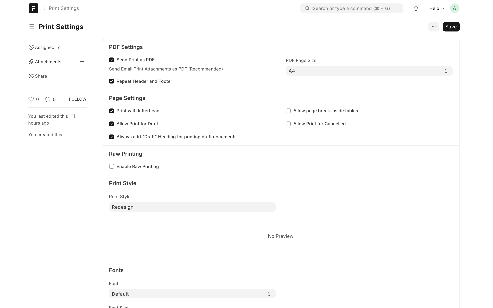

# Print Settings

`Print Settings` is a Single DocType that sets the site defaults for printing: paper size, letter head, draft and cancelled prints, print style and font. Use this page to find what each field does and which code reads it. For Print Formats and PDF generation, see [Print Formats](../../developer-guide/output/print-formats.md). For concepts that apply to all settings DocTypes, see [How settings work](how-settings-work.md).

## Print Settings

Open it at `/app/print-settings`, or from the **Print Settings** menu item of the print view. Only `System Manager` can read and write it.



The desk gets all values at boot. `load_print()` in `frappe/boot.py` adds the document as `:Print Settings` to the boot docs. Client code reads it with `frappe.model.get_doc(":Print Settings", "Print Settings")`. The server print view reads `frappe.get_single("Print Settings")`.

### PDF Settings

| Field | Default | Effect |
|---|---|---|
| Send Print as PDF (`send_print_as_pdf`) | `1` | `frappe.attach_print()` (`frappe/__init__.py`) makes a `.pdf` file. When off, it attaches the print as an `.html` file. This affects email attachments of documents, notifications and workflow actions. |
| Repeat Header and Footer (`repeat_header_footer`) | `1` | When on, the standard print templates mark the letter head header and footer as `header-html` and `footer-html`. `frappe/utils/pdf.py` then passes them to wkhtmltopdf, which repeats them on each PDF page. When off, they print once, inline. The print view shows "Footer might not be visible as Repeat Header and Footer option is disabled" when it is off. |
| PDF Page Size (`pdf_page_size`) | `A4` | The default paper size for PDFs (`prepare_options()` in `frappe/utils/pdf.py`). A `page-size` option in the `.print-format` CSS wins over it. Also the default of **Page Size** in the bulk print dialog, the `@page` size of Print Format Builder (beta) formats (`templates/print_format/print_format.css`) and their page width in `frappe/utils/weasyprint.py`. Options: A0 to A9, B0 to B10, C5E, Comm10E, DLE, Executive, Folio, Ledger, Legal, Letter, Tabloid, Custom. |
| PDF Page Height (in mm) (`pdf_page_height`) | empty | Page height when the size is `Custom`. Shows only then. Also the default height in the bulk print dialog. |
| PDF Page Width (in mm) (`pdf_page_width`) | empty | Page width when the size is `Custom`. Shows only then. |

Validation: when `pdf_page_size` is `Custom`, height and width must not be zero. The controller throws "Page height and width cannot be zero".

### Page Settings

| Field | Default | Effect |
|---|---|---|
| Print with letterhead (`with_letterhead`) | `1` | Used when the caller does not say if a letter head is wanted: `get_rendered_template()` in `frappe/www/printview.py`, the email composer (`frappe/public/js/frappe/views/communication.js`), and Notification print attachments (`print_letterhead`). |
| Allow Print for Draft (`allow_print_for_draft`) | `1` | Lets users print draft documents of submittable DocTypes. Checked on the server in `get_rendered_template()` in `frappe/www/printview.py`, which throws "Not allowed to print draft documents". In the desk, the form hides the **Print** menu item for drafts (`toolbar.js`), and bulk print skips them. A Notification that attaches a print of a draft throws an error. An Auto Repeat email of a draft is sent without the attachment and with a note. |
| Always add "Draft" Heading for printing draft documents (`add_draft_heading`) | `1` | Adds a "Draft" heading to prints of draft submittable documents (`templates/print_formats/standard_macros.html`). |
| Allow page break inside tables (`allow_page_break_inside_tables`) | `0` | When off, `templates/styles/standard.css` adds `page-break-inside: avoid` to `table td div`, so a cell does not split across pages. |
| Allow Print for Cancelled (`allow_print_for_cancelled`) | `0` | Lets users print cancelled documents. Same server and desk checks as `allow_print_for_draft`. |

The `Administrator` user can select draft and cancelled documents in bulk print, but the server check still applies.

### Print Server

| Field | Default | Effect |
|---|---|---|
| Enable Print Server (`enable_print_server`) | `0` | The print view gets a **Select Network Printer** menu item. **Print** sends the PDF to a CUPS printer from `Network Printer Settings` with `frappe.utils.print_format.print_by_server`. The server needs `pycups`. |

!!! warning
    The field has `depends_on: enable_print_server`, so it depends on itself. While it is off, the form hides it. Set it from code if you need it.

### Raw Printing

| Field | Default | Effect |
|---|---|---|
| Enable Raw Printing (`enable_raw_printing`) | `0` | Shows Print Formats with **Raw Printing** in the print view format list (`get_print_formats()` in `frappe/public/js/frappe/model/meta.js`). Adds the **Raw Printing Setting** menu item, which maps formats to printers for QZ Tray. |

### Print Style

| Field | Default | Effect |
|---|---|---|
| Print Style (`print_style`) | `Redesign` | The default `Print Style`. Its CSS is added after `templates/styles/standard.css` (`get_print_style()` in `frappe/www/printview.py`). Boot puts the rendered CSS in `frappe.boot.print_css`. Print Format Builder (beta) formats also use it (`frappe/utils/weasyprint.py`). |
| Print Style Preview (`print_style_preview`) | HTML | Shows the preview image of the selected Print Style in the form, or "No Preview". Client side only. |

### Fonts

| Field | Default | Effect |
|---|---|---|
| Font (`font`) | `Default` | Font of HTML prints when the Print Format sets no font (`get_font()` in `frappe/www/printview.py`). Options: Default, Helvetica Neue, Arial, Helvetica, Inter, Verdana, Monospace. `Default` uses Inter and system fonts. The CSS in `frappe.boot.print_css` always uses the default font. |
| Font Size (`font_size`) | empty | In points. `templates/styles/standard.css` sets the font size of `.print-format` to this value, or to `9pt` when it is empty or `0`. |

### For developers

Read values in Python:

```python
import frappe

size = frappe.db.get_single_value("Print Settings", "pdf_page_size")  # "A4"
settings = frappe.get_cached_doc("Print Settings")
settings.with_letterhead  # 1
```

Read values in the desk:

```js
const print_settings = frappe.model.get_doc(":Print Settings", "Print Settings");
print_settings.allow_print_for_draft;
```

- `on_update` calls `frappe.clear_cache()`. Reload the desk to get the new boot values.
- A print request can pass a `settings` argument (JSON). `get_rendered_template()` merges it into the Print Settings dict for that print. All keys are accepted.
- `before_print(self, settings)` on a controller gets the merged Print Settings dict.
- PDFs are made with wkhtmltopdf. Print Settings has no engine field. See [Print Formats](../../developer-guide/output/print-formats.md#the-pdf_generator-hook).
- `frappe.printing.doctype.print_settings.print_settings.is_print_server_enabled` is a whitelisted method that returns `enable_print_server`. Frappe code does not call it.

## Pitfalls

- `allow_print_for_draft` and `allow_print_for_cancelled` apply only to submittable DocTypes.
- Desk users keep the old boot values until they reload the page.

## Related

- [Printing](../data-and-reports/printing.md)
- [Print Formats](../../developer-guide/output/print-formats.md)
- [How settings work](how-settings-work.md)
