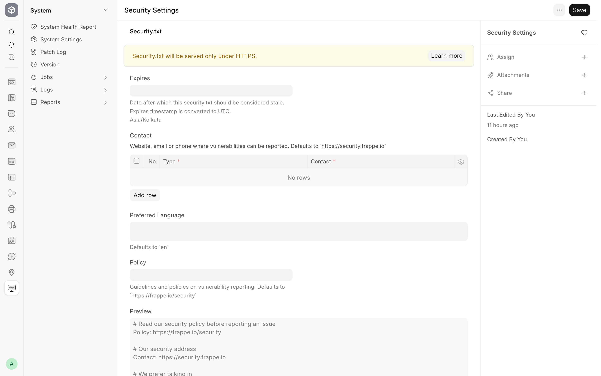
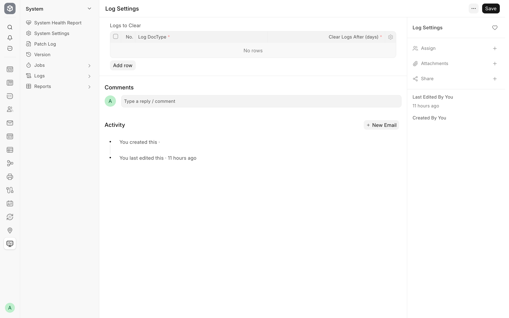

# Security, Session Default and Log Settings

This page is the field reference for three Single DocTypes: `Security Settings`, `Session Default Settings` and `Log Settings`. Only the `System Manager` role can read and write them. For the general rules about settings pages, caching and code access, see [How Settings Work](how-settings-work.md).

## Security Settings

`Security Settings` builds the `security.txt` file (RFC 9116) that tells security researchers how to report a vulnerability. Open it at `/desk/security-settings`. Only `System Manager` can edit it. Password policy, login and session options are not here. They are in [System Settings](system-settings.md).



Frappe serves the file at `/.well-known/security.txt` (`frappe/app.py`). It serves the file only when the request scheme is `https`. On plain `http` the route returns `404 Not Found`. The form shows a banner about this (`security_settings.js`).

### Security.txt

| Field | Default | Effect |
|---|---|---|
| Expires (`public_expires`) | empty | The `Expires:` line. Empty means one year from the time of the request. The value is read in the system time zone and written in UTC (`YYYY-MM-DDTHH:MM:SSZ`). `validate` rejects a date that is not in the future. A daily job emails System Managers 30, 15, 7 and 1 days before this date. |
| Contact (`public_contacts`) | empty | Table of `Security Settings Contact` rows. Each row is one `Contact:` line. Empty means `Contact: https://security.frappe.io`. |
| Preferred Language (`public_languages`) | empty | Table MultiSelect of `Security Settings Language` rows (Link to `Language`). Written as one `Preferred-Languages:` line, comma separated. Empty means `en`. |
| Policy (`public_policy`) | empty | The `Policy:` line. Empty means `https://frappe.io/security`. `validate` rejects a value that does not start with `https://`. |
| Preview (`security_txt`) | computed | Read only. Shows the full file text. It is a Python property on the controller, not a stored value. |

`Security Settings Contact` row fields:

| Field | Default | Effect |
|---|---|---|
| Type (`type`) | none, required | `Website`, `Email` or `Phone`. Sets the validation and the URI prefix. |
| Contact (`contact`) | none, required | `Email` is validated as an email address and gets the `mailto:` prefix. `Phone` is validated as a phone number and gets the `tel:` prefix. `Website` must be a valid URL that starts with `https://`. |

`Security Settings Language` row fields:

| Field | Default | Effect |
|---|---|---|
| Language (`language`) | none, required | Link to `Language`. The language code goes into `Preferred-Languages`. |

### For developers

- Read the file text in Python: `frappe.get_doc("Security Settings").security_txt`. Each line group comes from a property: `public_policy_section`, `public_contacts_section`, `public_languages_section`, `public_expires_section`.
- The `daily_maintenance` scheduler event runs `frappe.core.doctype.security_settings.security_settings_alert.check_security_txt_expiry`. It sends the email template `security_txt_expiry_alert` to all System Managers. It does nothing when `public_expires` is empty.
- The output on a new site:

```text
# Read our security policy before reporting an issue
Policy: https://frappe.io/security

# Our security address
Contact: https://security.frappe.io

# We prefer talking in
Preferred-Languages: en

Expires: 2027-11-22T11:03:34Z
```

## Session Default Settings

`Session Default Settings` selects the DocTypes for which each user can set a session default. A session default is a user default that fills Link fields in new documents. Open it at `/desk/session-default-settings`. Only `System Manager` can edit it.

### Session Defaults

| Field | Default | Effect |
|---|---|---|
| Session Defaults (`session_defaults`) | empty | Table of `Session Default` rows. Each row adds one Link field, labeled "Default <DocType>", to the user's Session Defaults panel. |

`Session Default` row fields:

| Field | Default | Effect |
|---|---|---|
| Document Type (`ref_doctype`) | none, required | Link to `DocType`. The form filter (`session_default_settings.js`) shows only DocTypes that are not Single and not child tables. |

How users set the values:

1. Open the user menu in the sidebar and select **Settings**.
2. Open the **Session Defaults** tab.
3. Set a value for each DocType and click **Save**.

The tab is built in `frappe/public/js/frappe/ui/user_settings_dialog.js` from `frappe.boot.session_defaults`. If the table is empty, the tab shows "No session defaults configured." The **Configure** action opens `Session Default Settings`. Users without permission get a "Not Permitted" error there.

How the values take effect:

- Each value is stored as a user default with the key `frappe.scrub(ref_doctype)`. For example, `Sample Item` becomes `sample_item`.
- In a new document, a Link field whose `fieldname` matches the key gets the value (`frappe/model/create_new.py`). User permissions can override it.
- After a save, the desk clears the cache and reloads (`frappe.ui.toolbar.clear_cache`).
- The `on_logout` hook runs `clear_session_defaults`. It deletes these user defaults, so the values last until the user logs out.

### For developers

- `frappe.core.doctype.session_default_settings.session_default_settings.get_session_default_values` returns the field list as a JSON string. `frappe/public/js/frappe/desk.js` calls it at desk start through `frappe.ui.toolbar.fetch_session_defaults` and stores it in `frappe.boot.session_defaults`.
- `set_session_default_values(default_values)` calls `frappe.defaults.set_user_default` for each key. It returns `"success"`, or `None` on the first error.
- Read a session default in Python with `frappe.defaults.get_user_default("sample_item")`.
- `frappe.ui.toolbar.setup_session_defaults` (an older prompt dialog) is still defined in `toolbar.js`, but no code in Frappe calls it.

## Log Settings

`Log Settings` sets how many days Frappe keeps the records of each log DocType. Open it at `/desk/log-settings`. Only `System Manager` can edit it. For the log DocTypes themselves, see [Logs and Monitoring](../system-administration/logs-and-monitoring.md).



### Logs to Clear

| Field | Default | Effect |
|---|---|---|
| Logs to Clear (`logs_to_clear`) | filled from the `default_log_clearing_doctypes` hook | Table of `Logs To Clear` rows. The daily job deletes old records of each DocType in the table. |

`Logs To Clear` row fields:

| Field | Default | Effect |
|---|---|---|
| Log DocType (`ref_doctype`) | none, required | Link to `DocType`. The link search (`get_log_doctypes`) shows only DocTypes that are not Single, not child tables and that support log clearing. |
| Clear Logs After (days) (`days`) | `30` | Records older than this number of days are deleted. Passed as `days` to the DocType's `clear_old_logs`. |

Validation in `LogSettings.validate`:

1. Rows for a DocType without a `clear_old_logs` static method are removed with a message.
2. Duplicate rows for one DocType are removed.
3. Every DocType in the `default_log_clearing_doctypes` hook that is missing from the table is added. Its retention is the last value in the hook. A message lists the added DocTypes.

You cannot remove a default log DocType for good. The next save or the next daily run adds it again. To keep its records longer, set a higher `days` value.

Default retentions that Frappe ships in `frappe/hooks.py`:

| Log DocType | Days |
|---|---|
| `Error Log`, `Prepared Report` | 14 |
| `Scheduled Job Log`, `Submission Queue`, `Background Task` | 7 |
| `Email Queue`, `Automation Run`, `MapReduce Job`, `Webhook Request Log`, `Unhandled Email`, `Reminder`, `OAuth Bearer Token`, `Email Queue Recipient`, `Attachment Queue` | 30 |
| `DuckDB Sync` | 45 |
| `Integration Request`, `Activity Log`, `Route History`, `API Request Log`, `Flow Session` | 90 |

`Email Queue Recipient` is a placeholder. `Email Queue` clears its recipients.

### Log Setting User

`Log Setting User` is a child DocType with one field, User (`user`, Link to `User`, required). No DocType uses it as a table. It is not read by Frappe code.

### For developers

- The `daily_maintenance` scheduler event runs `frappe.core.doctype.log_settings.log_settings.run_log_clean_up`. It removes unsupported rows, adds default rows, saves, then calls `clear_old_logs(days=...)` for each row and commits after each DocType.
- To make your own log DocType clearable, add a static method `clear_old_logs` to its controller, then list it in your app's hooks:

```python
# sample_app/sample_app/doctype/sample_log/sample_log.py
import frappe
from frappe.model.document import Document
from frappe.query_builder import Interval
from frappe.query_builder.functions import Now


class SampleLog(Document):
	@staticmethod
	def clear_old_logs(days=30):
		table = frappe.qb.DocType("Sample Log")
		frappe.db.delete(table, filters=(table.creation < (Now() - Interval(days=days))))
```

```python
# sample_app/hooks.py
default_log_clearing_doctypes = {
	"Sample Log": 30,
}
```

- Add or change a row from code with `LogSettings.register_doctype(doctype, days=30)`, then save the document.
- For a very large log table, use the CLI. It copies recent rows to a new table and swaps the tables, which is faster than a large `DELETE`. It works only for DocTypes in the `default_log_clearing_doctypes` hook. It takes a backup of the table first unless you pass `--no-backup`.

```bash
bench --site frappe.localhost clear-log-table --doctype "Error Log" --days 30
```

!!! warning
    Always pass `--days`. The option has no default. Without it, `days` is `None`, which `cint` turns into `0`, so the command removes all records of the DocType.

## Related

- [How Settings Work](how-settings-work.md)
- [System Settings](system-settings.md)
- [Logs and Monitoring](../system-administration/logs-and-monitoring.md)
- [Scheduler](../../developer-guide/runtime/scheduler.md)
- [Hooks reference](../../reference/configuration/hooks.md)
- [CLI](../../reference/configuration/cli.md)
