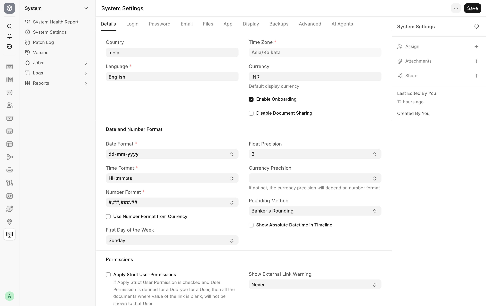
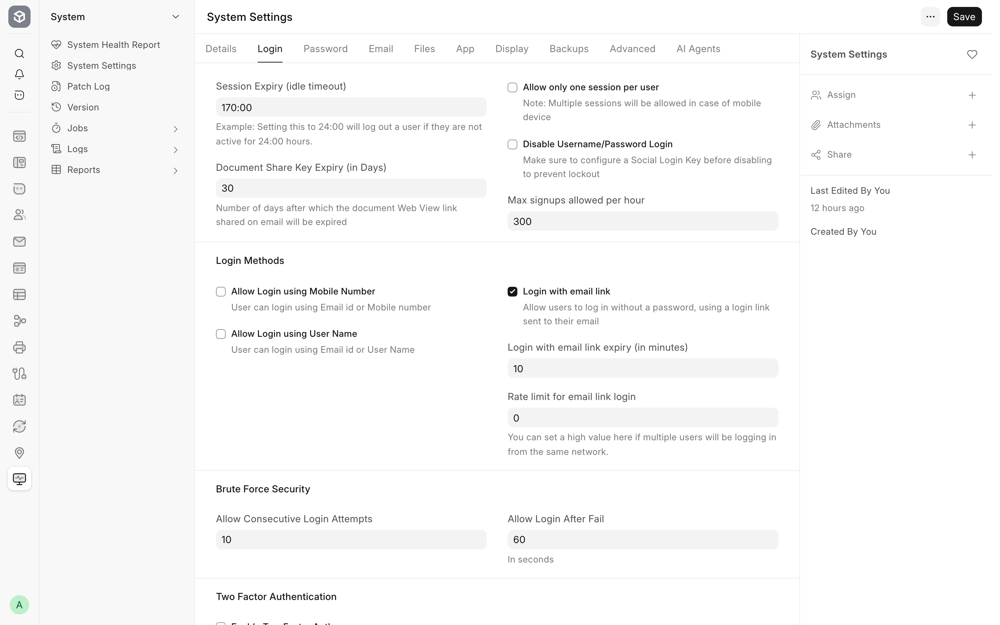

# System Settings

`System Settings` is the Single DocType with the site-wide settings: regional formats, login, passwords, email, files, dashboards, backups, background jobs and AI agents. Open it at `/desk/system-settings`. Only the `System Manager` role can read and write it. Changes apply to all users after you save. Users see desk changes after they reload the page. For how Single DocTypes, caching and boot data work, see [How Settings Work](how-settings-work.md).



The form has ten tabs: **Details**, **Login**, **Password**, **Email**, **Files**, **App**, **Display**, **Backups**, **Advanced** and **AI Agents**. The tables below list every field. "Default" is the default in the DocType JSON. A field with no default in the JSON shows "none". The setup wizard sets some of these values. See [Values set by the setup wizard](#values-set-by-the-setup-wizard).

Most fields are read on the server with `frappe.get_system_settings("<fieldname>")`. Desk code reads `frappe.boot.sysdefaults` through `frappe.defaults.get_default()` or `frappe.defaults.is_enabled()`.

## Details

### Details (first section)

| Field | Default | Effect |
|---|---|---|
| Country (`country`) | none | Desk loads `regional/<country>.js` and `regional/<country>_list.js` of each DocType (`frappe/desk/form/meta.py`). Workspace links with **Only for** show only for this country (`frappe/desk/desktop.py`). Default country of the Phone control (`frappe/public/js/frappe/form/controls/phone.js`, fallback `India`). Used to shorten numbers in charts and number cards. The `Country` document is sent in the boot data. |
| Language (`language`) | none | Required. Default language for users with no language on their User record (`frappe/translate.py`). On save, it is also set as the global default `lang`. If it changes, the form reloads the page. |
| Time Zone (`time_zone`) | none | Required. Server dates and times use it (`frappe.utils.get_system_timezone`, fallback `Asia/Kolkata`). Sent to the desk as `frappe.boot.time_zone.system`. A user can set a different time zone on the User record. |
| Currency (`currency`) | none | Default display currency. Used for Currency fields with no currency (`frappe/utils/formatters.py`, `frappe/public/js/frappe/utils/number_format.js`, `frappe/public/js/frappe/model/meta.js` with fallback `USD`). |
| Enable Onboarding (`enable_onboarding`) | 0 | Shows module onboarding blocks in workspaces (`frappe/desk/desktop.py`) and UI form tours (`frappe/desk/doctype/form_tour/form_tour.py`). The setup wizard sets it to 1. |
| Disable Document Sharing (`disable_document_sharing`) | 0 | Denies the `share` permission (`frappe/permissions.py`). The desk hides **Share** for all users except `Administrator` (`frappe/public/js/frappe/model/model.js`). Assigning a document to a user without permission fails, because Frappe cannot share it (`frappe/desk/form/assign_to.py`). |
| Application Name (`app_name`) | `Frappe` | Hidden. Fallback when **App Name** in [Website Settings](website-settings.md) is empty. Used for the login page title, the desk page title, the email brand name and the login link email (`frappe/www/login.py`, `frappe/www/desk.py`, `frappe/email/email_body.py`). |
| Setup Complete (`setup_complete`) | 0 | Hidden and read only. Frappe writes it from `Installed Application` after the setup wizard (`frappe/desk/page/setup_wizard/setup_wizard.py`). The desk uses `frappe.is_setup_complete()` instead of this field. |

### Date and Number Format

| Field | Default | Effect |
|---|---|---|
| Date Format (`date_format`) | none | Required. Options: `yyyy-mm-dd`, `dd-mm-yyyy`, `dd/mm/yyyy`, `dd.mm.yyyy`, `mm/dd/yyyy`, `mm-dd-yyyy`. Used to show and parse dates on the server (`frappe/locale.py`) and in the desk (`frappe/public/js/frappe/utils/datetime.js`, `frappe/public/js/frappe/form/controls/date.js`). Also used for date cells in Excel exports (`frappe/utils/xlsxutils.py`). |
| Time Format (`time_format`) | `HH:mm:ss` | Required. `HH:mm:ss` or `HH:mm`. Used for Time and Datetime fields on the server and in the desk. |
| Number Format (`number_format`) | none | Required. For example `#,###.##`, `#.###,##` or `#,##,###.##`. Sets the group and decimal separators (`frappe/model/meta.py`, `frappe/public/js/frappe/utils/number_format.js`). |
| Use Number Format from Currency (`use_number_format_from_currency`) | 0 | Uses the **Number Format** of the `Currency` record for currency values, if it has one. Read on the server in `frappe/model/meta.py` and in the desk in `number_format.js`. |
| First Day of the Week (`first_day_of_the_week`) | `Sunday` | First day in the date picker (`frappe/public/js/frappe/form/controls/date.js`, `date_range.js`), in calendars through the moment locale (`frappe/public/js/frappe/desk.js`) and in charts (`frappe/public/js/frappe/ui/island/loader.js`). Read with `frappe.datetime.get_first_day_of_the_week_index()`. |
| Float Precision (`float_precision`) | none | Decimal places for number fields, other than Currency, with no precision. Server fallback is 3 (`frappe/model/meta.py`). |
| Currency Precision (`currency_precision`) | none | Decimal places for Currency fields with no precision. If empty, the precision comes from the number format (`frappe/model/meta.py`, `frappe/utils/data.py`). |
| Rounding Method (`rounding_method`) | `Banker's Rounding (legacy)` | `Banker's Rounding (legacy)`, `Banker's Rounding` or `Commercial Rounding`. Used by `frappe.utils.rounded()` and `flt()` on the server and by `number_format.js` in the desk. The form asks you to confirm a change. After you move away from the legacy option, the form hides it. If the value changes, the form reloads the page. |
| Show Absolute Datetime in Timeline (`show_absolute_datetime_in_timeline`) | 0 | Shows the full date and time instead of "2 hours ago" in the form timeline and sidebar (`frappe/public/js/frappe/form/footer/base_timeline.js`, `frappe/public/js/frappe/form/sidebar/form_sidebar.js`). Each user can also turn it on for themselves. |

!!! note
    A user's **Language** can override the formats. When you set a language on a User, Frappe copies the **Date Format**, **Time Format**, **Number Format** and **First Day of the Week** of that `Language` record into the user's defaults. On the server, `frappe/locale.py` also reads the `Language` record of the current language before it reads System Settings.

### Permissions

| Field | Default | Effect |
|---|---|---|
| Apply Strict User Permissions (`apply_strict_user_permissions`) | 0 | When a user has a User Permission for a DocType, documents with an empty link field to that DocType are hidden. When off, they are shown. Read in `frappe/permissions.py`, `frappe/model/db_query.py`, `frappe/database/query.py`, `frappe/model/mapper.py` and `frappe/core/doctype/file/file.py`. See [User Permissions](../users-and-permissions/user-permissions.md). |
| Show External Link Warning (`show_external_link_warning`) | `Never` | `Never`, `Ask` or `Always`. Shows a warning dialog before the desk opens a link to another host. With `Ask`, the user can turn off the warning for one host in the browser. Sent as `frappe.boot.show_external_link_warning` and read by `frappe/public/js/frappe/router.js`. |

## Login



### Login (first section)

| Field | Default | Effect |
|---|---|---|
| Session Expiry (idle timeout) (`session_expiry`) | `170:00` | Idle time in `hh:mm` before a session ends. The controller rejects other formats. If empty, the server uses `240:00:00` (`frappe/sessions.py`). |
| Document Share Key Expiry (in Days) (`document_share_key_expiry`) | 30 | Days until a new `Document Share Key` expires. These keys are used in web view links in emails. If 0, the server uses 90 (`frappe/core/doctype/document_share_key/document_share_key.py`). |
| Allow only one session per user (`deny_multiple_sessions`) | 0 | At login, Frappe ends the other sessions of the user, but keeps the newest ones up to the **Simultaneous Sessions** value of the User record (default 2, counting the new session) (`clear_active_sessions` in `frappe/auth.py`, `frappe/sessions.py`). The site config key `deny_multiple_sessions` does the same. The form description says that mobile devices keep multiple sessions, but the code does not check the device. |
| Disable Username/Password Login (`disable_user_pass_login`) | 0 | `/api/method/login` with a password fails, and the login page hides the password form (`frappe/auth.py`, `frappe/www/login.html`). The controller requires an enabled `Social Login Key`, enabled LDAP or **Login with email link** first. |
| Max signups allowed per hour (`max_signups_allowed_per_hour`) | 300 | Website sign-up stops for the hour after this number of new users (`frappe/core/doctype/user/user.py`). |

### Login Methods

| Field | Default | Effect |
|---|---|---|
| Allow Login using Mobile Number (`allow_login_using_mobile_number`) | 0 | Users can log in with the **Mobile No** of their User record. The login page label shows "Mobile" (`frappe/www/login.py`, `frappe/core/doctype/user/user.py`). |
| Allow Login using User Name (`allow_login_using_user_name`) | 0 | Users can log in with their **Username**. The login page label shows "Username". |
| Login with email link (`login_with_email_link`) | 1 | Shows the login link option on the login page. `frappe.www.login.send_login_link` sends a one-time login link by email. |
| Login with email link expiry (in minutes) (`login_with_email_link_expiry`) | 10 | Shows when **Login with email link** is on. Minutes until the link expires. If 0, the server uses 10. |
| Rate limit for email link login (`rate_limit_email_link_login`) | none | Shows when **Login with email link** is on. Maximum login link requests per hour. If empty or 0, the server uses 5 (`frappe/www/login.py`). |

### Brute Force Security

| Field | Default | Effect |
|---|---|---|
| Allow Consecutive Login Attempts (`allow_consecutive_login_attempts`) | 10 | Failed logins before Frappe locks the account. 0 turns off the lock (`frappe/auth.py`). |
| Allow Login After Fail (`allow_login_after_fail`) | 60 | Seconds the account stays locked. |

### Two Factor Authentication

| Field | Default | Effect |
|---|---|---|
| Enable Two Factor Auth (`enable_two_factor_auth`) | 0 | Turns on two-factor authentication (`frappe/twofactor.py`). When you turn it on, the controller sets **Two Factor Authentication** on the role `All`. With method `SMS`, the controller requires **SMS Gateway URL** in `SMS Settings`. When you turn it off, the controller clears the two bypass fields below. |
| Bypass Two Factor Auth for users who login from restricted IP Address (`bypass_2fa_for_retricted_ip_users`) | 0 | Shows when two-factor is on. Users who log in from an IP in their **Restrict IP** list skip two-factor. |
| Bypass restricted IP Address check If Two Factor Auth Enabled (`bypass_restrict_ip_check_if_2fa_enabled`) | 0 | Shows when two-factor is on. All users can log in from any IP. Each user can also have this flag on the User record (`frappe/auth.py`). |
| Two Factor Authentication method (`two_factor_method`) | `OTP App` | Shows when two-factor is on. `OTP App`, `SMS` or `Email`. |
| Expiry time of QR Code Image Page (`lifespan_qrcode_image`) | none | Shows when two-factor is on and the method is `OTP App`. Seconds that the `/qrcode` link in the OTP setup email stays valid, and age after which the QR code image file is deleted. Empty or 0 means 240 (`frappe/twofactor.py`). |
| OTP Issuer Name (`otp_issuer_name`) | `Frappe Framework` | Shows when two-factor is on. Name shown in the authenticator app and in OTP emails. |
| OTP SMS Template (`otp_sms_template`) | none | Shows when the method is `SMS`. Jinja text of the OTP SMS. It must contain `{{ otp }}`. If empty, Frappe sends "Your verification code is {{otp}}". |

## Password

| Field | Default | Effect |
|---|---|---|
| Logout All Sessions on Password Reset (`logout_on_password_reset`) | 1 | Ends all sessions of a user after a password change or OTP secret reset (`frappe/core/doctype/user/user.py`, `frappe/twofactor.py`). |
| Force User to Reset Password (`force_user_to_reset_password`) | none | Days. At login, users whose last password reset is older than this must reset the password. Standard users are excluded (`frappe/auth.py`). When you first set it, Frappe sets **Last Password Reset Date** to today on users that have none. |
| Reset Password Link Expiry Duration (`reset_password_link_expiry_duration`) | 1200 | Duration in seconds. A reset link older than this fails. The reset email shows the expiry in minutes. 0 means no expiry. |
| Password Reset Link Generation Limit (`password_reset_limit`) | 3 | Reset link requests allowed per hour (`frappe/utils/password.py`). Users with `System Manager` get 1000. |
| Enable Password Policy (`enable_password_policy`) | 1 | Checks password strength with zxcvbn (`frappe/core/doctype/user/user.py`, `frappe/utils/password_strength.py`). When off, the controller clears **Minimum Password Score**. |
| Minimum Password Score (`minimum_password_score`) | 2 | Shows when the policy is on. Score from 1 to 4 that a new password must reach. The controller requires a value when the policy is on. |

## Email

| Field | Default | Effect |
|---|---|---|
| Email Footer Address (`email_footer_address`) | none | Organization name and address in the footer of outgoing emails. Read as a global default in `frappe/email/email_body.py`. |
| Email Retry Limit (`email_retry_limit`) | 3 | Send attempts before an `Email Queue` record is set to **Error** (`frappe/email/doctype/email_queue/email_queue.py`). If 0, the server uses 3. |
| Disable Standard Email Footer (`disable_standard_email_footer`) | 0 | Removes the footer from the `default_mail_footer` hook. Read as a global default in `frappe/email/email_body.py`. |
| Hide footer in auto email reports (`hide_footer_in_auto_email_reports`) | 0 | Removes the footer from `Auto Email Report` emails (`frappe/templates/emails/auto_email_report.html`). |
| Include Web View Link in Email (`attach_view_link`) | 1 | Adds a web view link of the document to emails sent with a print format (`frappe/core/doctype/communication/mixins.py`). |
| Store Attached PDF Document (`store_attached_pdf_document`) | 1 | Saves the PDF attached to an email as a private `File` on the `Communication` (`frappe/email/doctype/email_queue/email_queue.py`). This uses storage. |
| Welcome Email Template (`welcome_email_template`) | none | `Email Template` for the welcome email to new users (`frappe/core/doctype/user/user.py`). |
| Reset Password Template (`reset_password_template`) | none | `Email Template` for the password reset email. |

## Files

| Field | Default | Effect |
|---|---|---|
| Max File Size (MB) (`max_file_size`) | none | Upload size limit. If empty, Frappe uses `max_file_size` in site config (bytes), then 25 MB (`frappe/core/api/file.py`). Sent as `frappe.boot.max_file_size`. |
| Max Zip Extract Size (MB) (`max_zip_extract_size`) | none | Maximum total size of the files in an extracted ZIP. Fallback is `max_zip_extract_size` in site config, then 25 MB. |
| Allow Guests to Upload Files (`allow_guests_to_upload_files`) | 0 | Lets `Guest` call `frappe.handler.upload_file`, for example from a web form. |
| Allowed Doctypes for Guest Uploads (`allowed_doctypes_for_guest_uploads`) | none | Shows when guest uploads are on. One DocType per line. If set, guests can upload only for these DocTypes (`frappe/handler.py`). |
| Force Web Capture Mode for Uploads (`force_web_capture_mode_for_uploads`) | 0 | The camera dialog uses the web capture mode also on mobile devices (`frappe/public/js/frappe/ui/capture.js`). |
| Strip EXIF tags from uploaded images (`strip_exif_metadata_from_uploaded_images`) | 1 | Removes EXIF data from uploaded JPEG images (`frappe/core/doctype/file/file.py`). |
| Only allow System Managers to upload public files (`only_allow_system_managers_to_upload_public_files`) | 0 | Other users cannot make a file public. The file uploader does not let them make a file public (`frappe/public/js/frappe/utils/utils.js`), and the server rejects it (`frappe/core/doctype/file/file.py`). |
| Delete Background Exported Reports After (Hours) (`delete_background_exported_reports_after`) | 48 | Hours to keep report files exported in the background and sent by email. The `hourly_maintenance` job `frappe.desk.utils.delete_old_exported_report_files` deletes older files. |
| Allowed File Extensions (`allowed_file_extensions`) | none | One extension per line. Empty allows all. The controller saves them in upper case. The server checks uploads in a request (`frappe/core/doctype/file/file.py`). The uploader limits the file picker (`frappe/public/js/frappe/file_uploader/file_uploader.bundle.js`). |

## App

| Field | Default | Effect |
|---|---|---|
| Default App (`default_app`) | none | The app that opens after login. Options are the apps from `frappe.apps.get_apps`. The **Default App** of a User overrides it (`get_default_path()` in `frappe/apps.py`). |
| Dashboards (`dashboards`) | `Insights` | `Insights` or `Classic`. Applies to a standard `Dashboard` whose app also ships an Insights board for it. With `Insights`, an installed app (Insights) can draw the dashboard. With `Classic`, `/desk/dashboard-view/<name>` always uses the legacy renderer. Sent to the page as `__onload.dashboards` (`frappe/desk/doctype/dashboard/dashboard.py`, `frappe/core/page/dashboard_view/dashboard_view.js`). The patch `set_classic_dashboards` sets `Classic` on sites that upgrade. A System Manager can also answer a prompt on the dashboard page, which saves this field. |

## Display

| Field | Default | Effect |
|---|---|---|
| Disable System Update Notification (`disable_system_update_notification`) | 0 | Stops the weekly update check and the update popup for System Managers (`frappe/utils/change_log.py`). |
| Disable Change Log Notification (`disable_change_log_notification`) | 0 | Stops the "Updated To A New Version" dialog after an update (`frappe/public/js/frappe/desk.js`). |
| Hide Empty Read-Only Fields (`hide_empty_read_only_fields`) | 1 | Hides read-only fields with no value in forms (`frappe/public/js/frappe/form/controls/base_control.js`). |
| Disable Product Suggestion (`disable_product_suggestion`) | 0 | Hides the promotional banners in the sidebar. They show only to System Managers (`frappe/public/js/frappe/ui/sidebar/sidebar.js`). |
| Use Classic Charts (`use_classic_charts`) | 0 | Draws legacy chart configs and number cards the old way, with frappe-charts (`frappe/public/js/frappe/ui/chart.js`). Sites updated from an earlier version start with this on. |

## Backups

| Field | Default | Effect |
|---|---|---|
| Number of Backups (`backup_limit`) | 3 | Backups that the **Download Backups** page lists and keeps. The `hourly_maintenance` job `delete_downloadable_backups` deletes older ones (`frappe/desk/page/backups/backups.py`). The controller sets values below 1 to 1. |
| Encrypt Backups (`encrypt_backup`) | 0 | Encrypts new backups and adds `-enc` to the file names (`frappe/utils/backups.py`). See [Backups](../system-administration/backups.md). |

## Advanced

### Reports

| Field | Default | Effect |
|---|---|---|
| Max auto email report per user (`max_auto_email_report_per_user`) | 20 | Enabled `Auto Email Report` records per user. The site config key `max_reports_per_user` overrides it (`frappe/email/doctype/auto_email_report/auto_email_report.py`). |
| Max Report Rows (`max_report_rows`) | 100000 | If a query or script report returns more rows, the browser does not show them and asks the user to export (`frappe/public/js/frappe/views/reports/query_report.js`). |

### Snapshot Reports

| Field | Default | Effect |
|---|---|---|
| Enable Snapshot Reports (`enable_snapshot_reports`) | 0 | When it or **Frequency** changes, the controller deletes and creates the `DuckDB Sync` scheduled job (`frappe.database.duckdb.database.start_duckdb_sync`). |
| Sync In Batches (`sync_in_batch`) | 1 | Shows when snapshot reports are on. On: the sync uses pyarrow. Off: it uses the DuckDB extension (`frappe/core/doctype/duckdb_sync/duckdb_sync.py`). |
| Frequency (`frequency`) | `Weekly` | Shows when snapshot reports are on. `Daily` runs at 00:00 each day. `Weekly` runs at 00:00 on Sunday. |
| Sync Timeout (Seconds) (`sync_timeout`) | none | Shows when snapshot reports are on. Timeout of the sync jobs. If empty, the server uses 1500 seconds. |

### Background Workers

| Field | Default | Effect |
|---|---|---|
| Enable Scheduled Jobs (`enable_scheduler`) | 0 | Hidden. If off, the scheduler does not enqueue scheduled jobs (`frappe/utils/scheduler.py`). The setup wizard sets it to 1. Use `bench --site <site> enable-scheduler` or `disable-scheduler`. If `disable_scheduler` is set in site config, the scheduler does not run, whatever this value is. |
| Submission Queue Timeout (`submission_queue_timeout`) | 600 | Seconds that a queued submit or cancel can run in the background (`frappe/core/doctype/submission_queue/submission_queue.py`). The controller rejects values above 3600. |
| Run Jobs only Daily if Inactive For (Days) (`dormant_days`) | 4 | On Frappe Cloud, scheduled jobs run only once a day on sites with no activity for this many days. 0 turns this off. Not used on other hosts or in developer mode (`frappe/utils/scheduler.py`). |

### Telemetry

| Field | Default | Effect |
|---|---|---|
| Show Full Error and Allow Reporting of Issues to the Developer (`allow_error_traceback`) | 1 | System users get the full traceback in error responses (`frappe/utils/response.py`). Website users never get it. |
| Allow Sending Usage Data for Improving Applications (`enable_telemetry`) | 1 | Turns on usage telemetry and the Sentry error DSN in the boot data (`frappe/boot.py`, `frappe/utils/telemetry/pulse/client.py`). Telemetry is also off in developer mode. The setup wizard sets it from the user's choice. |

### Search

| Field | Default | Effect |
|---|---|---|
| Link Field Results Limit (`link_field_results_limit`) | 10 | Results in the Link field dropdown (`frappe/public/js/frappe/form/controls/link.js`). The controller sets an empty value to 10 and limits it to 50. |
| Allow Clearing Link Fields (`allow_clearing_link_fields`) | 0 | Adds a clear (x) button to Link fields when combobox fields are off. |
| Enable Combobox Fields (Beta) (`enable_combobox_link_field`) | 0 | Uses the combobox control for Link, Autocomplete and MultiSelect fields (`frappe/public/js/frappe/form/controls/link_combobox.js`). When on, the boot data includes `link_settings` (`frappe/boot.py`). |

### API Logging

| Field | Default | Effect |
|---|---|---|
| Log API Requests (`log_api_requests`) | 0 | Saves each `/api` request as an `API Request Log` with path, user and method (`frappe/api/__init__.py`). |

## AI Agents

### MCP Settings

| Field | Default | Effect |
|---|---|---|
| Enable MCP (`enable_mcp`) | 1 | Turns on the MCP endpoint `/api/v2/mcp` (`frappe/mcp/__init__.py`). The form shows the endpoint URL and a link to OAuth Settings. |
| Server Name (`server_name`) | none | Name sent to MCP clients. If empty, Frappe uses the host name (`frappe/mcp/protocol.py`). |
| Agent Instructions (`agent_instructions`) | none | Text sent to AI agents when they connect. Describe what the site is for and how your team uses it. |

### frappectl

This section has only an HTML field (`frappectl_help`) with install and login commands for the `frappectl` command-line client. It stores no value.

See [MCP and Discovery](../../developer-guide/api/mcp-and-discovery.md).

## Values set by the setup wizard

The setup wizard saves `float_precision` 3, `rounding_method` `Banker's Rounding`, `enable_scheduler` 1, `backup_limit` 3, and the country, language, time zone, currency and formats that the user selects. Date and time formats come from the `Country` record. If the wizard gets no country, it writes these values with `frappe.db.set_single_value` and fills empty required fields with `yyyy-mm-dd`, `HH:mm:ss` and `#,###.##`.

## For developers

```python
frappe.get_system_settings("date_format")                    # cached
frappe.db.get_single_value("System Settings", "backup_limit")  # cast to int
settings = frappe.get_single("System Settings")
settings.email_retry_limit = 5
settings.save()
```

- `frappe.get_system_settings(key)` reads the document from the client cache and keeps it on `frappe.local` for the request. `frappe.db.get_system_setting(key)` is the same function.
- `validate` checks the password score, session expiry format, two-factor and SMS setup, the username/password lockout, the backup limit, file extensions, the OTP SMS template, the link field limit and the submission queue timeout. It also schedules snapshot reports.
- `on_update` saves each changed value as a global default (`frappe.db.set_default`), sets the default language, and clears the System Settings cache (`clear_system_settings_cache`). A changed global default clears the full site cache, so the next boot of each user has the new values.
- The desk reads most values from `frappe.boot.sysdefaults`, which comes from the global defaults. `frappe.db.set_single_value("System Settings", ...)` does not update the global defaults, so the desk keeps the old value. Use `doc.save()` when the desk must see the change.
- The email footer fields (`email_footer_address`, `disable_standard_email_footer`) are read with `frappe.db.get_default()`. They also need `doc.save()`.
- Other boot keys from System Settings: `frappe.boot.time_zone`, `frappe.boot.show_external_link_warning`, `frappe.boot.max_file_size` and `frappe.boot.link_settings`.
- To set values when your app is installed, use an `after_install` hook and `doc.save()`. See [How Settings Work](how-settings-work.md).

## Pitfalls

- **Disable Username/Password Login** fails unless a Social Login Key, LDAP or **Login with email link** is enabled. This prevents a lockout.
- Turning on **Enable Two Factor Auth** sets two-factor on the role `All`. Turning it off does not clear the flag on the role.
- `enable_scheduler` is 0 by default. If it is off, scheduled jobs, such as the email queue flush, do not run.
- Changing **Rounding Method** on a site with data can change totals that Frappe calculates again.

## Related

- [How Settings Work](how-settings-work.md)
- [Security Settings](security-settings.md)
- [Desk Settings](desk-settings.md) (Navbar Settings)
- [Website Settings](website-settings.md)
- [Users and Roles](../users-and-permissions/users-and-roles.md)
- [Backups](../system-administration/backups.md)
- [Scheduler](../../developer-guide/runtime/scheduler.md)
- [Configuration](../../developer-guide/operations/configuration.md)
