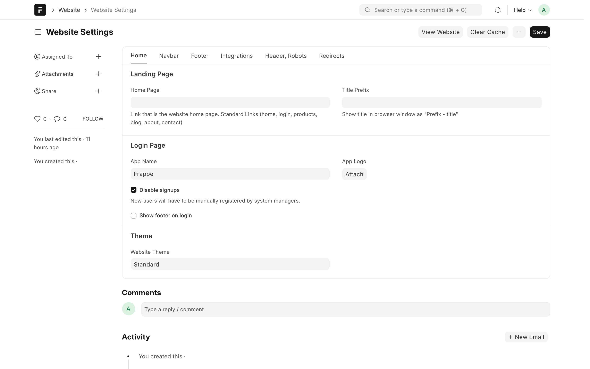
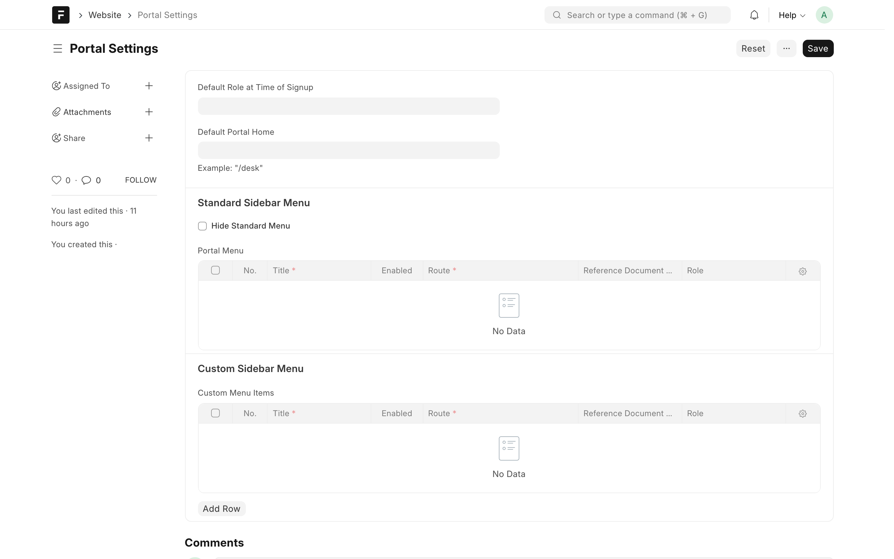

# Website Settings

Six Single DocTypes configure the public website, the portal and the blog: `Website Settings`, `Portal Settings`, `Contact Us Settings`, `About Us Settings`, `Website Script` and `Blog Settings`. Use this page to find what each field does, its default, and which code reads it. For the concepts behind settings DocTypes, see [How settings work](how-settings-work.md). For how-to steps, see [Website](../website-and-integrations/website.md).

## Website Settings

`Website Settings` controls the home page, branding, navbar, footer, login page, analytics, `robots.txt` and redirects of the website. Open it at `/app/website-settings`. Users with the `Website Manager` role can read and write it. The `All` role can read it.



Most fields reach the page through `get_website_settings()` in `frappe/website/doctype/website_settings/website_settings.py`. It copies a fixed list of fields into the Jinja context of every website page that extends `templates/base.html`. Other code reads one value with `frappe.get_website_settings(key)`.

### Home tab: Landing Page

| Field | Default | Effect |
|---|---|---|
| Home Page (`home_page`) | empty | The route that `/` shows. `get_home_page()` in `frappe/website/utils.py` uses it only after the **Home Page** of the user's roles (`Role.home_page`), the `default_portal_home` of Portal Settings (logged-in users), and the `get_website_user_home_page`, `website_user_home_page`, `role_home_page` and `home_page` hooks. If all are empty, Guests get `login` and other users get `me`. The controller checks the path with `PathResolver`. An invalid path shows a message and the field is cleared. |
| Title Prefix (`title_prefix`) | empty | Added before each page title as `Prefix - Title` by `set_title_with_prefix()` in `frappe/website/page_renderers/base_template_page.py`. |

### Home tab: Login Page

| Field | Default | Effect |
|---|---|---|
| App Name (`app_name`) | `Frappe` | The name on the login page and the subject of the login-link email (`frappe/www/login.py`), and the `<title>` of the desk (`frappe/www/app.py`). Falls back to the `app_name` of System Settings. |
| Disable signups (`disable_signup`) | `1` | Hides the sign-up link and form on `/login` (`frappe/www/login.html`). `frappe.core.doctype.user.user.sign_up` throws "Sign Up is disabled". Social logins with no own `sign_ups` value also refuse new users (`provider_allows_signup()` in `frappe/integrations/doctype/social_login_key/social_login_key.py`). The sign-up limit per hour is the System Settings field `max_signups_allowed_per_hour` (default 300). |
| Show footer on login (`show_footer_on_login`) | `0` | Shows the website footer on `/login`. Read in `frappe/www/login.py` and `frappe/templates/includes/login/login.js`. |
| App Logo (`app_logo`) | empty | The logo on the login page and in the desk navbar through `frappe.boot.app_logo_url` (`get_app_logo()` in `frappe/core/doctype/navbar_settings/navbar_settings.py`). It wins over the `app_logo` of Navbar Settings and the `app_logo_url` hook. |

### Home tab: Theme

| Field | Default | Effect |
|---|---|---|
| Website Theme (`website_theme`) | `Standard` | The active Website Theme (`get_active_theme()` in `frappe/website/doctype/website_theme/website_theme.py`). If it is not `Standard`, `templates/includes/head.html` loads the theme CSS file instead of `website.bundle.css`. The theme JS is added to `/website_script.js`. The **Set as Default Theme** button on a Website Theme sets this field. |
| Website Theme Image (`website_theme_image`) | empty | Hidden. Not read by Frappe code. |
| Website Theme image link (`website_theme_image_link`) | empty | Hidden. Not read by Frappe code. |

### Navbar tab: Brand

| Field | Default | Effect |
|---|---|---|
| Brand Image (`banner_image`) | empty | The image at the top left of the website navbar when `brand_html` is empty (`templates/includes/navbar/navbar.html`). Also used by the **Set Banner from Image** button. |
| Splash Image (`splash_image`) | empty | The image on the splash screen (`templates/includes/splash_screen.html`). Default `/assets/frappe/images/frappe-framework-logo.png`. |
| Brand HTML (`brand_html`) | empty | HTML at the top left of the navbar (`templates/includes/navbar/navbar.html`, `templates/doc.html`). Wins over `banner_image`. If both are empty, the first `brand_html` hook value or "Home" shows. |
| Set Banner from Image (`set_banner_from_image`) | button | Sets `brand_html` to an `` tag for `banner_image`. Client side only (`website_settings.js`). |
| FavIcon (`favicon`) | empty | The favicon of website pages (`templates/base.html`). Default `/assets/frappe/images/frappe-favicon.svg`. |

### Navbar tab: Navbar

| Field | Default | Effect |
|---|---|---|
| Top Bar Items (`top_bar_items`) | empty | Table of `Top Bar Item` rows. The links of the website navbar (`templates/includes/navbar/navbar_items.html`). See [Top Bar Item](#top-bar-item-child-table). |
| Hide Login (`hide_login`) | `0` | Hides the **Login** link in the navbar (`templates/includes/navbar/navbar_login.html`). |
| Include Search in Top Bar (`navbar_search`) | `0` | Adds a search box to the navbar that submits to `/search` (`templates/includes/navbar/navbar_search.html`). |
| Show Language Picker (`show_language_picker`) | `0` | Shows a language selector for Guests on website pages. Sets `window.show_language_picker` in `templates/base.html`. Read by `frappe/website/js/website.js`. |

### Navbar tab: Navbar Template

| Field | Default | Effect |
|---|---|---|
| Navbar Template (`navbar_template`) | empty | A `Web Template` of type `Navbar` to render the navbar. `templates/base.html` uses `Standard Navbar` when it is empty. |
| Navbar Template Values (`navbar_template_values`) | empty | Hidden JSON. Set by the **Edit Values** button. Not read by Frappe render code. The template gets the page context instead. |
| Edit Values (`edit_navbar_template_values`) | button | Opens an editor for the fields of the Web Template. Shows only when `navbar_template` is set and is not `Standard Navbar`. |
| Call To Action (`call_to_action`) | empty | The label of a primary button in the navbar (`templates/includes/navbar/navbar_items.html`). |
| Call To Action URL (`call_to_action_url`) | empty | The link of that button. |

### Navbar tab: Banner

| Field | Default | Effect |
|---|---|---|
| Banner HTML (`banner_html`) | empty | HTML shown above the navbar on every website page (`templates/base.html`). |

### Footer tab

| Section | Field | Default | Effect |
|---|---|---|---|
| Footer Items | Footer Items (`footer_items`) | empty | Table of `Top Bar Item` rows. Links in the footer (`templates/includes/footer/footer_links.html`, `footer_grouped_links.html`). New rows get `right = 0`. |
| Footer Details | Copyright (`copyright`) | empty | Shown as `© <value>` in `templates/includes/footer/footer_info.html`. |
| Footer Details | Footer Logo (`footer_logo`) | empty | Image in the footer (`templates/includes/footer/footer_logo_extension.html`). |
| Footer Details | Hide footer signup (`hide_footer_signup`) | `0` | Copied into the page context. Not read by any Frappe template. |
| Footer Details | Address (`address`) | empty | Shown in the footer as `footer_address`. |
| Footer Details | Footer "Powered By" (`footer_powered`) | empty | Replaces the "Built on Frappe" line in the footer. |
| Custom Footer | Footer Template (`footer_template`) | empty | A `Web Template` of type `Footer`. `templates/base.html` uses `Standard Footer` when it is empty. |
| Custom Footer | Footer Template Values (`footer_template_values`) | empty | Hidden JSON. Set by **Edit Values**. Not read by Frappe render code. |
| Custom Footer | Edit Values (`edit_footer_template_values`) | button | Same as the navbar button, for `footer_template`. |

### Integrations tab: Analytics

| Field | Default | Effect |
|---|---|---|
| Enable in-app website tracking (`enable_view_tracking`) | `0` | `/website_script.js` sends a `Web Page View` log for each page view, unless the browser sends Do Not Track. Boot sets `frappe.boot.website_tracking_enabled` from it, and the form sidebar and timeline then show page view counts for documents with a route. |
| Enable Google indexing (`enable_google_indexing`) | `0` | On update or delete of a published website-generator document that Guests can view, Frappe enqueues a Google Indexing API request (`send_indexing_request()` in `frappe/website/website_generator.py`). Validation: Google Settings must be enabled. |
| Authorize API Indexing Access (`authorize_api_indexing_access`) | button | Starts the Google OAuth flow (`google_indexing.authorize_access`). Shows only when `enable_google_indexing` is on. |
| Indexing refresh token (`indexing_refresh_token`) | empty | Hidden, read only, deprecated. Not read by Frappe code. |
| Indexing refresh token (`indexing_refresh_token_secret`) | empty | Hidden Password field. Set by the OAuth flow. Used to get an access token for the Indexing API. |
| Indexing authorization code (`indexing_authorization_code`) | empty | Hidden. Set by the OAuth flow. |
| Google Analytics ID (`google_analytics_id`) | empty | Adds Google Analytics to `/website_script.js` (website pages). Falls back to `google_analytics_id` in site config. Not added when `developer_mode` is on. The desk reads only the site config key (`frappe/www/app.py`). |
| Google Analytics anonymise IP (`google_analytics_anonymize_ip`) | `1` | Adds `anonymizeIp` to the Google Analytics code in `/website_script.js`. |

### Integrations tab: Account Deletion Settings

| Field | Default | Effect |
|---|---|---|
| Automatically delete account within (hours) (`auto_account_deletion`) | `72` | The `hourly_maintenance` job `process_data_deletion_request` starts the data deletion of each `Personal Data Deletion Request` in `Pending Approval` older than this. A value below `1` turns it off. |
| Show account deletion link in My Account page (`show_account_deletion_link`) | `0` | Shows the account deletion link on `/me` (`frappe/www/me.html`). |

### Header, Robots tab

| Field | Default | Effect |
|---|---|---|
| Subdomain (`subdomain`) | empty | Read only. `get_url()` in `frappe/utils/data.py` uses it as host name when there is no request host and no `frappe.local.site`. |
| `<head>` HTML (`head_html`) | empty | HTML added inside `<head>` of every website page (`templates/includes/head.html`). Use it for site verification tags. |
| Robots.txt (`robots_txt`) | empty | The body of `/robots.txt` (`frappe/www/robots.py`). Falls back to the file in the `robots_txt` site config key. `/sitemap.xml` leaves out DocType web pages that it disallows. |

### Redirects tab

| Field | Default | Effect |
|---|---|---|
| Route Redirects (`route_redirects`) | empty | Table of `Website Route Redirect` rows. `resolve_redirect()` in `frappe/website/path_resolver.py` checks them after the `website_redirects` hook rules. The controller compiles each source as a regex and throws on an invalid one (not during migrate). |

### Top Bar Item (child table)

Used by `top_bar_items` and `footer_items`.

| Field | Default | Effect |
|---|---|---|
| Label (`label`) | required | The link text. |
| URL (`url`) | empty | The link. Leave it empty to make a group parent. |
| Open URL in a New Tab (`open_in_new_tab`) | `0` | Adds `target="_blank"`. Shows only when `url` is set. |
| Align Right (`right`) | `1` | Puts the item on the right side of the navbar or footer. |
| Parent Label (`parent_label`) | empty | Puts the item in the dropdown of that parent. Validation: the parent must exist in the same table and must have no URL. |

### Website Route Redirect (child table)

| Field | Default | Effect |
|---|---|---|
| Source (`source`) | required | A regex for the path. Frappe strips `/` and spaces and adds `$`. |
| Target (`target`) | required | The new path. Can use regex groups such as `\1`. |
| Redirect HTTP Status (`redirect_http_status`) | `301` | One of `301`, `302`, `307`, `308`. |

Frappe caches each resolved redirect in the `website_redirects` cache key.

### For developers

- Read one value with `frappe.get_website_settings("fieldname")`. It reads the cached document once and keeps it on `frappe.local` for the request.
- On update, the controller clears the Guest cache, the website cache (`frappe.website.utils.clear_cache`) and then all caches.
- Add context to every website page with the `website_context` hook. It overwrites keys from Website Settings.
- Related hooks: `website_redirects`, `get_website_user_home_page`, `website_user_home_page`, `role_home_page`, `home_page`, `brand_html`, `app_logo_url`, `base_template`, `web_include_js`, `web_include_css`, `website_clear_cache`. See [Hooks reference](../../reference/configuration/hooks.md).
- `get_auto_account_deletion` is a guest whitelisted method that returns `auto_account_deletion`.

```python
import frappe

theme = frappe.get_website_settings("website_theme")  # "Standard"
app_name = frappe.db.get_single_value("Website Settings", "app_name")
```

## Portal Settings

`Portal Settings` sets the default role of new website users, the portal home page, and the sidebar menu of portal pages. Open it at `/app/portal-settings`. Only `Website Manager` can read and write it.



| Field | Default | Effect |
|---|---|---|
| Default Role at Time of Signup (`default_role`) | empty | Role added to users made by `sign_up` (`frappe/core/doctype/user/user.py`) and by social login (`frappe/utils/oauth.py`). The form lists only enabled roles with no desk access. The server does not check this. |
| Default Portal Home (`default_portal_home`) | empty | Home page for logged-in users whose roles have no home page. Read by `get_home_page()` in `frappe/website/utils.py`. Validated as a path when saved from a request. |

### Standard Sidebar Menu

| Field | Default | Effect |
|---|---|---|
| Hide Standard Menu (`hide_standard_menu`) | `0` | Leaves the `menu` rows out of the portal sidebar (`get_portal_sidebar_items()` in `frappe/website/utils.py`). |
| Portal Menu (`menu`) | empty | Rows that `sync_menu()` adds from the `standard_portal_menu_items` hook on install (`frappe/installer.py`) and migrate (`frappe/migrate.py`). The form allows only sorting and editing. |

### Custom Sidebar Menu

| Field | Default | Effect |
|---|---|---|
| Custom Menu Items (`custom_menu`) | empty | Your own sidebar rows. Shown after the standard rows. |

The `Portal Menu Item` child table has `title`, `enabled` (default `0`), `route`, `reference_doctype`, `role` and a read-only `target`. A row shows only when it is enabled and the user has its role (or it has no role).

### For developers

- The **Reset** button calls `reset()`. It clears `menu` and syncs it again from the hooks.
- `sync_menu()` makes a role from the hook if it does not exist. It saves only when the hook added or changed a row. That save also drops rows of both tables whose `reference_doctype` is not an existing DocType, including rows with no `reference_doctype`.
- Frappe itself has no `standard_portal_menu_items` hook, so on a site with only Frappe the **Portal Menu** table is empty.
- Items from the `portal_menu_items` hook are added after both tables, always enabled.
- The sidebar is cached per user in the `portal_menu_items` cache key. `on_update` clears the website cache and all caches.

## Contact Us Settings

`Contact Us Settings` controls the `/contact` page. Open it at `/app/contact-us-settings`. Only `Website Manager` can read and write it. The page code is `frappe/www/contact.py` and `frappe/www/contact.html`.

### Introduction

| Field | Default | Effect |
|---|---|---|
| Disabled (`is_disabled`) | `1` | `/contact` redirects to `/404` and `send_message` does nothing. Clear it to publish the page. |
| Send Acknowledgement Email (`send_acknowledgement_email`) | `1` | `send_message` emails a thank-you note to the sender. |
| Forward To Email Address (`forward_to_email`) | empty | `send_message` emails the enquiry to this address, with the sender as reply-to. Every enquiry also makes a `Communication` with status `Open`. |
| Heading (`heading`) | empty | The page heading and title. Default "Contact Us". |
| Introduction (`introduction`) | empty | Text above the form. |
| Query Options (`query_options`) | empty | Options of the subject select, one per line or comma separated. Default `Sales`, `Support`, `General`. |

### Address

| Field | Default | Effect |
|---|---|---|
| Address Title (`address_title`) | empty | The heading of the address block. The address block shows only when this is set. |
| Address Line 1 (`address_line1`) | empty | Shown in the address block. |
| Address Line 2 (`address_line2`) | empty | Shown in the address block. |
| City (`city`) | empty | Shown in the address block. |
| State/Province (`state`) | empty | Shown in the address block. |
| Pincode (`pincode`) | empty | Shown in the address block. |
| Country (`country`) | empty | Shown in the address block. |
| Phone (`phone`) | empty | Shown with a phone icon. |
| Email Id (`email_id`) | empty | Shown as a `mailto:` link. |
| Skype (`skype`) | empty | Shown with a Skype icon. |

`on_update` clears the website cache for `contact`. `send_message` is a guest method with a rate limit of 100 calls per hour.

## About Us Settings

`About Us Settings` controls the `/about` page. Open it at `/app/about-us-settings`. Only `Website Manager` can read and write it. The page code is `frappe/www/about.py` and `frappe/www/about.html`.

| Section | Field | Default | Effect |
|---|---|---|---|
| (top) | Disabled (`is_disabled`) | `1` | `/about` redirects to `/404`. |
| (top) | Page Title (`page_title`) | empty | The page title and hero heading. Default "About Us". |
| (top) | Company Introduction (`company_introduction`) | empty | The hero subtitle. A placeholder text shows when it is empty. |
| Org History | Org History Heading (`company_history_heading`) | empty | Heading of the history list. Default "Company History". |
| Org History | Org History (`company_history`) | empty | `Company History` rows with `year` and `highlight`. |
| Team Members | Team Members Heading (`team_members_heading`) | empty | Default "Team Members". |
| Team Members | Team Members Subtitle (`team_members_subtitle`) | empty | Text under the heading. |
| Team Members | Team Members (`team_members`) | empty | `About Us Team Member` rows with `full_name`, `image_link` and `bio`. |
| Team Members | Footer (`footer`) | empty | HTML at the bottom of the page. |

`about.py` reads the document with `frappe.get_cached_doc`. `on_update` clears the website cache for `about`.

## Website Script

`Website Script` holds JavaScript that runs on every website page. Open it at `/app/website-script`. Only `Website Manager` can read and write it.

| Field | Default | Effect |
|---|---|---|
| Javascript (`javascript`) | empty | Rendered at the top of `/website_script.js` by `frappe/www/website_script.py`. Frappe loads that file on each website page through `web_include_js = ["website_script.js"]` in `frappe/hooks.py`. The desk does not load it. |

`/website_script.js` also has the JS of the active Website Theme, Google Analytics and the view tracking code. `on_update` clears the Guest cache and the website cache.

## Blog Settings

`Blog Settings` controls the blog list at `/blog`, blog posts, comments and likes. Open it at `/app/blog-settings`. `Website Manager` can read and write it. `Blogger` can read it. For blog posts, see [Website](../website-and-integrations/website.md).

| Field | Default | Effect |
|---|---|---|
| Blog Title (`blog_title`) | empty | The heading and title of `/blog` (`templates/includes/blog/hero.html`, `blog_post_list.html`). Default "Blog". Also the title of the RSS feed at `/rss` (`frappe/www/rss.py`). A category page uses the category title instead. |
| Blog Introduction (`blog_introduction`) | empty | Text under the blog heading, the meta description of `/blog`, and the RSS feed description. |
| Preview Image (`preview_image`) | empty | The meta image of `/blog` (`get_list_context()` in `frappe/website/doctype/blog_post/blog_post.py`). A category page uses the category image. |
| Enable Social Sharing (`enable_social_sharing`) | `0` | Shows Twitter, Facebook, LinkedIn and email share links on each blog post (`fetch_social_links_info()`). |
| Allow Guest to comment (`allow_guest_to_comment`) | `1` | Lets Guests comment on blog posts. When off, `add_comment` in `frappe/templates/includes/comments/comments.py` ignores Guest comments on a Blog Post. |
| Browse by category (`browse_by_category`) | `0` | Shows the list of blog categories on `/blog`. |
| Show "Call to Action" in Blog (`show_cta_in_blog`) | `0` | Shows a call-to-action block on each blog post, unless the post has **Hide CTA** set. The **Hide CTA** field of Blog Post shows only when this is on (`blog_post.js`). |

### Call to Action

Shows only when `show_cta_in_blog` is on. Each field is then mandatory.

| Field | Default | Effect |
|---|---|---|
| Title (`title`) | empty | Heading of the call-to-action block. |
| Subtitle (`subtitle`) | empty | Text under the heading. |
| CTA Label (`cta_label`) | empty | The button label. |
| CTA URL (`cta_url`) | empty | The button link. |

### Rate Limits

| Field | Default | Effect |
|---|---|---|
| Like limit (`like_limit`) | `5` | Maximum likes per document per hour (`rate_limit` on `like()` in `frappe/templates/includes/likes/likes.py`). Falls back to 5 when empty. |
| Comment limit (`comment_limit`) | `5` | Maximum comments per document per hour (`rate_limit` on `add_comment()` in `frappe/templates/includes/comments/comments.py`). Falls back to 5 when empty. |

`on_update` clears the website cache for `blog` and `writers`.

## Pitfalls

- A change to `home_page` does not show for a user whose role has a home page, or when `default_portal_home` or a home page hook is set.
- `navbar_template_values` and `footer_template_values` are saved but not passed to the template.
- `hide_footer_signup` has no effect in Frappe templates.
- Contact and About pages are disabled by default. Clear **Disabled** to publish them. `/sitemap.xml` lists `/contact` and `/about` even when they are disabled.

## Related

- [How settings work](how-settings-work.md)
- [Website](../website-and-integrations/website.md)
- [Website for developers](../../developer-guide/website/website.md)
- [Integration settings](integration-settings.md)
- [Hooks reference](../../reference/configuration/hooks.md)
