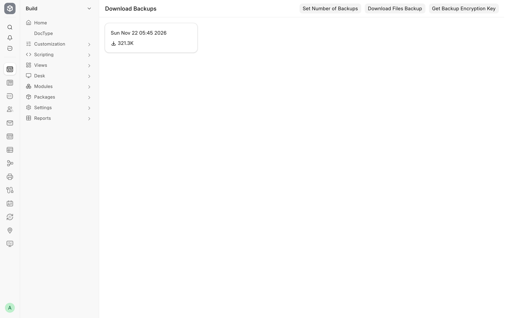

# Backups

A site backup has up to four files: the database dump, the public files, the private files, and a copy of `site_config.json`. You take backups with `bench backup` and restore them with `bench restore`. System Managers can download recent database backups from the desk. Take a backup before each update, and schedule regular backups on production servers.

## Backup files

Frappe saves backups in `sites/<site>/private/backups/`. You can change the folder with the `backup_path` key in `site_config.json`. File names start with the date and time and the site name, with dots changed to underscores:

| File | Example name |
|---|---|
| Database | `20261122_052729-frappe_localhost-database.sql.gz` |
| Site config | `20261122_052729-frappe_localhost-site_config_backup.json` |
| Public files | `20261122_052729-frappe_localhost-files.tar` |
| Private files | `20261122_052729-frappe_localhost-private-files.tar` |

- Partial backups (with includes or excludes) have `-partial` before `-database`.
- Encrypted backups have `-enc` before the extension.
- With `--compress`, file archives are `.tgz`.

## Take a backup

```bash
# database and site config only
bench --site frappe.localhost backup

# also public and private files
bench --site frappe.localhost backup --with-files

# all sites of the bench
bench --site all backup
```

Options of `bench backup`:

| Option | Description |
|---|---|
| `--with-files` | Also back up public and private files. |
| `--compress` | Compress the file archives (`.tgz`). |
| `-i`, `--include`, `--only` | DocTypes to back up, separated by commas. |
| `-e`, `--exclude` | DocTypes to leave out, separated by commas. |
| `--backup-path` | Folder for all backup files. |
| `--backup-path-db`, `--backup-path-files`, `--backup-path-private-files`, `--backup-path-conf` | Path for each file. |
| `--ignore-backup-conf` | Ignore the includes and excludes in site config. |
| `--verbose` | Print more output. |

`bench backup` prints a summary with the path and size of each file.

### Includes and excludes in site config

To always back up only some DocTypes, or to always leave some out, add a `backup` key to `site_config.json`:

```json
{
 "backup": {
  "excludes": ["Version", "Deleted Document"]
 }
}
```

Use `includes` for the other case. Frappe skips DocTypes that have no table, without a message. This applies to site config and to `--include` and `--exclude`. If no included DocType has a table, Frappe takes a full database backup.

## Schedule backups

Frappe does not take backups on its own. On a server, use the bench CLI to add a cron job:

```bash
bench setup backups
```

This adds a cron job that runs `bench --verbose --site all backup` every 6 hours and writes to `logs/backup.log`.

## Old backups

Frappe deletes old backups in two ways:

- Each new backup first deletes all files in the backup folder that are older than 23 hours. Set `keep_backups_for_hours` in site config to change this.
- An hourly job (`frappe.desk.page.backups.backups.delete_downloadable_backups`) keeps the newest **Number of Backups** (`backup_limit`, default 3) sets and deletes the rest.

Copy backups to another server or storage if you need to keep them longer.

## Download backups from the desk

1. Go to **Download Backups** (`/desk/backups`). You need the `System Manager` role.
2. Click a backup to download the database file.



The page shows the newest database backups, up to **Number of Backups**. Each download makes an `Access Log` entry. The buttons are:

| Button | What it does |
|---|---|
| Set Number of Backups | Opens **System Settings** at **Number of Backups**. |
| Download Files Backup | Queues a backup with files on the `long` queue. Frappe emails you the download links when it is done. |
| Get Backup Encryption Key | Shows the encryption key after you confirm your password. |

## Encrypt backups

1. Go to **System Settings > Backups**.
2. Set **Encrypt Backups** (`encrypt_backup`).
3. Save.

Frappe then encrypts the database and file archives with `gpg`. The `gpg` program must be installed on the server. The key is `backup_encryption_key` in `site_config.json`. Frappe creates it the first time it needs it. Store the key outside the server. Without it, you cannot restore an encrypted backup.

## Restore a backup

!!! warning
    `bench restore` replaces the whole database of the site. Take a backup of the site first.

```bash
bench --site frappe.localhost restore \
  sites/frappe.localhost/private/backups/20261122_052729-frappe_localhost-database.sql.gz \
  --with-public-files sites/frappe.localhost/private/backups/20261122_052729-frappe_localhost-files.tar \
  --with-private-files sites/frappe.localhost/private/backups/20261122_052729-frappe_localhost-private-files.tar
```

- If the path does not exist, `bench restore` also looks in `sites/<site>/private/backups` and in the bench folder.
- For an encrypted file, Frappe uses `--encryption-key`. Without it, Frappe uses `backup_encryption_key` in site config. If the site has no key, Frappe makes a new one, and the decryption fails.
- `--admin-password` sets the Administrator password after the restore.
- On MariaDB, Frappe asks you to confirm when the backup comes from a newer version of Frappe. `--force` skips this check and the SQL file validation.
- Run `bench --site <site> migrate` after a restore from an older version.

A partial backup cannot be restored with `bench restore`. Use `bench --site <site> partial-restore <file>`. It restores only the tables in the file, into the existing site.

## For developers

```python
from frappe.utils.backups import new_backup

odb = new_backup(ignore_files=True, force=True)
print(odb.backup_path_db)
```

- `frappe.utils.backups.new_backup(...)` takes a backup and returns the `BackupGenerator`. Without `force=True`, it reuses a complete backup set (database, files, private files and config) from the last 6 hours if one exists.
- `frappe.utils.backups.fetch_latest_backups()` returns the paths of the latest backups. It needs `System Manager`.
- Site config keys: `backup`, `backup_path`, `keep_backups_for_hours` and `backup_encryption_key`. See [Site Config reference](../../reference/configuration/site-config.md).

## Related

- [System Settings](../settings/system-settings.md)
- [Logs and Monitoring](logs-and-monitoring.md)
- [Deployment](../../developer-guide/operations/deployment.md)
- [CLI reference](../../reference/configuration/cli.md)
