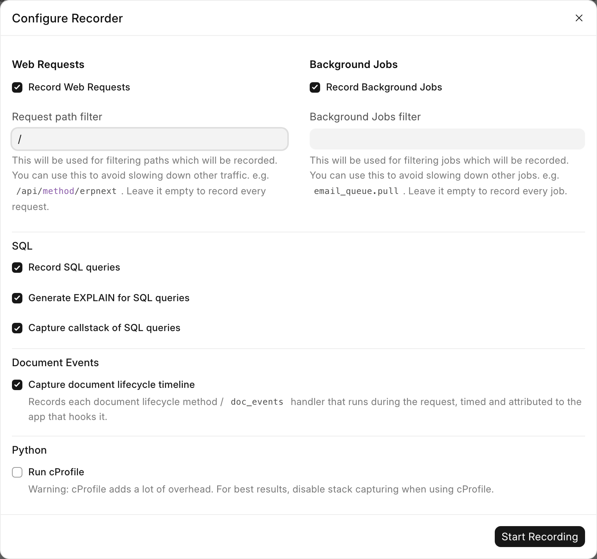
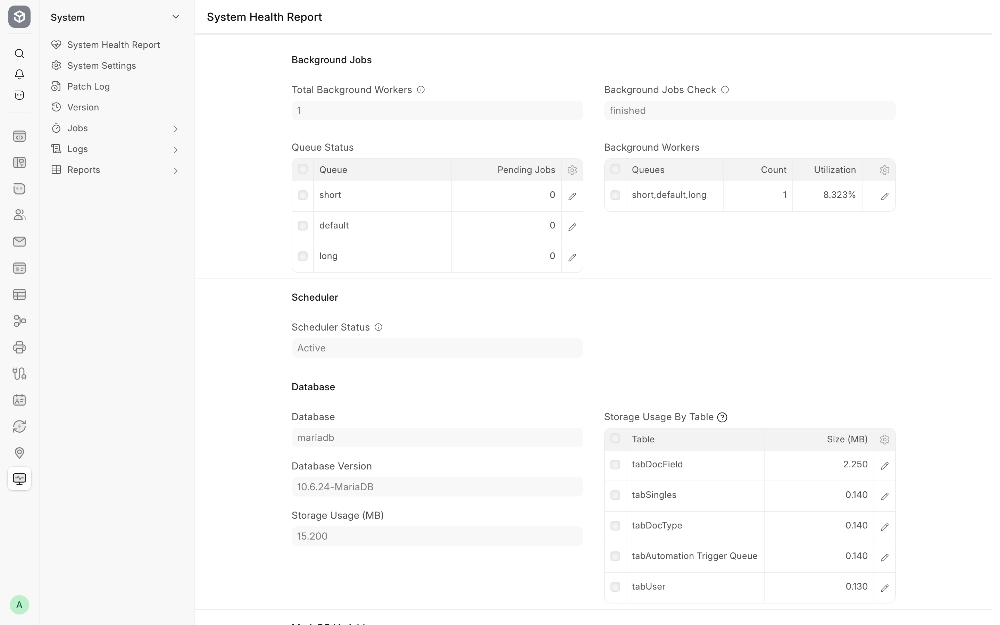

# Logs and Monitoring

Frappe records errors, logins, data access, scheduled job runs and background jobs in log DocTypes. Use them to find out why something failed, who did what, and whether workers and the scheduler run. Use the Recorder and the System Health Report to look at performance and the state of the site. Most of these DocTypes need the `System Manager` role.

## Overview

| DocType | Route | What it records |
|---|---|---|
| `Error Log` | `/desk/error-log` | Unhandled exceptions and errors logged by code. |
| `Activity Log` | `/desk/activity-log` | Login, logout and impersonation. |
| `Access Log` | `/desk/access-log` | Exports, printed documents, report views, private file and backup downloads. |
| `Scheduled Job Log` | `/desk/scheduled-job-log` | One row per run of a scheduled job. |
| `API Request Log` | `/desk/api-request-log` | API calls, if **Log API Requests** is set in System Settings. |
| `RQ Job` | `/desk/rq-job` | Background jobs in Redis queues. |
| `RQ Worker` | `/desk/rq-worker` | Background workers that run now. |
| `Recorder` | `/desk/recorder` | Requests and jobs with their SQL queries, while recording is on. |
| `System Health Report` | `/desk/system-health-report` | A live summary of workers, scheduler, database, cache, email and errors. |

!!! note "Log database"
    In develop, `Error Log`, `Access Log`, `Activity Log`, `Route History` and `Web Page View` store their rows in a separate SQLite database, `sites/<site>/private/files/sqlite.db`, not in the site database. A log entry stays even when the transaction that caused it rolls back.

## Error Log

Frappe adds an `Error Log` for each unhandled exception in a request or a background job. Code can also add one with `frappe.log_error`.

| Label | Fieldname | Description |
|---|---|---|
| Title | `method` | Short description, often the last line of the traceback. |
| Error | `error` | Full traceback. |
| Reference DocType / Reference Name | `reference_doctype`, `reference_name` | The document the error is about, if known. |
| Seen | `seen` | Set when a user opens the log. The list shows "Seen" or "Not Seen". |
| Trace ID | `trace_id` | ID of the request or job. |
| Fingerprint | `fingerprint` | Hash of the stack. The same error has the same fingerprint. |

The form shows how often the error occurred, first seen, last seen and a 30-day chart. Use **Show Similar Errors** to list logs with the same fingerprint, and **Open reference document** to open the document.

Some errors are queued in Redis first, for example during read-only requests. The list menu then shows **Flush Error Logs** to save them now. **Clear Error Logs** in the list menu deletes all Error Logs.

## Activity Log and Access Log

`Activity Log` has **Operation** (`operation`: `Login`, `Logout` or `Impersonate`), **Status** (`status`), **User**, **IP Address** and **Subject**. Failed logins also show here. Use it to audit who logged in and from where.

`Access Log` has **User**, **Export From**, **Reference Document**, **Report Name**, **Filters**, **File Type**, **Method** and **Timestamp**. Use it to see who exported or printed data.

## Scheduled Job Log

Each run of a scheduled job adds a row with **Scheduled Job** (`scheduled_job_type`), **Status** (`Scheduled`, `Complete` or `Failed`) and **Details** (the traceback if it failed). Open the `Scheduled Job Type` to see the frequency and the last run. See [Scheduler](../../developer-guide/runtime/scheduler.md).

## RQ Job and RQ Worker

`RQ Job` and `RQ Worker` are virtual DocTypes. They read the jobs and workers from Redis. Nothing is saved in the database.

`RQ Job` fields: **Job ID**, **Job Name**, **Queue** (`default`, `short` or `long`), **Status** (`queued`, `started`, `finished`, `failed`, `deferred`, `scheduled` or `canceled`), **Timeout**, **Time Taken**, **Arguments** and **Exception**.

- The list shows "Scheduler: Active" or "Scheduler: Inactive". If inactive, use **Actions > Enable Scheduler**.
- **Actions > Remove Failed Jobs** deletes all failed jobs of the site.
- On a job with status `started` or `queued`, **Force Stop job** stops it.

`RQ Worker` shows **Queue(s)**, **Status**, **Current Job ID**, **Successful Job Count**, **Failed Job Count**, **Last Heartbeat** and **Utilization %**. If the list is empty, no worker runs. See [Background Jobs](../../developer-guide/runtime/background-jobs.md).

## Recorder

The Recorder captures web requests and background jobs with their SQL queries, timings, call stacks and `EXPLAIN` output. Only `Administrator` can use it.

1. Go to **Recorder** (`/desk/recorder`).
2. Click **Start**.
3. Set the options and click **Start Recording**.
4. Do the slow action in another tab.
5. Click **Stop**.
6. Open a row to see its queries.



| Option | Default | Description |
|---|---|---|
| Record Web Requests / Request path filter | on, `/` | Records requests whose path starts with the filter. |
| Record Background Jobs / Background Jobs filter | on, empty | Records jobs whose name matches the filter. Empty records all. |
| Record SQL queries | on | |
| Generate EXPLAIN for SQL queries | on | |
| Capture callstack of SQL queries | on | |
| Capture document lifecycle timeline | on | Times each controller method and `doc_events` handler. |
| Run cProfile | off | Adds Python profile output. It is slow. |

Recording stops on its own after 10 minutes. On a recorded request, **Suggest Optimizations** proposes database indexes, and **Add Indexes** adds the ones you select. Use **Clear** to delete all recordings. **Export** and **Import** in the menu move recordings between sites.

From the command line, use `bench --site <site> start-recording` and `bench --site <site> stop-recording`.

## System Health Report

Open **System Health Report** (`/desk/system-health-report`). Frappe builds the report each time you open it. It does not save it.



| Section | What it shows |
|---|---|
| Background Jobs | Number of workers, pending jobs per queue, worker use. **Background Jobs Check** runs a test job and shows its status. |
| Scheduler | **Scheduler Status**, the oldest job that did not run, and failing scheduled jobs of the last 7 days. |
| Database | Database type and version, storage use, largest tables. |
| MariaDB Variables | Buffer pool size and binary logging. |
| Cache | Number of Redis keys and memory use. |
| Realtime (SocketIO) | **SocketIO Ping Check** (`Pass` or `Fail`) and the transport mode. |
| File Storage and Backups | Size of public and private files, number and size of backups on the server. |
| Users | Total users, new users and failed logins in the last 30 days, active sessions. |
| Emails | Outgoing, pending, failed, handled and unhandled emails. |
| Errors | Error count of the last day and the top errors. |

## System Console

**System Console** (`/desk/system-console`) runs Python or SQL on the site from the desk. Only `Administrator` has access.

- **Type** `Python` runs the code in the same restricted environment as Server Scripts. It needs `server_script_enabled` in `common_site_config.json`. See [Server and Client Scripts](../../developer-guide/low-code-and-ai/server-and-client-scripts.md).
- **Type** `SQL` runs the query in a read-only transaction.
- Frappe rolls back all changes unless **Commit** is set.
- Each run adds a `Console Log` with the script and whether it committed.
- **Show Processlist** lists the running database queries.

## Log Settings and cleanup

`Log Settings` (`/desk/log-settings`) sets how long Frappe keeps each log. Each row in **Logs to Clear** has **Log DocType** and **Clear Logs After (days)**. A daily job deletes older rows. Defaults come from the `default_log_clearing_doctypes` hook, for example:

| Log DocType | Days |
|---|---|
| Error Log | 14 |
| Scheduled Job Log | 7 |
| Email Queue | 30 |
| Activity Log | 90 |
| API Request Log | 90 |

To shrink a large log table at once, use the CLI. It copies recent rows to a new table and swaps the tables:

```bash
bench --site frappe.localhost clear-log-table --doctype "Scheduled Job Log" --days 30
```

## For developers

```python
try:
	process_sample_order(order)
except Exception:
	frappe.log_error(title="Sample Order sync failed", reference_doctype="Sample Order", reference_name=order.name)
```

- `frappe.log_error(title=None, message=None, reference_doctype=None, reference_name=None, *, defer_insert=False)` saves the current traceback if you do not pass `message`. It never raises.
- To make your own log DocType clearable, add a static method `clear_old_logs(days)` to its controller, and add it to the hook:

```python
# sample_app/hooks.py
default_log_clearing_doctypes = {
	"Sample Sync Log": 30,
}
```

- The Recorder API is in `frappe/recorder.py` (`frappe.recorder.start`, `stop`, `get`, `delete`). See [Performance](../../developer-guide/testing-and-performance/performance.md).

## Related

- [Background Jobs](../../developer-guide/runtime/background-jobs.md)
- [Scheduler](../../developer-guide/runtime/scheduler.md)
- [Performance](../../developer-guide/testing-and-performance/performance.md)
- [Backups](backups.md)
