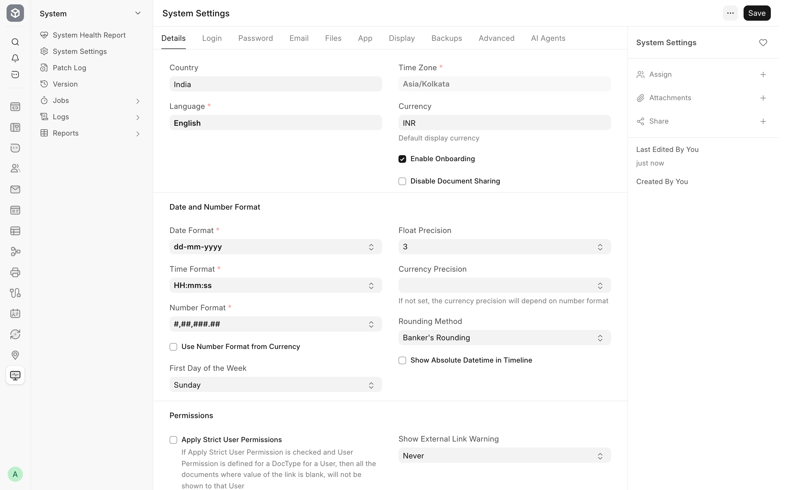

# System Settings

`System Settings` is a Single DocType with the site-wide settings: language, time zone, date and number formats, login and password rules, email, file uploads, backups and the scheduler. Only the `System Manager` role can open it. Go to `/desk/system-settings`. Changes apply to all users after you save.



The form has these tabs: **Details**, **Login**, **Password**, **Email**, **Files**, **App**, **Display**, **Backups**, **Advanced** and **AI Agents**. The tables below list the main fields of each tab. Field labels are as shown in the form.

## Details

| Label | Fieldname | Default | Description |
|---|---|---|---|
| Country | `country` | | Country of the site. |
| Language | `language` | | Default language. |
| Time Zone | `time_zone` | | System time zone. |
| Currency | `currency` | | Default display currency. |
| Enable Onboarding | `enable_onboarding` | 0 | Shows onboarding steps. |
| Disable Document Sharing | `disable_document_sharing` | 0 | Nobody can share documents. |
| Date Format | `date_format` | | For example `dd-mm-yyyy` or `yyyy-mm-dd`. |
| Time Format | `time_format` | `HH:mm:ss` | `HH:mm:ss` or `HH:mm`. |
| Number Format | `number_format` | | For example `#,###.##` or `#.###,##`. |
| Use Number Format from Currency | `use_number_format_from_currency` | 0 | Uses the number format of the currency. |
| First Day of the Week | `first_day_of_the_week` | `Sunday` | Used in date pickers and calendars. |
| Float Precision | `float_precision` | | Decimal places for Float fields. |
| Currency Precision | `currency_precision` | | If empty, it comes from the number format. |
| Rounding Method | `rounding_method` | `Banker's Rounding (legacy)` | Also `Banker's Rounding` or `Commercial Rounding`. |
| Apply Strict User Permissions | `apply_strict_user_permissions` | 0 | See [User Permissions](../users-and-permissions/user-permissions.md). |
| Show External Link Warning | `show_external_link_warning` | `Never` | `Never`, `Ask` or `Always`. |

## Login and Password

The **Login** tab has session, login method, brute force and two-factor settings. The **Password** tab has the password policy. See [Users and Roles](../users-and-permissions/users-and-roles.md#login-settings) for the full tables. Main fields:

- **Session Expiry (idle timeout)** (`session_expiry`), default `170:00`. It must be in the format `hh:mm`.
- **Enable Two Factor Auth** (`enable_two_factor_auth`). When you turn it on, Frappe sets two-factor authentication on the role `All`.
- **Enable Password Policy** (`enable_password_policy`), default on, with **Minimum Password Score** (`minimum_password_score`), default 2.

## Email

| Label | Fieldname | Default | Description |
|---|---|---|---|
| Email Footer Address | `email_footer_address` | | Your organization name and address in the footer. |
| Email Retry Limit | `email_retry_limit` | 3 | Send attempts before an email fails. |
| Disable Standard Email Footer | `disable_standard_email_footer` | 0 | |
| Include Web View Link in Email | `attach_view_link` | 1 | |
| Store Attached PDF Document | `store_attached_pdf_document` | 1 | Saves the PDF on the `Communication`. |
| Welcome Email Template / Reset Password Template | `welcome_email_template`, `reset_password_template` | | Custom `Email Template` for these emails. |

## Files

| Label | Fieldname | Default | Description |
|---|---|---|---|
| Max File Size (MB) | `max_file_size` | | Upload size limit. |
| Allowed File Extensions | `allowed_file_extensions` | | One extension per line. Empty allows all. |
| Allow Guests to Upload Files | `allow_guests_to_upload_files` | 0 | For example for web forms. |
| Strip EXIF tags from uploaded images | `strip_exif_metadata_from_uploaded_images` | 1 | |
| Only allow System Managers to upload public files | `only_allow_system_managers_to_upload_public_files` | 0 | |

## App and Display

- **Default App** (`default_app`): the app that opens after login. A user can override it on the User form.
- **Hide Empty Read-Only Fields** (`hide_empty_read_only_fields`), default on.
- **Disable System Update Notification** and **Disable Change Log Notification**.

## Backups

| Label | Fieldname | Default | Description |
|---|---|---|---|
| Number of Backups | `backup_limit` | 3 | Backups to keep. Older ones are deleted. Minimum 1. |
| Encrypt Backups | `encrypt_backup` | 0 | Encrypts new backups with `gpg`. |

See [Backups](backups.md).

## Advanced

| Label | Fieldname | Default | Description |
|---|---|---|---|
| Max Report Rows | `max_report_rows` | 100000 | Rows the report view can show. |
| Run Jobs only Daily if Inactive For (Days) | `dormant_days` | 4 | Runs jobs once a day on inactive sites. 0 turns this off. |
| Submission Queue Timeout | `submission_queue_timeout` | 600 | Seconds. Maximum 3600. |
| Show Full Error and Allow Reporting of Issues to the Developer | `allow_error_traceback` | 1 | Shows tracebacks to users. |
| Link Field Results Limit | `link_field_results_limit` | 10 | Maximum 50. |
| Log API Requests | `log_api_requests` | 0 | Saves API calls in `API Request Log`. |

The scheduler setting **Enable Scheduled Jobs** (`enable_scheduler`, default 0) is hidden in the form. Turn the scheduler on or off with `bench --site <site> enable-scheduler` and `bench --site <site> disable-scheduler`. If `disable_scheduler` is set in `site_config.json`, the scheduler does not run, whatever the setting.

## AI Agents

**Enable MCP** (`enable_mcp`, default on), **Server Name** (`server_name`) and **Agent Instructions** (`agent_instructions`) configure the MCP server. See [MCP and Discovery](../../developer-guide/api/mcp-and-discovery.md).

## Website Settings

`Website Settings` (`/desk/website-settings`) controls the public website. Basic fields:

| Label | Fieldname | Default | Description |
|---|---|---|---|
| Home Page | `home_page` | | Route of the website home page. |
| Title Prefix | `title_prefix` | | Added to the title of each web page. |
| App Name | `app_name` | `Frappe` | Name on the login page. |
| Disable signups | `disable_signup` | 1 | Turns off self sign-up on the login page. |
| App Logo | `app_logo` | | Logo on the login page. |
| Brand Image / FavIcon | `banner_image`, `favicon` | | Brand in the navbar and the browser icon. |
| Footer Items | `footer_items` | | Links in the footer. |
| Robots.txt | `robots_txt` | | Content of `/robots.txt`. |

See [Website](../website-and-integrations/website.md) for the other settings.

## Navbar Settings

`Navbar Settings` (`/desk/navbar-settings`) controls the desk navbar.

| Label | Fieldname | Description |
|---|---|---|
| Application Logo | `app_logo` | Logo in the desk. The `app_logo` of Website Settings takes priority. |
| Settings Dropdown | `settings_dropdown` | Items in the user menu. |
| Help Dropdown | `help_dropdown` | Items in the help menu. |
| Announcement Widget | `announcement_widget` | Text shown above the desk. Set **Widget Color** and **Is Dismissible**. |

Each `Navbar Item` has **Item Label**, **Item Type** (`Route`, `Action` or `Separator`), **Route** or **Action**, **Hidden** and **Condition**. Standard items come from the `standard_navbar_items` and `standard_help_items` hooks. `bench migrate` syncs them. Use **Hidden** to hide one.

## For developers

```python
frappe.get_system_settings("enable_scheduler")         # cached for the request
frappe.db.get_single_value("System Settings", "date_format")
frappe.db.set_single_value("System Settings", "enable_scheduler", 1)
```

- `frappe.get_system_settings(key)` reads from a client cache and caches the document on `frappe.local` for the request.
- When you save System Settings, Frappe also saves each changed value as a global default (`frappe.db.set_default`).
- To set values when your app is installed, use an `after_install` hook.
- Site config keys, such as `disable_scheduler`, are in [Configuration](../../developer-guide/operations/configuration.md).

## Pitfalls

- **Disable Username/Password Login** fails unless a Social Login Key, LDAP or **Login with email link** is enabled. This prevents a lockout.
- Turning on **Enable Two Factor Auth** affects all users through the role `All`.
- `enable_scheduler` is off by default. The setup wizard turns it on. If it is off, scheduled jobs, such as the email queue, do not run.

## Related

- [Users and Roles](../users-and-permissions/users-and-roles.md)
- [Backups](backups.md)
- [Scheduler](../../developer-guide/runtime/scheduler.md)
- [Configuration](../../developer-guide/operations/configuration.md)
