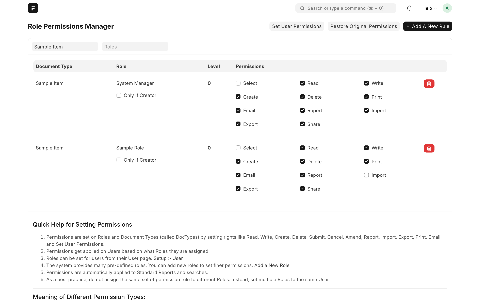

# Role Permissions

Role permissions decide what a user can do with a DocType. Each rule gives one role a set of rights, such as Read or Write, on one DocType at one permission level. A user gets the rights of all their roles together. Use the Role Permissions Manager to change these rules on a site. To limit a user to some records only, add [User Permissions](user-permissions.md) on top.

## Core concepts

- **Rule**: one row with a DocType, a role, a level and rights. The DocType JSON of an app holds the standard rules in `DocPerm`.
- **Custom rules**: when you change any rule in the manager, Frappe copies all standard rules of that DocType to `Custom DocPerm` and edits the copies. From then on, Frappe uses only the `Custom DocPerm` rules for that DocType.
- **Permission level** (`permlevel`): level 0 controls access to the document. Levels 1 and higher control groups of fields. Each field has a **Permission Level** property. A role needs access at level 0 first, or the higher levels have no effect.
- **Only If Creator** (`if_owner`): the rule applies only to documents that the user created (`owner`).
- `Administrator` has all rights on all DocTypes.

## Rights

| Right | Fieldname | What it allows |
|---|---|---|
| Select | `select` | Search and select records in Link fields, without opening them. Read also gives Select. |
| Read | `read` | Open and view documents. |
| Write | `write` | Change existing documents. |
| Create | `create` | Make new documents. |
| Delete | `delete` | Delete documents. |
| Submit | `submit` | Submit documents. Only for submittable DocTypes. |
| Cancel | `cancel` | Cancel submitted documents. Only for submittable DocTypes. |
| Amend | `amend` | Amend cancelled documents. Only for submittable DocTypes. |
| Print | `print` | Print and download PDF. |
| Email | `email` | Send email from the document. |
| Report | `report` | Open the Report view and reports of the DocType. |
| Import | `import` | Use Data Import. The DocType must allow import. |
| Export | `export` | Export data from the Report view. |
| Share | `share` | Share documents with other users. |

At levels higher than 0, only Read and Write apply.

## Open the Role Permissions Manager

1. Go to **Role Permissions Manager** (`/app/permission-manager`). You need the `System Manager` role.
2. In the filters at the top, select a **Document Type**, a role in **Roles**, or both.

You can also open it from the list view menu (**Role Permissions Manager**) or from Customize Form (**Actions > Set Permissions**). The route `/app/permission-manager/Sample Item` opens it for one DocType.



## Add a rule

1. Click **Add A New Rule**.
2. Select the **Document Type**, for example `Sample Item`.
3. Select the **Role**, for example `Sample Role`.
4. Enter the **Permission Level**. Use 0 for document access.
5. Click **Add**. The new rule has Read set.
6. Select the other rights in the table. Each click saves at once.

To remove a rule, click the red delete button at the end of the row. A DocType must keep at least one rule.

## Restore the standard rules

Click **Restore Original Permissions**. Frappe asks you to confirm. It then deletes all `Custom DocPerm` rules of the DocType and uses the rules from the DocType JSON again.

## Field-level permissions

1. Open [Customize Form](../customization/customize-form.md) for the DocType.
2. Set **Permission Level** of the fields to protect, for example 1.
3. Click **Update**.
4. In the Role Permissions Manager, add a rule for the role at level 1.
5. Set Read, and set Write if the role may change these fields.

Roles without a level 1 rule do not see these fields.

## Only If Creator

Set **Only If Creator** on a level 0 rule to give the rights only for documents that the user created. The user can still see the list, but only their own documents. You cannot set **Report** on a rule with **Only If Creator**. Frappe clears it.

## Pages and reports

Use **Role Permission for Page and Report** (`/app/role-permission-for-page-and-report`) to set which roles can open a desk page or a report. Select **Set Role For** (`Page` or `Report`), select the item, and edit the roles.

## Check a permission

Use **Permission Inspector** (`/app/permission-inspector`). Select a **DocType**, a **Document**, a **User** and a **Permission Type**. The **Output** explains each step of the check.

## For developers

Standard rules live in the `permissions` list of the DocType JSON in your app. Change them in the DocType form in developer mode. Code that checks permissions:

```python
frappe.has_permission("Sample Item", "write")                       # current user, DocType level
frappe.has_permission("Sample Item", "read", doc="Support Plan", user="user1@example.com")
```

For the `has_permission` and `permission_query_conditions` hooks, see [Permissions for developers](../../developer-guide/security/permissions.md).

## Pitfalls

- After the first change in the manager, app updates to the DocType JSON rules do not apply on that site. Click **Restore Original Permissions** to get them.
- Do not give the same rules to many roles. Give one user many roles instead.
- Rules apply to the Report view and reports. Removing Report hides them.
- Users who are not `Administrator` do not see rules for roles marked **Is Custom** in the manager.

## Related

- [User Permissions](user-permissions.md)
- [Users and Roles](users-and-roles.md)
- [Customize Form](../customization/customize-form.md)
- [Permissions for developers](../../developer-guide/security/permissions.md)
