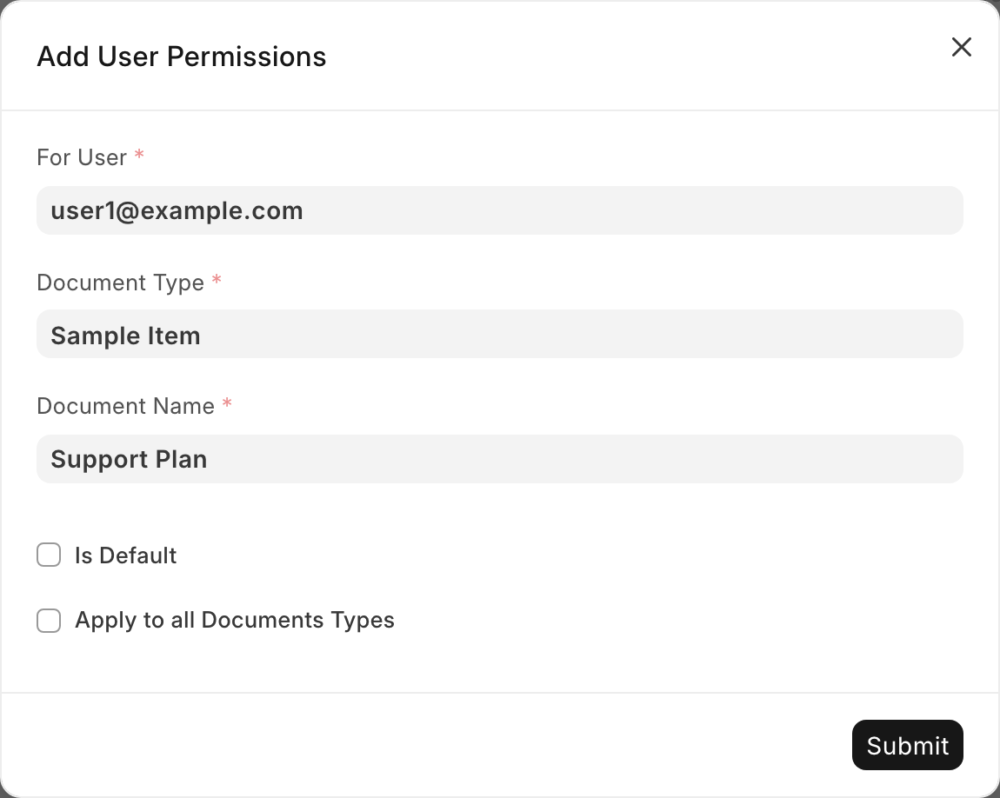

# User Permissions

A `User Permission` limits one user to some records of a DocType. Role permissions say what a user can do with a DocType. User permissions say which records they can do it on. For example, give `user1@example.com` access to the Sample Item "Support Plan" only. The user then sees only that Sample Item, and only documents whose Link fields to Sample Item point to it.

User permissions do not give access. The user still needs a role rule from the [Role Permissions Manager](permissions.md).

## How Frappe applies a User Permission

Assume a User Permission for `user1@example.com` with **Allow** = `Sample Item` and **For Value** = `Support Plan`.

1. **The DocType itself.** The user can open only the Sample Items listed in their User Permissions.
2. **Linked DocTypes.** In every DocType with a Link field to `Sample Item`, the user can open only documents where the link value is an allowed Sample Item. When a user opens a document, Frappe also checks the Link fields of its child table rows.
3. **Empty links.** Documents with an empty link field stay visible, unless **Apply Strict User Permissions** is set in System Settings.
4. **Ignored fields.** Link fields with **Ignore User Permissions** (`ignore_user_permissions`) set are not checked.

Frappe applies the same rules to the list view, reports, Link field search and `frappe.get_list`. `Administrator` and `Guest` are never limited.

## Fields

| Label | Fieldname | Default | Description |
|---|---|---|---|
| User | `user` | | The user to limit. |
| Allow | `allow` | | The DocType of the allowed record. |
| For Value | `for_value` | | The allowed record. |
| Is Default | `is_default` | 0 | Uses this value as the default in Link fields of new documents. A user can have one default per DocType. |
| Apply To All Document Types | `apply_to_all_doctypes` | 1 | Applies the rule in all DocTypes that link to **Allow**. |
| Applicable For | `applicable_for` | | Applies the rule in this DocType only. Shown when **Apply To All Document Types** is cleared. |
| Hide Descendants | `hide_descendants` | 0 | For tree DocTypes. Gives access to **For Value** only, not to the records below it. |

Frappe rejects a duplicate rule with "User permission already exists". A duplicate has the same user, **Allow**, **For Value**, **Applicable For** and **Apply To All Document Types**.

## Add User Permissions

1. Go to **User Permission** (`/app/user-permission`).
2. Click **Add / Update**.
3. Select **For User**, for example `user1@example.com`.
4. Select **Document Type**, for example `Sample Item`.
5. Select **Document Name**, for example `Support Plan`.
6. Set **Is Default** if this value should fill new documents.
7. Set **Apply to all Documents Types**, or clear it and select the **Applicable Document Types**.
8. Click **Submit**.



With **Apply to all Documents Types**, or with all applicable DocTypes selected, the dialog makes one User Permission with **Apply To All Document Types** set. Otherwise it makes one User Permission per selected DocType. If rules exist for the same user and record, the dialog title changes to "Update User Permissions".

You can also open the list from:

- The User form: **Permissions > Set User Permissions**.
- The list view menu of a DocType: **User Permissions**.
- The Role Permissions Manager: **Set User Permissions**.

To delete all rules of one user for one DocType, click **Bulk Delete** in the User Permission list.

!!! note
    In v15 the **Apply to all Documents Types** box is cleared when the dialog opens, although the code tries to set it (`frappe/core/doctype/user_permission/user_permission_list.js` passes `"checked"` as the value). If you click **Submit** without setting it or selecting DocTypes, the dialog shows "Please select applicable Doctypes".

## Strict user permissions

**Apply Strict User Permissions** (`apply_strict_user_permissions`) is in **System Settings > Details > Permissions**. Default: off.

When it is on, a user with User Permissions for a DocType does not see documents where the link to that DocType is empty. Single DocTypes are never checked in strict mode.

## Check what a user can see

Use the report **Permitted Documents For User** (`/app/query-report/Permitted Documents For User`). Its filters are **User**, **DocType** and **Show Permissions**. It needs the `System Manager` role.

The report lists the documents of the DocType that the user can read. With **Show Permissions** set, it adds one column per right.

## For developers

```python
from frappe.permissions import add_user_permission

add_user_permission(
	"Sample Item", "Support Plan", "user1@example.com",
	applicable_for="Sample Order",  # omit to apply to all DocTypes
	is_default=0,
)
```

- `add_user_permission(doctype, name, user, ignore_permissions=False, applicable_for=None, is_default=0, hide_descendants=0)` does nothing if the same rule exists.
- `frappe.core.doctype.user_permission.user_permission.get_user_permissions(user)` returns the rules as a dict keyed by DocType. Frappe caches it in Redis under `user_permissions` and clears it when a rule changes.
- Set `ignore_user_permissions` on a Link field in the DocType JSON when the field must not limit access.
- For the `has_permission` and `permission_query_conditions` hooks, see [Permissions for developers](../../developer-guide/security/permissions.md).

## Pitfalls

- A User Permission on a DocType that many DocTypes link to, such as a company or a department, limits all of them. Use **Applicable For** to narrow it.
- Strict mode hides documents with empty links. Users can lose access to records they created before the link was set.
- In a tree DocType, a rule on a parent also allows all descendants, unless **Hide Descendants** is set.

## Related

- [Role Permissions](permissions.md)
- [Users and Roles](users-and-roles.md)
- [System Settings](../system-administration/system-settings.md)
- [Permissions for developers](../../developer-guide/security/permissions.md)
