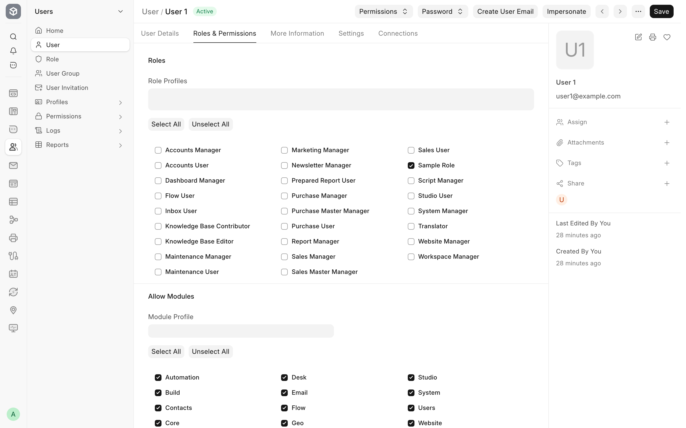

# Users and Roles

Every person who logs in is a `User`. A user gets access through roles. A `Role` is a name, such as `Sample Role`, that permission rules refer to. You give roles to users, and you give permissions to roles. Use this page to create users, assign roles, and set login and password rules. To set what a role can do, see [Permissions](permissions.md).

## Core concepts

| DocType | Purpose |
|---|---|
| `User` | One login account. The name is the email address. |
| `Role` | A named set of permissions. |
| `Role Profile` | A saved group of roles. Assign it to many users. |
| `Module Profile` | A saved list of blocked modules. Assign it to many users. |
| `User Type` | `System User`, `Website User`, or a custom type with a fixed role and DocTypes. |

### Desk users and website users

The **User Type** (`user_type`) field decides if a user can open the desk.

- `System User` can open the desk (`/desk`).
- `Website User` can only use the website and portal pages.

You do not set this field by hand for standard types. When you save a user, Frappe sets `System User` if at least one of the user's roles has **Desk Access** (`desk_access`) set. Otherwise it sets `Website User`.

### Automatic roles

Frappe adds some roles without a row in the user's role table:

| Role | Who gets it |
|---|---|
| `Guest` | Every user, and visitors who are not logged in. |
| `All` | Every logged-in user, including website users. |
| `Desk User` | Every `System User`. |
| `Administrator` | Only the `Administrator` user. That user has all roles. |

Use `All` or `Desk User` in a permission rule to give access to a large group.

## Create a user

1. Go to **User** (`/desk/user`) and click **Add User**.
2. Enter **Email** and **First Name**.
3. Keep **Send Welcome Email** set to send a link to set the password.
4. Save.
5. Open the **Roles & Permissions** tab and select the roles.
6. Save.



The **Roles & Permissions** tab has:

- **Role Profiles** (`role_profiles`). When you select one or more profiles, Frappe replaces the user's roles with the roles of these profiles on save. You cannot then add other roles by hand.
- **Roles Assigned** (`roles`). The role checkboxes.
- **Module Profile** (`module_profile`) and the module checkboxes. A cleared module is blocked. Blocked modules do not show in the user's sidebar.

To add or remove roles for many users at once, select them in the User list and use **Actions > Add Roles** or **Actions > Remove Roles**. Lists of more than 20 users run in a background job. The limit is 500 users per action.

### User form buttons

| Button | What it does |
|---|---|
| Permissions > Set User Permissions | Opens the User Permission list for this user. See [User Permissions](user-permissions.md). |
| Permissions > View Permitted Documents | Opens the report `Permitted Documents For User`. |
| Permissions > View Doctype Permissions | Opens the report `User Doctype Permissions`. |
| Password > Change Password / Reset Password | Sets a new password or sends a reset link. |
| Password > Reset OTP Secret | Makes the user set up two-factor authentication again. |
| Create User Email | Opens an `Email Account` for the email address of the user. Shows if you can create Email Accounts and the user has no Email Account for that address. |
| Impersonate | Logs you in as this user. You must give a reason. Frappe adds an `Activity Log` and notifies the user. |

**Impersonate** shows for `Administrator` and for roles that have the `impersonate` permission on `User`.

### Security settings of a user

These fields are in the **Settings** tab, section **Security Settings**:

| Label | Fieldname | Default | Description |
|---|---|---|---|
| Simultaneous Sessions | `simultaneous_sessions` | 2 | Maximum number of sessions at the same time. |
| Restrict IP | `restrict_ip` | | Allowed IP addresses, separated by commas. Partial addresses such as `111.111.111` are allowed. |
| Login After | `login_after` | | The user can log in only after this hour (0-24). |
| Login Before | `login_before` | | The user can log in only before this hour (0-24). |
| Bypass Restricted IP Address Check If Two Factor Auth Enabled | `bypass_restrict_ip_check_if_2fa_enabled` | 0 | Lets the user log in from any IP address with two-factor authentication. |

The **API Access** section has **Generate Keys**. It makes an API key and secret for token authentication. See [Authentication](../../developer-guide/security/authentication.md).

## Roles

Go to **Role** (`/desk/role`) to create a role.

| Label | Fieldname | Default | Description |
|---|---|---|---|
| Role Name | `role_name` | | The name. It is also the document name. |
| Home Page | `home_page` | | Route to open after login, for example `/desk`. |
| Disabled | `disabled` | 0 | If set, Frappe removes this role from all users. |
| Desk Access | `desk_access` | 1 | Users with this role become `System User`. |
| Two Factor Authentication | `two_factor_auth` | 0 | Users with this role must use two-factor authentication, if it is enabled in System Settings. |

The Role form also shows the users, DocType permissions, reports, pages and workspaces of the role in separate tabs.

## Role Profiles and Module Profiles

1. Go to **Role Profile** (`/desk/role-profile`) and click **Add Role Profile**.
2. Enter **Role Name** and select the roles.
3. Save.
4. Open a user and select the profile in **Role Profiles**.

A `Module Profile` works the same way. Enter **Module Profile Name**, clear the modules to block, and select the profile in the user's **Module Profile** field. On save, Frappe copies the profile's blocked modules to the user.

## User Types

`System User` and `Website User` are standard. A custom User Type (`Is Standard` cleared) gives a user a fixed role and access to a list of DocTypes only. Fields:

- **Role** (`role`), required.
- **Apply User Permission On** (`apply_user_permission_on`) and **User Id Field** (`user_id_field`). Frappe gives the role only to users who are linked from a document of this DocType through this field.
- **Document Types** (`user_doctypes`) with the rights Read, Write, Create, Submit, Cancel, Amend, Delete, Email, Share and Print.
- **Document Types (Select Permissions Only)** and **Custom Document Types (Select Permission)**.
- **User Type Module** (`user_type_modules`), the allowed modules.

On save, Frappe writes `Custom DocPerm` rules for the role. It also gives the role read, create and write on `File`.

## Password policy

Go to **System Settings > Password**.

| Label | Fieldname | Default | Description |
|---|---|---|---|
| Enable Password Policy | `enable_password_policy` | 1 | Checks password strength. |
| Minimum Password Score | `minimum_password_score` | 2 | From 1 (very weak) to 4 (very strong). |
| Logout All Sessions on Password Reset | `logout_on_password_reset` | 1 | Ends other sessions after a reset. |
| Force User to Reset Password | `force_user_to_reset_password` | | Number of days after which users must set a new password. |
| Reset Password Link Expiry Duration | `reset_password_link_expiry_duration` | 1200 (seconds) | How long a reset link works. |
| Password Reset Link Generation Limit | `password_reset_limit` | 3 | Reset links per hour. |

## Login settings

Go to **System Settings > Login**.

| Label | Fieldname | Default | Description |
|---|---|---|---|
| Session Expiry (idle timeout) | `session_expiry` | `170:00` | Idle time in `hh:mm` after which a user is logged out. |
| Allow only one session per user | `deny_multiple_sessions` | 0 | Ends the older session when the user logs in again. |
| Disable Username/Password Login | `disable_user_pass_login` | 0 | Needs an enabled Social Login Key, LDAP, or login with email link first. |
| Allow Login using Mobile Number | `allow_login_using_mobile_number` | 0 | |
| Allow Login using User Name | `allow_login_using_user_name` | 0 | |
| Login with email link | `login_with_email_link` | 1 | Login without a password, with a link sent by email. |
| Allow Consecutive Login Attempts | `allow_consecutive_login_attempts` | 10 | Failed attempts before Frappe locks the account. |
| Allow Login After Fail | `allow_login_after_fail` | 60 | Lock time in seconds. |

## Two-factor authentication

1. Go to **System Settings > Login**.
2. Set **Enable Two Factor Auth** (`enable_two_factor_auth`).
3. Select **Two Factor Authentication method**: `OTP App` (default), `SMS` or `Email`.
4. Save.

When you enable it, Frappe sets **Two Factor Authentication** on the role `All`, so all users must use it. To use it only for some users, clear the check on `All` and set it on the roles that need it. Frappe asks for the second factor when a user has at least one role with `two_factor_auth` set. The `SMS` method needs a gateway URL in **SMS Settings**.

## For developers

```python
user = frappe.get_doc("User", "user1@example.com")
user.add_roles("Sample Role")      # saves the user
user.remove_roles("Sample Role")   # saves the user

frappe.get_roles("user1@example.com")
# ['Sample Role', 'All', 'Guest', 'Desk User']
```

- `frappe.only_for("System Manager")` raises `frappe.PermissionError` if the session user does not have the role.
- Ship roles with your app as fixtures, or create them in `after_install`. See [Fixtures and Patches](../../developer-guide/building-apps/fixtures-and-patches.md).
- The hooks `on_login`, `on_session_creation` and `on_logout` run with the `login_manager` argument (`frappe/auth.py`).
- Bulk role endpoints: `frappe.core.doctype.user.user.bulk_add_roles(users, roles)` and `bulk_remove_roles(users, roles)`. Both need write permission on `User`.

## Pitfalls

- Disabling a role deletes it from all users. Enabling it again does not give it back. Standard roles cannot be disabled.
- A user with a Role Profile loses roles that are not in the profile on the next save.
- A user without any desk role becomes a `Website User` and cannot open `/desk`.
- `Administrator` and `Guest` cannot be disabled, deleted or renamed.

## Related

- [Permissions](permissions.md)
- [User Permissions](user-permissions.md)
- [System Settings](../system-administration/system-settings.md)
- [Authentication](../../developer-guide/security/authentication.md)
