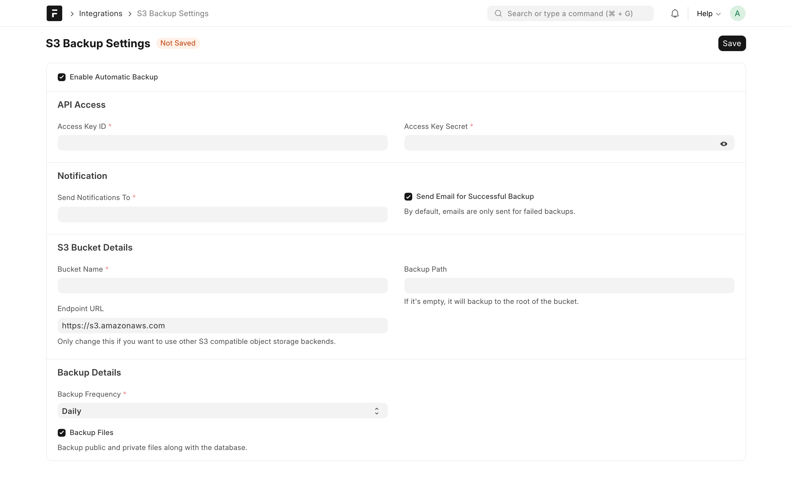

# Integrations

Frappe can send data to other systems, let other apps log in with Frappe, let users log in with other providers, and copy backups to cloud storage. All settings are in the **Integrations** workspace in the desk. Use a **Webhook** to push document changes to another service. Use **OAuth Client** when another app needs access to this site. Use **Social Login Key** or **LDAP Settings** to let users log in with an outside account.

## Overview

| DocType | Use it to |
|---|---|
| `Webhook` | Send an HTTP request when a document changes. |
| `Webhook Request Log` | See each webhook request and its response or error. |
| `Slack Webhook URL` | Save a Slack incoming webhook URL for the Slack channel of a Notification. |
| `OAuth Client` | Register an app that logs in to this site with OAuth 2.0. |
| `OAuth Provider Settings` (Single) | Set if users must approve access for an OAuth client. |
| `Connected App` | Connect this site to an outside OAuth 2.0 provider, to call its API. |
| `Social Login Key` | Let users log in with Google, GitHub, Office 365 and other providers. |
| `LDAP Settings` (Single) | Let users log in with an LDAP or Active Directory account. |
| `Google Settings` (Single) | Google OAuth client and API key for Google Calendar, Google Contacts, Google Drive and the Drive picker. |
| `Dropbox Settings`, `Google Drive`, `S3 Backup Settings` (Single) | Copy site backups to Dropbox, Google Drive or an S3 bucket on a schedule. |
| `Push Notification Settings` (Single) | Send mobile push notifications through a relay server. |

## Webhooks

A webhook sends a request to a URL when a document event happens.

1. Go to `/app/webhook/new`.
2. Enter a name for the webhook.
3. Select the **DocType**.
4. Select the **Doc Event**.
5. Optional: enter a **Condition**, for example `doc.status == "Open"`.
6. Enter the **Request URL**.
7. Select the **Request Method**.
8. Set **Request Structure** to `Form URL-Encoded` or `JSON`.
9. Add the data: rows in **Data** for form data, or a Jinja template in **JSON Request Body**.
10. Save.
11. Optional: open the **Preview** tab and select a document in **Select Document**. The tab shows **Meets Condition?** and the **Request Body**.


A JSON body is a Jinja template. It gets `doc` and `utils`:

```jinja
{
  "order": "{{ doc.name }}",
  "customer": "{{ doc.customer_name }}",
  "status": "{{ doc.status }}"
}
```

| Field | Default | Description |
|---|---|---|
| `webhook_docevent` | | `after_insert`, `on_update`, `on_submit`, `on_cancel`, `on_trash`, `on_update_after_submit` or `on_change`. |
| `condition` | | Python expression with `doc` and `utils`. The webhook runs only when it is true. |
| `request_url` | | Target URL. |
| `is_dynamic_url` | 0 | Renders the URL as a Jinja template with `doc`. |
| `request_method` | `POST` | `POST`, `PUT` or `DELETE`. |
| `webhook_headers` | | Extra headers, as key and value rows. |
| `enable_security`, `webhook_secret` | 0 | Signs each request. See below. |
| `timeout` | 5 | Request timeout in seconds. |
| `background_jobs_queue` | `default` | Queue for the request job. |
| `enabled` | 1 | Turn off to stop the webhook. |

How Frappe sends a webhook:

- Requests are queued and sent in a background job after the database commit. If a document changes more than once in one request, the last version is sent.
- Webhooks do not run during data import, patches, install or migrate.
- The job tries the request up to 3 times, with a short wait between tries.
- Each failed try and each success makes a `Webhook Request Log` with the URL, headers, data, response and error.
- The body is the JSON text of the data, for both request structures. Frappe adds no `Content-Type` header. Add one in **Headers** if the target needs it.
- `on_submit`, `on_cancel` and `on_update_after_submit` need a submittable DocType.

### Verify the signature

With **Enable Security** on, Frappe adds the header `X-Frappe-Webhook-Signature`. The value is the Base64 HMAC-SHA256 of the request body, with the **Webhook Secret** as key.

```python
import base64, hashlib, hmac

def is_valid(body: bytes, signature: str, secret: str) -> bool:
	expected = base64.b64encode(hmac.new(secret.encode(), body, hashlib.sha256).digest()).decode()
	return hmac.compare_digest(expected, signature)
```

## Frappe as an OAuth 2.0 provider

Other apps can log in users with their Frappe account and call the API with a bearer token.

1. Go to `/app/oauth-client/new`.
2. Enter **App Name**.
3. Optional: add **Allowed Roles** to limit which users can log in through this client.
4. Optional: turn on **Skip Authorization** to skip the approval page for this client.
5. Set **Scopes** (default `all openid`).
6. Enter the **Redirect URIs** of the app.
7. Enter the **Default Redirect URI**.
8. In **Advanced Settings**, select the **Grant Type** (`Authorization Code` or `Implicit`).
9. Select the **Response Type** (`Code` or `Token`).
10. Save.
11. Give the **App Client ID** and **App Client Secret** to the app.

Endpoints:

| Endpoint | Path |
|---|---|
| Authorize | `/api/method/frappe.integrations.oauth2.authorize` |
| Token | `/api/method/frappe.integrations.oauth2.get_token` |
| Revoke | `/api/method/frappe.integrations.oauth2.revoke_token` |
| User info | `/api/method/frappe.integrations.oauth2.openid_profile` |
| Introspect | `/api/method/frappe.integrations.oauth2.introspect_token` |
| OpenID configuration | `/.well-known/openid-configuration` (redirects to `frappe.integrations.oauth2.openid_configuration`) |

**OAuth Provider Settings** > **Skip Authorization** sets if users must approve access (`Force`) or not (`Auto`).

## Connected App

A Connected App lets this site call the API of an outside OAuth 2.0 provider for a user.

1. Go to `/app/connected-app/new`.
2. Enter **Provider Name**.
3. Enter the **OpenID Configuration** URL.
4. Click **Get OpenID Configuration** to fill the endpoints. Or enter **Authorization URI**, **Token URI** and the other URIs in **Endpoints**.
5. Enter the **Client Id** from the provider.
6. Enter the **Client Secret**.
7. Add **Scopes**.
8. Save. Frappe sets **Redirect URI**.
9. Register the **Redirect URI** at the provider.
10. Click **Connect to** and the provider name.
11. Log in at the provider to get a token for your user.

The redirect URI is `<site>/api/method/frappe.integrations.doctype.connected_app.connected_app.callback/<name>`. Tokens are saved per user as `Token Cache` records.

## Social login

1. Go to `/app/social-login-key/new`.
2. Turn on **Enable Social Login**.
3. Select the **Social Login Provider**: `Custom`, `Facebook`, `Frappe`, `GitHub`, `Google`, `Office 365`, `Salesforce`, `fairlogin` or `Keycloak`. Frappe fills the URLs for known providers.
4. Enter the **Client ID** from the provider.
5. Enter the **Client Secret**.
6. Set **Sign ups** to `Allow` or `Deny` new users.
7. Save. The login page now shows a button for the provider.

Register the **Redirect URL** at the provider. For Google it is `/api/method/frappe.integrations.oauth2_logins.login_via_google`.

## LDAP

1. Go to `/app/ldap-settings`.
2. Turn on **Enabled**.
3. Select the **Directory Server**: `Active Directory`, `OpenLDAP` or `Custom`.
4. Enter the **LDAP Server Url**.
5. Enter the **Base Distinguished Name (DN)** and the **Password for Base DN**.
6. In **LDAP Search and Paths**, enter the search paths for users and groups and the **LDAP Search String**.
7. In **LDAP User Creation and Mapping**, enter the LDAP fields for email, username and first name.
8. Optional: in **LDAP Security**, set **SSL/TLS Mode** to `StartTLS`.
9. In **LDAP Group Mappings**, select the **Default User Type** and, for system users, the **Default User Role**.
10. Optional: map LDAP groups to roles in the **LDAP Group Mappings** table.
11. Save.

Users then log in with their LDAP username and password. Frappe makes a user on first login unless **Do Not Create New User** is on.

## Google

In **Google Settings** (`/app/google-settings`), turn on **Enable**. Enter the OAuth **Client ID**, **Client Secret** and **API Key** from Google Cloud. Then:

- A `Google Calendar` record syncs Frappe Events with a Google calendar for one user. Click **Authorize Google Calendar Access** after save.
- A `Google Contacts` record syncs contacts. Click **Authorize Google Contacts Access** after save.
- **Google Drive Picker Enabled** with an **App ID** adds Google Drive to the file uploader.

## Backups to cloud storage

Frappe v15 can copy site backups to Dropbox, Google Drive or an S3 compatible bucket. Each one is a Single DocType in the **Backup** section of the Integrations workspace. Scheduled jobs in `frappe/hooks.py` run the daily and weekly backups. S3 also has a monthly backup.



### S3

1. Go to `/app/s3-backup-settings`.
2. Turn on **Enable Automatic Backup**.
3. Enter the **Access Key ID**.
4. Enter the **Access Key Secret**.
5. Enter **Send Notifications To**.
6. Enter the **Bucket Name**.
7. Optional: change **Endpoint URL** (default `https://s3.amazonaws.com`) for another S3 compatible service.
8. Optional: enter a **Backup Path** in the bucket.
9. Select the **Backup Frequency**: `Daily`, `Weekly`, `Monthly` or `None`.
10. Keep **Backup Files** on to also copy public and private files.
11. Save. Frappe checks that the bucket exists and that the keys can access it.

Click **Take Backup Now** to run a backup at once.

### Dropbox

1. Go to `/app/dropbox-settings`.
2. Enter **App Access Key** and **App Secret Key** of your Dropbox app. You can also set `dropbox_access_key` and `dropbox_secret_key` in the site config.
3. Register `<site>/api/method/frappe.integrations.doctype.dropbox_settings.dropbox_settings.dropbox_auth_finish` as a redirect URI in the Dropbox app.
4. Click **Allow Dropbox Access**.
5. Log in to Dropbox and approve the access.
6. Turn on **Enabled**.
7. Enter **Send Notifications To**.
8. Select the **Backup Frequency** (`Daily` or `Weekly`).
9. Optional: turn on **Limit Number of DB Backups** and set **Number of DB Backups** (default 5).
10. Save.

### Google Drive

1. Fill and enable **Google Settings** first.
2. Go to `/app/google-drive`.
3. Enter the **Backup Folder Name**.
4. Select the **Frequency** (`Daily` or `Weekly`).
5. Enter **Send Notification To**. This field is mandatory.
6. Optional: turn on **File Backup** and **Send Email for Successful backup**.
7. Save.
8. Click **Authorize Google Drive Access**.
9. Turn on **Enable**.
10. Save.

Click **Take Backup** to run a backup at once. **Last Backup On** shows the time of the last upload.

All three send an email to the notification address when a backup fails. **Send Email for Successful Backup** also sends one after each successful backup.

## Push notifications

Turn on **Enable Push Notification Relay** in Push Notification Settings. On the first call to the relay server, Frappe registers the site and saves the **API Key** and **API Secret**. The relay server URL comes from `push_relay_server_url` in the site config. Frappe does not let you turn on the relay without it.

## For developers

- Run code on document events in an app with the `doc_events` hook instead of a webhook. See [Extending Apps](../../developer-guide/building-apps/extending-apps.md).
- `frappe.integrations.doctype.connected_app.connected_app.ConnectedApp.get_active_token(user)` returns a valid token and refreshes it when it expired.
- `frappe.integrations.doctype.s3_backup_settings.s3_backup_settings.take_backup()` and the `take_backup` methods of `dropbox_settings` and `google_drive` are whitelisted. They queue a backup job in the `long` queue and need the `System Manager` role.
- API authentication with OAuth bearer tokens and API keys is in [Authentication](../../developer-guide/security/authentication.md).

## Pitfalls

- Use `on_update` with care. It runs on every save, so the target gets many requests.
- A webhook body template must make valid JSON. If it does not, the request is not sent and the `Webhook Request Log` shows the error.
- A webhook request log has no status field. Check the **Response** and **Error** fields.

## Related

- [Workflow](../customization/workflow.md)
- [Notifications](../automation/notifications.md)
- [Backups](../system-administration/backups.md)
- [Users and Roles](../users-and-permissions/users-and-roles.md)
- [Authentication](../../developer-guide/security/authentication.md)
- [REST API](../../developer-guide/api/rest-api.md)
- [Background Jobs](../../developer-guide/runtime/background-jobs.md)
- [Integration settings](../settings/integration-settings.md)
