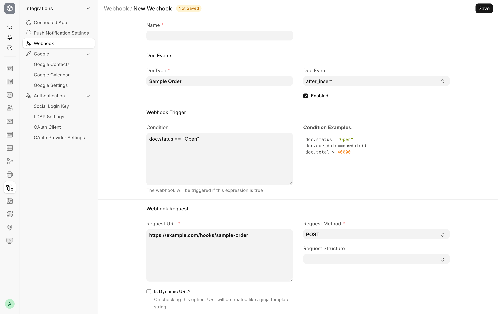

# Integrations

Frappe can send data to other systems, let other apps log in with Frappe, and let users log in with other providers. All settings are in the **Integrations** workspace in the desk. Use a **Webhook** to push document changes to another service. Use **OAuth Client** when another app needs access to this site. Use **Social Login Key** or **LDAP Settings** to let users log in with an outside account.

## Overview

| DocType | Use it to |
|---|---|
| `Webhook` | Send an HTTP request when a document changes. |
| `Webhook Request Log` | See each webhook request, its response and retries. |
| `OAuth Client` | Register an app that logs in to this site with OAuth 2.0. |
| `OAuth Provider Settings`, `OAuth Settings` (Single) | Set how this site acts as an OAuth server. |
| `Connected App` | Connect this site to an outside OAuth 2.0 provider, to call its API. |
| `Social Login Key` | Let users log in with Google, GitHub, Office 365 and other providers. |
| `LDAP Settings` (Single) | Let users log in with an LDAP or Active Directory account. |
| `Google Settings` (Single) | Google OAuth client and API key for Google Calendar, Google Contacts and the Drive picker. |
| `Push Notification Settings` (Single) | Send mobile push notifications through a relay server. |
| `Geolocation Settings` (Single) | Address autocomplete with the provider `Geoapify`, `Nomatim` or `HERE`. |

## Webhooks

A webhook sends a request to a URL when a document event happens.

1. Go to `/desk/webhook/new`.
2. Enter a **Name**.
3. Select the **DocType** and the **Doc Event**.
4. Optional: enter a **Condition**, for example `doc.status == "Open"`.
5. Enter the **Request URL** and select the **Request Method**.
6. Set **Request Structure** to `Form URL-Encoded` or `JSON`.
7. Add the data: rows in **Data** for form data, or a Jinja template in **JSON Request Body**.
8. Save.
9. Click **Preview** to check the condition and the request body against a document.



A JSON body is a Jinja template. It gets `doc` and `utils`:

```jinja
{
  "order": "{{ doc.name }}",
  "customer": "{{ doc.customer_name }}",
  "status": "{{ doc.status }}"
}
```

| Field | Default | Description |
|---|---|---|
| `webhook_docevent` | | `after_insert`, `on_update`, `on_submit`, `on_cancel`, `on_trash`, `on_update_after_submit`, `on_change` or `workflow_transition`. |
| `condition` | | Python expression with `doc` and `utils`. The webhook runs only when it is true. |
| `request_url` | | Target URL. |
| `is_dynamic_url` | 0 | Renders the URL as a Jinja template with `doc`. |
| `request_method` | `POST` | `POST`, `PUT` or `DELETE`. |
| `webhook_headers` | | Extra headers, as key and value rows. |
| `enable_security`, `webhook_secret` | 0 | Signs each request. See below. |
| `timeout` | 5 | Request timeout in seconds. |
| `max_retries` | 3 | Retries after a failed request. |
| `background_jobs_queue` | | Queue for the request job. |
| `enabled` | 1 | Turn off to stop the webhook. |

How Frappe sends a webhook:

- Requests are queued and sent in a background job after the database commit. If a document changes more than once in one request, the last version is sent.
- Webhooks do not run during data import, patches, install or migrate.
- Each request makes a `Webhook Request Log` with status `Delivered`, `Failed` or `Exhausted`.
- A failed request is retried after 5 minutes, 30 minutes, 2 hours, 5 hours, then every 10 hours, up to **Max Retries**.
- A `workflow_transition` webhook runs as a task of a Workflow transition. It runs at once, and an error stops the transition.
- Requests go through a guarded session that blocks internal addresses. Set `allow_internal_webhook_urls` in `common_site_config.json` to allow them.

### Verify the signature

With **Enable Security** on, Frappe adds the header `X-Frappe-Webhook-Signature`. The value is the Base64 HMAC-SHA256 of the request body, with the **Webhook Secret** as key.

```python
import base64, hashlib, hmac

def is_valid(body: bytes, signature: str, secret: str) -> bool:
	expected = base64.b64encode(hmac.new(secret.encode(), body, hashlib.sha256).digest()).decode()
	return hmac.compare_digest(expected, signature)
```

## Frappe as an OAuth 2.0 provider

Other apps can log in users with their Frappe account and call the API with a bearer token.

1. Go to `/desk/oauth-client/new`.
2. Enter **App Name (Client Name)**.
3. Enter the **Redirect URIs** and the **Default Redirect URI** of the app.
4. Set **Scopes** (default `all openid`).
5. Select the **Grant Type** (`Authorization Code` or `Implicit`) and **Response Type** (`Code` or `Token`).
6. Optional: add **Allowed Roles** to limit which users can log in through this client.
7. Save. Give the **Client ID** and **Client Secret** to the app.

Endpoints:

| Endpoint | Path |
|---|---|
| Authorize | `/api/method/frappe.integrations.oauth2.authorize` |
| Token | `/api/method/frappe.integrations.oauth2.get_token` |
| Revoke | `/api/method/frappe.integrations.oauth2.revoke_token` |
| User info | `/api/method/frappe.integrations.oauth2.openid_profile` |
| Introspect | `/api/method/frappe.integrations.oauth2.introspect_token` |
| OpenID configuration | `/.well-known/openid-configuration` |
| Authorization server metadata | `/.well-known/oauth-authorization-server` |
| Protected resource metadata | `/.well-known/oauth-protected-resource` |

**OAuth Provider Settings** > **Skip Authorization** sets if users must approve access (`Force`) or not (`Auto`). **OAuth Settings** sets the server metadata, **Enable Dynamic Client Registration** (on by default), and **Allowed Public Client Origins**.

## Connected App

A Connected App lets this site call the API of an outside OAuth 2.0 provider for a user.

1. Go to `/desk/connected-app/new`.
2. Enter **Provider Name**.
3. Enter the **OpenID Configuration** URL and click **Get OpenID Configuration** to fill the endpoints. Or enter **Authorization URI**, **Token URI** and the other URIs.
4. Enter **Client Id** and **Client Secret** from the provider.
5. Add **Scopes**.
6. Save. Frappe sets **Redirect URI**. Register this URI at the provider.
7. Click **Connect to** and the provider name. Log in at the provider to get a token for your user.

The redirect URI is `<site>/api/method/frappe.integrations.doctype.connected_app.connected_app.callback/<name>`. Tokens are saved per user as `Token Cache` records.

## Social login

1. Go to `/desk/social-login-key/new`.
2. Select the **Social Login Provider**: `Custom`, `Facebook`, `Frappe`, `GitHub`, `Google`, `Office 365`, `Salesforce`, `fairlogin` or `Keycloak`. Frappe fills the URLs for known providers.
3. Enter **Client ID** and **Client Secret** from the provider.
4. Turn on **Enable Social Login**.
5. Set **Sign ups** to `Allow` or `Deny` new users.
6. Save. The login page now shows a button for the provider.

Register the **Redirect URL** at the provider. For Google it is `/api/method/frappe.integrations.oauth2_logins.login_via_google`. For `Office 365`, set **Tenant ID**.

## LDAP

1. Go to `/desk/ldap-settings`.
2. Select the **Directory Server**: `Active Directory`, `OpenLDAP` or `Custom`.
3. Enter **LDAP Server Url**, **Base Distinguished Name (DN)** and **Password for Base DN**.
4. Enter the search paths for users and groups and the **LDAP Search String**.
5. Map the LDAP fields for email, username and first name.
6. Select the **Default User Type** and, for system users, the **Default User Role**.
7. Optional: set **SSL/TLS Mode** to `StartTLS`, and map LDAP groups to roles in **LDAP Group Mappings**.
8. Turn on **Enabled** and save.

Users then log in with their LDAP username and password. Frappe makes a user on first login unless **Do Not Create New User** is on.

## Google

Fill **Google Settings** with the OAuth **Client ID**, **Client Secret** and **API Key** from Google Cloud, and turn on **Enable**. Then:

- A `Google Calendar` record syncs Frappe Events with a Google calendar for one user. Click **Authorize Google Calendar Access** after save.
- A `Google Contacts` record syncs contacts.
- **Google Drive Picker Enabled** with an **App ID** adds Google Drive to the file uploader.

## Push notifications

Turn on **Enable Push Notification Relay** in Push Notification Settings. On the first call to the relay server, Frappe registers the site and saves the **API Key** and **API Secret**. The relay server URL comes from `push_relay_server_url` in the site config.

## For developers

- Run code on document events in an app with the `doc_events` hook instead of a webhook. See [Extending Apps](../../developer-guide/building-apps/extending-apps.md).
- `frappe.integrations.doctype.connected_app.connected_app.ConnectedApp.get_active_token(user)` returns a valid token and refreshes it when it expired.
- Hook `on_social_login` runs after a social login.
- API authentication with OAuth bearer tokens and API keys is in [Authentication](../../developer-guide/security/authentication.md).

## Pitfalls

- Use `on_update` with care. It runs on every save, so the target gets many requests.
- A webhook body template must make valid JSON, or the request is logged as `Exhausted`.

## Related

- [Workflow](../customization/workflow.md)
- [Users and Roles](../users-and-permissions/users-and-roles.md)
- [Authentication](../../developer-guide/security/authentication.md)
- [REST API](../../developer-guide/api/rest-api.md)
- [Background Jobs](../../developer-guide/runtime/background-jobs.md)
- [Integration settings](../settings/integration-settings.md)
