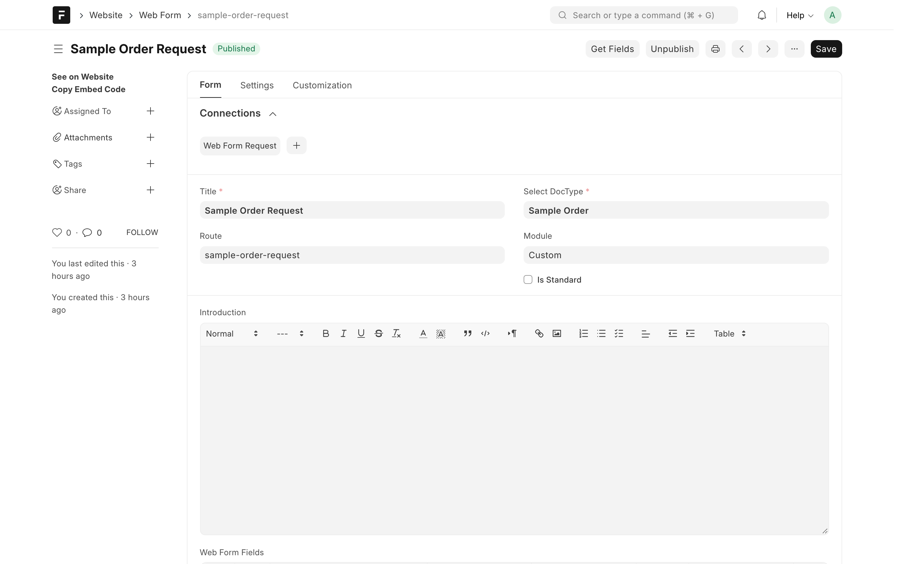
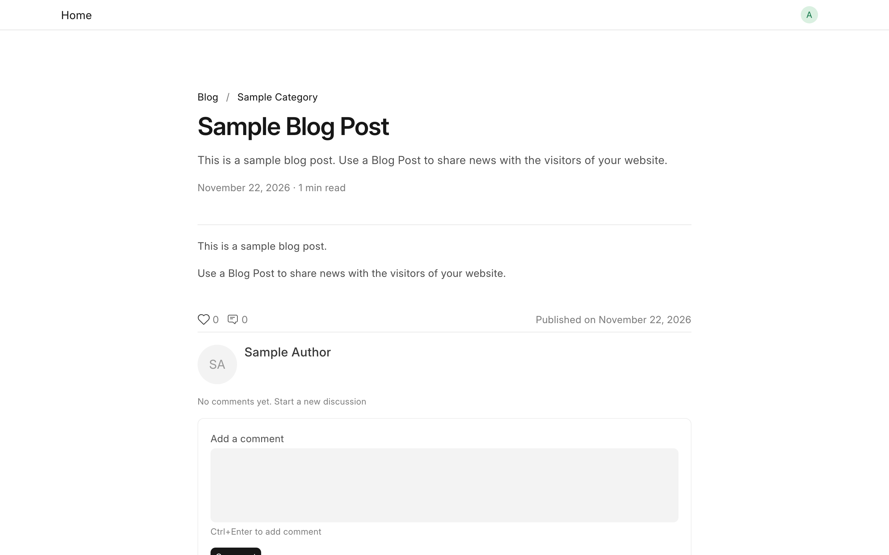
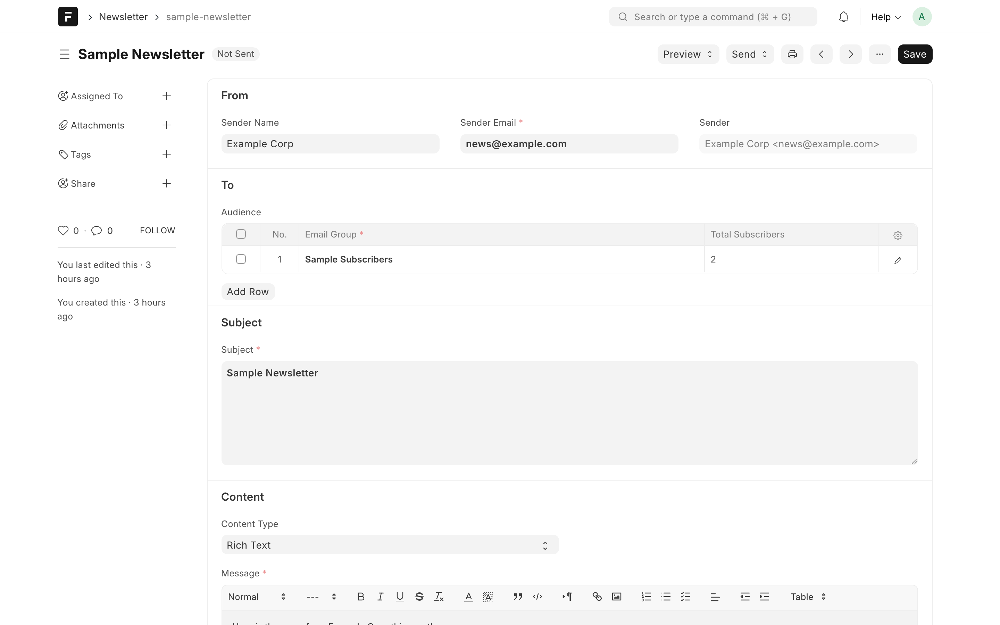

# Website

Every Frappe site also serves a website. You can publish pages, a blog and newsletters, collect data with forms, and give website users a portal. Use a **Web Page** for content, a **Web Form** to let people add or edit records from the website, and **Website Settings** for the header, footer and home page. The desk is at `/app`. Website routes are at the root of the site.

## Core concepts

| DocType | What it is |
|---|---|
| `Web Page` | A page at `/<route>`. Content in Rich Text, Markdown, HTML, Page Builder blocks or a slideshow. |
| `Web Form` | A form at `/<route>` that makes or edits records of one DocType. |
| `Web Form Request` | A key that lets a person use a Web Form without a login. |
| `Blog Post`, `Blog Category`, `Blogger`, `Blog Settings` (Single) | The blog at `/blog`. |
| `Newsletter`, `Email Group`, `Email Group Member` | Emails to a list of subscribers. Published newsletters are at `/newsletters`. |
| `Website Settings` (Single) | Home page, brand, navbar, footer, login and signup, redirects, analytics. |
| `Portal Settings` (Single) | The sidebar menu of the portal and the default role of new signups. |
| `Website Theme` | Colors, fonts and SCSS of the website. |
| `Website Script` (Single) | JavaScript added to every website page. |
| `Help Category`, `Help Article` | A knowledge base at `/kb/<category>`. |
| `Marketing Campaign` | A named campaign. A Newsletter can link to one. |

## Publish a Web Page

1. Go to `/app/web-page/new`.
2. Enter a **Title**.
3. Enter a **Route**, for example `sample-page`. If you leave it empty, Frappe makes one from the title.
4. Select the **Content Type**.
5. Write the content.
6. Keep **Published** on.
7. Save. The page is now at `/sample-page`.

| Field | Default | Description |
|---|---|---|
| `content_type` | `Page Builder` | `Rich Text`, `Markdown`, `HTML`, `Page Builder` or `Slideshow`. |
| `published` | 1 | The page is public only when this is on. |
| `start_date`, `end_date` | | A daily job publishes and unpublishes the page on these dates. |
| `show_title` | 0 | Shows the title above the content. |
| `full_width` | 1 | Uses the full width of the window. |
| `show_sidebar`, `website_sidebar` | | Shows a Website Sidebar. |
| `enable_comments` | 0 | Lets visitors comment. |
| `meta_title`, `meta_description`, `meta_image` | | Tags for search engines and link previews. |
| `javascript`, `css` | | Script and style for this page only. |
| `dynamic_template` | 0 | Renders the content as a Jinja template. |
| `dynamic_route` | 0 | Lets the route take variables. |
| `context_script` | | Python that adds values to the template context. It runs in the safe script sandbox. |

## Make a Web Form

A Web Form lets people make a record from the website, for example a `Sample Order`.

1. Go to `/app/web-form/new`.
2. Enter a **Title**.
3. Select the DocType in **Select DocType**.
4. In the **Form** tab, add fields to **Web Form Fields**. You can also click **Get Fields** to add all fields of the DocType.
5. Set access in the **Settings** tab.
6. Click **Publish**. It sets **Published** and saves the form.
7. Open the form with the **See on Website** link in the sidebar.

Visitors see the form at `/<route>/new`. When **Show List** is on, they see their records at `/<route>/list` and edit one at `/<route>/<name>/edit`.

| Field | Default | Description |
|---|---|---|
| `login_required` | 0 | Only logged-in users can use the form. |
| `anonymous` | 0 | Saves responses without the user. |
| `key_required` | 0 | The form opens only with a key from a `Web Form Request`. |
| `allow_edit` | 0 | Users can edit their record after they send it. |
| `allow_multiple` | 0 | Users can send more than one response. |
| `allow_delete` | 0 | Users can delete their responses. |
| `show_list`, `list_columns` | 0 | Shows a list of the user's records. |
| `apply_document_permissions` | 0 | Checks the permissions of the DocType for a record. When off, a user can open only records they own. |
| `allow_print`, `print_format` | 0 | Lets users print their record. |
| `allow_comments`, `show_attachments` | 0 | Shows comments and attachments to logged-in users. |
| `allow_incomplete` | 0 | Lets users save without mandatory fields. |
| `button_label` | `Save` | Text of the submit button. |
| `success_title`, `success_message`, `success_url` | | What happens after the user sends the form. |
| `condition_json` | | Filters for the records the form shows in its list. |
| `allowed_embedding_domains` | | Origins that may embed the form, one per line. Use **Copy Embed Code** to get the snippet. |
| `client_script`, `custom_css` | | Script and style for this form. |

When you turn off both **Login required** and **Key required** in the form, the desk also turns off **Allow Editing After Submit**, **Allow Multiple Responses**, **Allow Delete** and **Show List**. Frappe accepts at most 10 submissions a minute for one Web Form.

### Give access with a Web Form Request

Use **Key required** to let a person without a login use a Web Form.

1. Make a Web Form with **Key required** and **Published** on.
2. Go to `/app/web-form-request/new`.
3. Select the **Web Form**.
4. Optional: set **Expires On**.
5. Optional: add existing records in **References**. The key can open only these records and the records it makes.
6. Optional: enter JSON in **Web Form Values** to fill the form.
7. Optional: enter JSON in **Doc Values** to set fields on the saved record.
8. Save. Frappe makes a random **Key**.
9. Click **Copy Link**. The link is `/<route>/new?web_form_request_key=<key>`.

Frappe sets **First Used On** when the key is first used. After that the key cannot make a new record, unless **Allow Multiple Responses** is on. A key with a past **Expires On** stops working. A Link field in a guest **Key required** form must point to a DocType that Guest can read.

## Blog

A blog post is at `/blog/<category>/<post>`. The blog list is at `/blog`.

1. Make a `Blogger` at `/app/blogger/new`. Enter **Short Name** (the record name) and **Full Name**. Link a **User** if the author logs in.
2. Make a `Blog Category` at `/app/blog-category/new`. Frappe sets its route to `blog/<name>`.
3. Make a `Blog Post` at `/app/blog-post/new`. Enter **Title**, **Blog Category** and **Blogger**.
4. Select the **Content Type** (`Markdown`, `Rich Text` or `HTML`, default `Markdown`).
5. Write the content.
6. Turn on **Published**.
7. Save.

| Field | Default | Description |
|---|---|---|
| `published_on` | | Set to today when you publish without a date. |
| `blog_intro` | | Summary in the list. If empty, Frappe takes the first 200 characters of the content. |
| `featured` | 0 | Shows the post first. A featured post needs a **Meta Image**. Only one post stays featured. |
| `read_time` | | Set by Frappe from the content length. |
| `disable_comments`, `disable_likes` | 0 | Turns off comments and likes on the post. |
| `hide_cta` | 0 | Hides the call to action on this post. |
| `meta_title`, `meta_description`, `meta_image` | | Tags for search engines. `meta_description` is cut to 140 characters. |

**Blog Settings** at `/app/blog-settings` sets **Blog Title**, **Blog Introduction**, **Enable Social Sharing**, **Browse by category**, the call to action (**Show "Call to Action" in Blog**, **CTA Label**, **CTA URL**), **Allow Guest to comment** (default on), **Comment limit** and **Like limit** (default 5 each).

## Newsletter

A newsletter is an email to all members of one or more Email Groups.

1. Make an `Email Group` at `/app/email-group/new`. Enter a **Title**.
2. In the Email Group, use **Action** > **Add Subscribers** to paste email addresses, or **Import Subscribers** to import them from another DocType.
3. Make a `Newsletter` at `/app/newsletter/new`. Enter **Sender Email** and an optional **Sender Name**.
4. Add one or more Email Groups in **Audience**.
5. Enter the **Subject**.
6. Select the **Content Type**.
7. Write the **Message**.
8. Save.
9. Optional: click **Preview** > **Send a test email** to check the email.
10. Optional: click **Preview** > **Check broken links** to check the links.
11. Click **Send** > **Send now**, or **Send** > **Schedule sending** to pick a date and time.

Frappe puts one email per recipient in the email queue. Members with **Unsubscribed** on, and addresses in `Email Unsubscribe`, get no email. **Send Unsubscribe Link** (on by default) adds an unsubscribe link. Scheduled newsletters are sent by an hourly job. A newsletter can be sent only once.

To show a newsletter on the website, turn on **Published**. The route is `newsletters/<name>`. **Send Web View Link** adds a link to that page and needs **Published**.

## Website Settings

Go to `/app/website-settings`.

| Field | Default | Description |
|---|---|---|
| `home_page` | | Route of the home page for visitors. |
| `title_prefix` | | Text added before every page title. |
| `website_theme` | `Standard` | The active Website Theme. |
| `app_name`, `app_logo` | `Frappe` | App name and logo of the site. |
| `banner_image`, `brand_html` | | Brand at the left of the navbar. |
| `top_bar_items` | | Navbar links. |
| `navbar_search` | 0 | Adds a search box to the navbar. |
| `footer_items`, `copyright`, `address`, `footer_logo` | | Footer content. |
| `navbar_template`, `footer_template` | | Web Templates for a custom navbar and footer. |
| `disable_signup` | 1 | Turns off "Sign up" on the login page. |
| `hide_login` | 0 | Hides the login link in the navbar. |
| `route_redirects` | | Redirects from one route to another. |
| `head_html` | | HTML added to `<head>` of every page. |
| `robots_txt` | | Content of `/robots.txt`. |
| `google_analytics_id`, `google_analytics_anonymize_ip` | | Google Analytics. |
| `enable_view_tracking` | 0 | Logs visits as `Web Page View` records. |
| `show_language_picker` | 0 | Shows a language picker on the website. |
| `show_account_deletion_link`, `auto_account_deletion` | 0, 72 | Lets users ask to delete their account from `/me`. The account is deleted after the hours set. |

## Portal

Website users (users without desk access) log in to the portal. `/me` shows their account page. The sidebar shows the portal menu.

Go to `/app/portal-settings` to set:

- **Default Role at Time of Signup** (`default_role`): role given to new users who sign up.
- **Portal Menu** (`menu`): the standard menu items. Turn each one on or off.
- **Custom Menu Items** (`custom_menu`): your own links.
- **Hide Standard Menu**: shows only custom items.
- **Default Portal Home**: route to open after login.

## Help articles

1. Make a `Help Category`. Frappe sets its route to `kb/<category>`.
2. Make a `Help Article` in that category.
3. Turn on **Published**.

The article route is the category route plus the article title. When you unpublish a category, Frappe also unpublishes its articles.

## Track visits

Turn on **Enable in-app website tracking** in Website Settings. Each page visit then makes a `Web Page View` record with the path, referrer, browser and time zone. The `source`, `medium` and `campaign` parameters of the URL are saved in the fields of the same name. Visits to `/app`, `/api` and asset routes are not logged. Browsers with "Do Not Track" on are not logged.

## For developers

- Add pages in an app with files in `www/`, and add routes with `website_route_rules`. See [Website (developer)](../../developer-guide/website/website.md).
- A Web Form with **Is Standard** set is exported to the module folder of the app, with a `.py` and a `.js` file. See [Web Forms](../../developer-guide/website/web-forms.md).
- Frappe routes `/blog/<category>` to `Blog Post` and `/newsletters` to `Newsletter` in `website_route_rules` of `frappe/hooks.py`.
- `frappe.email.doctype.newsletter.newsletter.subscribe(email, email_group)` is a guest method that adds a subscriber after email confirmation.
- Hooks: `website_route_rules`, `website_redirects`, `update_website_context`, `portal_menu_items`, `standard_portal_menu_items`, `has_website_permission`, `webform_list_context`, `website_generators`.

## Pitfalls

- A Web Page with a past **End Date** cannot stay published. Frappe clears the date on save.
- A standard Web Form can only be published or unpublished on a site. Other changes need developer mode.
- With **Login required** on and **Allow Multiple Responses** off, `/<route>/new` opens the user's existing record.

## Related

- [Users and Roles](../users-and-permissions/users-and-roles.md)
- [System Settings](../settings/system-settings.md)
- [Email](../automation/email.md)
- [Website (developer)](../../developer-guide/website/website.md)
- [Web Forms (developer)](../../developer-guide/website/web-forms.md)
- [Website settings](../settings/website-settings.md)
