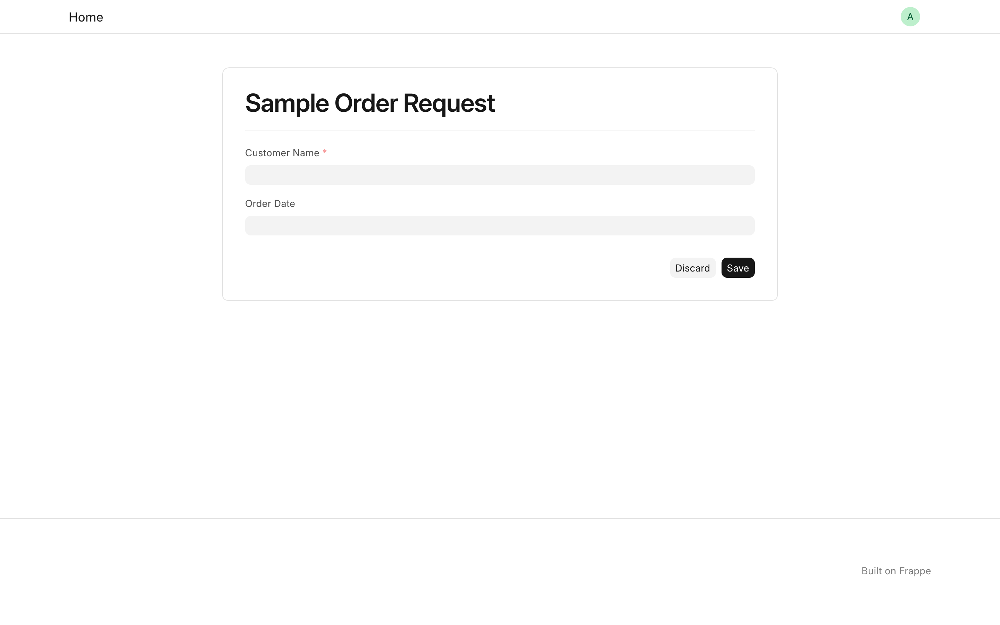

# Website

Every Frappe site also serves a website. You can publish pages, collect data with forms, and give website users a portal. Use a **Web Page** for content, a **Web Form** to let people add or edit records from the website, and **Website Settings** for the header, footer and home page. The desk is at `/desk`. Website routes are at the root of the site.

## Core concepts

| DocType | What it is |
|---|---|
| `Web Page` | A page at `/<route>`. Content in Rich Text, Markdown, HTML, Page Builder blocks or a slideshow. |
| `Web Form` | A form at `/<route>` that makes or edits records of one DocType. |
| `Web Form Request` | A key that lets a person open one record in a Web Form without a login. |
| `Website Settings` (Single) | Home page, brand, navbar, footer, login and signup, redirects, analytics. |
| `Portal Settings` (Single) | The sidebar menu of the portal and the default role of new signups. |
| `Website Theme` | Colors, fonts and SCSS of the website. |
| `Website Script` (Single) | JavaScript added to every website page. |
| `Help Category`, `Help Article` | A knowledge base at `/kb/<category>`. |
| `UTM Source`, `UTM Medium`, `UTM Campaign` | Names for campaign parameters in tracked visits. |

## Publish a Web Page

1. Go to `/desk/web-page/new`.
2. Enter a **Title**.
3. Enter a **Route**, for example `sample-page`. If you leave it empty, Frappe makes one from the title.
4. Select the **Content Type** and write the content.
5. Keep **Published** on.
6. Save. The page is now at `/sample-page`.

| Field | Default | Description |
|---|---|---|
| `content_type` | `Page Builder` | `Rich Text`, `Markdown`, `HTML`, `Page Builder` or `Slideshow`. |
| `published` | 1 | The page is public only when this is on. |
| `start_date`, `end_date` | | A daily job publishes and unpublishes the page on these dates. |
| `show_title` | 0 | Shows the title above the content. |
| `full_width` | 1 | Uses the full width of the window. |
| `show_sidebar`, `website_sidebar` | | Shows a Website Sidebar. |
| `enable_comments` | 0 | Lets visitors comment. |
| `meta_title`, `meta_description`, `meta_image` | | Tags for search engines and link previews. |
| `javascript`, `css` | | Script and style for this page only. |
| `dynamic_template` | 0 | Renders the content as a Jinja template. |
| `context_script` | | Python that adds values to the template context. It runs in the safe script sandbox. |

## Make a Web Form

A Web Form lets people make a record from the website, for example a `Sample Order`.

1. Go to `/desk/web-form/new`.
2. Enter a **Title** and select the DocType in **Select DocType**.
3. Open the **Form** tab and add fields. You can also click **Get Fields** to add all fields of the DocType.
4. Set access in the **Settings** tab.
5. Save.
6. Click **Publish**. The button changes to **Unpublish**.
7. Open the form with the **See on Website** link.

Visitors see the form at `/<route>/new`. When **Show list** is on, they see their records at `/<route>/list` and edit one at `/<route>/<name>/edit`.

| Field | Default | Description |
|---|---|---|
| `login_required` | 0 | Only logged-in users can use the form. |
| `anonymous` | 0 | Saves responses without the user. Not used with **Login required**. |
| `key_required` | 0 | The form opens only with a key from a `Web Form Request`. |
| `allow_edit` | 0 | Users can edit their record after they send it. Needs **Login required** or **Key required**. |
| `allow_multiple` | 0 | Users can send more than one response. Needs **Login required** or **Key required**. |
| `allow_delete` | 0 | Users can delete their responses. Needs **Allow multiple**. |
| `show_list`, `list_columns` | 0 | Shows a list of the user's records. Needs **Login required** or **Key required**. |
| `apply_document_permissions` | 0 | Checks the permissions of the DocType for a record. When off, a user can open only records they own. |
| `allow_print`, `print_format` | 0 | Lets users print their record. |
| `allow_comments`, `show_attachments` | 0 | Shows comments and attachments to logged-in users. |
| `allow_incomplete` | 0 | Lets users save without mandatory fields. |
| `button_label` | `Save` | Text of the submit button. |
| `success_title`, `success_message`, `success_url` | | What happens after the user sends the form. |
| `condition_json` | | Filters for the records the form shows in its list. |
| `allowed_embedding_domains` | | Origins that may embed the form, one per line. Empty means the same origin only. Use **Copy embed code** to get the snippet. |
| `client_script`, `custom_css` | | Script and style for this form. |

**Allow editing after submit**, **Allow multiple responses** and **Show list** show only when **Login required** or **Key required** is on. **Allow delete** also needs **Allow multiple responses**.

When **Allow multiple responses** is off and a logged-in user already has a record, `/<route>/new` redirects to that record.

### Send a link to edit one record

Use **Key required** to let a person without a login edit one record.

1. Make a Web Form with **Key required**, **Allow editing after submit** and **Published** on.
2. Open the record in the desk, for example a `Sample Order`.
3. Click **...** > **Request via Web Form**.
4. Select the Web Form and an optional **Expires On** date.
5. Click **Copy Link**, or click **Email Link**.

The link opens `/<route>/<name>/edit?web_form_request_key=<key>`. The dialog lists earlier requests with the status `Not Used`, `Used` or `Expired`. You need create permission on `Web Form Request` and write permission on the record.

## Website Settings

Go to `/desk/website-settings`.

| Field | Default | Description |
|---|---|---|
| `home_page` | | Route of the home page for visitors. |
| `title_prefix` | | Text added before every page title. |
| `website_theme` | `Standard` | The active Website Theme. |
| `app_name`, `app_logo` | `Frappe` | App name and logo of the site. |
| `banner_image`, `brand_html` | | Brand at the left of the navbar. |
| `top_bar_items` | | Navbar links. |
| `footer_items`, `copyright`, `address` | | Footer content. |
| `navbar_template`, `footer_template` | | Web Templates for a custom navbar and footer. |
| `disable_signup` | 1 | Turns off "Sign up" on the login page. |
| `hide_login` | 0 | Hides the login link in the navbar. |
| `route_redirects` | | Redirects from one route to another. |
| `head_html` | | HTML added to `<head>` of every page. |
| `robots_txt` | | Content of `/robots.txt`. |
| `google_analytics_id`, `google_analytics_anonymize_ip` | | Google Analytics. |
| `enable_view_tracking` | 0 | Logs visits as `Web Page View` records. |
| `show_language_picker` | 0 | Shows a language picker on the website. |
| `show_account_deletion_link`, `auto_account_deletion` | 0, 72 | Lets users ask to delete their account from `/me`. The account is deleted after the hours set. |

## Portal

Website users (users without desk access) log in to the portal. `/me` shows their account page. The sidebar shows the portal menu.

Go to `/desk/portal-settings` to set:

- **Default Role at Time of Signup** (`default_role`): role given to new users who sign up. Pick a role without desk access.
- **Portal Menu** (`menu`): the standard menu items. Turn each one on or off.
- **Custom Menu Items** (`custom_menu`): your own links.
- **Hide Standard Menu**: shows only custom items.
- **Default Portal Home**: route to open after login.

## Help articles

1. Make a `Help Category`. Frappe sets its route to `kb/<category>`.
2. Make a `Help Article` in that category.
3. Turn on **Published**.

The article route is the category route plus the article title. When you unpublish a category, Frappe also unpublishes its articles.

## Track campaigns

Turn on **Enable in-app website tracking** in Website Settings. Each page visit then makes a `Web Page View` record in the site database with the referrer, browser and campaign values. The values come from `utm_source`, `utm_medium`, `utm_campaign` and `utm_content` (or `source`, `medium`, `campaign`, `content`) in the URL. Use `UTM Source`, `UTM Medium` and `UTM Campaign` records to give these values fixed names.

## For developers

- Add pages in an app with files in `www/`, and add routes with `website_route_rules`. See [Website (developer)](../../developer-guide/website/website.md).
- A Web Form with **Is standard** set is exported to the module folder of the app, with a `.py` and a `.js` file. See [Web Forms](../../developer-guide/website/web-forms.md).
- Hooks: `website_route_rules`, `website_redirects`, `update_website_context`, `portal_menu_items`, `standard_portal_menu_items`, `has_website_permission`, `webform_list_context`, `website_generators`.
- `frappe.website.doctype.web_form_request.web_form_request.create_for_document(web_form, docname, expires_on)` makes a Web Form Request and returns the edit link.
- `frappe.utils.parse_and_map_trackers_from_url(url, create=False)` reads the UTM values from a URL.

## Pitfalls

- A Web Page with a past **End Date** cannot stay published. Frappe clears the date on save.
- A standard Web Form can only be published or unpublished on a site. Other changes need developer mode.
- A Link field in a **Key required** form must point to a DocType that Guest can read.

## Related

- [Users and Roles](../users-and-permissions/users-and-roles.md)
- [System Settings](../settings/system-settings.md)
- [Website (developer)](../../developer-guide/website/website.md)
- [Web Forms (developer)](../../developer-guide/website/web-forms.md)
- [Website settings](../settings/website-settings.md)
